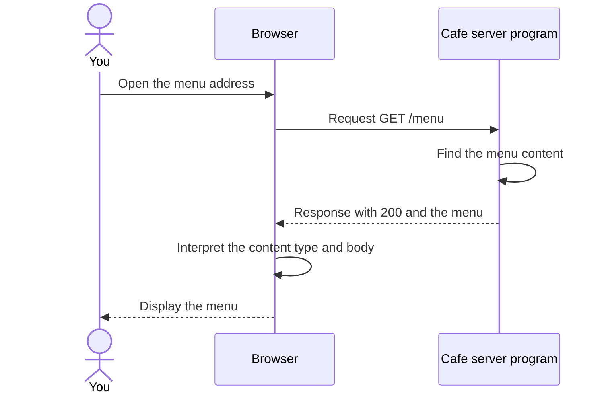

# Lesson 1: What happens when your browser asks for something?

You want to know whether a café serves tea. You open its website, choose **Menu**, and a list of drinks appears.

You did something small. Behind that action, programs exchanged messages. One asked for information; another sent an answer. Your browser then used that answer to show you something.

We are going to slow this down until you can explain the exchange yourself. That will give you a starting point for questions you will eventually investigate as a developer: What did the browser ask for? What answered it? What came back? Did the answer contain what we expected?

You do not need to write code or install anything for this lesson. You will read a few short messages and work through some questions. In the following lessons, you will inspect real messages and run a small web server on your own computer.

If **browser** is an unfamiliar word, it means the application you use to visit websites, such as Firefox, Chrome, Safari, or Edge. A **web page** is a document that application can display. You can keep the browser open while visiting many different pages; the browser and the page are different things.

A **program** is a set of instructions a computer follows. A browser is one kind of program. A program running elsewhere can follow instructions for receiving messages and preparing replies. That is the kind of cooperation we are about to explore.

There are natural stopping points below. Take one if the terms start running together. Being able to explain a small exchange is more useful here than reaching the last paragraph quickly.

## 1. Start with a familiar situation: asking for a menu

Imagine walking into a small café. You have not decided what to drink, and you cannot see a menu from the door. You approach the counter and ask:

> “Could I see the drinks menu, please?”

The person behind the counter hears your question, finds the drinks menu, and hands it to you:

> “Here you are.”

You read it and discover that the café serves tea, coffee, and hot chocolate.

There are several distinct things happening in this very ordinary moment.

First, **you want some information**. Wanting it does not make it appear. You need to communicate what you want to someone who can supply it.

Second, **your question identifies the information you want**. Asking for the drinks menu is different from asking for the opening hours. The person behind the counter needs that distinction to choose a useful answer.

Third, **the answer comes back to you**. Your question and the menu are not the same thing. One goes from you to the counter; the other comes back from the counter to you.

Finally, **you interpret what you received**. The person has supplied a menu, but you still need to read it to discover which drinks are available.

We can give two of these things names now:

- Your “Could I see the drinks menu?” is a **request**: a message asking for something.
- The reply, including the menu supplied with it, is a **response**: a message sent back in answer.

Now change one detail. You ask for a dinner menu, but this café closes in the afternoon. The person says:

> “We don't have a dinner menu.”

You did not receive the thing you wanted. You did receive a response. Someone heard your request and answered it.

That is different from standing at an empty counter and hearing nothing at all. Keep that distinction in mind: **an answer saying that something cannot be supplied is still an answer**.

### Pause and explain

You ask for the opening hours. The person gives you a card saying “Monday–Friday, 08:00–17:00.” Which part is the request? Which part is the response?

Try saying your answer before reading on.

The request is your question about the opening hours. The response is the reply supplying the opening-hours card. The card is the information carried back to you.

## 2. Now put the browser into that situation

Return to the café's website. You choose a link to its menu.

For our first example, assume the browser needs to ask the café's web service for the menu. Your browser constructs a request and sends it. A program serving the café's website receives that request and prepares a response. Your browser receives the response and uses its content.

The program receiving requests and supplying responses is acting as a **server**. Your browser, which is making the request, is acting as a **client**.

These words describe jobs in the exchange. Here, “client” does not mean a paying customer with a contract. It means the requesting program. “Server” does not mean a person waiting at a keyboard to answer every visitor. It means a program carrying out instructions written by developers. Other programs besides browsers can also act as clients. These are roles, rather than permanent categories of computer. [HTTP roles in the specification](https://www.rfc-editor.org/rfc/rfc9110.html#section-3.3)

People also use “server” to mean the computer running that program. In this lesson, when we say the server answers, we mean the **running software**. A large computer in a data centre can run it, but so can a laptop. Later, your browser and a small server will run on your own machine. [MDN: What is a web server?](https://developer.mozilla.org/en-US/docs/Learn_web_development/Howto/Web_mechanics/What_is_a_web_server)

Let's connect this explicitly to the café:

| In the café | In our web example | What the connection helps explain |
| --- | --- | --- |
| You ask for a menu | The browser acts as a client | Something initiates the request because it needs information |
| The person at the counter handles your question | The server program handles the browser's request | Something receives the request and decides how to answer |
| “Could I see the drinks menu?” | A request identifying the menu | The recipient needs to know what is being asked for |
| “Here you are,” with the menu | A response carrying the requested content | The answer travels back to the requester |
| You read the menu | The browser interprets the received content | Receiving information and presenting it are separate steps |

One adjustment matters: in the real web example, **you are the person using the browser**. The browser makes the technical request on your behalf. In the café story, you played both parts: you decided what you wanted and asked for it yourself.

## 3. Why the programs need agreed rules

At a café, several questions might work:

> “Could I see the menu?”
>
> “What drinks do you have?”
>
> “Do you have a list of coffees and teas?”

A person can use context to understand what you mean. An ordinary web server does not work that way. It is programmed to interpret particular message structures.

Imagine that one browser sends “menu please,” a second sends “give me drinks,” and a third sends only “coffee.” Every server developer would have to guess what each browser meant. The server's answers would create the same problem in reverse.

Agreed rules solve this coordination problem. The requesting program uses a known format, and the responding program uses a format the requester knows how to interpret.

A set of communication rules like this is called a **protocol**. The protocol we are studying is **HTTP**, short for **Hypertext Transfer Protocol**. For now, the useful part of that name is “protocol”: HTTP defines how these requests and responses are expressed and what their parts mean. It can carry more than web-page text; images and other kinds of information can travel in HTTP responses too. [MDN: Overview of HTTP](https://developer.mozilla.org/en-US/docs/Web/HTTP/Guides/Overview)

In our menu example, the request needs to communicate at least the kind of action being requested and which thing that action concerns. The response needs to communicate an outcome and, when appropriate, carry the requested content.

Those requirements explain the technical pieces you are about to see. We are giving names to parts of an exchange you already understand.

## 4. Read one request, one piece at a time

Suppose our fictional café uses this address for its menu:

```text
https://cafe.example/menu
```

This is a teaching address; you do not need to visit it. An address of this kind is called a **URL**. Here, `cafe.example` names the site, and `/menu` is the **path**, which helps identify what is being requested there.

`https://` indicates that the browser should use HTTP through a secure connection. We will study how that protection works later. Today, we are concentrating on what the request and response mean. [MDN: How the web works](https://developer.mozilla.org/en-US/docs/Learn_web_development/Getting_started/Web_standards/How_the_web_works)

Here is a small excerpt showing the request in HTTP/1.1's readable format:

```http
GET /menu HTTP/1.1
Host: cafe.example

```

This is an illustration, not a command to paste into a terminal. Real messages can contain additional lines. HTTP has several versions; HTTP/1.1 is useful for showing the pieces as readable text. Later versions arrange the transmitted information differently, while retaining concepts such as methods, headers, and status codes. [MDN: HTTP messages](https://developer.mozilla.org/en-US/docs/Web/HTTP/Guides/Messages)

Let's read the excerpt without trying to memorize its punctuation.

### What kind of action? `GET`

`GET` is an HTTP **method**. A method tells the server what kind of action the client is requesting.

For this example, read `GET` as “send me the content for this.” We want to retrieve the menu. We are asking to read information, rather than asking the café to place an order. HTTP has other methods for other intentions; you can learn them when we need them.

### Which thing? `/menu`

The path `/menu` identifies the menu in this example. If we asked for `/opening-hours`, we would be asking for something else from the same site.

The server's code determines how it handles these paths. `/menu` does not have to be the name of a file sitting on its computer. The code might read a file, assemble the menu from stored information, or produce it another way. The path gives the request a target; it does not reveal the implementation behind that target.

### Which site? `Host: cafe.example`

`Host: cafe.example` is a **header**. A header is a named field carrying information about the message. This header identifies the host being requested.

The colon separates the name, `Host`, from its value, `cafe.example`. You will meet other header names later. “Header” describes their role in the message; it is not the heading printed at the top of a web page.

### What is `HTTP/1.1` doing there?

It identifies the version used by this illustrated message. It is not part of the menu's name. You only need to recognize it here; comparing protocol versions belongs to a later lesson.

Put the meaningful parts together:

> “Using HTTP/1.1, retrieve the content for `/menu` at `cafe.example`.”

That is the technical counterpart of asking the café for its menu. The message uses agreed fields instead of a conversational sentence.

### A small change for you to make

The café's opening-hours information is available at `/opening-hours`. Keep the host and method the same. Which part of the request would you change?

Only the path changes in this example:

```http
GET /opening-hours HTTP/1.1
Host: cafe.example

```

You have changed **what you are asking for**. You have not changed the kind of action or the site you are asking.

## 5. Read the response: outcome, description, content

Return to our request for `/menu`. Suppose the server successfully supplies a deliberately simple menu, written as plain text.

Here is a shortened response. Some message details are omitted so we can concentrate on the parts being taught:

```http
HTTP/1.1 200 OK
Content-Type: text/plain

Tea
Coffee
Hot chocolate
```

There are three parts to understand.

### The status says how the request turned out

`200` is the **status code**. In this response, it says that the request succeeded. `OK` is the accompanying readable phrase in this HTTP/1.1 example.

The status is separate from the menu. Think back to the person saying “Here you are” and then handing over a sheet. The outcome and the information supplied have different jobs.

A successful status tells us how the server reports handling this request. It does not prove that the menu is well written, the prices are correct, or the entire website works perfectly.

### A header describes the content

`Content-Type: text/plain` says that this response's content is plain text. The receiving program needs that information because different content needs different interpretation. An image should not be treated as a paragraph of text.

This is another header: its name is `Content-Type`, and its value is `text/plain`. Notice that requests and responses can both have headers. They carry information relevant to the message in which they appear.

### The body carries the menu

The lines listing tea, coffee, and hot chocolate form the **body** in this example: the content carried by the response. In the displayed HTTP/1.1 format, a blank line separates the headers from the body.

The whole response includes the status, headers, and body. Calling the menu alone “the whole response” would leave out information the browser also received.

Returning to the café story:

| Part of this response | Job in the exchange | Connection to the story |
| --- | --- | --- |
| `200` | Report success | “Here you are” signals that the menu request was fulfilled |
| `Content-Type: text/plain` | Describe the supplied content's type | Telling the recipient what kind of material is being handed over |
| The list of drinks | Supply the requested content | The menu itself |

The café comparison is approximate: people do not normally announce a menu's content type before handing it over. Programs benefit from explicit information that people often infer from context.

## 6. What if the café has no dinner menu?

Suppose the browser requests `/dinner-menu`. In this fictional application, there is no such menu, and the server is written to return this response:

```http
HTTP/1.1 404 Not Found
Content-Type: text/plain

We do not have a dinner menu.
```

Here, `404` reports that the requested content was not found. The body explains the situation in words. You asked for a dinner menu and received an explanation instead.

That is still an HTTP response. It contains a status, a header, and a body just as our successful example did. The fact that your goal was not fulfilled does not mean that no communication occurred. In our example, the drinks menu can still be available even though the dinner menu is missing. [HTTP status semantics](https://www.rfc-editor.org/rfc/rfc9110.html#section-15.5.5)

Now imagine a different situation: the browser receives **no HTTP response** from the service. It might show its own connection error message. That message on the screen is not automatically a `404` response from the server.

You can already ask a useful debugging question:

> “Did a server answer and report a problem, or did the browser fail to receive an HTTP answer?”

You cannot yet diagnose every reason for a missing response. We will learn how to collect that evidence in the local-server lesson. For now, recognizing that these are different situations is enough.

## 7. Follow the whole exchange

Read this diagram from top to bottom. Time moves downward. The arrows show messages or actions; each label tells you what is happening.



In words: you open an address; your browser asks the server for the menu; the server prepares a successful response containing it; the browser interprets the response and displays the menu for you.

There are two program roles and a person in this picture. The browser sends the HTTP request. The server sends the HTTP response. You interact with the browser and read the result.

The diagram deliberately follows one request. A more elaborate menu page could also need a separate photograph. The browser might first request the page, discover that it includes a photograph, and then request that image too. The screen you see can therefore depend on several responses. We will follow those requests individually using the browser's tools in a later lesson.

This is why “the page appeared” is only the beginning of an investigation. Eventually, you will be able to inspect the messages that contributed to it.

## 8. Where the café comparison helps—and where to stop using it

The café story gives you a familiar sequence: identify what you need, ask for it, receive a reply, and interpret the reply. Keep using that sequence when the new vocabulary feels abstract.

Three details should now become more precise:

1. **The server follows code.** It is not a person understanding a casual conversation. We introduced methods, paths, and headers because the programs need agreed ways to express the request.
2. **The client is a program.** In our example, your browser sends the request for you. The person using the browser and the client software are different participants.
3. **A response is more than the visible page.** It can carry status information and headers as well as content. The browser uses that content to produce what you see.

These are limits of our comparison. They are not defects in HTTP. The comparison has done its job if it helps you understand the real exchange and you can identify which parts should not be taken literally.

## 9. Try a similar example with less help

Use the explanations above if you need them. These are small practice questions, and the complete explanations follow. You do not have to guess unfamiliar rules.

### Practice A: explain a supplied exchange

The client sends:

```http
GET /opening-hours HTTP/1.1
Host: cafe.example

```

The server returns this excerpt:

```http
HTTP/1.1 200 OK
Content-Type: text/plain

Monday-Friday: 08:00-17:00
Saturday-Sunday: Closed
```

Explain the exchange in three steps:

1. **Identify the request.** What action is requested, and what information is the target?
2. **Read the outcome.** What reports whether the request succeeded?
3. **Identify the content.** What information would the recipient find in the body?

### Practice B: repair an explanation

A learner writes:

> “The server is the browser. It sends back `GET`. The page says ‘Not found,’ so we know the server did not respond.”

Correct the first two sentences using what you have learned. For the last sentence, explain why words on the screen alone do not establish that no response arrived.

### Practice C: make a bounded prediction

For this exercise, the café application's rules are explicitly given:

- `/menu` and `/opening-hours` are available and return `200` with their content when requested with `GET`.
- An unknown path returns `404` with a short explanation.

You change only `/opening-hours` to `/opening-times`. Which outcome do you predict, and why? Is your prediction based on a universal rule about English words, or on this application's stated rules?

### Practice explanations

**A.** The client requests retrieval of the opening-hours content. `GET` names the method and `/opening-hours` identifies the target path. The `200` status reports success. The body carries the weekday hours and weekend closure information; `Content-Type: text/plain` describes that body as plain text.

**B.** In this example, the browser is the client. It sends a request containing the `GET` method. The server handles that request and sends a response. A “Not found” message could have arrived inside a response body, as it did in the dinner-menu example. Seeing those words does not establish that no server answered.

**C.** Under the supplied rules, `/opening-times` is unknown, so the response should use `404`. Although “opening times” and “opening hours” mean similar things to a person, this application has only been described as recognizing `/opening-hours`. Another application could deliberately support both paths. We are predicting from the stated contract, rather than assuming a server guesses human intent.

If you missed a question, look for the specific distinction that caused trouble. Mixing up client and server calls for revisiting the roles. Mixing up status and body calls for rereading the response. You do not need to repeat everything because one term was unfamiliar.

## 10. What you should be able to explain now

Close the examples for a moment and tell the menu story using these terms: **client, request, server, response**. Then answer:

- Why do the programs need a protocol?
- What does the method contribute that the path does not?
- How do the status and body do different jobs?
- Why can a request fail to supply the desired information and still receive an HTTP response?

You are ready for the next introductory lesson when you can explain these ideas in your own words and interpret a similar supplied exchange. Exact wording and memorizing a catalogue of status codes are not the goal. If you needed an explanation, use it, then try another example.

Later, after a break or at the start of your next session, try the same explanation for a library website supplying its opening hours. Reconstruct the roles without looking at the café example first. The setting changes; the relationship between requester and responder remains useful.

Next we will make the addresses and programs concrete: what a URL identifies, what it means to run a server on your own computer, and how the browser knows where to send a local request. We will guide the setup before asking you to investigate it independently.
