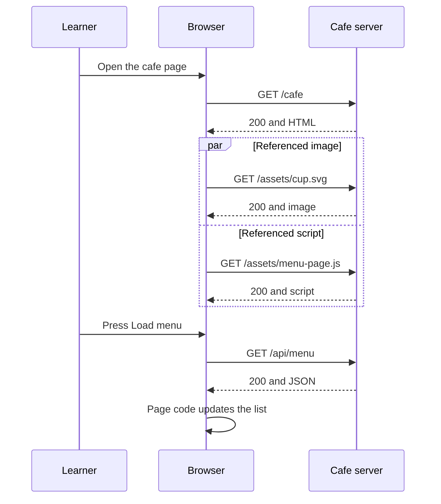

# Lesson 5: One page can make several requests

So far, most examples have followed one request and one response. You asked for `/api/menu`, and the café returned a JSON body. You asked for `/menu.html`, and it returned an HTML document.

That is a useful starting model. Now we will widen it.

A browser can fetch an HTML document, discover that the document refers to other resources, and request those resources too. Later, a button on the page can cause another request without replacing the whole page.

Today you will watch that happen. You will open a real browser tool, connect individual requests to visible parts of the café page, and investigate a menu request that fails while the page itself remains visible.

You will use supplied page code. The goal is to understand and inspect its behavior before you are asked to implement it yourself.

## 1. Think about assembling a café board

Imagine you are putting a small information board beside the café entrance. You have a sheet with a heading, an instruction to place a cup picture underneath, and a space where today's drinks will go.

The sheet gives you the structure. The picture is stored separately, so you collect it before placing it on the board. The drink list can also arrive separately. Someone might ask for it only when a customer presses a “Show menu” button.

To a customer, the result looks like one board. To the person assembling it, the result came from several pieces and several actions.

A page can work in a similar way. Its HTML describes the initial document. References in that document can lead the browser to fetch an image or a JavaScript file. JavaScript is program code that the browser can run; in our example, it makes the menu buttons work.

After a button click, that code can ask the server for JSON and use the returned drink names to update the existing page.

The board story helps distinguish the visible whole from the pieces used to build it. It does not mean the browser is a person following informal instructions. The browser follows HTML and JavaScript rules, and each HTTP request still has its own target and response.

## 2. Meet the supplied page before investigating it

Use the shared `http-lessons-03-05-lab` folder. If its server is stopped, open that folder in VS Code, choose **Terminal → New Terminal**, and run:

```sh
node server.mjs
```

Wait for the listening message. Leave that terminal running. If you selected another port earlier, use its startup argument and substitute the actual port in today's addresses.

Open this address in your desktop browser:

```text
http://127.0.0.1:4315/cafe
```

You should see a page headed **The cafe board**, a cup image, two buttons, and the message **Menu not loaded yet.** Do not press either button yet. We want to observe what arrived before a menu was requested.

Here are the important pieces of this particular page:

| Piece | Purpose in the supplied example |
| --- | --- |
| HTML document at `/cafe` | Provides the heading, image reference, buttons, and initial empty menu area |
| Image at `/assets/cup.svg` | Supplies the picture the HTML refers to |
| JavaScript at `/assets/menu-page.js` | Supplies the behavior for the two buttons |
| JSON at `/api/menu` | Supplies the title and drink names when **Load menu** is pressed |

An **asset** here simply means a supporting resource, such as the image or script. The word in `/assets/` is a folder-style naming choice in the server's URL design. Like `/api/`, it does not create a new HTTP mechanism.

The image uses SVG, a format that describes shapes. You do not need to read its shape instructions. The JavaScript is also supplied; reading its entire implementation is optional at this stage. We will inspect what requests it causes and what changes on the page.

Before opening the tools, make a prediction: **Has the browser necessarily requested the drink data just because the café heading is visible? What would you look for to find out?** Keep your original answer in your notes.

## 3. Open the browser's Network panel

Developer tools are built into desktop browsers. They let you inspect what a page is doing. The **Network** panel records requests so you can examine their targets, response statuses, headers, and content.

This walkthrough uses **desktop Chrome**. Other browsers have similar tools, but labels and shortcuts can differ. If you use another browser, record it in your review and ask for the equivalent action when a label does not match. Do not guess that a missing label means you failed the lesson.

With the café page active in Chrome:

1. Open the browser's menu, choose **More tools → Developer tools**, then choose the **Network** tab in the tools panel. If the tab is hidden behind an overflow control, open that control to find it.
2. If you prefer a keyboard shortcut, Chrome's developer tools can be opened with **Ctrl+Shift+I** on Windows/Linux or **Command+Option+I** on macOS. Then select **Network**.
3. Keep the tools open while you reload the café page.

The menu route and shortcuts are documented in [Chrome's guide to opening DevTools](https://developer.chrome.com/docs/devtools/open).

Opening the panel does not reconstruct every request that occurred before recording began. Reloading with it open gives you a fresh page load to inspect. The official [Chrome Network tutorial](https://developer.chrome.com/docs/devtools/network) describes this recording workflow.

You should now see rows in a table. A row records one request's activity; it is not a paragraph or visible element on the page. Some rows may correspond to resources with nothing directly visible, such as JavaScript.

If the table is empty, first make sure you reloaded **after** opening the panel. Check that recording is enabled. The round recording control normally shows an active red state while recording; hovering over it helps identify its current action. A control offering to stop recording means recording is already on.

Clear text from the filter field and select **All** among the resource-type filters. A filter changes which recorded rows you can see; it does not by itself prove that the hidden requests never happened.

For this experiment, turn **Preserve log** off so a new page load does not retain an old page's rows. The **Clear** control clears the current request table. Neither action changes the café's source files. These display controls are described in [Chrome's Network reference](https://developer.chrome.com/docs/devtools/network/reference).

You do not need to adjust request throttling, block requests, or understand the timing graphs yet. Our first job is to find the relevant rows and read their details.

## 4. Read the initial page load

After a fresh reload, look for requests corresponding to these three paths:

```text
/cafe
/assets/cup.svg
/assets/menu-page.js
```

The **Name** column may show only a final path component, such as `cup.svg`. Select a row and inspect its full Request URL to confirm which resource it represents.

Your browser might record incidental activity too, and repeat loads can produce repeated entries if earlier records remain. Do not use the total row count as a quiz answer. Identify the requests belonging to this page by their URLs and purpose.

Four fields will be especially useful:

| Field | The question it helps answer |
| --- | --- |
| Name or Request URL | What did the browser request? |
| Status | What HTTP outcome was reported, if a response arrived? |
| Type | What kind of resource or request the browser is showing |
| Initiator | What caused the browser to request it? |

In this fixture, the HTML contains references to the image and script. The browser discovers those references while processing the HTML and requests those resources. An initiator label such as **Parser** refers to the browser reading the document structure. It does not mean another person requested the picture.

The browser can do some of this work concurrently. Do not infer that the image must always finish before the script, or that two nearby rows caused one another merely because they are next to each other. A dependency explains **why** something was requested; a timing display shows **when** recorded activity occurred.

### Inspect the document response

Select the `/cafe` row. In its **Headers** view, find **Request URL**, **Request Method**, and **Status Code**. For the expected fresh load of this lab, you should find the café URL, GET, and 200.

Look under **Response Headers** for `Content-Type`. It should describe HTML. Now open **Response** to inspect the returned document text. Find the heading text, `The cafe board`, and the initial message, `Menu not loaded yet.`

You have connected a visible page detail to content in a particular response body.

Also find the image reference `/assets/cup.svg` and the script reference `/assets/menu-page.js` in that document. You do not need to explain every HTML attribute. The important observation is that this response **names other resources** the browser subsequently requests.

Chrome also offers a **Preview** view for some resources. Preview may present or organize content; Response is useful when you want to read the received text itself. These views describe a response; they do not create another café menu.

### What should not have happened yet?

In the supplied page, neither menu button has been pressed after the reload. The page code has not yet requested `/api/menu` or `/api/missing-menu`.

This is a property of our example, not a rule for all websites. Many pages request data automatically during startup. We deliberately made this one wait for a click so you can connect an action to its request.

If you see an API row already, check whether you pressed a button earlier and kept the old log. Clear the log, reload with Preserve log off, and repeat without clicking. If the behavior still differs, record it. That is evidence we should investigate, not a reason to copy the expected result.

## 5. Press a button and follow the data

Keep the Network panel open. Before clicking, predict the target path, response format, and one body value you expect the **Load menu** button to obtain.

Now press **Load menu** on the café page. You should see **Menu loaded.**, a menu heading, and the three drink names. The browser's address can remain `/cafe`; a page update does not have to be a navigation to a new document.

Find the new request for `/api/menu`. If you cannot see it, make sure All is selected and no text filter is hiding it. The name may appear as `menu`, so verify the full URL.

Inspect the request's details and record:

- Request URL and method.
- Response status.
- Response `Content-Type`.
- One value from the response body.

The expected response is the same kind you inspected with curl in Lesson 4: GET receives 200 and an `application/json` body with `title` and `drinks`. Your browser may classify this row as **fetch** or group it with **Fetch/XHR** requests. For now, connect that label to this fact: page code initiated the request to obtain data.

The script then reads the JSON values and places the drink names into the page's list. **Fetching data** and **displaying data** are two steps. JSON does not spontaneously draw buttons, and the server did not send a whole replacement HTML document in this response.

You can check that claim by looking at the API's body. It contains the menu object. It does not contain the complete café page you inspected in the document response.

Here is the relationship among the important events. The image and script requests are shown as independent branches; their exact completion order is not a lesson requirement.



In words: navigation requests the HTML; references in that HTML lead to image and script requests; the later button click causes a JSON request; the supplied script uses its response to update the existing page. All the browser-side work happens in the learner's browser. The diagram does not introduce an extra server for the page code.

## 6. A visible page can contain a failed operation

Now we will use the second button: **Try a missing menu**. It deliberately asks for `/api/missing-menu`, which the supplied café does not have.

Before clicking, make a prediction: **Will a 404 for that request mean the original `/cafe` document must also have failed? Will the heading and image necessarily disappear?**

Click the button and inspect the new request. You should find an HTTP 404 response with this JSON body:

```json
{
  "error": "Menu not found"
}
```

On the page, the earlier drink list should clear, and the message should become **Menu unavailable: Menu not found.** The café heading, cup image, and buttons remain.

The supplied page code makes those presentation choices. It checks the response status, reads the error explanation, and updates the menu area. A different application might choose another error message or keep the old list with a notice. HTTP alone does not prescribe the exact words or layout of that interface.

There are now two separate outcomes worth naming:

| Request | Outcome in this experiment |
| --- | --- |
| GET `/cafe` during the page load | 200: the HTML document was supplied |
| GET `/api/missing-menu` after the click | 404: that menu was not supplied |

It is therefore possible to receive a successful document response and later have a failed data request within that page. Looking only at the document's 200 would miss the operation the user was trying to perform.

Conversely, a visible error message does not prove that the whole server is unreachable. This 404 arrived from a running server, just as it did in the curl experiment. The Network panel gives you the evidence needed to distinguish these cases.

Press **Load menu** again and inspect its request. It should receive the successful menu response and repopulate the list. You have restored a working case without reloading the whole document.

## 7. Compare the browser request with curl

Leave the server running. In your second VS Code terminal, use the command from Lesson 4:

```sh
curl -i "http://127.0.0.1:4315/api/menu"
```

Use `curl.exe` in Windows PowerShell and your actual port if it differs. Compare curl's result with a successful `/api/menu` request in the Network panel.

For this fixture, both clients receive a 200 response containing the same menu data and JSON content type. They need not send identical request headers, and response fields such as the time can differ. Compare the specific fields relevant to the question rather than requiring every byte of the two exchanges to match.

Now think about requesting `/cafe` with curl. An ordinary curl request returns that URL's response. It does not automatically behave like a browser by reading the HTML, running its JavaScript, and clicking a menu button. If you try `curl -i` with `/cafe`, the HTML source you receive is evidence for the document response, not proof that the button's data request succeeded.

That gives you a practical reason to use both tools. curl helps you isolate a chosen request. The browser's Network panel helps you see which requests the actual page made while you used it.

Neither tool can tell you everything about why an application is correct. A JSON response with 200 could still contain the wrong drinks. A page could receive correct data and display it incorrectly. Today you are learning to locate evidence at each step so you can ask better questions later.

## 8. If your observation differs

Start with the smallest check that fits the symptom:

| Observation | A useful next check |
| --- | --- |
| The page cannot be opened | Confirm the shared kit is running and compare the URL's port with its listening message |
| The Network table is empty | Open it before reloading, check recording, and clear filters |
| The menu request seems absent | Check whether the button was pressed after the latest reload; inspect All requests and confirm full URLs |
| A click does nothing | Check whether the script request succeeded; look for the page's message about JavaScript being unavailable |
| The drink list already contains values | Reload to restore the initial empty state, then repeat the sequence |
| Labels differ from the lesson | Record the browser and version, and the label you found; use the field's purpose to orient yourself |

These are first checks, not proof of a root cause. If the script response is 200 but a button still does nothing, more investigation may be needed. Keep the actual result and ask for help rather than treating the suggested check as a guaranteed fix.

Do not modify unfamiliar code just to make your observations resemble the example. An unexpected result is an opportunity to compare the setup, request, response, and visible behavior one step at a time.

## 9. Practice: explain the page using its requests

Use your own Network recording where possible. If you use the supplied examples instead, label your answer accordingly. Full explanations follow.

### Practice A: explain one click

Explain what happens between pressing **Load menu** and seeing the three drinks. Include the initiating action, target path, response format, and the step that updates the page.

Do not simply say “the browser loads the page.” Which part of the existing page changed, and what response supplied the needed information?

### Practice B: repair a progress report

A teammate writes: “The page request returned 200, so the missing-menu button works correctly and there are no failed requests.”

Use the two relevant request paths and statuses to explain what is wrong with that conclusion. What can a 200 for `/cafe` actually support?

### Practice C: choose the next piece of evidence

You see the café heading and cup image, but no drink names. That is all you know so far.

Give two different explanations consistent with that observation. Then describe what you would inspect or do to distinguish them. Keep your examples within today's supplied page rather than inventing a database or caching problem we have not investigated.

### Practice explanations

**Practice A:** The click runs the supplied page behavior, which requests `/api/menu` using GET. The server returns a 200 response with JSON containing the title and drink array. The page code reads those values and updates the menu heading and list. The new response is menu data, not a complete replacement document. The browser can keep the address `/cafe` while the menu area changes.

**Practice B:** A 200 for `/cafe` supports that the document request succeeded. It says nothing by itself about every later operation. In the missing-menu experiment, a separate request to `/api/missing-menu` returns 404. The page successfully displays an explanation of that unsuccessful menu request. Describing these two outcomes separately avoids hiding the failed data request behind the document's successful status.

**Practice C:** One explanation is that no menu button has been pressed since the reload, so the supplied page has not requested any drink data. Another is that **Try a missing menu** was pressed, and its 404 response led the page to clear the list. Inspect the menu-area message and the recorded API requests. In the first case, a fresh recording has no API request until you click; in the second, the missing-menu request and its response provide evidence. Other causes are possible, so report what you actually find rather than treating these examples as an exhaustive diagnosis.

## 10. Pause here and review the first five lessons

You have moved from a café analogy to inspecting real HTTP activity. The sequence has introduced clients and servers, local addresses and processes, body formats, terminal requests, and the browser's view of a page assembled from several responses.

That is a useful beginning. It does not mean you have mastered HTTP, written a robust server, or demonstrated independent production debugging. Those require later lessons and increasingly independent work.

Before continuing, explain this statement in your own words:

> A visible page is the result of browser work; its success cannot always be judged from one HTTP status.

Use one request you actually inspected as evidence. Include any help you needed. Then save your notes and the places where the explanation, setup, or application got in your way.

For this first trial, use **Owner_Review_After_Lesson_05.md** to send your observations back to the content author. Exact passages and the point where you became uncertain are especially useful. A clear report that a lesson left you confused helps us improve it before we write the rest of the course.
