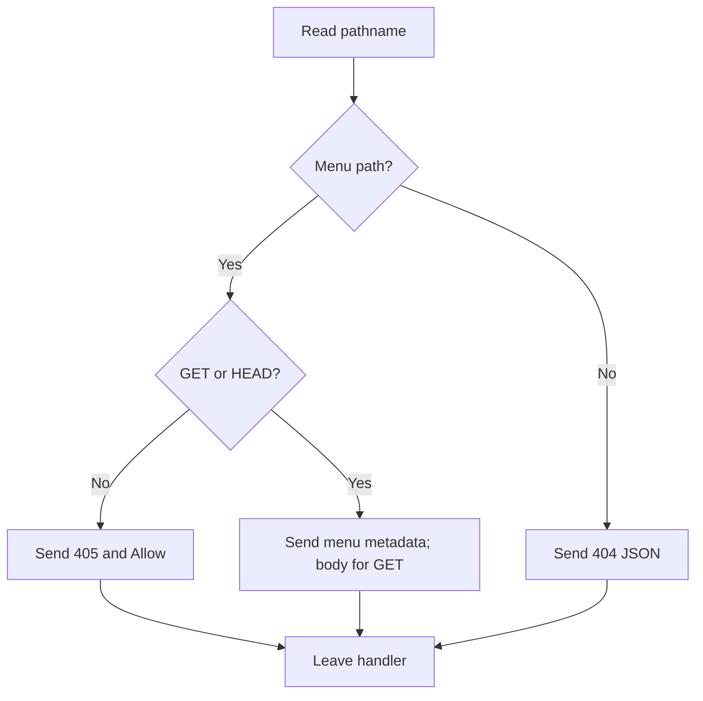

# Lesson 6: Follow the code that chooses the reply

In the first five lessons, you stood on the receiving side of the café's replies. You inspected their status, headers, and content. You also saw that a page can depend on several separate exchanges.

Now we will walk behind the counter. When a request arrives, how does the running program decide what to send back?

We will follow one small piece of real code. You do not need to memorize it or write a server from a blank file. Your goal is to connect a particular request to the decisions that produce its response. That connection will let you change the behavior in the next lesson and investigate a wrong answer after that.

If JavaScript is familiar, you can move quickly through the reading bridge. Still make the predictions: recognizing code is different from explaining the path it takes for a particular input.

## 1. The instructions behind the counter

Imagine covering a shift at the café. You know where the printed drinks menus are, but you do not know every service the café offers. The owner leaves you a short instruction card:

> If someone asks for the drinks menu, hand them a menu. Then finish handling that request.
>
> If the request does not match anything on this card, explain that you cannot find what they asked for.

The card does not contain a reply for every possible sentence a visitor could say. It describes a decision. You compare the request with a known case, choose the matching action, and stop once you have supplied the answer.

Why mention stopping? Imagine handing someone a menu and then continuing to read the bottom of the card aloud: “Sorry, I cannot find that.” The first answer was correct, but continuing into the fallback created a contradiction.

A program has a similar need for explicit control flow: which instructions run, in which order, and where this piece of work ends. The program will not infer that a branch was meant to be the final answer merely because that seems reasonable to us.

Here is the connection we will investigate:

| Café situation | This program |
| --- | --- |
| A visitor's request arrives at the counter | Node passes a received request to our handler function |
| You inspect what was requested | The function reads the request's path and method |
| The instruction card selects an action | An `if` condition chooses a block of code |
| You hand over the selected information | A helper writes the response |
| You finish handling that request | `return` leaves the current function |

Unlike a person, this handler follows the comparisons in its code. It will not guess that a slightly different path means the same thing.

## 2. Open the new practice kit

Use **HTTP_Lessons_06_08_Local_Kit_v1.zip**. Extract the whole ZIP and open its `http-lessons-06-08-lab` folder in VS Code. This kit is a separate, smaller view of the same café idea. Keep your previous kit and notes; this folder does not replace them.

You should see `server.mjs`, `handler.mjs`, and folders named `support`, `checks`, `incidents`, and `reference`. We will use the first two files and one helper today. Later lessons explain the other folders.

In a terminal opened in this folder, run:

```sh
node --version
```

Use the Node.js 24.x environment from the previous lessons. Then start the server:

```sh
node server.mjs
```

Wait for a message beginning:

```text
Lessons 6-7 starter is listening on http://127.0.0.1:4317
```

The next line identifies the handler file this process loaded. Its full location depends on where you extracted the kit. Keep that line in mind; later it can help you check which copy you are running.

The default port is **4317**, different from the earlier kit's 4315. If 4317 is occupied, stop your previous copy if you recognize it, or start this one with `node server.mjs 4318`. Use the successfully printed port in every request. Do not stop an unfamiliar program just to free a port.

Leave this terminal running. Open a second terminal and request:

```sh
curl -i "http://127.0.0.1:4317/api/menu"
```

In Windows PowerShell, use `curl.exe` in place of `curl` throughout this lesson. You should receive status 200 and JSON containing the café title and drinks. The first terminal also prints a short request summary.

There is no café web page in this smaller kit. Its job is to make the response-selection code easy to follow. A 404 for `/` does not mean the process failed to start: you requested a path it does not provide.

If setup fails before you can receive the menu, use the kit's README. You can read the examples below while repairing setup, but keep supplied examples separate from observations you actually made.

## 3. A short bridge for reading JavaScript

Open `handler.mjs`. Several pieces may look familiar from JSON, but JavaScript also contains instructions. JSON describes data; this file describes what a program should do with data.

A **value** is a piece of information, such as the text `'/api/menu'` or the number `200`. A name lets the code refer to a value. In:

```javascript
const path = '/api/menu';
```

`const` declares the name `path`, and `=` gives it a value. The quotes mark the text as a string. This line does not make an HTTP request. It gives the program a value to use.

An **object** groups named values. If an object called `request` has a `method` property containing `'GET'`, then `request.method` reads that property. The dot connects the object to the property being read.

A **function** is a named piece of work that can receive inputs. Here is an illustration, not something to add to the kit:

```javascript
function describeRequest(method, path) {
  return method + ' ' + path;
}
```

The names between parentheses stand for the inputs this function receives. Calling `describeRequest('GET', '/api/menu')` supplies those values. Its body builds the text `GET /api/menu`. `return` ends this function call and gives that text back to whoever called it. A `return` without a value still leaves the current function.

You do not need the example function in order to run the café. It gives us a smaller setting for understanding function inputs and return before meeting them in the handler. [MDN: functions](https://developer.mozilla.org/en-US/docs/Web/JavaScript/Guide/Functions)

Finally, `if` introduces a decision:

```javascript
if (path === '/api/menu') {
  // Instructions in this block run when the comparison is true.
}
```

`===` compares the two values. It does not assign a new value. The braces group the instructions belonging to the condition. A line beginning `//` is a comment for readers, not an action the program performs. [MDN: control flow](https://developer.mozilla.org/en-US/docs/Web/JavaScript/Guide/Control_flow_and_error_handling)

Before continuing, explain the difference between `const path = '/api/menu'` and `path === '/api/menu'`. The first creates a named value; the second asks whether a value matches. If these ideas are still unclear, take a pause here. The programming foundations develop them with more practice; you do not have to pretend they are obvious to study HTTP.

## 4. How the request reaches this function

Open `server.mjs`. It contains:

```javascript
import { handleRequest } from './handler.mjs';
import { startServer } from './support/start-server.mjs';

startServer(handleRequest, 'Lessons 6-7 starter', new URL('./handler.mjs', import.meta.url));
```

`import` makes a named function from another file available here. The first line brings in the handler. The second brings in a supplied startup helper. The final line asks that helper to start the server and identifies the handler it should use.

Notice `handleRequest` without parentheses in that final line. We are passing the function as a value so the startup code can use it when requests arrive. We are not calling it immediately with a made-up request. The last argument provides the file location printed at startup; it is setup information, not an HTTP request.

The helper uses Node's HTTP server facilities. Node handles the connection and message parsing, and our function receives two objects: `request`, with information about this request, and `response`, through which we construct its reply. Our routing decisions are only part of the server's work. [Node.js HTTP server API](https://nodejs.org/docs/latest-v24.x/api/http.html#httpcreateserveroptions-requestlistener)

Today you are responsible for understanding the decision in `handler.mjs`. The networking, runtime scheduling, and startup helper will have their own deeper treatment. The helper's narrow contract here is: listen at the printed local address and call this handler for received requests.

## 5. Identify the path before choosing the answer

At the start of `handler.mjs`, you will find:

```javascript
export function handleRequest(request, response) {
  const path = new URL(request.url, 'http://127.0.0.1').pathname;
```

`export` lets `server.mjs` import the function. The function's two inputs are the objects we just described.

The next line uses JavaScript's URL facility to interpret the request target and reads its `pathname`. Here, `new URL(...)` creates a parsed URL value. The local base supplies the host part needed to interpret a relative target such as `/api/menu`. Parsing this text does not contact another server.

Why not simply compare every character of `request.url`? Consider these two targets:

```text
/api/menu
/api/menu?source=lesson
```

The part after `?` is a **query**. Applications can use query information to influence their response. This particular handler does not use it; its route choice uses only the pathname. For both targets above, `path` becomes `/api/menu`.

That is a deliberate policy in this small application, not a rule that queries never matter. Later APIs will use them, and later caching lessons will ask which inputs influence returned content.

## 6. Follow one successful GET

The next block starts by comparing the path:

```javascript
if (path === '/api/menu') {
```

For your `GET /api/menu`, the comparison is true, so execution enters the braces. Inside is a second decision:

```javascript
if (request.method !== 'GET' && request.method !== 'HEAD') {
  response.setHeader('Allow', 'GET, HEAD');
  sendJson(request, response, 405, { error: 'Method not allowed' });
  return;
}
```

`!==` means “is not equal to.” `&&` means both comparisons must be true. Read the condition as: “If the method is neither GET nor HEAD.” Our method is GET, so the first comparison is false and this block does not run.

The block describes how this resource refuses another method. It prepares an `Allow` header and a 405 response. We will examine that contract in the next lesson. For today's trace, the important fact is that our GET proceeds past the block.

Now the handler calls:

```javascript
sendJson(request, response, 200, {
  title: 'Cafe menu',
  drinks: ['Tea', 'Coffee', 'Hot chocolate'],
});
return;
```

The inputs tell the helper which request and response it is handling, which status to use, and which data to send. The object contains a title and a list of drinks. It resembles the JSON you saw in Lesson 3, but at this point it is a JavaScript value inside the running program.

After the helper finishes its work, `return` leaves `handleRequest`. We do not fall through to the missing-path response below it.

You can now tell the causal story: the path selected this branch, GET passed the method decision, the branch chose this data and status, and the helper constructed the response.

## 7. Open the response helper

The first line of `handler.mjs` imports `sendJson`. Open `support/send-json.mjs` and find:

```javascript
const body = JSON.stringify(data, null, 2) + '\n';
```

The helper receives the value under the name `data`. `JSON.stringify` turns it into JSON text. The supplied arguments produce the indented display you see in the terminal, and `\n` adds a final line break. The details of pretty printing are not the route decision; they explain why the text is readable.

Next it calls `response.writeHead` with the status and response headers. The content type labels the text as JSON. `Content-Length` reports the byte length calculated from the generated text. This matters because text and transmitted bytes are not interchangeable counts in every language.

The helper also includes `Cache-Control: no-store` and `X-Content-Type-Options: nosniff`. They are supplied fixture settings. We will explain cache policy in M021 and browser security controls later; you do not need to invent those settings to solve today's task.

Then it makes one decision:

```javascript
if (request.method === 'HEAD') {
  response.end();
  return;
}

response.end(body);
```

For HEAD, the helper finishes without sending the body. For our GET, it reaches `response.end(body)`, which supplies the text and completes the response. [Node.js response API](https://nodejs.org/docs/latest-v24.x/api/http.html#responseenddata-encoding-callback)

**Completing the response and leaving a function are separate actions.** `response.end(...)` deals with the HTTP response. `return` deals with JavaScript execution. Also, a `return` inside `sendJson` leaves that helper, not the function that called it. This is why the handler has its own `return` after calling the helper.

## 8. Follow a request that does not match

Predict the result of this command before running it:

```sh
curl -i "http://127.0.0.1:4317/api/hours"
```

The extracted kit has only the menu route so far. `/api/hours` does not match `/api/menu`. Execution skips the whole menu block and reaches the last line of the handler:

```javascript
sendJson(request, response, 404, { error: 'Not found' });
```

You should receive 404 with a JSON explanation. The program did not crash or fail to hear you. It followed its fallback branch. We will add opening hours in Lesson 7.

This flowchart follows the same code. Begin at the top; each decision chooses which instructions follow. The method-refusal branch is included so you can locate it, even though today's main traces use GET and HEAD.



In words: choose the path first. A missing path receives the fallback. A known path checks the method, then either refuses it or supplies the menu response. Every route through the diagram finishes one response.

## 9. Practice: trace before running

### Practice A: the query variation

Predict `GET /api/menu?source=lesson`. Identify the value assigned to `path`, the branch selected, and the data supplied. Then run the request with curl and compare. If you only write “200,” add the reasoning that produced that prediction.

### Practice B: metadata without menu text

Use `curl -I "http://127.0.0.1:4317/api/menu"`. Where does HEAD travel through the handler, and where does its behavior diverge from GET? Remember that `-I` is the capital-letter option from Lesson 4.

### Practice C: a different spelling

Predict `GET /api/menus`. Is the café's knowledge of English plurals relevant? Name the comparison that decides the result.

### Practice explanations

For A, the pathname is `/api/menu`; this application ignores the query when choosing the route. GET enters the menu branch and receives the menu JSON with 200. This observation does not establish how a different application uses queries.

For B, both path and method decisions accept the request. The same data is passed to `sendJson`. Inside that helper, HEAD takes the no-body branch. The response can describe content without carrying that content in its body.

For C, `/api/menus` is not equal to `/api/menu`. The handler reaches the 404 fallback. Its comparison is exact; it does not interpret a plural as an alias.

## 10. What you should carry into the next lesson

Choose one request you actually ran. In your notes, connect five things: its target, the value used for route selection, the decision it passed through, the data/status chosen, and the helper behavior that produced the response. Include any help you used.

You now have a way to connect an external observation to a small program's decisions. In Lesson 7, you will use that connection to add a response and check its contract. Later, the same habit will help with conditional requests, security checks, and rate-limit decisions: identify the inputs, trace the decision, and inspect what the system actually did.

Stop the server with Ctrl+C in its own terminal when you finish. Keep the extracted folder for Lessons 7 and 8.
