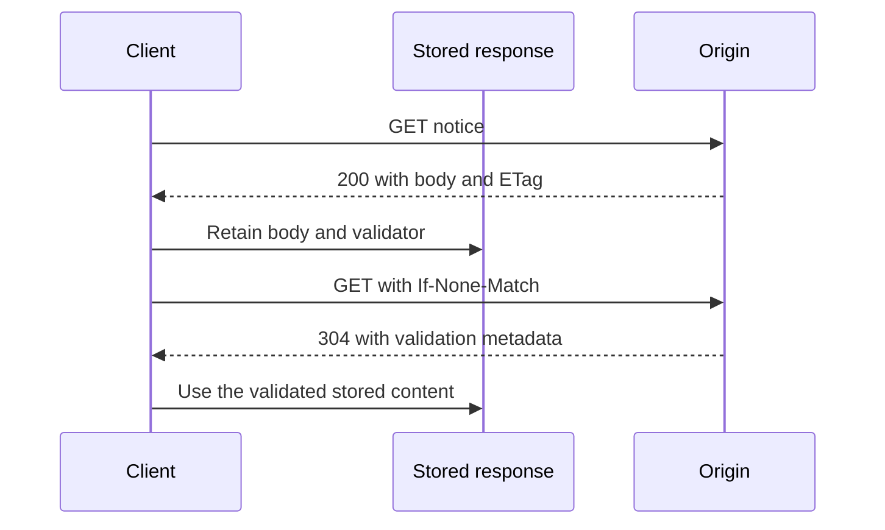

# Lesson 11: Ask whether your copy still applies

You have a stored café notice, but its policy requires checking before you use it again. You could ask for the whole notice every time. That works, but it may transfer the same content repeatedly.

Can you instead say which copy you have and ask whether it still applies?

HTTP supports that conversation. This lesson follows it carefully: obtain a response and its validator, send a conditional request, then interpret the origin's answer. We will use curl so the messages remain visible before the browser does some of the work for us.

## 1. Identify the copy, not just the noticeboard

Imagine that each café notice carries an edition label. Your photograph shows the notice labeled “edition A.” Before relying on it, you call the café:

> “I have edition A of the notice. If that is still the edition you would give me, I can keep using my copy. If it is different, please send the new notice.”

The café can give two useful answers. It can confirm that edition A still applies, or provide the current notice if the selected content differs.

The distinction works only if the edition label is managed correctly. If the closing time changes but the café accidentally keeps the old label, the reply can incorrectly encourage you to reuse an old photograph. We will investigate a defect of that kind after learning the correct mechanism.

The label also does not contain the photograph. If you lose the actual copy and retain only its label, a confirmation cannot reconstruct the missing text.

Keep those relationships in mind as we attach the HTTP names.

## 2. Meet ETag and If-None-Match

An origin can send an **ETag** header with a response. Its value acts as a validator for the selected representation. The client should treat the tag as an opaque value: a label to preserve and compare according to the protocol, not a date or version number it invents meaning for. [ETag reference](https://developer.mozilla.org/en-US/docs/Web/HTTP/Reference/Headers/ETag)

Here is a shortened **illustrative** response:

```http
HTTP/1.1 200 OK
Content-Type: application/json
Cache-Control: private, no-cache
ETag: "notice-A"

{"message":"Today we close at 17:00."}
```

The body and the tag have different jobs. The body contains the notice. The tag identifies the selected representation for later validation. The surrounding quotes are part of the tag's syntax, not decoration to remove.

When requesting again, the client can send:

```http
GET /api/notice HTTP/1.1
Host: cafe.example
If-None-Match: "notice-A"

```

The field name **If-None-Match** expresses a condition. For this ordinary GET example, read it as: “Send the selected content if its tag does not match the one I supplied.” A match produces a different response: **304 Not Modified**. [If-None-Match reference](https://developer.mozilla.org/en-US/docs/Web/HTTP/Reference/Headers/If-None-Match)

These snippets are teaching messages, not commands or real captures. The local kit uses longer quoted tags. Use the tag you actually receive when running it.

## 3. Obtain the body and its tag together

Use the same kit. Start the server in Terminal A if needed. In Terminal B, restore a known state and choose the validation policy:

```sh
node state.mjs baseline
node state.mjs validate
```

The selected body now describes 17:00, and the API response policy is `private, no-cache`. It can be stored privately, but reuse requires validation.

We will save three pieces of the initial exchange. Run this as **one command** from the lab root:

```sh
curl --etag-save observations/notice.etag --dump-header observations/initial.headers --output observations/initial.json "http://127.0.0.1:4319/api/notice"
```

Use `curl.exe` in PowerShell. Substitute your chosen port if needed. The `observations` folder is included in the kit.

| Part | Purpose |
| --- | --- |
| `--etag-save observations/notice.etag` | Save the response's ETag in a file |
| `--dump-header observations/initial.headers` | Save the status line and response headers |
| `--output observations/initial.json` | Save the body separately |
| The URL | Request the full notice from this local origin |

Because the body goes to a file, curl need not print the notice in the terminal. Open the three files in VS Code. Confirm that the headers report 200, the body says 17:00, and the tag file contains one quoted value. These named files will be replaced if you rerun the same command; keep separate copies if you want several attempts.

The ETag file is not a complete HTTP cache. It contains a label, and the body file contains text. curl will do exactly what the next command requests; it will not automatically turn those files into the browser's cache or update the page. [curl ETag options](https://curl.se/docs/manpage.html#--etag-save)

### If your curl lacks these ETag options

Inspect the response with `curl -i` instead. In VS Code, create `observations/condition.headers` containing one line: `If-None-Match: ` followed by the complete quoted tag you received. Do not use the fictional `notice-A` label.

You can then use `curl -i -H "@observations/condition.headers" "http://127.0.0.1:4319/api/notice"` for the conditional commands below. `-H @file` reads request headers from a file and avoids shell-specific escaping of the tag's quotes. This fallback requires curl 7.55 or newer. If neither option is supported, update curl before the experiment; reading the supplied examples remains possible in the meantime.

## 4. Validate while the content is unchanged

Predict what the origin should do when the selected representation still matches the saved tag. Then run:

```sh
curl -i --etag-compare observations/notice.etag "http://127.0.0.1:4319/api/notice"
```

`--etag-compare` reads the saved tag and sends it in If-None-Match. Ensure the file exists and contains the original tag before treating this as a validation test; a missing or empty file cannot identify the copy you intended.

The unchanged fixture should return **304 Not Modified** and no response body. Headers still carry useful information, including the current ETag and cache policy. Compare the server log: its `ifNoneMatch` field shows the tag received, and `status` shows 304.

The origin is not sending an empty replacement notice. It is responding to the condition. A client that retains the matching stored response can use that stored content after processing the successful validation. A client that has only the tag has no notice text to reconstruct from this body-free response. [304 response semantics](https://www.rfc-editor.org/rfc/rfc9110.html#section-15.4.5)

Open `observations/initial.json` again. Its 17:00 content is still there. We did not direct curl to overwrite it with this later response. Those saved bytes help illustrate the division of work: the old body remains available, while the new exchange establishes whether it still applies.

## 5. Follow the unchanged exchange in order

The diagram shows the body and validator traveling together initially, then a later check. Read downward in time. The final use of content comes from retained data, not from a body inside 304.



Our curl experiment performs the two origin exchanges and saves files for inspection. A browser automates storage and reuse under its cache rules. Lesson 13 will compare the origin's message with what page code receives.

A useful explanation is therefore more specific than “304 means use the cache.” It means this conditional retrieval did not require a new body under the evaluated condition; successful reuse also depends on having the appropriate stored response and applying the relevant cache rules.

## 6. Change something that does not affect the representation

Use the controlled internal-note edit from Lesson 9:

```sh
node state.mjs note
```

Repeat the conditional command with the same saved tag. You should still receive 304.

Why? The source file changed, but the selected response body did not. This fixture's validator is derived from that body's bytes. The internal note is not used to construct them, so this edit does not require a new tag.

Do not turn this observation into “the server knows the whole application is unchanged.” The validator concerns a selected representation. Other records, routes, or internal notes can change independently.

## 7. Change the selected content

Now change the closing time:

```sh
node state.mjs later
```

Before requesting again, predict the response to the **old** saved tag. Then repeat:

```sh
curl -i --etag-compare observations/notice.etag "http://127.0.0.1:4319/api/notice"
```

The body the origin would now send contains 18:00. Its tag differs from the stored 17:00 tag. The response should be **200**, with the current body and its current ETag.

This command compares the old tag but does not rewrite `observations/notice.etag`. If you run it again unchanged, you are still presenting the old tag. Another 200 is expected; it does not show that the server changed the notice a second time.

To adopt the new representation in your saved example, repeat the initial save command. Confirm that both the saved body and tag now describe the newly retrieved response. A subsequent comparison with that new tag should produce 304 until relevant content changes again.

That is a complete small cycle: retrieve, retain, validate, replace when changed, and validate the replacement.

## 8. Look inside the validator's calculation

Open `support/representation.mjs`. The helper first constructs the selected body's JSON text. It then uses a supplied SHA-256 hash function to turn those bytes into a fixed-format fingerprint and encloses that fingerprint in quotes.

You do not need to implement a hash algorithm here. The relevant dependency is that the validator is derived from **the body selected for this response**. The full and short views have different content, so the fixture gives them different tags. Changing the closing time changes the selected body and its tag; changing only the internal note does neither.

This is one implementation strategy. An ETag is not universally a hash, timestamp, database row number, or sequence you can order numerically. Other strategies can work when their change rules correctly describe the selected representation. A tag is also not proof of a user's identity or permission to access content.

Our helper emits strong tags for this simple uncompressed JSON representation. The next lesson introduces the comparison rule used by If-None-Match, including what happens when a request presents a weak tag. Compression and negotiated variants need additional reasoning in a broader system.

## 9. Compare the cost of three paths

| Path | Origin contacted? | New body transferred from origin? |
| --- | --- | --- |
| Reuse an eligible fresh response | No | No |
| Validate an unchanged representation | Yes | No, for the 304 exchange |
| Validate a changed representation | Yes | Yes, in the new 200 response |

Validation still requires communication. It is not the same as a fresh cache hit. In this lab, the origin even reconstructs the body to calculate its tag before comparing it, so the body-generation work still occurs.

The experiment demonstrates a reduction in body transfer for the unchanged case. It does not prove a particular latency improvement or show that hashing always saves server computation. Later design work can compare different validator strategies and their costs under real requirements.

## 10. Practice: follow the information

### Practice A: a validator without a body

A tool retains `notice.etag` but deletes the saved JSON. It sends the tag and receives 304. Can it recover the notice from that response? What ordinary request could it make to obtain the body again?

### Practice B: an unchanged source detail

The internal note changes, and the next conditional GET returns 304. A colleague says, “The server ignored the edit.” What narrower explanation fits the fixture and the evidence?

### Practice C: a different selected view

You save the full-view tag, then present it while requesting `/api/notice?view=short`. Why should the supplied fixture send the short body with 200 instead of confirming the full representation as a match?

### Practice explanations

For A, the tag does not contain the content and 304 has no new body. An ordinary GET without that conditional header can retrieve the current body. Keeping only a validator is insufficient for reconstructing a cached response.

For B, the handler can read the changed source while still selecting the same public body. The validator's dependency is the selected content, which excludes `editorNote`. The observation does not show that all source changes are ignored.

For C, the request selects a different body shape. The fixture derives tags from the selected body, so the short-view tag differs from the full-view tag. The comparison must concern the representation for this request, not any response sharing its pathname.

## 11. What the next lesson adds

You have now observed the ordinary unchanged and changed validation paths. Next we will turn that model into an explicit decision table: matching lists, weak comparison, HEAD, absent resources, unsupported methods, and malformed conditions under the lab's stated policy.

We will explain those cases before asking you to implement their decisions. Save the actual tags, outcomes, and your revised predictions; those are useful preparation for investigating a validator that makes the wrong decision later.
