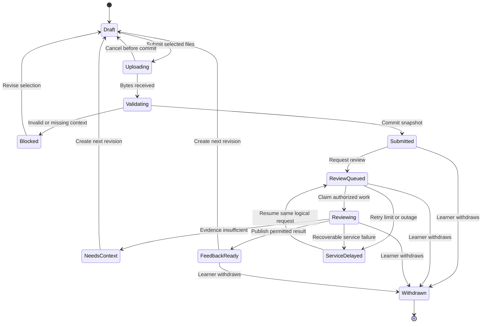

# Application Requirements and UX Specification v1

[Product stages](#2-product-stages-and-boundaries) · [Requirements](#3-users-permissions-and-decision-authority) · [Evidence model](#8-domain-model-and-versioned-records) · [Screens](#11-screen-and-interaction-specifications) · [Acceptance scenarios](#16-acceptance-scenario-catalog) · [Delivery and gates](#17-delivery-backlog-and-release-gates) · [Open decisions](#18-open-decisions-and-validation-questions)

## 1. Product purpose and design authority

The application supports a professional engineering learning loop: understand a concept, predict behavior, investigate or build with real tools, submit a bounded body of evidence, receive a justified review, revise, and later demonstrate the capability in a changed context. Students use their own editor, terminal, Git, databases, containers, and approved infrastructure. The platform organizes instruction, feedback, and competency evidence around that work.

The first product release serves the authored HTTP unit and the beginner probe, with the operational probe enabled only after its own runtime release gate. It must support the eventual 68-module curriculum without pretending that those modules already contain published lessons. A large course map is planned coverage; a reviewed learning episode is evidence; an authorized competency decision is a separate action.

This document specifies a concrete MVP and its learner, author, reviewer, and operator experience. It is sufficient to start interaction prototyping and technical architecture. Its numerical limits are proposed design defaults requiring rehearsal, not measured capacity, learning-effectiveness findings, or commercial promises.

### 1.1 Source identity

| Source | Exact identity | What remains authoritative |
| --- | --- | --- |
| Graduate Competency Standard | GCS-FSSE-001 v1.1; SHA-256 `501145c310956a46319d27649840c0e4bdf501e6a2ddd684422da51a335d78ca` | The 206 practical outcomes, 12 awareness topics, depth/P targets, H semantics, evidence rules, G1–G11 and NC-01–NC-06 |
| Curriculum Architecture | FSSE-CURR-001 v1.0; SHA-256 `369706fb1fb9bd80de8458e67b0b7a23dd2ec28257796d2ac0c44c206241d85b` | The 68 modules, prerequisites, projects, initial slices, proposed child indicators and EX01–EX07 experiments |
| Representative Learning Package | FSSE-RLP-001 v1.0.0; archive SHA-256 `19fbaf9a3c0a16e9dec7c47df88a807438521ee52c98b2aa2aaa0c77cfeb351b` | The concrete HTTP lessons, exercises, fixtures, review examples and recorded author checks, subject to clarification C-01 below |
| This specification | FSSE-APP-001 v1.0 | Product scope, interaction contracts, state transitions, acceptance scenarios and implementation gates |

Source precedence is standard → curriculum → compatible learning release → application presentation. The app must surface an incompatibility instead of inventing a rule that silently changes the standard. Document versions, evidence schema versions, fixture versions and model versions are distinct identities.

The older learning archive remains a historical release. This specification does not assert that its browser, Docker, accessibility, or human calibration gates have since passed.

### 1.2 Corrections and consequential design decisions

| ID | Finding or decision | Binding product behavior |
| --- | --- | --- |
| C-01 | The standard defines a decisive diagnosis as H5. Some architecture/package wording groups “decisive diagnosis” under H4, and the HTTP H4 entries reveal the exact faults. | Apply the standard: H4 is genuinely partial help; a complete solution or decisive diagnosis for the task is H5. Treat the current main and transfer H4 disclosures as H5-level content on import. Require relabeled or rewritten hints before learner release; retain original labels in provenance. Do not infer historical independence from an ambiguous H4 label. |
| C-02 | A static-source criterion can be technically met while execution and independence remain unverified. | Store criterion result, claim scope, help and verification provenance separately. Do not display one green “mastered” badge for all of them. |
| C-03 | The owner package exposes the transfer variant and reserved review cases. | Record known exposure and use fresh comparable variants for affected independence or held-out evaluation claims. A filename containing “reserved” does not establish an unseen task. |
| C-04 | The file-first collector produces a local JSON envelope, not a full evidence-schema implementation. | Import its source and metadata as untrusted submitted data. Construct the server-owned evidence record from authenticated identity, pinned versions and actual provenance; never trust a supplied authority or execution claim. |
| C-05 | Browser interaction and Docker execution were not established by the earlier author report. | Keep environment gates scoped to the exact tested path. A new browser connection was attempted during this specification work but dropped before page inspection; Docker remains absent. No new successful rehearsal is claimed. |
| C-06 | Preserving assessment history can conflict with deletion and retention limits. | Use immutable revisions during retention, controlled redaction/tombstones and authorized deletion afterward. Evidence whose supporting source is gone cannot keep an unexplained verified status. |
| C-07 | A background review can finish after a learner withdraws or supersedes an attempt. | Recheck authorization and current attempt state before publishing a result; late work cannot resurrect withdrawn content or overwrite a newer review. |
| C-08 | The unit teaches diagnoses as part of learning, while independence requires fresh work. | A taught exact solution remains learning evidence. Do not manufacture H0 independent diagnosis from reproducing it. Fresh-task criteria and actual help govern the later claim. |

For C-01, a content importer must return an explicit compatibility result: `compatible`, `requires_help_reclassification`, or `requires_author_review`. It preserves the original release bytes, records the rule/version used, and creates a reviewed compatible release. It must not quietly edit historical attempts. Before an affected independence decision, an assessor examines the actual disclosure; missing disclosure content means `needs_review`, not a guessed H value.

## 2. Product stages and boundaries

### 2.1 Release stages

| Stage | Purpose | Included behavior | Exit condition |
| --- | --- | --- | --- |
| P0 — Workflow prototype | Validate task comprehension and interaction choices using synthetic scenarios | Clickable or facilitated learner/reviewer/author flows; fake service failures clearly labeled; no real source collection | EX06 task observations and access issues recorded; essential design blockers resolved |
| P1 — Private learning MVP | Run the first learning loop with invited learners and qualified manual review | Curated lessons, local lab downloads, predictions, explicit hints, bounded files/local-packet submission, human review, response/resubmission, evidence views, support and data controls | Required implementation, privacy, access, operating and exact-lab gates passed for the pilot |
| P2 — Calibrated advisory automation | Assist qualified reviewers and offer labeled contextual explanations | Bounded model review and tutor generation behind tested policies, evaluations, cost limits and manual fallback | EX04 evaluation and application-specific controls passed; ongoing review sampling staffed |
| P3 — Curriculum and integration expansion | Support additional reviewed modules and evolving projects | More content releases, project checkpoints, later ZIP/Git integrations and editor integration where justified | Each module/environment/integration passes its own release contract |
| P4 — Verified assessment service | Offer a bounded verified graduation decision | Full indicator/gate blueprint, observed performance, fresh tasks, qualified sign-off, appeals and lifecycle policy | Role/outcome validation, assessment capacity, G/NC coverage and recency policy independently reviewed |

The full course remains the intended scope. Staging concerns delivery and validation, not removal of required graduate outcomes. Cloud and Kubernetes remain practical curriculum requirements; P1 does not claim to have implemented or verified those labs.

### 2.2 P1 scope

P1 must let an invited learner complete the HTTP learning/review/revision loop with a human reviewer. Curated hints and full explanations work without a model. A model outage therefore cannot remove access to instruction or trap an attempt. P2 generation can be introduced incrementally after its evaluation gates.

P1 accepts selected text/source files and the course collector's local JSON packet. It also supports a small number of optional raster evidence images. ZIP extraction and Git-repository fetching are specified as later ingestion capabilities; the UI must not advertise them before their controls work. The archive used to **download** a course-owned lab is distinct from accepting an uploaded learner ZIP.

P1 includes a lightweight project/checkpoint relation so later work can connect to a long-lived codebase. It does not need a universal project builder, cloud account provisioning, in-browser IDE, video-call system, payment service, employment credential, public leaderboard, or marketplace. Observation can be arranged through an approved external process and recorded by the qualified assessor without recording a permanent video.

### 2.3 Proposed operating assumptions

| Assumption | Initial design choice | Validation and owner |
| --- | --- | --- |
| Audience | Private adult pilot; beginners enter through preparation, HTTP learners demonstrate its prerequisites | Program owner must review audience/access policy before enrollment; under-18 access requires a separate design and policy review |
| Language | English content initially; explicit locale fields and externalized product strings | Curriculum/accessibility owner validates comprehension; no automatic multilingual-equivalence claim |
| Model provider | Unselected; P1 can operate through manual review | Assessment/data owners approve provider, handling, retention and evaluation before P2 |
| Commercial model | No payments or verified credential in P1 | Product owner uses EX07 measurements before pricing or service promises |
| Organization model | One program organization in the first pilot; all learner/evidence access is scoped by organization and enrollment | Security owner tests cross-learner and future cross-organization denials |
| Supported tools | Each lab release declares its own tested OS/runtime/browser/container path | Lab owner; actual browser and Docker checks remain pending here |
| Review capacity | A qualified review queue with a published operating window and named coverage | Operations owner assigns people and response expectations before live pilot; no staffing is assumed to exist |

## 3. Users, permissions, and decision authority

The same person may hold several roles, but the active role, permitted object scope and decision authority must remain explicit. A platform operator is not automatically an assessor or entitled to read all learner source.

| Role | Permitted core actions | Required boundary |
| --- | --- | --- |
| Learner | Read available content; manage own drafts; submit own approved source/evidence; request help; respond, appeal, export or request deletion | Own organization/enrollment/attempts only; cannot set trusted verification, final help classifications or competence decisions |
| Tutor/support educator | Explain approved material and respond within an assigned learner/support context | Does not silently award independence or change a formal decision; source access requires an assigned need |
| Reviewer | Read assigned complete attempt context; draft/publish permitted criterion feedback; request missing evidence; respond to a rebuttal | Assignment checked at every read/write; no code execution or role escalation from submitted text |
| Qualified assessor | Record observed performance; make authorized competency decisions; request fresh checks; resolve assigned critical findings | Must identify basis, scope and provenance; graduation service remains disabled until P4 gates |
| Content author | Create Markdown content, fixtures, rubrics and release candidates; run trusted author fixtures in an approved author environment | Drafts do not become public because generation completed; learner source is not author fixture material by default |
| Content reviewer/publisher | Review compatibility, technical/pedagogical/access gates; approve and publish or withdraw releases | Author cannot supply the independent approval for their own release; bootstrap solo work stays draft |
| Appeal adjudicator | Review the disputed result and its pinned record; issue a reasoned disposition | Independent of the disputed decision where staffing permits; conflicts must be disclosed and routed, not hidden |
| Platform operator | View service/job health and bounded metadata; pause queues, manage authorized incidents and retention tasks | Source access requires a separate time-bounded, reasoned grant and audit; no standing “read everything” assumption |
| Program administrator | Manage enrollment and scoped roles, approved policies, operating capacity | Cannot forge assessor observation or learner work; role changes audited and effective on already queued work |

**REQ-01 — Scoped identity.** Every protected request must derive identity and organization/enrollment scope from the authenticated session and current authorization policy. An ID in a URL, packet, model response or job payload is a lookup key, not proof of access. **Accept when:** a second learner cannot read or modify another learner's source, reviews, exports, upload sessions or cached responses by replacing IDs.

**REQ-02 — Role and assignment enforcement.** Enforce role, assignment and resource state on reads, writes, downloads and worker result publication. Staff use stronger authentication controls appropriate to their access; choose a managed identity solution in architecture. **Accept when:** revoking a reviewer assignment prevents subsequent content access and publication from an already claimed job.

**REQ-03 — Session recovery.** Expired sign-in preserves a safe recovery path for acknowledged drafts and upload/attempt state. Reauthentication must not submit twice or transfer a previous user's draft to the next signed-in user. **Accept when:** the learner returns to the same authorized draft after session renewal; another account cannot recover its source.

**REQ-04 — Explicit decision authority.** Automated and ordinary review outputs are advisory. Only an authorized qualified assessor can create the applicable decision record; verified graduation is feature-disabled in P1–P3. **Accept when:** a model result containing a valid-looking decision field is rejected as unauthorized and no competency state changes.

These are product requirements, with denial by default and authorization on each relevant request as technical foundations. See the scoped guidance in [OWASP Authorization](https://cheatsheetseries.owasp.org/cheatsheets/Authorization_Cheat_Sheet.html). The reference supports access-control mechanisms, not the educational validity of a decision.

## 4. Learning and assistance requirements

**REQ-05 — Honest curriculum availability.** Show published lessons, planned modules and temporarily withdrawn releases distinctly. Search and progress use the learner's applicable program/release versions. **Accept when:** all 68 module records can be present while only released lessons are launchable; a planned module contributes no fabricated completion evidence.

**REQ-06 — Readiness and placement.** A prerequisite names a capability and an accepted evidence/diagnostic route. Hard, suggested and co-requisite relationships are distinct; only hard edges block a dependent practical task. Reading ahead remains available where the content policy allows it. **Accept when:** a missing browser-observation prerequisite routes to the relevant preparation or placement task without forcing unrelated completed lessons to repeat.

**REQ-07 — Staged concept explanations.** Render each substantial concept's intuition, useful model, concrete example, technical mechanism, model limits and later reuse. Learners can navigate directly among these sections; opening every panel is not a competence requirement. **Accept when:** the HTTP resource/representation lesson exposes both its simple model and the correction without unexplained prerequisite concepts or hidden mandatory clicks.

**REQ-08 — Prediction and reflection.** A prediction can be saved before the learner records an observation. Preserve the acknowledged prediction revision and later reflection. Local experiments remain outside platform observation. **Accept when:** the learner can correct an earlier wrong prediction without overwriting what was originally recorded, and the UI does not call a timestamp proof of an unseen local experiment's order.

**REQ-09 — Real local work.** Exercises provide the exact starter identity, approved tools/environment, scope, commands, required evidence, reset and cleanup. Buttons download or copy instructions; they never launch submitted code on the platform. **Accept when:** a learner completes the HTTP task using Node/Git/browser/curl and can identify the source snapshot used.

**REQ-10 — Recoverable project work.** Give each cumulative project a release/checkpoint, learner source baseline and known migration/recovery paths. A recovery copy or patch is offered with a clear scope and source identity. **Accept when:** accepting a solution-bearing recovery snapshot preserves the earlier attempt and records help for affected indicators without destroying unrelated work.

**REQ-11 — Help semantics.** Use H0–H5 from the standard and C-01. Record the delivered content/version, source, affected indicators and actual disclosure. Ordinary references/access support do not automatically reduce independence. **Accept when:** a decisive task diagnosis labeled “small hint” is recorded as H5-level help and cannot be counted as H0 diagnosis evidence.

**REQ-12 — Available explanations.** The full walkthrough is directly available on request in learning mode. In a formal attempt, selecting solution-specific help immediately continues the affected work in learning mode after a short consequence notice; no forced waiting period or punitive lock follows. **Accept when:** a learner can request the solution, retain earlier process evidence and later obtain a fresh comparable task.

**REQ-13 — Unsolved and Heroic work.** Accept investigation records, ruled-out hypotheses, documentation, experiments, partial conclusions and a request for explanation even when the implementation is incomplete. Distinguish required Heroic process evidence from optional solution success. **Accept when:** a strong investigation with an unresolved bug can receive a met process criterion and a separate not-met or insufficient implementation result.

**REQ-14 — Supported environments and safety scope.** Availability is tied to the tested lab release/environment. Show real constraints and stop conditions where they affect a lab decision. A known essential access or scope defect pauses the affected lab with an alternate learning route. **Accept when:** Docker probe status remains unreleased until its specified runtime, limits and cleanup rehearsal passes, while the learner can continue unrelated available work.

## 5. Submission requirements and boundaries

### 5.1 Initial input contract

The MVP accepts explicitly selected source/text files, a supported course-local packet JSON, and optional PNG/JPEG evidence images. Text is UTF-8. Required/optional paths and permitted file classes belong to each exercise release; a generic extension allowlist is only an additional restriction. `.env` files, private keys, unrelated directories and `.git` contents are excluded from normal collection. An exercise-specific synthetic `.env.example` requires explicit approval in that release.

Proposed P1 limits are 64 source/text-evidence files, 256 KiB per text file, 8 MiB of text total, at most two images of at most 2 MiB each, and 10 MiB total per attempt across all classes. Limits are binary byte units and apply to decoded packet entries as well as directly uploaded files. Default to three open upload sessions per learner; expired sessions are cleaned by policy. These values accommodate the current small HTTP package and must be measured before expansion. The UI tells the learner which limit was reached and offers a bounded-context/manual-review route rather than silent truncation.

The course collector's packet version 1.0 embeds file contents and reported metadata. Client-side preview can unpack this **JSON data structure** without executing contained source. Validate it again on the server. Supplied hashes are checked against received bytes; supplied paths cannot address storage locations. Reported provenance and identifiers are displayed as claims until reconciled with authenticated/server-owned records.

**REQ-15 — Preview before transfer.** Selecting files or opening a packet creates a local preview with filenames, sizes, inclusion reasons, optional exclusions and the destination exercise. Source is not uploaded or sent to a model merely because it was selected. **Accept when:** canceling at preview causes no source bytes to be sent; network inspection confirms that previews do not trigger third-party analytics or model calls.

**REQ-16 — Minimal complete context.** Preview marks required files, supplied baseline/dependencies, evidence and missing context. The server retains the approved full artifact while the review context explicitly lists what was included or omitted. **Accept when:** a correct revision-based tag with no mutation mechanism is routed for missing context rather than automatically rejected or falsely accepted.

**REQ-17 — Bounded ingestion.** Enforce byte/count/type/path restrictions independently on the server, including decoded packet entries, duplicate/colliding names, control characters and unexpected fields. Store objects under generated IDs outside executable/content-serving paths. Reject unsupported input with per-file reasons. **Accept when:** a malicious filename, oversized JSON entry or disallowed file cannot become a stored executable, leak another object or bypass the aggregate limit.

**REQ-18 — Inspectable untrusted content.** Source, Markdown, diffs and logs are displayed as escaped/sanitized data. No scripts, raw HTML execution, SVG execution, remote embeds, model tool instructions or package hooks run from a submission. Images are decoded under bounds and stripped of unnecessary metadata before approved display. **Accept when:** submitted HTML and Markdown payloads remain inert in preview, review, export views and staff tools.

**REQ-19 — Immutable attempt snapshot.** A commit operation pins the program/exercise/rubric/environment versions, manifest hash, exact artifacts, help snapshot and source/baseline context into an attempt revision. The submitted snapshot remains immutable during retention. **Accept when:** local file edits after submission cannot alter the reviewed bytes; resubmission creates a new revision linked to the same learning episode.

**REQ-20 — Retry without duplication.** Upload chunks/objects, attempt commit and review enqueue are independently idempotent under a scoped request key and content hash. A lost response can be reconciled by operation ID. **Accept when:** two Submit clicks or a retry after a timeout produce one committed revision and one logical review request; reuse of a key with different content returns a conflict.

**REQ-21 — Submission completeness and provenance.** Capture environment, commands, selected raw results, included/missing context, reasoning, help and learner questions. A learner may mark an observation “not captured” or request help assembling a packet. **Accept when:** the empty course template cannot masquerade as complete execution/independence evidence merely because JSON parses.

**REQ-22 — Withdrawal and replacement.** A learner can withdraw an unneeded submission or replace it with a new revision. Withdrawal immediately revokes routine review/publication access; data deletion follows the applicable policy and communicates timing. **Accept when:** a model or human response arriving after withdrawal is not published and cannot restore access or count as fresh evidence.

**REQ-23 — Token/context sufficiency.** The chosen review adapter must measure its actual model limits and reserve room for policy, rubric, source and output. Required context cannot be silently dropped to fit. **Accept when:** an oversized or incomplete context returns a bounded missing-context/manual-review action and the reviewer can inspect the omission list; “reviewed entire project” is never claimed after partial ingestion.

For later ZIP ingestion, require local selection/preview with bounded parsing where feasible, then independent quarantine validation of compressed/expanded sizes, entry counts, nesting, traversal, symlinks, collisions and extraction behavior. Do not execute build/install hooks. If a design requires uploading the original archive before preview, that transfer must be explicitly described and selected; it cannot be disguised as a local preview. Later Git imports need repository permission, immutable commit identity, strict fetch scope and no hook execution. These features remain disabled until their separate controls pass. [OWASP File Upload](https://cheatsheetseries.owasp.org/cheatsheets/File_Upload_Cheat_Sheet.html) supports the layered ingestion approach; the specific product limits above are proposed choices.

### 5.2 Attempt processing state



Diagram labels describe one revision's processing state. “Create next revision” leaves the submitted revision intact and opens a new draft; it does not mutate old source. Withdrawal also applies from NeedsContext and ServiceDelayed. Upload validation is an ingestion result, not an academic result. A rejected unsafe file does not automatically imply misconduct.

The exact draft-save, upload, review-job, criterion and decision states are stored separately. In particular, a review can be FeedbackReady while its criteria are insufficient_evidence and the competency decision remains undecided.

## 6. Review, revision, and assessment requirements

**REQ-24 — Complete review context.** A reviewer receives the pinned requirement/rubric, taught prerequisite boundary, approved source/dependencies, baseline, observations, help history and missing-context list. **Accept when:** the reviewer can tell which files and claims are actually in scope and cannot silently penalize an untaught architectural concern as a required criterion.

**REQ-25 — Criterion-based findings.** Each finding identifies its indicator, result, severity, source/evidence locations, reasoning, uncertainty, considered alternatives and next action. Use `met`, `not_met`, `insufficient_evidence`, or `needs_review`; do not require a numeric score. **Accept when:** a title-only tag receives a concrete body-change counterexample, while a complete revision design is considered on its assumptions rather than rejected for not matching SHA-256.

**REQ-26 — Truthful verification.** A static reviewer cannot claim it ran tests or verified authorship. Imported logs remain learner-reported until an authorized corroboration/observation record supports a stronger statement. **Accept when:** a polished green report without source/environment linkage does not become observed_performance, and the UI states the actual verification scope.

**REQ-27 — Review authority and untrusted inputs.** Submitted code, comments, filenames, logs and prompts cannot alter policy, authorize tools, expose other records, reveal reserved material or forge output authority. The review process has no learner-code execution tool and no arbitrary network-fetch capability. **Accept when:** the application rejects authority-changing output and safe synthetic prompt-injection cases cannot cause source execution, cross-learner disclosure or a decision write.

**REQ-28 — Validated model output.** P2 responses must satisfy a versioned schema and semantic checks: known assigned indicators, existing authorized evidence references, allowed result/severity values, permitted claim scope and no fabricated execution. Invalid or unsupported output is withheld from authoritative presentation and routed to bounded retry/manual review. **Accept when:** schema-valid but nonexistent evidence references still fail publication.

**REQ-29 — Qualified fallback and escalation.** Manual review is available in P1 and remains available for uncertainty, critical allegations, service failure or contested consequential results. A potential immediate lab exposure is explained and contained without inventing an untaught grading requirement. **Accept when:** a critical flag is visibly an allegation awaiting qualified review and never an automatic misconduct finding or permanent disqualification.

**REQ-30 — Reply to review.** Learners can accept, partly accept, or rebut each finding with a requirement, evidence and proposed action. The reviewer can correct their own finding without erasing its original version. **Accept when:** a learner can challenge a SHA-256-only claim, retain a valid version-based implementation and see the corrected review rationale.

**REQ-31 — Revision continuity.** A resubmission identifies the previous revision, addressed findings, changed source and new evidence. It stays in the same learning episode unless an assessor explicitly assigns a genuinely different scenario/occasion. **Accept when:** three repairs to the revealed main defect do not count as three independent demonstrations.

**REQ-32 — Fair appeal.** An appeal identifies disputed findings/decisions and preserves the relevant versioned record within lifecycle rules. Publish routing, conflict handling, response expectations and possible dispositions. **Accept when:** the adjudicator can inspect the original rubric/source/help/provenance, issue a reasoned correction/upholding/new-verification request, and the learner sees its effect without an unexplained score change.

**REQ-33 — Fresh task assignment.** A transfer assignment identifies comparable demands, variant family/version, known exposure, actual interval, allowed assistance and target indicators. A learner can disclose prior access or request an accessible equivalent. **Accept when:** an exposed transfer patch is treated as practice and a new technically rehearsed variant is used for the affected independent claim.

**REQ-34 — Calibrated release of automation.** P2 requires qualified annotations/adjudication, a frozen rubric/prompt/model release, a genuinely held-out evaluation and production-boundary tests. Record denominators, repeat-case stability, false passes/rejections, unsupported findings, abstentions, help leakage, usage and human effort. **Accept when:** reserved candidate cases read during development are excluded/replaced in held-out claims, and no unresolved serious failure is promoted under EX04's rule.

OWASP describes prompt injection as an application trust-boundary problem requiring layered controls, constrained capabilities and evaluation; a label around untrusted text is not an assurance by itself. [OWASP LLM Prompt Injection Prevention](https://cheatsheetseries.owasp.org/cheatsheets/LLM_Prompt_Injection_Prevention_Cheat_Sheet.html). The product requirements above additionally constrain educational claims and qualified decision authority.

### 6.1 Tutor generation policy for P2

Generated explanations are labeled as generated and tied to the approved lesson/release context. The learner can report a suspected error, ask for a different explanation, or open the curated explanation. The tutor's relevant context includes the learner's demonstrated prerequisites and current task, but retrieval must remain within authorized published content and the allowed help level. It may not browse arbitrary learner-supplied URLs or retrieve another learner's solution.

A delivered reply that reveals more than requested is not silently recorded under the requested hint level. Capture the actual disclosure, flag the affected claim and offer a fresh task. A tutor cannot guarantee what an external coding assistant does on the learner's machine. Use explicit disclosure and fresh defense/change tasks, never covert device surveillance or an authorship detector as proof.

Teaching an urgent safety issue is always available. Assessment policy decides which taught/research-based dimensions can affect the current criterion. The system can explain a newly discovered concern without retroactively adding it as an undisclosed passing requirement.

## 7. Evidence and progress requirements

**REQ-35 — Separate progress from competence.** Store content completion, criterion outcomes, help/provenance and assessor decisions separately. Show unmet required indicators and evidence limits in domain summaries. **Accept when:** completing eight lessons changes curriculum progress without automatically marking NET-04, the database domain or a graduation gate achieved.

**REQ-36 — Claim-level evidence rules.** Apply explicit standard rules to each competency/indicator, including depth/P target, occasion, fresh H0, integrated/unfamiliar context and P4 adaptation/defense where required. Do not infer entire parent outcomes from child coverage. **Accept when:** one static HTTP repair can support its narrow criterion while the target remains unestablished pending additional evidence.

**REQ-37 — Help and episode aggregation.** Preserve individual help events and compute the highest applicable H under a versioned classification with `unknown`/`needs_review` where necessary. Distinct revisions of one episode are not new independent demonstrations. **Accept when:** H5 for the main diagnosis remains visible even after a later H0 transfer; unaffected claims are assessed on their own actual help.

**REQ-38 — Reconfirmation and changes.** Material tool/content/rubric changes, contradictory recent performance and graduation review can trigger targeted reconfirmation. Keep prior evidence and explain what needs checking. **Accept when:** a revised representation-selection requirement creates a bounded new check rather than deleting unrelated programming competence or relabeling old evidence under new requirements.

**REQ-39 — Authorized state decisions.** An assessor decision cites counted/excluded evidence, standard/rubric versions, target achievement, descriptive state, remaining uncertainty, critical findings and next action. Corrections supersede earlier decisions with a reason. **Accept when:** an H0 independent claim cannot be created solely from a self-report, checkbox, file hash or model confidence percentage.

The allowed descriptive states are Not yet observed, Emerging, Developing, Strong, Adaptive, and Needs reconfirmation. Target achievement is separately `not_evaluated`, `not_yet_met`, `met`, or `needs_review` in the application. These application values map to the standard's semantic distinction; they are not an extra performance scale. P0–P4, H0–H5 and L1–L6 keep their existing meanings.

For a core P3/P4 target, the standard's proposed evidence rule includes two distinct demonstrations on separate occasions, at least one fresh H0 demonstration and at least one integrated or unfamiliar context. P4 additionally requires H0 adaptation and defense. Working and awareness targets have their own explicit rules. The app may surface evidence eligibility and gaps, but it does not turn counts alone into an assessor decision. Graduation recency windows and operating capacity must be published and reviewed before P4 enrollment.

## 8. Domain model and versioned records

### 8.1 Product entities

| Entity | Essential identity and relationships | Invariant |
| --- | --- | --- |
| Organization, User, Enrollment, RoleAssignment | Authenticated user; organization/program enrollment; role/scope/expiry | Identity and scope are server-owned; revoked access applies to cached/queued work |
| ProgramRelease | Standard, curriculum and supported policy versions | Stable reference for every attempt; migration explicit |
| Competency, Indicator | Stable parent/child IDs, expanded depth/P target, evidence and critical-rule mappings | Unknown IDs or inferred target defaults cannot pass a release gate |
| Concept, PrerequisiteEdge | Concept ID/depth; hard/suggested/co-requisite edge | Hard prerequisite graph is acyclic |
| LearningRelease | Lesson/exercise/rubric/hint/solution/lab manifest and approvals | Published revision immutable; compatibility checked as one release |
| Exercise, ProjectCheckpoint, VariantAssignment | Brief, intended evidence, difficulty, tools, baseline, reset, family/exposure | A harder or changed criterion is not silently substituted mid-attempt |
| LearningEpisode | Learner, scenario family and occasion context | Resubmission alone does not create an independent episode |
| Draft, PredictionRevision, Reflection | Acknowledged content revisions with times/context | Unsaved text is not represented as saved; predictions preserved separately |
| SubmissionRevision, ArtifactManifest, Artifact | Episode/revision, exact hashes, approved paths/types, source/baseline references | Committed artifact bytes do not change; retention/redaction actions are explicit |
| HelpEvent | Source, delivered content/version, order/time, affected claims, original and resolved H | Classification follows actual disclosure; no automatic unknown-to-H0 default |
| Observation, VerificationRecord | Observer/source, task, environment, result, provenance and consent reference where applicable | Reported execution is distinct from assessor-observed performance |
| ReviewRequest, ReviewJob, ReviewRevision, Finding | Request identity, attempt revision, authorization, policy/model/reviewer and evidence refs | A worker retry is one logical review request; late stale results cannot replace current authorized output |
| CriterionResult, CompetencyDecision | Claim scope, evidence, help, provenance, target/state and authorized maker | Technical criterion satisfaction is separate from independence and target achievement |
| ReviewResponse, Appeal | Disputed finding/revision, response, adjudication and disposition | Original record remains interpretable during permitted retention |
| RetentionPolicy, DeletionRequest, ExportJob | Policy version, object scope, expiry, exceptions, completion and failure | Access revocation, content deletion and backup expiry have different explicit states |
| AuditEvent, OperationalMetric | Actor/action/references/reason; bounded service measurements | Telemetry normally contains identifiers/status, not source or free-form learner content |

These are logical boundaries. A modular application with a background worker can implement them; the specification does not require a separately deployed service for every entity or “engine”. Persistence transactions, background delivery and authorization semantics must be chosen in the technical architecture to preserve these invariants.

### 8.2 Evidence schema 2.0 field contract

The source standard defines semantic schema 2.0. The implementation must produce a validated serialization that satisfies the following field rules and reject references it cannot resolve. This document specifies the behavior; it does not claim that a production schema validator or API already exists. The local review envelope 1.0 is an input/output adapter with a narrower purpose, not a substitute for the full evidence record.

| Field/group | Required value or rule | Trusted source |
| --- | --- | --- |
| Evidence identity | Stable ID, revision ID, schema `2.0`, creation time, superseded revision if any | Server |
| Learner/program identity | Authorized learner/enrollment and standard/curriculum/assessment/environment versions | Session plus pinned release |
| Scenario | Exercise/rubric IDs and versions, baseline hash or explicit absence, attempt/episode IDs, L level, conditions and variant identity | Release plus authenticated attempt; reported baseline reconciled to artifacts |
| Claims | Known parent/indicator IDs; expanded target/depth; observed behavior, claimed P if any, scope and supporting references | Reviewer/assessor within permitted authority; never inferred from filename |
| Artifacts | Stable immutable reference, hash, included/missing context, type/path label, ownership/access classification | Validated received bytes and authorization policy |
| Environment | OS/runtime/config/fixture version and deviations; no secrets | Learner report or qualified observed record with provenance |
| Help events | Actual disclosure, source, order/time, H, affected claims, collaborators/generated material and exposure | Recorded tutor events plus explicitly attributed external reports; reviewed classification |
| Observations | Directly observed versus inferred versus reported; hypotheses, experiments, revision and observer role | Attributed origin; learner cannot label them as another person's observation |
| Verification | Command/task, source/environment link, raw result, time, deviations, one permitted provenance enum | Attributed evidence; elevated provenance requires authorized corroboration |
| Criterion results | Known criterion, result enum, scope, severity, reason, missing context, confidence basis and alternatives | Scoped reviewer/assessor |
| Critical findings | NC rule where relevant, allegation/verified status, evidence, containment, qualified closure and fresh check | Qualified review; model flag remains an allegation |
| Decision | Counted/excluded evidence and reasons, target/state, recency/reassessment, next action and maker | Authorized assessor; absent for mere advisory review |
| Review provenance | Reviewer or model/prompt/policy/evaluation identity, time, finding refs, sign-off/appeal refs | Review pipeline and staff identity |
| Data lifecycle | Permission/access scope, reuse policy, retention expiry, export/deletion/redaction references | Approved versioned policy and authorized actions |

Verification provenance enums are exactly `static_artifact`, `learner_reported_execution`, `corroborated_execution`, and `observed_performance`. They are categories, not an automatically increasing trust score. Unknown or missing provenance remains unresolved. Dates use an explicit timezone; authoritative event order and acknowledged revisions do not establish what happened outside the platform.

### 8.3 Example of separated results

The following is a synthetic explanatory fragment, not a real learner result or a complete API payload:

```json
{
  "episode_id": "DEMO-HTTP-MAIN-01",
  "attempt_revision": 2,
  "indicator_id": "NET-04.i03",
  "criterion_result": "met",
  "criterion_scope": "Static source implements the published validator relationship",
  "maximum_help": "H5",
  "verification_provenance": "learner_reported_execution",
  "independent_diagnosis_established": false,
  "target_achievement": "not_evaluated",
  "next_action": "Attempt a fresh comparable task with actual help recorded"
}
```

The learner may have understood and implemented a revealed fix. That does not erase its help record or establish independent diagnosis. A later fresh task links a distinct episode and its actual evidence; the app never rewrites the earlier H5 event to make the profile look stronger.

### 8.4 Deletion-compatible history

“Immutable” means published evidence/source is not edited in place during its permitted retention. It does not mean the product retains private learner content forever. A redaction/deletion operation preserves a minimal tombstone or audit reference only where the approved policy permits it. Reevaluate dependent claims when their evidence becomes unavailable; show why a record can no longer be reproduced. Avoid retaining raw source in logs, model traces, search indexes, exports, analytics or backups beyond the same lifecycle boundary.

## 9. Content authoring and release requirements

**REQ-40 — Markdown as canonical content.** Lessons, briefs, explanations, rubrics, hint bodies and design notes have a stable Markdown source plus structured release metadata. AI generation creates drafts; curated published content is versioned and reviewable. **Accept when:** export preserves the source text, stable IDs, relationships and version identity without requiring screenshots or a proprietary editor.

**REQ-41 — Compatibility validation.** Check known IDs, explicit depth/P expansion, rubric coverage, hard-prerequisite cycles, help semantics, links, supported environment, solution alternatives and fixture/test compatibility before publish. **Accept when:** an unknown indicator, cycle, missing worked explanation or C-01 H4/H5 mismatch blocks the candidate with a specific repair action.

**REQ-42 — Independent release review.** A release records technical, pedagogical and accessibility review, exact author fixture verification, scope/reset, rights/licenses, and compatible content approval. The author cannot supply their own independent approval. **Accept when:** a draft operational probe remains unavailable for learners until the recorded runtime and cleanup gate passes, even if its prose and YAML compile.

**REQ-43 — Pinned versions and migration.** Learners begin against a compatible release; later author edits create a new candidate. A migration identifies affected claims/tasks and whether a fresh check is needed. **Accept when:** a learner's submitted fix is reviewed against its original requirement/rubric unless an explicit documented migration is accepted; a new difficulty or criterion is never added retroactively.

**REQ-44 — Withdrawal and correction.** An essential access, correctness or scope defect can withdraw the affected release. Current learners receive the reason and a recovery path; historical source/rubric identity stays interpretable within retention. **Accept when:** a withdrawn lab cannot start a new attempt, while an affected learner can view permitted prior evidence and continue unrelated safe learning.

The authoring interface must handle the concrete package objects: eight LS-HTTP lessons, EX-HTTP-01–24, optional EX-HTTP-H01, HC01–HC17, TX01–TX05, the proposed 24 child indicators, full explanations, alternative solutions, lab versions and draft calibration packets. These are import fixtures for authoring acceptance tests, not proof of learner mastery.

## 10. Shared experience and accessibility

### 10.1 Navigation and visual hierarchy

The learner navigation has four primary destinations: **Learn**, **Practice**, **Reviews**, and **Progress**. Help is consistently available, and account/data controls are in the account menu. Authors, reviewers and operators receive role-specific workspaces; changing workspace does not widen authorization. Do not expose internal engine/service names as learner navigation.

Use a calm reading layout, clear type hierarchy and generous spacing. Lesson prose occupies a readable central column; optional context such as glossary, outcomes and current task is adjacent on wide screens and follows in document order on narrow screens. The main action belongs next to the information needed to choose it. Avoid leaderboards, streak pressure, confetti for uncertain judgments, or numeric displays that imply confidence unsupported by evidence.

Use explicit text for state, with color/icon as reinforcement. Source/diff views support unified display, adjustable wrapping and accessible line references; side-by-side comparison is optional. Horizontal scrolling may be needed inside a code pane, but it must not prevent reading controls or completing the surrounding task. No essential action depends solely on hover, dragging or an unlabeled icon.

**REQ-45 — Accessible complete journeys.** Adopt WCAG 2.2 AA as the product target for complete learner/author/reviewer tasks, with manual keyboard, zoom/reflow and appropriate assistive-technology verification in addition to automated checks. Provide text alternatives for diagrams/evidence, captions/transcripts for future media, programmatic labels/errors and accessible authentication/recovery. **Accept when:** the essential scenario tests in section 16 can be completed through the supported access paths with no unresolved blocker. This is a target, not a current conformance claim. [W3C WCAG 2.2](https://www.w3.org/TR/WCAG22/) defines the normative conformance framework.

**REQ-46 — Honest saving and conflict recovery.** Distinguish local editing, saving, acknowledged save, offline/failed save and conflicting revisions. Do not silently overwrite a newer draft from another tab. Source-file selection is not automatically persisted to a browser database; explain when reselection is needed. **Accept when:** a network loss or concurrent edit preserves acknowledged work, exposes unsaved content for recovery and never displays a false “Saved”.

**REQ-47 — Useful notifications.** In-app notifications identify changed review/support/release states and deep-link to the authorized object. Email or other channels are optional and configured with consent; source, sensitive feedback and learner data are not placed in email previews. **Accept when:** a review-ready notification does not reveal private work to another account or create a duplicate request when opened twice.

### 10.2 Global interaction rules

- Show current context: program/release, lesson/exercise, attempt revision and relevant mode. Display technical IDs in expandable details or reviewer views where they help identify evidence, not as mandatory jargon on every learner card.
- Keep a single clear primary action per step. Secondary actions include save/return, get help, show requirements, and export a recovery copy where appropriate.
- Announce meaningful save/upload/review changes without repeatedly interrupting a screen reader for every token or background poll. Move focus deliberately after navigation, validation errors and dialog dismissal.
- On form errors, keep entered data, identify fields and explain the repair. A generic red toast is insufficient for an inaccessible file or missing required source.
- Long asynchronous work shows its real state and a recovery route. Do not animate invented progress, estimate a queue position without data, or imply the learner is being graded while files are merely being validated.
- Mobile supports reading, predictions, hints, review responses and progress. Local coding still uses the supported professional environment; provide a clear resume-on-computer path instead of an unusable mobile IDE.
- Default timing information describes planned active work and actual elapsed/review delay separately. It is optional teaching analytics, not a measure of student intelligence or a penalty for using accessible workflows.

## 11. Screen and interaction specifications

Routes are illustrative product routes, not implemented endpoints or public URLs. Object authorization applies independently of route visibility. Every screen includes its loading, empty, error and permission states; avoid exposing whether another learner's hidden object exists.

### UX-01 — Entry, enrollment and readiness (`/start`)

**Purpose:** get the learner to an appropriate available task. Present program scope, current published material, supported environment and a short readiness diagnostic. A learner can choose preparation or demonstrate prerequisites. Show only the data/recording arrangements actually approved for this pilot.

**Primary action:** Start preparation or Begin diagnostic, based on the learner's choice. **Secondary:** inspect supported setup, request access support, return later. Preserve partial diagnostic work. An unsupported environment routes to help or a verified alternate path; it is not recorded as a programming failure. Invitation/sign-in errors reveal only what is necessary for recovery.

### UX-02 — Learning plan (`/learn`)

Present a resume card, available next lessons, prerequisite explanations and the complete module map with Published/Planned/Temporarily unavailable labels. Allow search/filter by subject, project and availability. A planned module offers its outline, not a fake Start button.

The resume card identifies where the learner stopped and any saved prediction/draft. Show curriculum progress as studied/completed content, with a separate link to competency evidence. Avoid flattening all required outcomes into one percentage. A withdrawn lesson identifies the issue and recovery path without hiding the learner's earlier work.

### UX-03 — Lesson reader (`/learn/lessons/:lessonId`)

**Page order:** lesson title/outcome and prerequisites; estimated effort with uncertainty where applicable; section navigation; lesson content with inline exercises; reflection and next practice. The main reading region includes intuition, accurate model, concrete example, internals and model limits as ordinary semantic headings. The learner can jump to technical depth and return to a simpler explanation.

Predictions have a labeled response field, Save prediction action and acknowledged-save state. Observation/reflection is separate. A reference or diagram has a readable text explanation and relevant source link. An issue-report action lets the learner flag unclear/wrong material without leaving the lesson.

**Primary action:** Continue to the relevant exercise. **Secondary:** Mark studied, get an explanation, review prerequisites, save/return. Mark studied affects content progress only. Loading failure preserves saved responses and offers the same pinned Markdown download where permitted.

### UX-04 — Local exercise brief (`/practice/:exerciseId`)

**Page order:** real problem and observable success; required evidence and assessed indicators; difficulty/mode/help policy; environment and approved target; starter/version and setup; predictions; investigation workspace; reset/cleanup; submission action. Advanced prompts may be ambiguous about design choices, but the assessed boundary and evidence expectations remain explicit.

**Primary action:** Download starter, then Prepare submission when ready. **Secondary:** copy a command, view public cases, open investigation template, get help, preserve a recovery snapshot. Copy commands do not execute them. State/environment/scope errors identify the affected step; no running lab is assumed from clicking Download.

### UX-05 — Explanation and hint panel (available from lesson/exercise)

Offer Nudge, Point to a subsystem, Suggest an experiment, Partial help, and Complete explanation with the actual reviewed H level available in details. Deliver each request as an event tied to the current task and affected indicators. The content class takes precedence over the button name under C-01.

Before a complete explanation during a formal independent attempt, show a concise inline notice: **“This reveals the solution for this task. You can keep learning and use a fresh task later to demonstrate independence.”** The action then opens the explanation; it is not withheld behind a second approval, timer or score. Keep the panel keyboard-operable and return focus to the requesting control on close.

For generated help in P2, identify it as generated, show a correction/report path, and keep the curated explanation available. A failed generation does not erase the help request or block access to the existing walkthrough. Do not expose hidden future task answers through search snippets or unrelated context retrieval.

### UX-06 — Source selection and preview (`/attempts/:draftId/prepare`)

**Page order:** destination exercise and revision context; required-context checklist; native multi-file/packet picker; per-file selection/size/type table; source preview; baseline/environment/evidence/help fields; destination/data handling summary; explicit Submit action.

Rows show Include/Exclude, requirement, filename, bytes, and a readable reason for any rejection. Drag/drop can be a convenience, with an equivalent keyboard picker. A local packet expands into its entries for review before transfer. The learner can remove an unexpected `.env` or unrelated file; source is not sent during selection.

**Primary action:** Submit selected files. **Secondary:** save metadata draft, change selection, request packet help, cancel. Cancelling before transfer leaves source on the device; after a committed submission use Withdraw, with its distinct lifecycle meaning. Missing baseline/context has a clear repair route and can be honestly recorded for an appropriately limited review.

Example state text: **“12 files selected. Nothing uploaded yet.”** After transfer begins, state the real upload/check status. Never show “Private” as a substitute for identifying the receiving program and approved review handling.

### UX-07 — Submission status (`/attempts/:attemptId`)

Display the immutable revision/source identity, submitted items, actual status, last acknowledged event and next available action. The normal path is Checking files → Submitted → Waiting for review → Reviewing → Feedback ready. More context needed and Service delayed are separate states with clear actions.

**Primary action:** View feedback when ready; otherwise provide missing context or retry the same operation if appropriate. **Secondary:** inspect submitted snapshot, withdraw, get help, return to learning. Refreshing or retrying does not enqueue duplicate work. Do not present ingestion failures as academic grades.

### UX-08 — Evidence-based review (`/reviews/:reviewId`)

**Page order:** review scope and provenance; concise outcome/next action; criterion findings; linked source/diff/evidence; help record; response controls. Show a finding's requirement, severity, evidence, reasoning and uncertainty close together. A model-generated advisory review is visibly identified; a qualified assessor decision has a different label and maker.

Provide a unified source/diff view with keyboard navigation, line references and an evidence list. Missing files appear as missing, not empty code. Source remains inert. Each finding can expand to acceptable alternatives and what would resolve uncertainty.

Example headline: **“Your validator repair meets the source criterion. Execution is learner-reported; independent diagnosis still needs a fresh task.”** Use this only when supported by the actual record. A technical success should not be mislabeled as full parent competency achievement.

### UX-09 — Review response and resubmission (`/reviews/:reviewId/respond`)

For each selected finding, offer Accept / Partly accept / Rebut, an explanation and evidence reference, plus optional proposed change. Save a draft independently of publishing the response. A revision summary links addressed findings and new source/evidence.

**Primary action:** Send response or Submit revision, clearly distinguished. **Secondary:** compare versions, request clarification, get the full explanation. A reviewer correction changes the review revision with a reason; it does not edit the learner's source. Preserve responses during network or sign-in interruption and detect conflicts with a newer review version.

### UX-10 — Progress and competency evidence (`/progress`)

Show two distinct sections: curriculum progress and demonstrated capability. Domain cards name the descriptive state, target status, unmet required indicators and evidence limits. An indicator detail lists episodes, source/review references, actual help, context, provenance, decisions and reconfirmation actions.

Use a table or readable list for exact mappings. Do not require interpreting a radar chart, color gradient, average score or streak. Example: **“Databases: not yet observed”** when there is no relevant evidence, regardless of HTTP completion. A broad required P4 target cannot be marked achieved by a small child indicator.

### UX-11 — Fresh task and observation (`/practice/assignments/:assignmentId`)

Show the target indicators, comparable difficulty/conditions, actual allowed resources, estimated active work, scheduling arrangement if any, and known exposure. Ask the learner to report prior access or intervening practice. Missing a planned delay is a scheduling/re-entry issue.

**Primary action:** Begin the assigned task. **Secondary:** report prior exposure, request an accessible equivalent, reschedule or get teaching help. Observed demonstrations state who observes and what is recorded; permanent video is not a default requirement. Only the qualified observer can submit their own observation record.

### UX-12 — Appeal and support (`/reviews/:reviewId/appeal`)

Let the learner select the disputed finding/decision, describe the factual/technical/attribution concern and attach only necessary evidence. Show the applicable policy, current routing, expected operating response window and conflict disclosure. Provide an ordinary question route so every clarification need not become a formal appeal.

**Primary action:** Submit appeal. **Secondary:** save draft, request clarification, inspect the pinned record. Disposition shows upheld/corrected/new-verification-needed with reasons and the exact effect on evidence/decision. If an independent adjudicator is unavailable, say so and keep the consequential result pending under policy; do not imply independence from the same reviewer re-reading their own work.

### UX-13 — Account, data and access (`/account/data`)

Show the learner's approved data-use/retention policy version, active review-provider handling where relevant, export requests, source/attempt withdrawal controls and deletion status. Source and optional observation recordings have separately understandable scopes.

**Primary actions:** Request export, manage a scoped deletion request, or update permitted notifications/access preferences. For deletion, explain which evidence/appeal can no longer be verified and any approved expiry/backup delay; do not require the learner to waive a right or invent a retention exception. Export and delete jobs remain visible until completed or explained as failed.

### UX-14 — Content authoring (`/author/content`)

Provide an ID/versioned content tree, Markdown source editor/import, rendered preview, metadata/forms for prerequisites/outcomes/assistance, and linked exercise/rubric/fixture/solution assets. AI-generated material enters Draft with provenance, not Published.

**Primary action:** Save candidate or Request review. **Secondary:** compare previous release, validate compatibility, preview as learner/reviewer, inspect affected references. Validation errors name the ID and field/link that needs repair. Author preview cannot be confused with the learner's current published release.

### UX-15 — Release review and publication (`/author/releases/:releaseId`)

Show the complete release diff, dependency/indicator coverage, hint disclosure review, known environments, fixture test results, reset/scope evidence, rights and independent review assignments. Clearly distinguish author-reported checks from qualified reviewer sign-off.

**Primary action:** Approve/publish only for an authorized independent publisher after required gates. **Secondary:** request changes, keep draft, withdraw an affected release, create migration/recovery notes. Missing browser/Docker/access evidence blocks only the release/path that requires it; an explicit exception cannot silently become a supported-environment claim.

### UX-16 — Reviewer queue and case workspace (`/reviewer/queue`)

Show assigned requests with age/state, target exercise/version, missing-context signals and priority reasons. Avoid ranking learners by inferred ability or personal attributes. Claiming work is an atomic operation with an assignment lease; another reviewer sees that state.

The case workspace exposes the scope, baseline, full approved manifest, reviewer context, observations, help and previous findings/responses. **Primary action:** Publish authorized feedback or Request context. **Secondary:** save draft, escalate, release assignment, compare a defensible alternative. A lease/permission change prevents stale publication and explains how to hand off safely.

### UX-17 — Assessor decision and appeal adjudication (`/assessor/cases/:caseId`)

Show eligible/excluded episodes with reasons, independent/transfer conditions, provenance, target requirements, critical allegations and open appeals. The assessor can drill into the pinned source and observed task record. No preselected “graduate” outcome appears in P1.

**Primary action:** Record the bounded authorized decision and next action. **Secondary:** request fresh evidence, record observation, disclose a conflict, issue a reasoned appeal disposition. The application rejects decisions outside the role, phase, program version or evidence scope, even if the UI was open before access changed.

### UX-18 — Operations and service recovery (`/operations`)

Show queues, job state/age, failure categories, usage/cost limits, upload/export/deletion health and release incidents using identifiers and bounded metadata. Source is hidden by default. A separately authorized time-bounded access event requires a reason and audit.

**Primary action:** Resume/pause a scoped queue or resolve an assigned service incident under operating policy. **Secondary:** inspect redacted diagnostics, route manual review, verify recovery or communicate service status through approved channels. A retry cannot publish a withdrawn response, duplicate a charge or evade learner authorization. Operational success is separate from any academic result.

## 12. Worked journey and state copy

### 12.1 HTTP learner journey

1. The learner enters UX-01, demonstrates the relevant prerequisites and opens LS-HTTP-03 through UX-02/UX-03. They save a prediction about a repeated request. The app records the acknowledged prediction; it cannot verify whether a local experiment was already run.
2. UX-04 provides the exact lab release and commands. The learner works in VS Code, Node, curl, the browser and Git. The app does not observe success merely from opening or downloading those materials.
3. The learner records two hypotheses and experiments. They request the decisive main diagnosis through UX-05. Under C-01 it is H5, even if an imported asset formerly said H4. Their investigation remains visible, and they can continue with the full explanation.
4. UX-06 previews selected source, baseline information, tests, actual local results and help. The learner excludes an unrelated file. Only Submit begins transfer. A failed response after commit is reconciled through the operation ID, producing one attempt revision.
5. UX-07 shows the real state. In P1 a qualified human reviews through UX-16. UX-08 explains that source behavior is sound, execution is learner-reported and independent diagnosis is not established for the helped main task.
6. The learner uses UX-09 to accept a missing test finding and rebut an unjustified SHA-256-only rule. A response and then a new submission revision preserve the same episode and help history.
7. UX-10 shows lesson progress and the narrow evidence gained. It leaves the broad HTTP target incomplete. UX-11 later supplies a genuinely fresh comparable task; known exposure and help are recorded again. An assessor may then add an appropriately scoped decision through UX-17.

This journey exercises the complete educational loop without server execution of learner code, model-based grading claims, a browser IDE, or a false equivalence between content completion and independent engineering.

### 12.2 Required status language

| State or situation | Product wording pattern | Available action |
| --- | --- | --- |
| Files selected locally | “12 files selected. Nothing uploaded yet.” | Inspect, exclude, submit or cancel |
| Save not acknowledged | “Saving…” / “Not saved. Your latest text is still here.” | Retry or copy/download unsaved work |
| Ingestion check | “Checking the selected files.” | Inspect transfer state; no grade implied |
| Missing baseline | “The reviewer needs the starting source to assess this change.” | Add a baseline or request a limited review |
| Review queued | “Submitted. Waiting for review.” | Inspect snapshot, return to learning, withdraw |
| Service interruption | “Review is delayed. Your submission is retained.” | Retry the same request when available or request manual help |
| Insufficient evidence | “We need the request details to judge this case.” | Add specific evidence; no automatic failing score |
| Visible defect | “A body-only change still validates the old content.” | Inspect the cited case, revise, ask for explanation |
| Help changed the claim | “This attempt includes a revealed diagnosis. A fresh task can demonstrate independence.” | Continue learning or request a fresh task |
| Review corrected | “This finding was revised. Your version-based approach satisfies the stated conditions.” | Read the reason and updated evidence implications |
| Unsupported environment | “This lab has not been verified on this setup.” | Use an approved path or request environment support |
| Source withdrawn | “This submission is withdrawn. New feedback will not be published.” | Inspect permitted history or request deletion/export under policy |

Copy must follow the actual record. Do not use the example success text when evidence is missing. Keep source/provenance details near the relevant finding rather than adding a generic warning to every page.

## 13. Service commands, concurrency, and failure handling

The architecture may expose these as endpoints or application commands. Their permission, idempotency and version semantics are requirements; the example names are not claims of an implemented API.

| Command | Preconditions and input | Result/invariant |
| --- | --- | --- |
| SaveDraft | Own draft, expected draft revision, new content, request key | New acknowledged draft revision or explicit conflict; no silent last-writer overwrite |
| RecordPrediction | Own task/release, prediction content, expected revision | Preserved prediction revision; later reflection separate |
| RequestHelp | Own assigned task, requested kind, allowed content release | Actual delivered HelpEvent and exposure classification; generation failure is distinct from delivery |
| CreateUploadSession | Own draft, validated proposed manifest/class limits | Scoped expiring session; upload access cannot read arbitrary objects |
| CommitSubmission | Completed validated uploads, expected draft revision, content hash, request key | One immutable attempt revision; retry returns the same result |
| RequestReview | Submitted authorized revision, policy and context identity, request key | One logical ReviewRequest; no regrading a withdrawn or unavailable source |
| PublishReview | Current assignment/authority, exact source/rubric/context, expected review revision | Validated review revision or conflict/denial; stale callback cannot overwrite |
| RespondToFinding | Own authorized review, expected version, response/evidence | New response record; preserves the disputed finding version |
| SubmitRevision | Own episode, previous revision, addressed findings, new artifacts | New revision within the same episode; no fabricated new occasion |
| RecordObservation | Qualified assigned assessor, task/source/environment and actual observed content | Attributed verification record; learner-supplied observer identity is insufficient |
| DecideCompetency | Qualified authority, exact standard/evidence set, expected decision version | Reasoned bounded decision or missing-evidence response; no automated credential |
| OpenAppeal | Own decision/finding, policy/version, reason and selected evidence | Versioned appeal record with routing and conflict state |
| WithdrawAttempt | Own revision, expected state, request key | Routine publication/access revoked; late worker result discarded |
| RequestExport/Delete | Own scope, applicable policy, authenticated request | Tracked asynchronous job with completion, partial/failure detail and lifecycle effects |
| PublishLearningRelease | Authorized independent approval and compatibility/lab gates | Immutable compatible release; prior attempts remain pinned |

An attempt commit and its review-request intent must not be separated by a failure that permanently loses work. Use a transactionally reliable handoff or reconciliation mechanism in architecture. A worker lease carries object/version references, not permanent authority; reauthorize before reading protected context and before publishing. Network callbacks, duplicate messages and reordered events are normal cases to design and test.

| Failure | Required behavior | Prohibited shortcut |
| --- | --- | --- |
| Browser loses network while editing | Preserve acknowledged server draft; label unsaved local text and provide recovery | Display Saved without acknowledgement |
| Upload connection drops | Resume/reconcile the same session under limits, or expire with a clear retry path | Submit duplicate attempts or lose the fact that commit already occurred |
| Context exceeds review capacity | Explain omissions and route a smaller adequate context or manual review | Silently truncate critical source and claim full-project review |
| Model times out or returns invalid output | Bound retries; preserve source and route manual work | Turn service failure into learner failure |
| Two staff members edit feedback | Detect expected-version/assignment conflict and preserve both drafts for resolution | Overwrite published feedback without history |
| Reviewer access is revoked | Revoke reads/downloads and publication from already queued/claimed work | Trust the old job payload's permissions |
| Attempt is withdrawn during review | Stop publication and revoke ordinary review access; attempt cancellation best-effort | Allow a late answer to resurrect it |
| Source is deleted or expires | Mark dependent references unavailable and reassess affected claims | Retain unexplained verified status or copy source to an ungoverned audit field |
| Required lab release is withdrawn | Pause the affected task and provide a reviewed recovery/migration route | Quietly substitute new requirements under the old version |
| Export/deletion partly fails | Show partial state, retry safely and retain an auditable completion record | Declare completion from one successful subsystem alone |

## 14. Data handling, operations, and quality budgets

**REQ-48 — Approved data policy before collection.** Before real source/observation collection, publish purpose, access, provider handling, reuse, retention, deletion/export and appropriate participant arrangements. Reuse for model training, evaluation cases or marketing requires separately appropriate permission and cannot be inferred from submission. **Accept when:** a missing policy/provider approval blocks the affected collection/processing path; P1 manual review remains available within its approved boundary.

**REQ-49 — Export and deletion.** Export authorized learner content in portable Markdown/JSON plus selected original artifacts and a manifest. Deletion/expiry removes live copies and derived source-bearing data under the approved policy, revokes access promptly and tracks residual backup/provider handling. **Accept when:** another user cannot retrieve an export URL; a deletion request is not marked complete while live authorized copies or unresolved processor copies remain contrary to policy.

**REQ-50 — Bounded review work and cost.** Define request limits, per-job input/output/usage bounds, retry limits, provider timeouts, learner fairness and manual capacity before enabling P2. Initial design allows at most two automatic attempts per logical model-review request, then manual resolution; a resubmission is a separate explicit request. **Accept when:** timeout/invalid output cannot create an unlimited retry loop or surprise learner charge, and a service budget limit produces a service state rather than an academic penalty.

**REQ-51 — Useful minimal telemetry.** Measure service states, content failures, active/elapsed effort where appropriately supplied, help use, missing context, review corrections, transfer results and support cost. Use pseudonymous IDs and avoid raw source, credentials or free-form learner text in routine logs/analytics. **Accept when:** the team can identify a broken lesson or queue without automatically recording the learner's screen, keystrokes or private workspace.

**REQ-52 — Recovery and incident operation.** Maintain an owned service runbook, backups/restore rehearsal, queue reconciliation, permission revocation, incident communication and data-exposure handling. Separate recovery of service state from academic decisions. **Accept when:** a rehearsed restore retains acknowledged attempt identities and help/decision provenance without replaying withdrawals as new publications.

**REQ-53 — Fair pilot and progression operation.** Publish the learning-only status, prerequisites, accommodations, support route, review operating window and appeal process. Use descriptive pilot findings and disclose sample/exposure limits. **Accept when:** an absent observer, missed transfer appointment, unsupported setup or service outage does not silently become a failed competence judgment.

**REQ-54 — Measurable performance and access budgets.** Validate the agreed reference workload and complete essential journeys on the supported device/network/browser paths before live release. **Accept when:** actual measurements meet the signed-off budgets below, or the release records a reviewed adjustment and its impact; unmeasured targets cannot be advertised as achieved.

### 14.1 Proposed P1 lifecycle defaults

These are concrete candidates for data/product-owner review, not legal advice or an implemented retention promise. Activation requires a versioned approved policy, a defined pilot closure date and disclosure to participants. Later multi-year programs and verified assessment need a separately reviewed schedule.

| Data class | Proposed P1 default | Required implementation detail |
| --- | --- | --- |
| Uncommitted uploaded bytes | Expire after 24 hours | Revoke session/object access; delete or reconcile partial transfers; never count them as submitted evidence |
| Unsubmitted metadata/text drafts | 30 days of inactivity, with expiry visible while editing | Preserve a recovery/export route; explicitly distinguish local unsaved text and acknowledged draft |
| Submitted source, observations, help and reviews | Until 90 days after the defined pilot closes, unless earlier scoped deletion applies | No indefinite “pilot still active” default; active access remains role/assignment scoped |
| Optional observation recordings | Not collected by default | If separately approved, use a specific short retention/access policy and an equivalent non-video observation route |
| Export packages | Expire after 24 hours | Authenticated authorization on access; revocable short-lived retrieval rather than a permanent public link |
| Routine diagnostic logs | Seven days, with source/free-text excluded | Bound event fields and scrub sensitive error details |
| Security/decision audit metadata | Candidate 180 days with only the necessary minimal fields | Approve purpose and deletion/redaction handling; do not copy source or detailed allegations into permanent logs |
| Backups | Candidate maximum 35-day rolling expiry | Reapply deletions/revocations after restore; disclose residual expiry and test recovery behavior |
| External model/provider copies | No P1 model transfer; P2 requires an approved provider-specific handling/retention contract | Apply the shortest compatible approved boundary; do not promise instant provider deletion without verifying that capability |

Where an appeal, deletion request, incident or retention obligation conflicts, the approved policy and qualified data owner determine the specific handling. The product must not invent a blanket indefinite hold or claim legal compliance from these defaults. Learners see the practical consequence for their evidence and appeal without being forced into undisclosed data reuse.

### 14.2 Proposed P1 reference workload and budgets

| Area | Proposed acceptance workload/target | Measurement |
| --- | --- | --- |
| Curriculum navigation | Metadata for 68 modules and 206 practical competencies; initially 16 authored lesson records | Test available/planned filtering, lookup and pagination without rendering every source file at once |
| Interactive use | 25 simultaneous active learner sessions and five staff sessions in a private pilot rehearsal | Exercise navigation, draft saves, upload commits, status reads and review publication with scoped data |
| Essential page response | 95th-percentile usable navigation within two seconds on the agreed supported device/network profile | Include error recovery and warm/cold behavior; define the profile before measuring |
| Draft acknowledgement | 95th-percentile acknowledged save within one second under the reference service load | Instrument client intent through server acknowledgement; show unsaved state outside the budget |
| Submission transfer | Correct handling up to the published 10 MiB aggregate limit under interruption | No fixed promise for upload time independent of user bandwidth; verify resume/commit semantics |
| Async review | Real queue/running/delayed status visible within five seconds of an acknowledged state change | Content generation/manual turnaround is a separate measured operating service, not a two-second UI promise |
| Recovery | Candidate recovery point within 15 minutes and recovery time within four hours for pilot service incidents | Rehearse restore and reconciliation; adjust based on operating capacity before promising it |
| Accessibility | Essential tasks meet the approved complete-journey access target | Manual and automated evidence on supported paths; no conformance claim from a single screen |

These workload figures are design inputs, not estimates of the number of learners needed to establish educational effectiveness. Change them through a recorded capacity decision, not by lowering a published standard after a failed test.

### 14.3 Learning and operating measures

Use per-indicator transfer/help/provenance results, corrected misconceptions, quality of investigation, source-context completeness, reviewer disagreement/correction, access/setup failures, active work and calendar delay, support time and total review cost. Completion rate alone is insufficient. Report denominators and missing data; do not treat repeated revisions of one episode as additional independent learner outcomes.

Pilot findings remain descriptive. The architecture's proposed six-to-eight-learner HTTP/beginner trials and forty-case review inventory are starting experiments. No result has been collected here, no staffing/recruitment is implied, and a small clean evaluation cannot establish whole-program validity or unattended grading safety.

## 15. Traceability to the educational plan

| Educational commitment | Product realization | Source relationship |
| --- | --- | --- |
| Understanding before memorization | REQ-07/08; UX-03 staged models, predictions, observations and reflection | Standard universal learning cycle; LS-HTTP-01–04 |
| Actual professional tools | REQ-09/10/14; UX-04 local environment, source identity, reset and evolving checkpoints | Standard professional environment; SL-START/HTTP/OPS |
| Continuous unit practice | REQ-05/07/13; exercises remain linked to lesson concepts and evidence | EX-HTTP-01–24 plus beginner/operational practice |
| Debugging, unfamiliar code and misleading evidence | REQ-13/24/25; hypothesis records, code/evidence inspection and source-linked findings | ENG indicators; LS-HTTP-05/06; later incident/project releases |
| Levels through Heroic | REQ-13/33; distinct L/H/P fields and process credit for unresolved challenges | L1–L6; G11 requires investigation, not a full Heroic solution |
| Help without withholding knowledge | REQ-11/12/37; UX-05 complete explanation with correct disclosure record | Standard H0–H5; C-01 resolves inconsistent descendant wording |
| Competency-based progression | REQ-35–39; explicit evidence eligibility, target/state, qualified decisions | Standard evidence rules and G1–G11; no automatic parent credit |
| Fresh transfer and defense | REQ-30/33/36; variant exposure, review response and observation | LS-HTTP-07/08; P3/P4 conditions and EX03 |
| Review with valid alternatives | REQ-24–29/34; full context, rubric, uncertainty and calibrated advisory automation | HTTP hash/version and keyed/direct alternatives; EX04 |
| Safe authorized security/operational practice | REQ-14/29/42; release scope and observed runtime gates | NC-01–NC-06 and EX05; broader cloud/Kubernetes labs remain later releases |
| Exhaustive but bounded curriculum | REQ-05/06/40–44; all planned modules visible, only compatible published content available | 68-module architecture and 206 practical outcomes; not a claim that all content is authored |
| Reusable AI-readable artifacts | REQ-19/40/49; Markdown, source manifests, JSON evidence and pinned versions | User's canonical Markdown requirement and source schema 2.0 |
| Evaluate the curriculum itself | REQ-51/53/54; access issues, transfer/help, review corrections and cost measurements | EX02–EX07 and risk register RK01–RK14 |

The application's early implementation must not remove advanced curriculum requirements merely because their content is not yet authored. It must also avoid making those future requirements an unexplained criterion in an early loops or HTTP exercise.

## 16. Acceptance scenario catalog

These are **specified acceptance scenarios**, not tests already run against an application. Implement them with synthetic data first. Include negative/permission paths, exact source/version relationships and the observed expected result; a green UI snapshot alone is insufficient.

| Scenario | Concrete setup and action | Required observable outcome | Requirements | Screens |
| --- | --- | --- | --- | --- |
| AC-01 | Learner A submits source; learner B substitutes its attempt/review/export IDs. Revoke a reviewer's assignment while their screen/job is open. Expire A's session and reauthenticate. | B receives no content or existence leak; revoked staff cannot read/publish; A recovers only their own acknowledged draft; no role can bypass decision authority through payload fields. | REQ-01, REQ-02, REQ-03, REQ-04 | UX-01, UX-06, UX-16, UX-17, UX-18 |
| AC-02 | Import all 68 module records with only the current reviewed material published. Enter with a missing hard prerequisite and then with accepted placement evidence. | Planned material is labeled; dependent practice routes to preparation/placement; available independent learning remains accessible; no completion/competence is fabricated. | REQ-05, REQ-06 | UX-01, UX-02, UX-03 |
| AC-03 | Save a wrong prediction, record an observation and correction, then lose network during another edit and create a conflicting edit from a second tab. | The original prediction and reflection remain distinct; acknowledged and unsaved revisions are clear; conflict is recoverable; local experiment order is not claimed as observed. | REQ-07, REQ-08, REQ-46 | UX-03 |
| AC-04 | Download a lab, use local professional tools, restore a solution-bearing checkpoint, and attempt to start the unrehearsed Docker probe. | Download is not run/completion evidence; baseline/recovery identity and affected help are recorded; Docker stays unavailable until its gate passes. | REQ-09, REQ-10, REQ-14 | UX-04, UX-11, UX-15 |
| AC-05 | Import the current main/transfer H4 diagnosis text, request that help, then request a full explanation during a formal independent attempt. | C-01 reclassification/review is explicit; actual decisive disclosure is H5; affected independence continues in learning mode; earlier process evidence and later fresh-task route remain. | REQ-11, REQ-12, REQ-37 | UX-05, UX-10, UX-15 |
| AC-06 | Submit an unresolved Heroic investigation with sound hypotheses/experiments and an incomplete implementation. | Process and implementation receive separate criterion results; full solution availability remains; no requirement for a Heroic full solution or automatic parent mastery appears. | REQ-13, REQ-35, REQ-36 | UX-04, UX-08, UX-10 |
| AC-07 | Select the HTTP packet plus an unrelated sensitive file; inspect network activity; exclude the file and cancel before Submit. | Preview identifies exact selected context; no source bytes leave the device before submission; cancelling transfers nothing; missing baseline can be described honestly. | REQ-15, REQ-16, REQ-21 | UX-06 |
| AC-08 | Submit oversized decoded JSON, duplicate/colliding paths, disallowed file types and inert HTML/Markdown/script payloads, including hostile text in evidence images/logs. | Server limits apply independently; unsafe entries are rejected or displayed inertly; nothing executes or changes trusted policy; no cross-object storage access is possible. | REQ-17, REQ-18 | UX-06, UX-08, UX-16 |
| AC-09 | Import local packet 1.0 with a forged learner ID, hash/provenance claim and missing mutation module. Change the local file afterward. | Identity comes from the session, hashes match received bytes, source snapshot stays fixed, missing context is visible, and reported claims do not elevate verification. | REQ-16, REQ-19, REQ-21, REQ-23 | UX-06, UX-07, UX-16 |
| AC-10 | Double-click Submit, lose the response after commit, retry with the same key, then retry that key with different bytes and later resubmit deliberately. | One original revision/logical review exists; conflicting key reuse is rejected; deliberate revision remains the same episode; bounded retries do not multiply cost or demonstrations. | REQ-19, REQ-20, REQ-31, REQ-50 | UX-06, UX-07, UX-09, UX-18 |
| AC-11 | Withdraw an attempt while a worker/reviewer is processing it, then deliver its previously generated result and attempt to reuse download access. | No late result publishes or resurrects source; access is rechecked; withdrawal and lifecycle/deletion state remain distinct and correctly explained. | REQ-02, REQ-22, REQ-27 | UX-07, UX-13, UX-16, UX-18 |
| AC-12 | Review full hash and controlled-version alternatives, then a title-only near miss, with the same published contract and source-linked learner-reported results. | Valid alternatives are accepted at their supported scope; the body-only defect is cited; no reviewer claims executed/observed performance without evidence. | REQ-24, REQ-25, REQ-26 | UX-08, UX-16 |
| AC-13 | Provide a submitted “system override,” fabricated observation, foreign evidence ID and model output attempting to write a final decision. | Instructions stay data; output authority/references are validated; no execution/disclosure/decision occurs; uncertainty and critical allegations route correctly. | REQ-04, REQ-27, REQ-28, REQ-29 | UX-08, UX-16, UX-17, UX-18 |
| AC-14 | Omit representation selection from a valid hash submission and exceed the chosen model's safe context capacity with optional logs. | Required context is not silently discarded; a specific context/manual-review route appears; findings cite only authorized available evidence. | REQ-16, REQ-23, REQ-24, REQ-28 | UX-06, UX-08, UX-16 |
| AC-15 | Respond to one valid missing-test finding and one invalid SHA-256-only finding, revise source, then appeal an attribution decision. | Feedback/source revisions and response are separate; valid rebuttal can correct the review; appeal preserves the pinned record and discloses adjudicator conflict. | REQ-30, REQ-31, REQ-32 | UX-09, UX-12, UX-17 |
| AC-16 | A learner who saw the transfer solution claims a fresh H0 success, misses a scheduled delay and later receives a genuinely new comparable task with access support. | Exposure is resolved; missed scheduling is not a competence failure; appropriate support is classified by content; actual new evidence is scoped to its own episode/indicators. | REQ-33, REQ-36, REQ-37, REQ-38 | UX-10, UX-11, UX-17 |
| AC-17 | Complete all eight HTTP lessons and submit one helped correct repair; attempt to mark the broad HTTP P4 target and graduation achieved. Then record a qualified narrow decision. | Content progress updates; broad targets/gates stay unestablished; only the authorized bounded decision changes with cited evidence/reasons. | REQ-35, REQ-36, REQ-39 | UX-02, UX-10, UX-17 |
| AC-18 | Try to enable model review using only the owner package's exposed reserved cases, then exhaust retries or a service budget. | Automation promotion is blocked pending valid adjudication/held-out evidence; repeated failures route to manual service state and never become a learner penalty. | REQ-34, REQ-50 | UX-15, UX-16, UX-18 |
| AC-19 | Import Markdown with unknown indicators, a hard prerequisite cycle, missing solutions and ambiguous H4 disclosure. Publish a revised rubric while a learner has an old attempt. Withdraw a defective lab. | Specific validation failures block publish; independent review required; old attempt remains pinned; migration/withdrawal gives a controlled recovery path. | REQ-40, REQ-41, REQ-42, REQ-43, REQ-44 | UX-02, UX-04, UX-14, UX-15 |
| AC-20 | Complete entry, lesson, prediction, file selection, upload error recovery, code review, help, response, appeal and data export using supported keyboard/zoom/screen-reader paths. | Each essential action is operable and understandable; focus/status/errors work; setup/access support is not misclassified as unrelated technical failure. | REQ-45, REQ-46, REQ-53 | UX-01 through UX-18 as applicable |
| AC-21 | Receive review-ready notifications, open them after signing in as another learner and opt out of optional delivery channels. | No source/feedback leak through preview or deep link; account/notification choices are respected; repeated opens do not duplicate work. | REQ-01, REQ-47 | UX-01, UX-07, UX-13 |
| AC-22 | Attempt collection with no approved policy, request a portable export, delete an attempt with derived review/search data, and test an expired/foreign export reference. | Collection is gated; authorized Markdown/JSON/artifact export is complete; deletion tracks every governed copy and evidence effect; inaccessible references leak nothing. | REQ-48, REQ-49 | UX-06, UX-13, UX-18 |
| AC-23 | Restore from a backup containing an already withdrawn attempt, replay duplicate jobs, inspect routine telemetry and interrupt a deletion/export job. | Revocations/deletions reconcile; no stale publication or unbounded retries; metadata supports diagnosis without raw source; partial completion is visible and safely retriable. | REQ-50, REQ-51, REQ-52 | UX-07, UX-13, UX-18 |
| AC-24 | Exercise the published reference workload, slow network, device/reflow profiles and async state updates before pilot release. | Actual measurements and unmet budgets are recorded; the system preserves task/authorization correctness during degraded service; no unmeasured target is called achieved. | REQ-54 | UX-02, UX-03, UX-06, UX-07, UX-16, UX-18 |

A release verification record names the exact app/content/policy/model versions, environment, test source, actual outcome, observer and unresolved defects. Source/fixture checks from the learning package can be reused for their original claims; they do not stand in for these application-level scenarios.

## 17. Delivery backlog and release gates

### 17.1 Concrete implementation order

| Work package | Reviewable output | Dependency and completion evidence |
| --- | --- | --- |
| W-01 — Compatible content import | Resolve C-01; typed registry/import rules and corrected hint candidate; preserve original release identity | Standard/curriculum source check; AC-05/AC-19 compatibility tests |
| W-02 — Interaction prototype | Learner core screens UX-01–13 plus staff UX-14–18 task paths using synthetic records and explicit failure states | This specification; facilitator scenarios and manual access review; no real enrollment needed |
| W-03 — Technical architecture | Logical boundaries, persistent schema/transactions, authorization, object storage/ingestion, jobs, provider adapter, lifecycle and deployment/restore design | Use W-02 findings; state invariants and open decisions below; architecture decisions remain traceable |
| W-04 — P1 learning application | Scoped sign-in/enrollment, content release/reader, prediction/draft, local exercise and curated help | W-01/W-03; AC-01–06, AC-19/20 |
| W-05 — P1 evidence/review workflow | Preview/ingestion, immutable attempts, manual review, reply/revision, fresh task, progress/appeal | W-03/W-04; AC-07–17, AC-20/21 |
| W-06 — P1 operating readiness | Approved data/participant arrangements, portable export/deletion, diagnostics/limits, restore and staffed support/review | AC-22–24; exact lab/browser/access gates; EX07 operating plan |
| W-07 — Facilitated learning pilot | Actual EX02/EX03/EX06 records, corrected content/UX, effort/support measurements and bounded conclusions | W-06; named participants/reviewers and approved arrangements; none are supplied by this document |
| W-08 — P2 advisory automation | Qualified case adjudication, fresh held-out evaluation, tested model/context/output/cost boundaries, human fallback | REQ-27–29/34/50; AC-13/14/18/23; no graduation automation |
| W-09 — Course and integration expansion | Additional complete module releases and necessary later ZIP/Git/editor/operational integrations | Evidence that a concrete need justifies each integration; per-release environment/assessment checks |

The prototype and architecture can proceed while human/lab rehearsals are arranged. Label their untested assumptions. Real learner effectiveness results cannot be produced by replaying synthetic source cases or by asking the same author/model to declare the course validated.

### 17.2 Gate ledger at this document's release

| Gate | Required evidence | Current status | Owner role |
| --- | --- | --- | --- |
| GATE-01 Content compatibility | C-01 correction reviewed; registry/rubric/hint/fixture compatibility | Specified; corrected import/release candidate still to implement | Curriculum and assessment owners |
| GATE-02 HTTP browser and access rehearsal | Actual page/network/terminal observations, keyboard/zoom/assistive-technology tasks on each supported path | Pending; new browser connection dropped before page inspection | Lab and accessibility reviewers |
| GATE-03 Docker probe release | Pinned image, real failure/repair/transfer, effective limits/scope and three reset cycles | Pending; Docker executable unavailable in this environment | Operational lab owner |
| GATE-04 Independent technical/pedagogical review | Qualified review of the authored content, claims and alternatives | Pending; author checks are available, independent sign-off is not | Independent content/technical reviewers |
| GATE-05 Application security and lifecycle | AC-01/07–14/21–23, approved data policy and tested retention/export/deletion | Specified; application not implemented | Security/data and engineering owners |
| GATE-06 Workflow usability | EX06 observations across learner/author/reviewer roles and complete access paths | Pending; screen/state specification authored | Product/accessibility owners |
| GATE-07 Learner transfer and effort | Actual EX02/EX03 episodes and delayed comparable work, help/exposure and limitations | Pending; no participants assessed | Learning lead and qualified observers |
| GATE-08 Reviewer calibration | Two qualified annotations, adjudication, genuinely held-out cases and model/application tests | Pending; forty draft candidate packets exist | Assessment lead and independent reviewers |
| GATE-09 Operations/economics | Named coverage, measured review/support costs, bounds and recovery rehearsal | Pending; proposed limits and operating requirements specified | Program/operations owners |
| GATE-10 Verified graduation service | Full indicator/gate/critical-rule blueprint, calibrated role claim, fresh observed evidence and qualified sign-off capacity | Deferred to P4; disabled in the initial product | Assessment/program leadership |

“Owner role” is a required responsibility, not an individual who has been assigned or contacted. This task created the specification and performed the checks recorded below; it did not recruit people, create accounts, spend on infrastructure, enroll learners or publish a service.

## 18. Open decisions and validation questions

| Decision | Proposed direction | Evidence/authority needed before commitment |
| --- | --- | --- |
| DEC-01 Supported pilot devices and browsers | Start with the smallest fully rehearsed set; offer verified equivalent access paths | GATE-02/GATE-03; do not infer support from source portability |
| DEC-02 Program name and visual brand | Use descriptive neutral language during workflow prototype | Owner preference plus readability/access testing; cosmetic choice must not delay core learning validation |
| DEC-03 Identity/deployment/provider stack | Managed identity; modular app with reliable background work and scoped storage; P1 manual review | W-03 architecture, current provider capabilities/terms and required operating budget |
| DEC-04 Review operating window and staffing | Publish a realistic manual review/support schedule before enrollment | Named qualified coverage, EX07 workload and appeal-conflict handling |
| DEC-05 Data policy and jurisdiction/audience | Review the explicit P1 lifecycle candidates and adult private-pilot assumption | Qualified data/product review appropriate to the intended program; no legal-compliance claim here |
| DEC-06 Lesson completion semantics | Self-reported studied/completed status plus required practice readiness, separate from competence | EX06 comprehension and EX03 workload; avoid forced clicks or hours as mastery evidence |
| DEC-07 Formal observation method | Qualified local demonstration/fresh modification with accessible equivalent; no default permanent video | Consent/access/operating arrangements and scope-specific evidence validity |
| DEC-08 Model review/tutor provider | Enable only after approved handling, stable evaluation and bounded cost/context behavior | GATE-08 and provider-specific implementation checks; no vendor chosen by this spec |
| DEC-09 ZIP, Git, extension and MCP priority | Add only when measured context/submission friction warrants the integration | EX06/EX07 evidence and each integration's authority/ingestion controls |
| DEC-10 Full-program recency and evidence retention | Targeted reconfirmation and a published schedule compatible with long study duration | Assessment/data owners before verified program enrollment; pilot defaults cannot silently become graduation policy |

None of these decisions prevents producing a synthetic interaction prototype and a technical architecture draft. Missing evidence does prevent treating the resulting app, course or qualification as validated. The next concrete artifact is W-02, an interactive workflow prototype exercising the acceptance scenarios, followed by W-03 with its technical decisions tied to those observations.

## 19. Specification verification and provenance

This specification was grounded in the conversation's existing Markdown standard, curriculum architecture, learning package and author verification report. The prior package records 14 passing author tests, the intended main/transfer failures, alternative repairs and three terminal reset cycles. Those earlier results retain their original scope and environment; they were not relabeled as application or learner tests.

During this task, Docker remained unavailable. A supported browser connection was established, but it closed before the local lab page could be inspected. Consequently, no browser rendering/cache/accessibility outcome was obtained. No new application, human-calibration or learner-pilot result is asserted.

The document's structural check verifies requirement/screen/scenario uniqueness, acceptance-reference coverage, stable source hashes, internal links and Markdown structure. It verifies a specification's consistency, not implemented software behavior. External primary references support narrow accessibility/security mechanisms where cited. Proposed design limits, data schedules, workloads and educational decisions remain identified as proposals requiring the listed review gates.

The completed structural pass found 54 unique requirements, 18 screen specifications and 24 acceptance scenarios, with every requirement referenced by at least one scenario and no unknown REQ/UX/AC identifiers. The three source artifact hashes match the recorded inputs. This counts specified behavior; none of the 24 application acceptance scenarios has been represented as executed.

The H4/H5 inconsistency is resolved here by explicitly applying the standard's H5 definition to decisive diagnoses and defining the compatible import/migration behavior. The original archive is preserved as historical evidence; a corrected learning release must pass W-01 before learner use. No historical help event is silently rewritten and no unseen disclosure is guessed.
