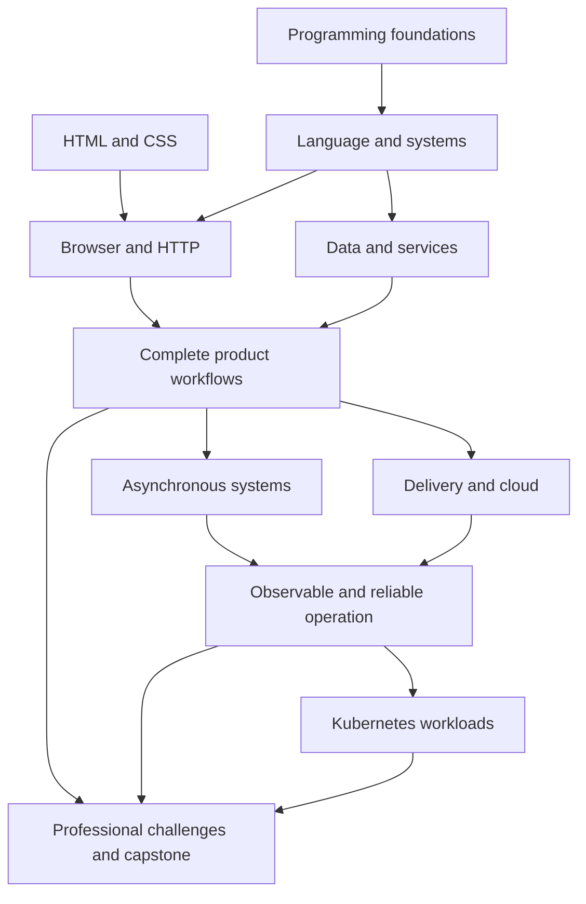

# Full-Stack Engineering Curriculum Architecture v1

## 1. Purpose, Authority, and Scope

This document turns the reviewed Graduate Competency Standard v1.1 into a complete module-level curriculum architecture. It defines the learning sequence, prerequisite model, project lines, milestone assessments, coverage of every required competency, and an initial risk and assessment experiment plan. It includes detailed design for the first representative learning trials so the next authoring task is concrete.

The source standard remains authoritative for graduate outcomes, depth, P targets, H-level help, critical rules, and graduation gates. This architecture owns module IDs, sequencing, project placement, planned evidence opportunities, and the trial designs below. Displayed depth and target fields are copied from the identified standard; they are not independently redefined here. Standard changes require an explicit impact review and a new architecture version.

The eventual program remains extensive: programming, browser and frontend work, backend services, data, networking, security, real Git workflows, Linux, Docker, cloud infrastructure, infrastructure as code, CI/CD, Kubernetes, observability, reliability, engineering judgment, and communication. Learners execute and investigate their own work locally or in explicitly provisioned training environments. The platform reviews evidence without executing arbitrary learner submissions.

This is a syllabus architecture, not a finished lesson library, working assessment engine, validated qualification, or application specification. Every module below is **planned for authoring**, including modules whose outcomes and evidence requirements are fully described. Specific runtime/framework/provider versions and numerical device requirements are not approved by this document; they belong in a tested environment manifest.

### Identifiers and Machine Use

| Identifier | Meaning | Ownership and interpretation |
| --- | --- | --- |
| S00 to S12 | Curriculum stages | Planning groups, not mandatory serial completion locks. |
| M001 to M068 | Modules | Stable units with explicit prerequisite modules, topics, effort estimates, and exit artifacts. |
| PJ01 to PJ05 | Project lines | Codebase families; each release will have its own source identity and fixture version. |
| MS01 to MS08 | Learning milestones | Readiness checks within the course; not new graduation credentials. |
| G1 to G11 | Graduation gates | Defined by the source standard; mapped here to planned assessment opportunities. |
| CP001 to CP020 | First-slice concepts | A deliberately limited concept graph; not the entire curriculum's detailed concept registry. |
| LS-prefixed IDs | First-slice lesson specifications | Detailed authoring sequence, with finished content still to be produced. |
| DOMAIN-NN.iNN | Proposed child indicators | Assessable parts of a source competency; an indicator does not replace its parent outcome. |
| RK01 to RK14 | Initial risks | Open hypotheses with owner roles, experiments, and decision deadlines. |
| EX01 to EX07 | Validation experiments | Planned investigations; no recruitment, spending, or execution has occurred. |

Module numbering supplies one usable default traversal of the dependency graph. A learner may take independent branches in another order. Dependencies mean demonstrated prerequisite capability; placement evidence can satisfy them without repeating instruction. No learner gains competency credit merely because a module is complete or an ID appears in a table.

## 2. Learner Path, Depth, and Progression

The default audience is a motivated beginner with basic computer literacy. Preparation covers files, safe installation, editor use, technical vocabulary, and the arithmetic/logic needed for first programs. There is no hidden assumption of prior Git, Linux, JavaScript, databases, Docker, or cloud experience.

Experienced learners may demonstrate prerequisites through bounded diagnostic tasks and explain their work. They receive credit for demonstrated capability, not job titles or self-reported familiarity. A diagnostic may skip instruction; it cannot silently skip an operational, security, collaboration, or graduation evidence requirement.

The sequence revisits important ideas. A beginner first learns enough about a process, a port, or a request to run a small program and inspect its behavior. Later modules deepen the execution, protocol, concurrency, and failure models. This prevents both unexplained abstractions and a long theoretical barrier before useful work.

- Security boundaries, accessibility, testing, documentation, and versioning begin early and recur. Their later specialist modules deepen habits already practiced.
- Independence is recorded through H0 to H5 separately from task difficulty L1 to L6. Documentation does not itself count as solution-specific help. Accessibility or setup support does not reduce an unrelated technical claim.
- Ordinary modules include small prediction, implementation, code-reading, and debugging exercises. A module exit artifact is not the only practice in that module.
- Learners can pause, request explanations, use a recovery snapshot, or enter a remedial unit. Supplied solutions remain learning evidence; a fresh task is needed for affected independence claims.
- Advancing means prerequisite readiness. A missing advanced indicator does not block unrelated learning, while unsafe activity is stopped and explained immediately.

### Stage Overview and Draft Effort

The following hours are author estimates of active learner work, including ordinary setup, reading, experiments, implementation, review responses, and assessment within each module. They are not observed completion times or statistical confidence intervals. See Section 9 for the estimation and calibration rules.

| Stage | Module range | Outcome | Draft active hours |
| --- | --- | --- | --- |
| S00 Entry and professional setup | M001 to M003 | Use a safe workspace, terminal, and repository; know how to get unstuck. | 26–48 |
| S01 Programming from first principles | M004 to M008 | Build, explain, test, and revise a useful command-line program. | 98–166 |
| S02 Language, systems, and engineering tools | M009 to M016 | Reason about execution, dependencies, types, resources, and computational cost. | 164–276 |
| S03 Browser and web foundations | M017 to M023 | Build accessible browser interactions and investigate requests with real tools. | 148–248 |
| S04 Data and secure backend engineering | M024 to M032 | Own a relational API with enforced invariants, identity, permissions, and recovery. | 218–362 |
| S05 Frontend and complete product workflows | M033 to M037 | Deliver accessible cross-layer features and diagnose browser/application failures. | 128–212 |
| S06 Quality, security, collaboration, and design | M038 to M042 | Improve unfamiliar systems, review work, investigate vulnerabilities, and defend choices. | 132–218 |
| S07 Asynchronous and supporting systems | M043 to M048 | Handle stale state, duplicate work, files, search, real-time delivery, and partial failure. | 130–218 |
| S08 Containers, delivery, and real cloud operation | M049 to M054 | Build reproducible environments, provision infrastructure, and release safely. | 138–228 |
| S09 Observability, performance, and reliability | M055 to M057 | Measure user impact, diagnose bottlenecks, recover service, and verify recovery. | 78–130 |
| S10 Kubernetes application operation | M058 to M060 | Deploy, secure, inspect, change, and repair real Kubernetes workloads. | 66–108 |
| S11 Independent professional challenges | M061 to M064 | Demonstrate transfer in unfamiliar code, incidents, security reviews, and research. | 104–172 |
| S12 Capstone and readiness review | M065 to M068 | Design, deliver, operate, change, and defend an independently built system. | 208–356 |
| Total planning envelope | 68 modules | Complete proposed program, including capstone. | 1,638–2,742 |

### Dependency Overview

This diagram shows major relationships only. The exact module prerequisite lists in Section 3 are the authoritative graph for this version; later revisits are not hard prerequisite edges.

## 3. Complete Module-Level Syllabus

Every module record contains an authored scope, explicit hard prerequisites, a primary project, and a concrete exit artifact or failure investigation. The topic lists describe planned coverage; they do not claim that each topic already has a finished lesson. A supported alternative tool may change examples while preserving the required behavior.

The source standard defines P and depth targets per competency, not per module. Early attempts can be guided; a later integrated or fresh scenario is where independent and adaptive performance is tested. Read the coverage matrix in Section 6 alongside this syllabus.

### S00 Entry and professional setup

Use a safe workspace, terminal, and repository; know how to get unstuck.

#### M001 Orientation, access, and safe setup

**Hard prerequisites:** None; use the entry diagnostic. **Primary project:** PJ01. **Draft active effort:** 6–12 hours.

**Planned topics:** Files and folders; editor navigation; installing approved tools; synthetic data; permissions; accessible input; learning versus assessment; help and evidence disclosure.

**Exit artifact or investigation:** A checked workspace and a recovery note; identify an unsafe instruction before running it.

#### M002 Terminal and local program operation

**Hard prerequisites:** M001. **Primary project:** PJ01. **Draft active effort:** 10–18 hours.

**Planned topics:** Paths; commands and arguments; quoting; standard streams; exit codes; environment variables; processes; reading errors; locating a missing executable.

**Exit artifact or investigation:** Reproduce and repair a path or environment problem using a short command log.

#### M003 Git as change history

**Hard prerequisites:** M002. **Primary project:** PJ01. **Draft active effort:** 10–18 hours.

**Planned topics:** Working tree, index, commits, branches, remotes; focused diffs; ignores; synthetic-secret handling; first pull-request-style exchange; safe undo preview.

**Exit artifact or investigation:** An inspectable repository with focused commits and a reviewed revision; recover an accidentally edited file.

### S01 Programming from first principles

Build, explain, test, and revise a useful command-line program.

#### M004 Values, expressions, and first programs

**Hard prerequisites:** M002. **Primary project:** PJ01. **Draft active effort:** 16–28 hours.

**Planned topics:** Literal values; variables; assignment; arithmetic and Boolean logic; strings; input/output; execution order; tracing; errors versus expected results.

**Exit artifact or investigation:** A small input-to-output program with written predictions and corrected boundary examples.

#### M005 Control flow, functions, and decomposition

**Hard prerequisites:** M004. **Primary project:** PJ01. **Draft active effort:** 20–34 hours.

**Planned topics:** Conditions; loops; functions; parameters; return values; scope introduction; invariants; breaking a brief into small behaviors; avoiding accidental infinite loops.

**Exit artifact or investigation:** An independently structured calculator or record validator with a trace explaining a loop defect.

#### M006 Collections and everyday algorithms

**Hard prerequisites:** M005. **Primary project:** PJ01. **Draft active effort:** 20–34 hours.

**Planned topics:** Arrays, records, maps, sets; iteration; search, grouping, sorting, deduplication; mutation versus new values; recursion intuition; input and output examples.

**Exit artifact or investigation:** A searchable record report with duplicate and empty-input handling; compare two data-structure choices.

#### M007 Errors, tests, and debugging habits

**Hard prerequisites:** M006. **Primary project:** PJ01. **Draft active effort:** 18–30 hours.

**Planned topics:** Assertions; focused unit tests; boundaries; debugger and breakpoints; exceptions; stack traces; hypotheses; minimal reproduction; experiments and investigation notes.

**Exit artifact or investigation:** A tested fix for an unfamiliar small program, including an initially wrong hypothesis and useful evidence.

#### M008 Project: a useful command-line tool

**Hard prerequisites:** M003, M007. **Primary project:** PJ01. **Draft active effort:** 24–40 hours.

**Planned topics:** Brief clarification; file-based input with synthetic fixtures; explicit errors; small modules; tests; Git review; README; scope and effort notes; requested help.

**Exit artifact or investigation:** Release FieldKit with a fresh requirement change and a short explanation/defense; no framework scaffold.

### S02 Language, systems, and engineering tools

Reason about execution, dependencies, types, resources, and computational cost.

#### M009 JavaScript semantics and identity

**Hard prerequisites:** M005, M006. **Primary project:** PJ01. **Draft active effort:** 18–30 hours.

**Planned topics:** Coercion and equality; value and reference behavior; copying; mutation; lexical scope; closures; higher-order functions; predictable code versus memorized output.

**Exit artifact or investigation:** Prediction and repair of closure/mutation defects, followed by a changed-input transfer task.

#### M010 Objects, modules, and boundaries

**Hard prerequisites:** M009. **Primary project:** PJ01. **Draft active effort:** 18–30 hours.

**Planned topics:** Properties; prototypes; classes; this binding; modules and exports; dependency direction; composition; object modeling; readable feature boundaries.

**Exit artifact or investigation:** Restructure part of FieldKit and repair an unfamiliar module or object-model defect.

#### M011 TypeScript and runtime contracts

**Hard prerequisites:** M010. **Primary project:** PJ01. **Draft active effort:** 24–40 hours.

**Planned topics:** Inference; narrowing; unions; generics; structural types; type guards; unknown external data; validation; documented unsafe boundaries; generated/dependency ownership.

**Exit artifact or investigation:** Migrate a feature to TypeScript while retaining runtime checks; explain why a passing compile misses a bad input.

#### M012 Asynchronous execution and cancellation

**Hard prerequisites:** M007, M010. **Primary project:** PJ01. **Draft active effort:** 24–40 hours.

**Planned topics:** Promises; tasks and microtasks; browser/Node distinctions; timers; asynchronous iteration; concurrency versus parallelism; cancellation; propagated and lost errors.

**Exit artifact or investigation:** Predict ordering, reproduce a race, and repair a bounded asynchronous workflow with cancellation and error tests.

#### M013 Dependencies, builds, and repeatable tooling

**Hard prerequisites:** M011, M012. **Primary project:** PJ01. **Draft active effort:** 16–28 hours.

**Planned topics:** Runtime selection; package graphs; manifests and lockfiles; version constraints; scripts; source maps; lint/format; build outputs; dependency updates and supply-chain boundaries.

**Exit artifact or investigation:** Clean setup plus a controlled dependency upgrade, with an explained incompatible change and verification.

#### M014 How programs use a computer

**Hard prerequisites:** M012. **Primary project:** PJ01. **Draft active effort:** 18–30 hours.

**Planned topics:** CPU, memory, storage; processes, threads, descriptors, system calls; compilation and runtimes; stack/heap/GC; resource contention; text, numeric precision, clocks and serialization.

**Exit artifact or investigation:** Trace a running program and reproduce an encoding, time, precision, blocking, or memory defect.

#### M015 Linux service operation and automation

**Hard prerequisites:** M002, M014. **Primary project:** PJ03. **Draft active effort:** 22–38 hours.

**Planned topics:** Permissions and ownership; process signals; services; ports; logs; resource inspection; package paths; defensive shell; idempotent setup; exit and partial-failure handling.

**Exit artifact or investigation:** Repair a failed local service and deliver a safe repeatable diagnostic/setup script.

#### M016 Data structures, complexity, and measurement

**Hard prerequisites:** M006, M007, M014. **Primary project:** PJ01. **Draft active effort:** 24–40 hours.

**Planned topics:** Time/space cost; arrays, linked structures, queues, trees, heaps, graphs; traversal; repeated work; recursion limits; units, distributions, simple measurement and I/O tradeoffs.

**Exit artifact or investigation:** Replace a measured bottleneck, explain input-shape limits, and test an alternative structure on new data.

### S03 Browser and web foundations

Build accessible browser interactions and investigate requests with real tools.

#### M017 Semantic HTML and accessible documents

**Hard prerequisites:** M001. **Primary project:** PJ02. **Draft active effort:** 16–28 hours.

**Planned topics:** Document structure; links; landmarks; images and text alternatives; native controls; names and labels; keyboard navigation; introductory screen-reader use.

**Exit artifact or investigation:** A usable support directory whose key navigation works with keyboard and a screen reader.

#### M018 CSS, layout, and responsive behavior

**Hard prerequisites:** M017. **Primary project:** PJ02. **Draft active effort:** 24–40 hours.

**Planned topics:** Cascade; specificity; inheritance; box model; positioning; stacking; flexbox/grid; responsive content; zoom; contrast; motion; content expansion.

**Exit artifact or investigation:** Repair a layout that fails with zoom or long content and explain the underlying cascade/layout cause.

#### M019 DOM, events, forms, and browser debugging

**Hard prerequisites:** M009, M017, M018. **Primary project:** PJ02. **Draft active effort:** 22–36 hours.

**Planned topics:** Navigation and page lifecycle; DOM updates; event propagation/defaults; focus; validation; error recovery; loading/empty/error states; DevTools; rendering observations.

**Exit artifact or investigation:** An accessible request-intake form and a diagnosed event/focus defect in unfamiliar JavaScript.

#### M020 HTTP requests and a local web server

**Hard prerequisites:** M012, M013, M019. **Primary project:** PJ02. **Draft active effort:** 20–34 hours.

**Planned topics:** URL and origin basics; local address/port; request/response; methods, status, headers and body; JSON/text; curl; browser Network; a small inspectable Node server.

**Exit artifact or investigation:** Trace a request and implement a bounded response contract; distinguish connection failure from an HTTP error.

#### M021 Caching, conditional requests, and origins

**Hard prerequisites:** M020. **Primary project:** PJ02. **Draft active effort:** 20–34 hours.

**Planned topics:** Freshness versus validation; validators; conditional responses; representation identity; browser caching; redirects; introductory cookies, same-origin/CORS and cache boundaries.

**Exit artifact or investigation:** Diagnose a stale representation with captured requests and a source fix, then solve a fresh validator variant.

#### M022 Networking, DNS, TLS, and intermediaries

**Hard prerequisites:** M015, M020. **Primary project:** PJ03. **Draft active effort:** 28–46 hours.

**Planned topics:** Addresses/subnets/routes/NAT/firewalls; sockets; TCP, UDP, QUIC; HTTP versions; DNS layers and TTL; certificate trust/renewal; proxies, balancing, CDN and forwarded information.

**Exit artifact or investigation:** A layered network investigation with DNS/TLS/proxy evidence; locate the failing hop and explain transport limits.

#### M023 Browser storage, lifecycle, and offline failure

**Hard prerequisites:** M019, M021. **Primary project:** PJ02. **Draft active effort:** 18–30 hours.

**Planned topics:** Cookies versus local/session storage; browser cache; service-worker lifecycle; stale assets; reload/navigation; origin security; compatibility; rendering/memory tools and stale client state.

**Exit artifact or investigation:** Repair a stale/offline workflow across two browsers or sessions with an explicit persistence and reset model.

### S04 Data and secure backend engineering

Own a relational API with enforced invariants, identity, permissions, and recovery.

#### M024 Relational modeling and SQL foundations

**Hard prerequisites:** M007, M015. **Primary project:** PJ02. **Draft active effort:** 28–46 hours.

**Planned topics:** PostgreSQL client and local service; entities/keys/relations; nullability; normalization; constraints; CRUD; joins; domain examples; money/time representation; parameterized queries.

**Exit artifact or investigation:** A schema and query set that encodes support-workflow invariants and rejects invalid shared facts.

#### M025 SQL depth, indexes, and query plans

**Hard prerequisites:** M016, M024. **Primary project:** PJ02. **Draft active effort:** 28–46 hours.

**Planned topics:** Aggregates; CTEs; window functions; set operations; representative distributions; B-tree intuition; selectivity; composite/covering indexes; EXPLAIN; statistics and query cost.

**Exit artifact or investigation:** A slow-query investigation with a useful and an unhelpful index and a justified before/after measurement.

#### M026 Transactions and concurrent data integrity

**Hard prerequisites:** M012, M024. **Primary project:** PJ02. **Draft active effort:** 24–40 hours.

**Planned topics:** Atomicity; isolation; locks; deadlocks; anomalies; unique/exclusion constraints; retries; transaction boundaries; duplicate operations; controlled concurrent clients.

**Exit artifact or investigation:** Reproduce and repair a reservation or state-transition race, preserving invariants under repeated concurrent trials.

#### M027 Data change, pools, backups, and restore

**Hard prerequisites:** M025, M026. **Primary project:** PJ02. **Draft active effort:** 24–40 hours.

**Planned topics:** Migration compatibility; backfills; roll-forward/rollback; connection pools; database permissions; backup/restore; retention and deletion assumptions; recoverability verification.

**Exit artifact or investigation:** A staged migration plus a restored dataset with checked invariants; diagnose pool exhaustion or a failed migration.

#### M028 Application data access and ORM limits

**Hard prerequisites:** M011, M027. **Primary project:** PJ02. **Draft active effort:** 18–30 hours.

**Planned topics:** Database access boundaries; ORM/query-builder models; generated SQL; loading/joins; query counts; transaction propagation; pagination; escape to SQL; alternative store selection.

**Exit artifact or investigation:** Repair an ORM N+1 or transaction leak with visible SQL and explain when a different store is justified.

#### M029 Node services and resource boundaries

**Hard prerequisites:** M012, M013, M020, M028. **Primary project:** PJ02. **Draft active effort:** 24–40 hours.

**Planned topics:** Server lifecycle; routing/middleware; dependency initialization; shutdown; validation; bounded inputs and streams; connections; timeouts; logging; layered business/persistence boundaries.

**Exit artifact or investigation:** Implement a tested API feature with useful errors and graceful failure; investigate a resource or lifecycle defect.

#### M030 API contracts and secure integration

**Hard prerequisites:** M022, M029. **Primary project:** PJ02. **Draft active effort:** 24–40 hours.

**Planned topics:** REST/RPC/GraphQL comparison; pagination; errors; compatibility; idempotency; webhooks; runtime contracts; client/server trust; injection and request boundaries; minimal threat models.

**Exit artifact or investigation:** A contract review and changed-client integration task with explicit invariants, allowed inputs, and failure behavior.

#### M031 Authentication, sessions, and delegated identity

**Hard prerequisites:** M021, M026, M030. **Primary project:** PJ02. **Draft active effort:** 24–40 hours.

**Planned topics:** Authentication versus authorization; vetted password/session tooling; token validation; cookies; OAuth/OIDC purposes; rotation, expiry and recovery; secret handling; observed trust boundaries.

**Exit artifact or investigation:** Integrate identity, test invalid/expired/replayed credentials as relevant, and explain a recovery or validation defect.

#### M032 Authorization, tenants, and data lifecycle

**Hard prerequisites:** M027, M031. **Primary project:** PJ02. **Draft active effort:** 24–40 hours.

**Planned topics:** Object/action permissions; tenant boundaries; roles and attributes; jobs/storage paths; ownership change; account deletion; audit/redaction; browser/server controls and explicit denial tests.

**Exit artifact or investigation:** A cross-tenant permission matrix and regression-protected repair, including an ownership or retention change.

### S05 Frontend and complete product workflows

Deliver accessible cross-layer features and diagnose browser/application failures.

#### M033 Components, rendering, and frontend state

**Hard prerequisites:** M011, M019, M023. **Primary project:** PJ02. **Draft active effort:** 26–44 hours.

**Planned topics:** Component identity; rendering/reconciliation; state preservation; props; effects, refs and context; local versus shared state; native semantics retained through components.

**Exit artifact or investigation:** A component feature plus prediction and diagnosis of a state/effect defect.

#### M034 Routes, server state, and asynchronous UI

**Hard prerequisites:** M030, M033. **Primary project:** PJ02. **Draft active effort:** 24–40 hours.

**Planned topics:** Routing/URL state; server versus client/form state; data loading; invalidation; optimistic updates; cancellation; retries; pagination; race handling and navigation recovery.

**Exit artifact or investigation:** Repair stale or out-of-order data across routes and defend a state-placement decision.

#### M035 Accessible product workflows and localization

**Hard prerequisites:** M032, M034. **Primary project:** PJ02. **Draft active effort:** 22–36 hours.

**Planned topics:** Complex forms; client/server validation; submission state; unsaved work; destructive and denied states; keyboard/screen-reader flows; locale/date/number/plural/text-direction changes.

**Exit artifact or investigation:** An end-to-end accessible workflow with an unfamiliar locale or permission condition and documented manual checks.

#### M036 Rendering strategies and frontend performance

**Hard prerequisites:** M016, M023, M034. **Primary project:** PJ02. **Draft active effort:** 24–40 hours.

**Planned topics:** Client/server/static rendering; hydration and streaming; bundle/image loading; interactions; layout/paint; profiling; memory; caching constraints; compatibility and SEO/product tradeoffs.

**Exit artifact or investigation:** Prototype client and server rendering paths, fix a measured bottleneck, and defend the strategy under changed constraints.

#### M037 Project: one complete feature across the stack

**Hard prerequisites:** M027, M035, M036. **Primary project:** PJ02. **Draft active effort:** 32–52 hours.

**Planned topics:** Requirement examples; browser/API/data contracts; identity and side effects; integration/E2E tests; diagnostics; architecture notes; review; a material product change.

**Exit artifact or investigation:** A reviewed cross-layer feature and later changed requirement with evidence of correctness, access, recovery, and traceability.

### S06 Quality, security, collaboration, and design

Improve unfamiliar systems, review work, investigate vulnerabilities, and defend choices.

#### M038 Risk-based testing and diagnostic quality

**Hard prerequisites:** M037. **Primary project:** PJ02. **Draft active effort:** 28–46 hours.

**Planned topics:** Unit/integration/E2E strategy; contracts; test doubles; fixtures and clocks; isolation; flakiness; property/fuzz/mutation methods where useful; coverage limits; accessibility/security tests.

**Exit artifact or investigation:** Improve a misleading test suite, expose an escaped defect, and justify test boundaries and omissions.

#### M039 Code archaeology and architecture repair

**Hard prerequisites:** M038. **Primary project:** PJ04. **Draft active effort:** 28–46 hours.

**Planned topics:** Repository/history map; cohesion/coupling; ownership; dependency direction; cyclic/leaky modules; pattern selection; incremental refactoring; configuration and feature flags.

**Exit artifact or investigation:** Map an unfamiliar repository, make a safe behavior-preserving repair, and absorb a changed requirement.

#### M040 Collaboration, Git recovery, and AI verification

**Hard prerequisites:** M003, M039. **Primary project:** PJ04. **Draft active effort:** 24–40 hours.

**Planned topics:** Semantic merge/rebase; reflog/revert/reset; bisect; review etiquette; interfaces and ownership; handoff; AI claim/source verification; generated-change accountability; assistance-limited work.

**Exit artifact or investigation:** A peer/assessor integration exercise, history recovery, and correction of a plausible but defective generated change.

#### M041 Authorized application security laboratories

**Hard prerequisites:** M032, M038. **Primary project:** PJ04. **Draft active effort:** 28–46 hours.

**Planned topics:** Injection/XSS/CSRF/SSRF/traversal/upload/deserialization classes; session/tenant defects; secrets; dependency risk; threat modeling; privacy requirements; scope, containment, repair and regression.

**Exit artifact or investigation:** Find and safely demonstrate a scoped defect, fix the class, reject an incomplete fix, and explain the data/supply-chain impact.

#### M042 Requirements and engineering design decisions

**Hard prerequisites:** M037, M039. **Primary project:** PJ02. **Draft active effort:** 24–40 hours.

**Planned topics:** Stakeholder questions; quality budgets; constraints/capacity; architecture views; modular monolith/services/serverless; buy/build; ADRs; risks, estimation, user evidence and ownership.

**Exit artifact or investigation:** A defended design with credible alternatives, a bounded delivery plan, and a revised decision after new evidence.

### S07 Asynchronous and supporting systems

Handle stale state, duplicate work, files, search, real-time delivery, and partial failure.

#### M043 Redis and cache correctness

**Hard prerequisites:** M026, M030, M038. **Primary project:** PJ02. **Draft active effort:** 20–34 hours.

**Planned topics:** Cache placement; keys/tenant scope; invalidation/expiry; stale data; warming; stampedes; source of truth; failure behavior; measuring whether a cache is justified.

**Exit artifact or investigation:** Repair a stale or cross-tenant cache and compare it with a simpler uncached design under load.

#### M044 Queues, jobs, events, and delivery guarantees

**Hard prerequisites:** M026, M030, M038. **Primary project:** PJ03. **Draft active effort:** 28–46 hours.

**Planned topics:** Scheduling; webhooks/email; delivery and ordering; idempotency; retries/backoff; poison/dead-letter work; outbox; schemas; replay; replication/partition/lag models.

**Exit artifact or investigation:** A worker and publication flow tested under duplicate delivery, partial completion, replay, and dependency outage.

#### M045 Files, streams, and object storage

**Hard prerequisites:** M030, M032, M038. **Primary project:** PJ02. **Draft active effort:** 20–34 hours.

**Planned topics:** Bounded streaming; size/type controls; names and metadata; signed access; quarantine assumptions; lifecycle/orphans; storage permissions; asynchronous user-visible states.

**Exit artifact or investigation:** A secure file workflow with a failed-upload cleanup and a denied cross-tenant access case.

#### M046 Search and derived data

**Hard prerequisites:** M025, M044. **Primary project:** PJ03. **Draft active effort:** 18–30 hours.

**Planned topics:** Search documents; relevance/filters; mappings; indexing pipeline; source-of-truth lag; pagination; rebuilds; permissions; alternative database-native search options.

**Exit artifact or investigation:** A searchable derived view that recovers after indexing failure and explains freshness and access limitations.

#### M047 Real-time and reconnecting clients

**Hard prerequisites:** M023, M034, M044. **Primary project:** PJ02. **Draft active effort:** 20–34 hours.

**Planned topics:** Polling/SSE/WebSockets; authorization; connection state; reconnect; missed events; ordering; presence; fan-out; backpressure; choosing a simpler transport.

**Exit artifact or investigation:** A live workflow that reconciles after disconnect and a defended transport choice under new constraints.

#### M048 Reliability across asynchronous workflows

**Hard prerequisites:** M043, M044, M045, M047. **Primary project:** PJ03. **Draft active effort:** 24–40 hours.

**Planned topics:** Timeout/retry budgets; compensation; reconciliation; deduplication; rate limits; load shedding; circuit/fallback decisions; cross-layer correlation; partial success and user recovery.

**Exit artifact or investigation:** A duplicate-side-effect or outage investigation with an invariant-preserving fix and a transfer scenario.

### S08 Containers, delivery, and real cloud operation

Build reproducible environments, provision infrastructure, and release safely.

#### M049 Container images and application processes

**Hard prerequisites:** M013, M015, M029. **Primary project:** PJ03. **Draft active effort:** 20–34 hours.

**Planned topics:** Images/layers/registries; namespaces/cgroups limits; host relation; multi-stage builds; build context; cache; non-root users; signals; secrets; reproducible artifacts.

**Exit artifact or investigation:** Build and inspect an application image, repair an image/process fault, and explain containment limits.

#### M050 Compose, networking, and persistent environments

**Hard prerequisites:** M027, M032, M049. **Primary project:** PJ03. **Draft active effort:** 22–36 hours.

**Planned topics:** Service discovery; published ports; localhost scope; volumes/bind mounts; health; readiness; dependencies; config; persistence; reset; host resource and architecture differences.

**Exit artifact or investigation:** A multi-service environment with verified reset and a repaired networking/persistence/health failure.

#### M051 CI pipelines and artifact provenance

**Hard prerequisites:** M038, M040, M050. **Primary project:** PJ03. **Draft active effort:** 22–36 hours.

**Planned topics:** Checks and builds; immutable identities; environment variants; caches; credentials and protected environments; approval boundaries; version tags; test diagnosis; source-to-release trace.

**Exit artifact or investigation:** A working pipeline and an investigated cache, permission, or artifact mismatch with controlled credentials.

#### M052 Cloud foundations, IAM, networks, and cost

**Hard prerequisites:** M022, M041, M050. **Primary project:** PJ03. **Draft active effort:** 24–40 hours.

**Planned topics:** One provider; compute/storage/data/queue selection; zones/regions; virtual networks/routes/firewalls; identities/policies; short-lived credentials; audit; cost drivers; budgets and cleanup.

**Exit artifact or investigation:** A reviewed cloud deployment plan and scoped IAM/network exercise with cost visibility and an actual shutdown/cleanup check.

#### M053 Infrastructure as code and real deployment

**Hard prerequisites:** M051, M052. **Primary project:** PJ03. **Draft active effort:** 28–46 hours.

**Planned topics:** Plans/state/modules; environments; dependencies; drift/imports; destructive changes; config/secrets; managed versus self-operated services; DNS/TLS; backups; deployment diagnostics.

**Exit artifact or investigation:** Provision and operate a controlled cloud application from reviewed infrastructure code; repair drift or denied access without broadening privilege.

#### M054 Safe releases and database compatibility

**Hard prerequisites:** M027, M044, M053. **Primary project:** PJ03. **Draft active effort:** 22–36 hours.

**Planned topics:** Rolling/blue-green/canary/recreate choices; feature flags; deployed identity; schema compatibility; old clients/workers; backfills; rollback/roll-forward; verification and release notes.

**Exit artifact or investigation:** A release and recovery exercise that preserves data and mixed-version behavior under a failed rollout.

### S09 Observability, performance, and reliability

Measure user impact, diagnose bottlenecks, recover service, and verify recovery.

#### M055 Logs, metrics, traces, and useful telemetry

**Hard prerequisites:** M048, M053. **Primary project:** PJ03. **Draft active effort:** 24–40 hours.

**Planned topics:** Structured correlated logs; redaction; metrics/dimensions/cardinality; histograms; traces across jobs/data; sampling; dashboards; retention and cost; product telemetry limits.

**Exit artifact or investigation:** Instrument a complete path and answer a defined operational question without exposing sensitive context.

#### M056 Profiling, load, and quantitative investigation

**Hard prerequisites:** M016, M025, M036, M055. **Primary project:** PJ03. **Draft active effort:** 26–44 hours.

**Planned topics:** CPU/memory/event-loop/browser/query/network profiles; units and percentiles; concurrency/capacity; variance/warmup; representative workloads; load/stress/endurance; stopping criteria and causal tests.

**Exit artifact or investigation:** A measured optimization with fresh data, tail behavior, correctness checks, and a defended limit on the conclusion.

#### M057 SLOs, incidents, recovery, and game days

**Hard prerequisites:** M027, M054, M056. **Primary project:** PJ03. **Draft active effort:** 28–46 hours.

**Planned topics:** User indicators/objectives; actionable alerts; triage; communication; mitigation; evidence timelines; backup/restore and recovery objectives; controlled failure injection; postmortem actions.

**Exit artifact or investigation:** An observed incident and restore with safe stop conditions, a handoff/runbook, and verified corrective actions.

### S10 Kubernetes application operation

Deploy, secure, inspect, change, and repair real Kubernetes workloads.

#### M058 Kubernetes model and workload deployment

**Hard prerequisites:** M050, M052, M055. **Primary project:** PJ03. **Draft active effort:** 22–36 hours.

**Planned topics:** API and desired state; controllers/scheduling; pods/nodes; Deployments, StatefulSets when warranted, Jobs/CronJobs; Services/Ingress; namespaces; application versus platform ownership.

**Exit artifact or investigation:** Deploy real workloads to a local or controlled cluster and trace reconciliation and service reachability.

#### M059 Kubernetes configuration, access, health, and resources

**Hard prerequisites:** M048, M058. **Primary project:** PJ03. **Draft active effort:** 22–36 hours.

**Planned topics:** ConfigMaps/Secrets; identities/RBAC; network controls; startup/readiness/liveness; requests/limits; pending/throttled/OOM behavior; autoscaling and disruption; dependency-failure effects.

**Exit artifact or investigation:** Diagnose a scoped unhealthy or unreachable workload and repair access/probes/resources using observed evidence.

#### M060 Kubernetes changes and operational judgment

**Hard prerequisites:** M054, M057, M059. **Primary project:** PJ03. **Draft active effort:** 22–36 hours.

**Planned topics:** kubectl/events/logs/endpoints/metrics; rollouts/rollback; configuration and data migrations; scale; application fault versus cluster responsibility; simpler deployment alternatives.

**Exit artifact or investigation:** A fresh workload incident and compatible rollout; defend when Kubernetes is unnecessary without waiving its practical demonstration.

### S11 Independent professional challenges

Demonstrate transfer in unfamiliar code, incidents, security reviews, and research.

#### M061 Unfamiliar product change and team handoff

**Hard prerequisites:** M040, M041, M048, M054. **Primary project:** PJ04. **Draft active effort:** 32–52 hours.

**Planned topics:** New repository/history; ambiguous brief; cross-layer change; client/server/data contracts; architecture repair; focused tests; semantic merge; peer negotiation; accessible workflow; review response.

**Exit artifact or investigation:** A fresh H0 feature/change episode with individual attribution, integrated verification, and a usable handoff.

#### M062 Production investigation with incomplete evidence

**Hard prerequisites:** M057, M061. **Primary project:** PJ04. **Draft active effort:** 24–40 hours.

**Planned topics:** Misleading reports; noisy telemetry; data/query/concurrency/caching/search-pipeline/resource failures; reproduction; mitigation; measured fix; safe recovery; postmortem and follow-up change.

**Exit artifact or investigation:** An H0 incident investigation with an evidence timeline, root-boundary repair, regression protection, and defended uncertainty.

#### M063 Security and integrity design review

**Hard prerequisites:** M041, M053, M061. **Primary project:** PJ04. **Draft active effort:** 24–40 hours.

**Planned topics:** Fresh authorized application/infrastructure target; tenant access; data integrity/privacy; secret/dependency/configuration defects; controlled proof; remediation alternatives; human-reviewed critical findings.

**Exit artifact or investigation:** A bounded H0 security review and verified repair, with explicit authorization and no third-party targets.

#### M064 System design, unfamiliar technology, and Heroic inquiry

**Hard prerequisites:** M042, M060, M062, M063. **Primary project:** PJ04. **Draft active effort:** 24–40 hours.

**Planned topics:** Constraint/capacity/cost tradeoffs; synchronous versus events; monolith/services/build-buy; specialist escalation; primary-source research; bounded unfamiliar integration; above-target investigation and defense.

**Exit artifact or investigation:** An H0 bounded research/design task plus a separately timeboxed Heroic learning investigation; solving the Heroic task is optional.

### S12 Capstone and readiness review

Design, deliver, operate, change, and defend an independently built system.

#### M065 Capstone brief, architecture, and evidence plan

**Hard prerequisites:** M046, M064. **Primary project:** PJ05. **Draft active effort:** 24–40 hours.

**Planned topics:** Stakeholder clarification; user journeys; invariants; permissions; data/API/threat models; quality budgets; ADRs; delivery slices; evidence blueprint; risks and exclusions.

**Exit artifact or investigation:** An approved bounded product and assessment plan, including cloud, accessibility, change, incident, and recovery obligations.

#### M066 Capstone implementation and engineering review

**Hard prerequisites:** M065. **Primary project:** PJ05. **Draft active effort:** 100–170 hours.

**Planned topics:** Independent frontend/backend/data implementation; identity/permissions; async workflow; selected storage/search/cache; tests; accessible states; history; collaboration/review; evolving design notes.

**Exit artifact or investigation:** A credible product release candidate with verified core journeys and checkpoint reviews; no tutorial/reference replica.

#### M067 Capstone delivery, observability, and recovery

**Hard prerequisites:** M060, M066. **Primary project:** PJ05. **Draft active effort:** 40–70 hours.

**Planned topics:** Container setup; CI; infrastructure code; controlled cloud deployment; secret/access boundaries; telemetry; performance budget; backups/restore; runbooks; cost and cleanup verification.

**Exit artifact or investigation:** An operated release with observable behavior, restored data, traceable artifacts, and recovery proof.

#### M068 Capstone change, failure, and readiness defense

**Hard prerequisites:** M067. **Primary project:** PJ05. **Draft active effort:** 44–76 hours.

**Planned topics:** Material requirement change; scale/capacity constraint; incident; security/integrity review; fresh verification of selected older evidence; individual defense; appeals/remediation plan.

**Exit artifact or investigation:** A signed evidence-based readiness decision or explicit missing-evidence plan; complete gate coverage is checked, never inferred from project size.

## 4. Dependency Rules and Entry Checks

The complete hard module graph is expressed in the module records. All prerequisites must exist and form an acyclic graph. Module IDs are never reused for a different scope. A future split preserves the parent and introduces child units; a curriculum release records transitions for active learners.

| Relationship | Meaning | Example |
| --- | --- | --- |
| Hard prerequisite | The next activity depends on a specific capability already demonstrated. | M026 needs basic asynchronous/concurrency reasoning from M012 and relational operations from M024. |
| Suggested background | Helpful context that can be introduced or repaired without blocking the whole module. | Broader DNS internals are useful for HTTP work but are not required before the first local request in M020. |
| Co-requisite | Two bounded activities can be taught together without assuming either has been mastered first. | A first request trace can introduce a local port and response headers in the same unit. |
| Later revisit | A concept is reused with new mechanics or constraints. It must not create a hard cycle. | Request caching in M021 returns as application cache correctness in M043 and deployment compatibility in M054. |
| Placement equivalence | Demonstrated prior skill satisfies the prerequisite outcome. | A learner can demonstrate Git basics and safely enter a later module without replaying M003. |

Entry checks are short and diagnostic. For example, before M020 a learner must be able to run and stop the supplied local server, trace a small asynchronous function, edit a module, and inspect a browser request. If one component is missing, provide a targeted bridge. Do not require an entire unrelated stage to be repeated.

### First-Slice Concept Graph

Only the concepts required for the initial learning trials are expanded here. Each hard edge is stated explicitly. A concept's depth is the narrow form described in the table; CP016 does not imply mastery of all networking in M022.

| Concept | Narrow prerequisite model | Hard concept prerequisites | Initial module |
| --- | --- | --- | --- |
| CP001 | Safe local workspace, synthetic data, help and permission boundaries | None | M001 |
| CP002 | Paths, command arguments, output, and exit status | CP001 | M002 |
| CP003 | Values, variables, expressions, and function calls | CP002 | M004 |
| CP004 | Trace conditions and loops against concrete input | CP003 | M005 |
| CP005 | Assert a behavior and interpret a failing example | CP004 | M007 |
| CP006 | Trace a bounded asynchronous handler and its error path | CP005 | M012 |
| CP007 | Find and edit a module and run an approved package script | CP003 | M013 |
| CP008 | Identify the source snapshot and inspect a focused diff | CP002 | M003 |
| CP009 | Locate a browser request and inspect its evidence | CP001 | M019 |
| CP010 | Distinguish request, response, status, headers, and body | CP006, CP009, CP016 | M020 |
| CP011 | Distinguish a resource from its selected representation | CP010 | M020 |
| CP012 | Explain stored response, freshness, and validation as different concepts | CP011 | M021 |
| CP013 | Relate a validator and a conditional request to the current representation | CP012 | M021 |
| CP014 | Change one relevant variable to distinguish two hypotheses | CP004 | M007 |
| CP015 | Distinguish an observation, a learner report, and an inference | CP001 | M001 |
| CP016 | Identify a running process, local address, and listening port | CP002 | M020 |
| CP017 | Explain the application process and network boundary inside a container | CP007, CP016 | M049 |
| CP018 | Distinguish container service discovery and host port publication | CP017 | M050 |
| CP019 | Correlate process, health, request, and log observations | CP018 | M050 |
| CP020 | Confirm a lab target, obey a stop condition, and verify reset | CP001, CP002 | M002 |

CP identifiers are architectural concepts, not additional graduation competencies. Before publishing any later module, expand its specific prerequisite concepts and check for hidden dependencies. The module-level map makes this possible without pretending that all future lesson detail has already been authored.

## 5. Cumulative Projects and Recovery

Five project lines provide different kinds of evidence. Names are working educational themes, not product brands or instructions to create external repositories now. All repositories, histories, data, and intentionally defective variants still need authoring and release review.

| Project | Purpose and evolution | Main milestones | Distinct evidence |
| --- | --- | --- | --- |
| PJ01 FieldKit | A local record/log inspection tool: first programs become functions, collections, tests, a CLI, typed boundaries, controlled dependencies, and measured algorithms. | M008 useful release; M011 typed change; M013 clean setup; M016 measured improvement. | Programming from scratch, boundary cases, research notes, Git history, and algorithmic judgment without framework scaffolding. |
| PJ02 SupportDesk | An accessible service directory becomes request intake, relational case workflows, identity/tenant boundaries, frontend state, files, caching, and reconnecting clients. | M019 accessible intake; M032 secure data service; M037 complete feature; M043 to M048 supporting-system integrations. | Consequences of early schema, route, state, and component decisions as product requirements accumulate. |
| PJ03 DispatchLab | A course-owned service/worker environment evolves through Linux operation, networking, job delivery, search, containers, cloud, release pipelines, telemetry, incidents, and Kubernetes. | M015 process repair; M044 reliable worker; M050 repeatable services; M053 real cloud; M057 recovery; M060 cluster operation. | Operational state, duplicate work, dependency failure, deployment identity, safe cleanup, and systems diagnosis. |
| PJ04 InheritedWorks | Several unfamiliar training repositories with believable history, tests, notes, defects, and contributor changes; the learner must orient before changing them. | M039 archaeology/refactor; M040 shared change; M041 security labs; M061 to M064 professional challenges. | Transfer beyond familiar project structure, semantic conflicts, evidence discrimination, review, security, and bounded research. |
| PJ05 Independent capstone | A fresh product brief, preferably in a different domain from SupportDesk: for example, a multi-organization asset-reservation service with conflicting allocations, expiry, and notifications. | M065 design; M066 implementation; M067 operated release; M068 change, incident, and defense. | Individual product ownership under ambiguity, verified end-to-end behavior, safe operation, and adaptation. |

PJ02 and PJ03 may integrate through documented events or APIs. They remain separately understandable codebases with explicit contracts and owners. PJ04 must not be merely a renamed copy of an already solved repository. The capstone is not a requirement to reproduce the course's reference architecture.

### Project Release Contract

Each release requires a baseline source identity, supported environment manifest, seeded synthetic dataset, known-good state, intentional-fault manifest for assessors, reset instructions, acceptance observations, allowed targets, and cleanup verification. A learner-facing issue report must not disclose the defect location unless that is part of the guidance level. Unrelated noise must be explainable through investigation.

Preserve project history with milestone tags or equivalent immutable snapshots. Provide a rescue starting state after an unrecoverable local mistake, a long pause, or placement into a later stage. Record which code or diagnosis was supplied. Do not count an assisted rescue and its copied solution as fresh independent evidence.

Cumulative development and prerequisite remediation are different. A learner can use a correct prior milestone to study the next concept while the missing earlier competency remains visible. Graduation still requires closure of its evidence gap.

### Capstone Scope Boundaries

The baseline includes multiple users/organizations, authentication and authorization, relational invariants/migrations/restore, an accessible frontend, a coherent API, one meaningful asynchronous workflow, tests, cloud delivery, observable operation, and required engineering explanations. Use a supplied acceptance envelope with synthetic data and bounded quality budgets. No real payment processing or third-party security testing is needed to simulate serious correctness and authorization problems.

Optional caches, search, real-time features, and extra services require a product reason. Omitting them from the capstone does not waive the relevant competencies: their required demonstrations remain in PJ02/PJ03 and the coverage map. Kubernetes is a required practical course experience; a well-justified simpler capstone runtime remains acceptable.

M068 includes a requirement change, scale/capacity constraint, operational incident, and security/integrity review. One carefully designed scenario can cover several, but each observation must be explicit. “No architecture change is needed” can be defensible when measurements support it. Heroic investigation is separately scoped and does not require a successful solution.

## 6. Complete Competency Coverage Map

Each row below maps one of the 206 required practical competencies. **I** identifies an early introduction to at least part of the outcome, **P** identifies substantive practice, and **T** identifies a later integrated or fresh transfer/assessment opportunity. A parent with several behaviors will require multiple lesson indicators; the short assessment focus is an anchor, not an exhaustive replacement for the source outcome.

Every row has P and T in distinct modules. This supplies a planned route to repeated evidence; it does not prove two valid demonstrations exist. The assessment blueprint must still distinguish separate learning episodes, observed indicators, actual H levels, source/provenance, and recency. A resubmitted revealed solution does not create another demonstration. T tasks are designed for H0 where P3/P4 is claimed; each P4 claim needs a changed-context or ambiguity test and defense.

The I/P/T map also defines an evidence schedule: a transfer task is assigned only after the relevant practice and concept readiness are demonstrated, regardless of the order in which a learner explores module branches. Multi-scenario modules select or defer tasks accordingly. Module access does not imply readiness for every possible assessment variant inside it.

The gate column identifies a primary destination for evidence, not exclusive coverage or an additional exam. G1 conceptual checks and G10 defense can interrogate many rows, but cannot substitute for their practical work. General role calibration occurs in EX01. Most detailed indicators beyond Section 10 remain to be authored before their module is released.

### ENG coverage

| Competency | Depth | Target | I | P | T | Gate | Assessment focus |
| --- | --- | --- | --- | --- | --- | --- | --- |
| ENG-01 | Core | P4 | M008 | M042 | M065 | G7 | Clarify an ambiguous brief and expose a changed assumption. |
| ENG-02 | Core | P4 | M007 | M025 | M062 | G3 | Use competing hypotheses and a discriminating experiment. |
| ENG-03 | Core | P3 | M002 | M013 | M064 | G11 | Use primary sources and check version/context applicability. |
| ENG-04 | Core | P3 | M007 | M012 | M062 | G3 | Build a faithful minimal reproduction and explain its limits. |
| ENG-05 | Core | P4 | M013 | M040 | M064 | G7 | Research and verify a bounded unfamiliar integration at H0. |
| ENG-06 | Core | P4 | M007 | M022 | M062 | G3 | Separate an irrelevant warning from a causal failure. |
| ENG-07 | Core | P3 | M007 | M025 | M062 | G3 | Leave a source-linked investigation another engineer can continue. |

### SYS coverage

| Competency | Depth | Target | I | P | T | Gate | Assessment focus |
| --- | --- | --- | --- | --- | --- | --- | --- |
| SYS-01 | Core | P3 | M014 | M015 | M050 | G6 | Trace resources and descriptors through a failing service. |
| SYS-02 | Working | P2 | M014 | M049 | M051 | G6 | Explain and apply runtime/build distinctions in an artifact fault. |
| SYS-03 | Core | P3 | M009 | M014 | M056 | G4 | Diagnose retained memory or resource pressure from observations. |
| SYS-04 | Core | P3 | M012 | M026 | M062 | G3 | Reconstruct a race, lock, or blocking failure. |
| SYS-05 | Core | P3 | M014 | M024 | M061 | G2 | Preserve encoding, precision, time, and serialized state in a change. |
| SYS-06 | Core | P3 | M014 | M015 | M056 | G4 | Use process and resource observations to narrow a bottleneck. |

### LNX coverage

| Competency | Depth | Target | I | P | T | Gate | Assessment focus |
| --- | --- | --- | --- | --- | --- | --- | --- |
| LNX-01 | Core | P3 | M002 | M015 | M050 | G6 | Use safe paths, quoting, pipes, and file operations. |
| LNX-02 | Core | P3 | M002 | M015 | M057 | G6 | Inspect and control a failed process without losing evidence. |
| LNX-03 | Core | P3 | M001 | M015 | M050 | G6 | Repair ownership/permission failure without unnecessary privilege. |
| LNX-04 | Core | P3 | M015 | M050 | M053 | G6 | Automate setup/diagnosis with guarded inputs and partial failures. |
| LNX-05 | Core | P3 | M002 | M015 | M051 | G6 | Resolve executable, package, or environment assumptions. |
| LNX-06 | Core | P3 | M015 | M022 | M062 | G3 | Choose useful shell/log observations for an unfamiliar incident. |

### PRG coverage

| Competency | Depth | Target | I | P | T | Gate | Assessment focus |
| --- | --- | --- | --- | --- | --- | --- | --- |
| PRG-01 | Core | P4 | M004 | M009 | M061 | G2 | Explain and repair an unfamiliar identity/coercion/mutation defect. |
| PRG-02 | Core | P4 | M005 | M010 | M061 | G2 | Adapt function/module boundaries without breaking lexical assumptions. |
| PRG-03 | Core | P3 | M010 | M033 | M039 | G2 | Trace and repair object/property/this behavior in another codebase. |
| PRG-04 | Core | P4 | M012 | M034 | M062 | G3 | Predict and fix runtime-specific asynchronous ordering and errors. |
| PRG-05 | Core | P3 | M007 | M029 | M048 | G3 | Preserve error context and correct partial-failure control flow. |
| PRG-06 | Core | P3 | M011 | M028 | M061 | G2 | Model a new boundary with types and justified assertions. |
| PRG-07 | Core | P4 | M011 | M030 | M063 | G5 | Reject malformed external state using runtime invariants. |
| PRG-08 | Core | P3 | M013 | M033 | M051 | G6 | Configure and debug modules, scripts, source maps, and build tooling. |
| PRG-09 | Core | P3 | M004 | M008 | M016 | G2 | Decompose a fresh small program and verify boundary behavior. |
| PRG-10 | Core | P3 | M013 | M038 | M051 | G6 | Repair a dependency conflict and verify an upgrade/reproducible setup. |

### DSA coverage

| Competency | Depth | Target | I | P | T | Gate | Assessment focus |
| --- | --- | --- | --- | --- | --- | --- | --- |
| DSA-01 | Core | P3 | M016 | M025 | M056 | G4 | Explain complexity and observed costs for realistic input. |
| DSA-02 | Core | P3 | M006 | M016 | M046 | G4 | Choose a structure for changing lookup/order/traversal needs. |
| DSA-03 | Core | P3 | M006 | M016 | M061 | G2 | Implement correct traversal, grouping, search, or pagination. |
| DSA-04 | Core | P3 | M016 | M025 | M062 | G4 | Find repeated work or unbounded growth in unfamiliar code. |
| DSA-05 | Core | P4 | M016 | M043 | M064 | G7 | Defend computation/memory/I/O/latency tradeoffs after a constraint change. |
| DSA-06 | Core | P3 | M016 | M025 | M056 | G4 | Verify a measured algorithmic improvement on representative data. |

### GIT coverage

| Competency | Depth | Target | I | P | T | Gate | Assessment focus |
| --- | --- | --- | --- | --- | --- | --- | --- |
| GIT-01 | Core | P3 | M003 | M008 | M040 | G2 | Explain tree/index/reference state before recovering a change. |
| GIT-02 | Core | P3 | M003 | M008 | M061 | G2 | Create focused commits and a reviewable integrated change. |
| GIT-03 | Core | P4 | M003 | M040 | M061 | G2 | Resolve a semantic conflict and verify combined behavior. |
| GIT-04 | Core | P4 | M003 | M040 | M054 | G6 | Recover shared work without an unauthorized history rewrite. |
| GIT-05 | Core | P4 | M003 | M040 | M062 | G3 | Use history and bisect to locate a behavioral regression. |
| GIT-06 | Core | P3 | M003 | M037 | M061 | G2 | Submit a reviewable change and respond to substantive feedback. |
| GIT-07 | Core | P3 | M003 | M013 | M063 | G5 | Handle configuration, generated files, hooks, and secret history safely. |

### NET coverage

| Competency | Depth | Target | I | P | T | Gate | Assessment focus |
| --- | --- | --- | --- | --- | --- | --- | --- |
| NET-01 | Core | P3 | M020 | M022 | M053 | G6 | Trace address/route/port boundaries in a deployed failure. |
| NET-02 | Core | P3 | M022 | M053 | M062 | G3 | Investigate DNS records, caches, delegation, and stale answers. |
| NET-03 | Working | P3 | M022 | M047 | M062 | G3 | Distinguish protocol guarantees while diagnosing transport behavior. |
| NET-04 | Core | P4 | M020 | M021 | M054 | G2 | Preserve HTTP semantics under changed clients/cache/proxy conditions. |
| NET-05 | Core | P3 | M022 | M031 | M053 | G6 | Investigate certificate trust, hostname, termination, and renewal. |
| NET-06 | Core | P3 | M022 | M053 | M060 | G6 | Follow a request through proxy/load-balancer/service boundaries. |
| NET-07 | Core | P3 | M020 | M047 | M064 | G7 | Defend a transport choice under directionality and failure constraints. |
| NET-08 | Core | P4 | M020 | M022 | M062 | G3 | Use layered network evidence to isolate an unfamiliar failure. |

### BRW coverage

| Competency | Depth | Target | I | P | T | Gate | Assessment focus |
| --- | --- | --- | --- | --- | --- | --- | --- |
| BRW-01 | Core | P3 | M019 | M023 | M036 | G2 | Trace navigation/origin/frame/lifecycle effects on a workflow. |
| BRW-02 | Core | P3 | M019 | M033 | M035 | G2 | Repair DOM/event/default/focus behavior in a component flow. |
| BRW-03 | Core | P3 | M018 | M036 | M056 | G4 | Locate and explain layout/paint/interaction work. |
| BRW-04 | Core | P3 | M021 | M023 | M047 | G2 | Reconcile persistent/cache/client state after lifecycle changes. |
| BRW-05 | Core | P4 | M021 | M031 | M063 | G5 | Repair an origin/security integration without disabling protection. |
| BRW-06 | Core | P4 | M019 | M036 | M061 | G2 | Choose DevTools evidence that diagnoses an unfamiliar UI failure. |
| BRW-07 | Core | P3 | M023 | M036 | M054 | G2 | Handle stale assets or cross-browser behavior across a release. |

### UI coverage

| Competency | Depth | Target | I | P | T | Gate | Assessment focus |
| --- | --- | --- | --- | --- | --- | --- | --- |
| UI-01 | Core | P3 | M017 | M019 | M035 | G8 | Preserve semantic structure through a complete accessible journey. |
| UI-02 | Core | P3 | M019 | M035 | M061 | G8 | Provide usable labels, validation, focus, and error recovery. |
| UI-03 | Core | P4 | M018 | M035 | M061 | G2 | Diagnose a layout/cascade conflict under changed content. |
| UI-04 | Core | P3 | M018 | M035 | M066 | G8 | Adapt to zoom, content, viewport, contrast, and motion needs. |
| UI-05 | Core | P3 | M017 | M035 | M061 | G8 | Complete keyboard and assistive-technology interaction paths. |
| UI-06 | Core | P3 | M019 | M034 | M048 | G8 | Make partial/error/denied/destructive states understandable and recoverable. |
| UI-07 | Core | P3 | M017 | M035 | M066 | G8 | Combine automated findings with recorded manual task checks. |
| UI-08 | Working | P3 | M014 | M035 | M061 | G2 | Implement a locale/content-direction change without corrupting meaning. |

### FEN coverage

| Competency | Depth | Target | I | P | T | Gate | Assessment focus |
| --- | --- | --- | --- | --- | --- | --- | --- |
| FEN-01 | Core | P4 | M033 | M034 | M061 | G2 | Explain and repair rendering/state identity in unfamiliar components. |
| FEN-02 | Core | P4 | M033 | M034 | M061 | G2 | Reassign state after a requirement change and defend ownership. |
| FEN-03 | Core | P4 | M034 | M037 | M047 | G2 | Handle invalidation, cancellation, optimistic updates, and races. |
| FEN-04 | Working | P3 | M036 | M042 | M065 | G7 | Choose a rendering model from bounded product constraints. |
| FEN-05 | Core | P3 | M033 | M037 | M039 | G2 | Make frontend feature boundaries support a new change. |
| FEN-06 | Core | P3 | M035 | M037 | M061 | G8 | Integrate a complex accessible form with recoverable server behavior. |
| FEN-07 | Core | P3 | M036 | M056 | M067 | G4 | Meet a measured frontend performance budget without regressions. |
| FEN-08 | Core | P4 | M033 | M036 | M061 | G2 | Diagnose stale state, effect, hydration, or dependency failures. |

### BEN coverage

| Competency | Depth | Target | I | P | T | Gate | Assessment focus |
| --- | --- | --- | --- | --- | --- | --- | --- |
| BEN-01 | Core | P3 | M020 | M029 | M050 | G6 | Trace initialization, connection reuse, shutdown, and request lifecycle. |
| BEN-02 | Core | P4 | M029 | M030 | M061 | G2 | Evolve an API contract with justified semantics and compatibility. |
| BEN-03 | Core | P4 | M010 | M029 | M039 | G2 | Repair misplaced business logic while preserving behavior. |
| BEN-04 | Core | P4 | M026 | M032 | M063 | G5 | Enforce trusted business/permission boundaries during partial failure. |
| BEN-05 | Core | P4 | M012 | M044 | M048 | G3 | Bound retries, cancellation, concurrency, and resource consumption. |
| BEN-06 | Core | P3 | M030 | M044 | M048 | G3 | Deliver scheduled/job/webhook side effects with replay safety. |
| BEN-07 | Core | P3 | M029 | M045 | M063 | G5 | Handle streams/files with bounded resources and secure cleanup. |
| BEN-08 | Core | P4 | M029 | M048 | M062 | G3 | Diagnose an unfamiliar service using correlated runtime evidence. |

### WEB coverage

| Competency | Depth | Target | I | P | T | Gate | Assessment focus |
| --- | --- | --- | --- | --- | --- | --- | --- |
| WEB-01 | Core | P4 | M030 | M037 | M061 | G2 | Trace an action across identity, data, side effects, UI, and telemetry. |
| WEB-02 | Core | P4 | M011 | M030 | M054 | G2 | Preserve runtime client/server contracts across version skew. |
| WEB-03 | Core | P4 | M034 | M047 | M048 | G3 | Recover coherently after duplicate submission or stale connectivity. |
| WEB-04 | Core | P4 | M021 | M032 | M063 | G5 | Repair cookies/origins/CSRF/proxy/cache trust boundaries. |
| WEB-05 | Core | P3 | M034 | M045 | M048 | G2 | Keep user-visible states consistent with background outcomes. |
| WEB-06 | Core | P4 | M029 | M055 | M062 | G3 | Correlate browser, service, job, and database evidence. |

### DAT coverage

| Competency | Depth | Target | I | P | T | Gate | Assessment focus |
| --- | --- | --- | --- | --- | --- | --- | --- |
| DAT-01 | Core | P4 | M024 | M027 | M065 | G7 | Model new domain invariants and justify normalization choices. |
| DAT-02 | Core | P4 | M024 | M025 | M061 | G2 | Write and explain correct SQL for an unfamiliar data question. |
| DAT-03 | Core | P4 | M024 | M026 | M063 | G5 | Reject invalid shared facts under concurrent and alternate writers. |
| DAT-04 | Core | P4 | M025 | M043 | M062 | G4 | Choose indexes from data shape and write/read costs. |
| DAT-05 | Core | P4 | M025 | M028 | M062 | G4 | Use plans and measurements to distinguish query/application causes. |
| DAT-06 | Core | P4 | M026 | M044 | M062 | G4 | Repair concurrency anomalies with correct transaction/retry boundaries. |
| DAT-07 | Core | P3 | M027 | M054 | M068 | G9 | Perform a compatible schema/backfill change with recovery evidence. |
| DAT-08 | Core | P3 | M027 | M053 | M057 | G6 | Operate pools/access/backup and prove restoration against invariants. |
| DAT-09 | Working | P3 | M024 | M028 | M064 | G7 | Defend store selection from access patterns and consistency. |
| DAT-10 | Core | P3 | M028 | M037 | M062 | G4 | Inspect generated SQL and repair an ORM abstraction leak. |

### DIS coverage

| Competency | Depth | Target | I | P | T | Gate | Assessment focus |
| --- | --- | --- | --- | --- | --- | --- | --- |
| DIS-01 | Core | P4 | M021 | M043 | M062 | G4 | Adapt cache keys/invalidation after a consistency or tenancy change. |
| DIS-02 | Core | P4 | M044 | M048 | M062 | G3 | Preserve invariants under duplicate, poison, delayed, or partial work. |
| DIS-03 | Working | P3 | M044 | M048 | M054 | G6 | Evolve and replay events without losing publication consistency. |
| DIS-04 | Working | P3 | M046 | M055 | M062 | G4 | Diagnose a derived search pipeline and safely rebuild authorized results. |
| DIS-05 | Working | P3 | M045 | M053 | M063 | G5 | Verify signed operations, access boundaries, lifecycle, and orphan cleanup. |
| DIS-06 | Working | P3 | M047 | M048 | M061 | G2 | Reconcile reconnect/missed events with ordering and authorization. |
| DIS-07 | Working | P3 | M026 | M044 | M064 | G7 | Explain replicated/partitioned state and identify duplicate or stale claims. |

### SEC coverage

| Competency | Depth | Target | I | P | T | Gate | Assessment focus |
| --- | --- | --- | --- | --- | --- | --- | --- |
| SEC-01 | Core | P4 | M030 | M041 | M065 | G7 | Revise a threat model as assets and trust boundaries change. |
| SEC-02 | Core | P4 | M031 | M041 | M063 | G5 | Diagnose and repair identity/session/token validation with vetted components. |
| SEC-03 | Core | P4 | M032 | M041 | M063 | G5 | Demonstrate and repair object/action/tenant permission failures. |
| SEC-04 | Core | P4 | M030 | M041 | M063 | G5 | Find and fix a scoped input vulnerability class and incomplete alternatives. |
| SEC-05 | Core | P3 | M001 | M031 | M053 | G6 | Protect credentials and explain secure primitive/key-management use. |
| SEC-06 | Core | P4 | M021 | M032 | M063 | G5 | Preserve browser/TLS/proxy protections across a changed deployment. |
| SEC-07 | Core | P3 | M013 | M041 | M051 | G6 | Verify a dependency/build/image risk fix without unsafe broad changes. |
| SEC-08 | Core | P3 | M032 | M052 | M063 | G5 | Repair cloud/storage/network access with least necessary privilege. |
| SEC-09 | Core | P4 | M001 | M041 | M063 | G5 | Stay within lab authorization and verify root-cause remediation. |
| SEC-10 | Core | P3 | M024 | M032 | M068 | G9 | Implement a data-lifecycle change with access, deletion, and telemetry limits. |

### TST coverage

| Competency | Depth | Target | I | P | T | Gate | Assessment focus |
| --- | --- | --- | --- | --- | --- | --- | --- |
| TST-01 | Core | P4 | M007 | M038 | M065 | G7 | Defend a risk-based test strategy and explicit residual risk. |
| TST-02 | Core | P3 | M007 | M008 | M061 | G2 | Write boundary-focused behavior tests for a new change. |
| TST-03 | Core | P3 | M026 | M038 | M048 | G3 | Test real data/service interactions under controlled failure. |
| TST-04 | Core | P3 | M035 | M038 | M061 | G8 | Verify a critical user journey without brittle irrelevant assertions. |
| TST-05 | Working | P2 | M025 | M038 | M041 | G5 | Apply a suitable advanced test technique and explain its limits. |
| TST-06 | Core | P4 | M007 | M038 | M062 | G3 | Avoid a fake/mocked boundary that conceals the real defect. |
| TST-07 | Core | P4 | M012 | M038 | M051 | G6 | Diagnose flaky or state-dependent checks across environments. |
| TST-08 | Core | P3 | M007 | M038 | M057 | G3 | Interpret coverage and escaped-defect signals without false assurance. |

### DSG coverage

| Competency | Depth | Target | I | P | T | Gate | Assessment focus |
| --- | --- | --- | --- | --- | --- | --- | --- |
| DSG-01 | Core | P4 | M010 | M039 | M061 | G2 | Adapt cohesion/coupling boundaries to a changed feature. |
| DSG-02 | Core | P4 | M029 | M039 | M061 | G2 | Separate policy and integration detail with justified simplicity. |
| DSG-03 | Core | P4 | M010 | M039 | M061 | G2 | Repair a structural weakness that makes the requested change unsafe. |
| DSG-04 | Core | P3 | M010 | M039 | M064 | G7 | Choose a pattern only when its forces outweigh a simpler design. |
| DSG-05 | Core | P4 | M010 | M039 | M061 | G2 | Refactor incrementally with preserved behavior and focused diffs. |
| DSG-06 | Core | P3 | M013 | M039 | M054 | G6 | Keep configuration/migration/flag behavior explicit through a release. |
| DSG-07 | Core | P4 | M008 | M039 | M061 | G2 | Map a new repository before changing the correct boundary. |

### ARC coverage

| Competency | Depth | Target | I | P | T | Gate | Assessment focus |
| --- | --- | --- | --- | --- | --- | --- | --- |
| ARC-01 | Core | P4 | M008 | M042 | M065 | G7 | Translate quality and functional needs into measurable architecture drivers. |
| ARC-02 | Core | P4 | M029 | M042 | M064 | G7 | Defend a simpler or distributed architecture from real constraints. |
| ARC-03 | Core | P4 | M030 | M044 | M064 | G7 | Choose synchronous versus queued/event processing and explain failure cost. |
| ARC-04 | Working | P3 | M029 | M044 | M064 | G7 | Define bounded service/data ownership and a compatible migration. |
| ARC-05 | Core | P4 | M016 | M042 | M064 | G7 | Reconcile capacity, availability, correctness, cost, and team constraints. |
| ARC-06 | Core | P4 | M027 | M054 | M068 | G9 | Evolve interfaces/data safely under a new product requirement. |
| ARC-07 | Core | P3 | M030 | M042 | M065 | G7 | Use diagrams that answer explicit design/deployment/data questions. |
| ARC-08 | Core | P4 | M008 | M042 | M064 | G7 | Defend an ADR, rejected alternatives, risks, and reconsideration triggers. |

### CTR coverage

| Competency | Depth | Target | I | P | T | Gate | Assessment focus |
| --- | --- | --- | --- | --- | --- | --- | --- |
| CTR-01 | Core | P3 | M014 | M049 | M060 | G6 | Explain workload/host/isolation boundaries during a real fault. |
| CTR-02 | Core | P3 | M013 | M049 | M051 | G6 | Produce and inspect a bounded reproducible multistage image. |
| CTR-03 | Core | P4 | M049 | M050 | M060 | G6 | Repair a changed service-discovery or persistence boundary. |
| CTR-04 | Core | P3 | M050 | M053 | M067 | G6 | Reproduce and reset a multi-service development environment. |
| CTR-05 | Core | P3 | M049 | M051 | M063 | G5 | Inspect image/user/secret/dependency risk and verify a correction. |
| CTR-06 | Core | P4 | M049 | M050 | M060 | G6 | Diagnose an unfamiliar process/image/network/resource failure. |

### CIC coverage

| Competency | Depth | Target | I | P | T | Gate | Assessment focus |
| --- | --- | --- | --- | --- | --- | --- | --- |
| CIC-01 | Core | P3 | M013 | M051 | M067 | G6 | Deliver a traceable pipeline with useful checks and deployment verification. |
| CIC-02 | Core | P3 | M049 | M051 | M054 | G6 | Promote an identified artifact and justify necessary build variants. |
| CIC-03 | Core | P3 | M040 | M051 | M063 | G5 | Protect pipeline credentials, source, environments, and approval boundaries. |
| CIC-04 | Core | P4 | M042 | M054 | M068 | G9 | Adapt a release strategy to compatibility and observed risk. |
| CIC-05 | Core | P4 | M027 | M054 | M068 | G9 | Coordinate schema/application change and tested recovery. |
| CIC-06 | Core | P3 | M003 | M051 | M057 | G6 | Identify deployed state from versions and release metadata. |
| CIC-07 | Core | P4 | M038 | M051 | M054 | G6 | Investigate failed checks, artifacts, credentials, or environment drift. |

### CLD coverage

| Competency | Depth | Target | I | P | T | Gate | Assessment focus |
| --- | --- | --- | --- | --- | --- | --- | --- |
| CLD-01 | Working | P3 | M042 | M052 | M065 | G7 | Select actual services for a bounded workload and its failure needs. |
| CLD-02 | Working | P3 | M022 | M052 | M053 | G6 | Configure and diagnose controlled network boundaries. |
| CLD-03 | Core | P4 | M032 | M052 | M063 | G5 | Adapt workload identity and access without indiscriminate privilege. |
| CLD-04 | Core | P3 | M052 | M053 | M067 | G6 | Review infrastructure plans/state and recover from drift safely. |
| CLD-05 | Working | P4 | M042 | M053 | M064 | G7 | Defend managed/self-operated choices after a team or cost constraint changes. |
| CLD-06 | Working | P3 | M016 | M052 | M067 | G6 | Estimate and inspect cost drivers and verify cleanup/residual ownership. |
| CLD-07 | Working | P3 | M027 | M053 | M067 | G6 | Operate separated environments with explicit secrets/backups/recovery. |
| CLD-08 | Working | P4 | M022 | M053 | M063 | G6 | Diagnose a scoped provider failure and preserve access boundaries. |

### KUB coverage

| Competency | Depth | Target | I | P | T | Gate | Assessment focus |
| --- | --- | --- | --- | --- | --- | --- | --- |
| KUB-01 | Working | P3 | M058 | M059 | M060 | G6 | Use desired-state/controller models to explain observed workload behavior. |
| KUB-02 | Working | P3 | M058 | M059 | M060 | G6 | Deploy and inspect the justified workload and service resources. |
| KUB-03 | Working | P3 | M058 | M059 | M060 | G6 | Verify application configuration, secrets, identity, and network boundaries. |
| KUB-04 | Working | P4 | M050 | M059 | M060 | G6 | Repair probe behavior after a changed dependency failure. |
| KUB-05 | Working | P3 | M049 | M059 | M060 | G6 | Diagnose scheduling/throttling/OOM and justify resource changes. |
| KUB-06 | Working | P3 | M054 | M059 | M060 | G6 | Perform a compatible rollout/configuration/migration and recovery. |
| KUB-07 | Working | P4 | M058 | M059 | M060 | G6 | Investigate fresh pending/crashing/unreachable workloads at H0. |
| KUB-08 | Working | P4 | M042 | M058 | M064 | G7 | Defend orchestration or a simpler runtime under changed constraints. |

### OBS coverage

| Competency | Depth | Target | I | P | T | Gate | Assessment focus |
| --- | --- | --- | --- | --- | --- | --- | --- |
| OBS-01 | Core | P3 | M007 | M029 | M055 | G3 | Create useful structured/redacted logs and diagnose from them. |
| OBS-02 | Core | P3 | M016 | M055 | M057 | G3 | Choose bounded metric dimensions and actionable operational signals. |
| OBS-03 | Working | P3 | M037 | M055 | M062 | G3 | Correlate traces across service/data/job boundaries. |
| OBS-04 | Core | P4 | M014 | M056 | M062 | G4 | Locate a changed bottleneck with appropriate profiles. |
| OBS-05 | Core | P3 | M016 | M056 | M067 | G4 | Run a bounded representative workload with stop conditions. |
| OBS-06 | Core | P3 | M042 | M055 | M057 | G3 | Connect service objectives and alerts to user impact and response. |
| OBS-07 | Core | P4 | M016 | M056 | M062 | G4 | Verify improvement despite variance and competing explanations. |
| OBS-08 | Core | P3 | M032 | M055 | M063 | G5 | Protect sensitive telemetry while retaining required diagnostics. |
| OBS-09 | Core | P3 | M016 | M025 | M056 | G4 | Explain percentiles, capacity, samples, and measurement uncertainty. |

### REL coverage

| Competency | Depth | Target | I | P | T | Gate | Assessment focus |
| --- | --- | --- | --- | --- | --- | --- | --- |
| REL-01 | Core | P4 | M012 | M048 | M062 | G3 | Adapt timeouts/retries/fallback without amplification or hidden failures. |
| REL-02 | Core | P4 | M026 | M044 | M062 | G3 | Preserve idempotency and reconcile partial or duplicate work. |
| REL-03 | Core | P3 | M029 | M048 | M057 | G3 | Preserve critical paths using justified resource/admission controls. |
| REL-04 | Core | P3 | M027 | M053 | M057 | G6 | Demonstrate restoration against published recovery objectives. |
| REL-05 | Core | P4 | M007 | M057 | M062 | G3 | Triage, mitigate, communicate, and change safely under uncertainty. |
| REL-06 | Core | P4 | M007 | M057 | M062 | G3 | Separate trigger from contributing system weaknesses with evidence. |
| REL-07 | Core | P4 | M008 | M057 | M062 | G3 | Write and verify owned corrective actions from a postmortem. |
| REL-08 | Working | P3 | M001 | M057 | M060 | G6 | Inject and stop a scoped failure with authorized recovery. |

### PRD coverage

| Competency | Depth | Target | I | P | T | Gate | Assessment focus |
| --- | --- | --- | --- | --- | --- | --- | --- |
| PRD-01 | Core | P4 | M008 | M042 | M065 | G7 | Identify users, outcomes, sensitive facts, and stakeholder ownership. |
| PRD-02 | Core | P4 | M008 | M037 | M065 | G7 | Turn ambiguity into acceptance examples and explicit unresolved questions. |
| PRD-03 | Core | P4 | M024 | M032 | M068 | G9 | Adapt business invariants/lifecycle rules across the system. |
| PRD-04 | Core | P4 | M017 | M042 | M065 | G7 | Make relevant access, cost, performance, security, and reliability needs testable. |
| PRD-05 | Core | P3 | M008 | M037 | M065 | G7 | Stage useful increments while exposing dependencies and risk. |
| PRD-06 | Working | P3 | M042 | M055 | M068 | G9 | Interpret product evidence responsibly during a requirement change. |
| PRD-07 | Core | P4 | M008 | M037 | M068 | G9 | Implement a change with cross-layer impact and recovery analysis. |

### COM coverage

| Competency | Depth | Target | I | P | T | Gate | Assessment focus |
| --- | --- | --- | --- | --- | --- | --- | --- |
| COM-01 | Core | P3 | M002 | M008 | M057 | G10 | Provide a guide/runbook another person can actually use. |
| COM-02 | Core | P4 | M008 | M042 | M065 | G7 | Write decisions tied to options, evidence, uncertainty, and validation. |
| COM-03 | Core | P4 | M003 | M040 | M061 | G2 | Prioritize substantiated defects over unsupported preferences. |
| COM-04 | Core | P4 | M003 | M037 | M061 | G2 | Resolve review disagreement through tests and explicit decisions. |
| COM-05 | Core | P4 | M004 | M020 | M068 | G10 | Explain the same system at useful depths and correct each model limit. |
| COM-06 | Core | P4 | M007 | M057 | M062 | G3 | Communicate impact, evidence, unknowns, and next actions accurately. |
| COM-07 | Core | P3 | M008 | M040 | M065 | G10 | Estimate risks, expose blockers, and escalate with useful context. |
| COM-08 | Core | P4 | M008 | M042 | M064 | G7 | Defend and revise a design with decisions assigned to proper owners. |
| COM-09 | Core | P3 | M003 | M040 | M061 | G2 | Negotiate, integrate, resolve disagreement, and hand off real shared work. |

### AIE coverage

| Competency | Depth | Target | I | P | T | Gate | Assessment focus |
| --- | --- | --- | --- | --- | --- | --- | --- |
| AIE-01 | Core | P3 | M001 | M040 | M064 | G10 | Select permitted assistance and explain why it suits the task. |
| AIE-02 | Core | P3 | M001 | M013 | M040 | G10 | Provide bounded useful context without protected information. |
| AIE-03 | Core | P4 | M007 | M040 | M063 | G5 | Verify a generated security/API claim against source and behavior. |
| AIE-04 | Core | P4 | M013 | M040 | M061 | G2 | Detect a plausible invented or scope-changing generated implementation. |
| AIE-05 | Core | P3 | M003 | M040 | M061 | G10 | Trace and safely change accepted code with assistance disclosed. |
| AIE-06 | Core | P3 | M004 | M008 | M061 | G2 | Complete a comparable fresh task without solution-specific AI help. |
| AIE-07 | Core | P4 | M007 | M040 | M064 | G10 | Resolve AI disagreement from evidence and escalate material uncertainty. |

### Awareness Coverage

These 12 P1 topics define specialist boundaries. They require purpose, limits, and escalation judgment; they do not introduce hidden implementation obligations. Each appears in teaching and a later review.

| Topic | Introduction | Later review | P1 evidence |
| --- | --- | --- | --- |
| AW-SYS | M014 | M056 | Explain when runtime/kernel specialization is needed. |
| AW-LNX | M015 | M053 | Identify the boundary between service ownership and fleet administration. |
| AW-DSA | M016 | M064 | Recognize when ordinary algorithms require deeper investigation. |
| AW-NET | M022 | M060 | Separate application diagnosis from carrier/protocol engineering. |
| AW-BRW | M023 | M036 | Explain abstraction leaks without claiming engine-author competence. |
| AW-DAT | M027 | M062 | Escalate engine/replication/admin concerns beyond application ownership. |
| AW-SEC | M031 | M063 | Explain why custom cryptography and advanced exploitation exceed scope. |
| AW-ARC | M044 | M064 | Recognize consensus/global-system questions and limits. |
| AW-CLD | M052 | M064 | Identify when estate-scale governance needs platform specialists. |
| AW-KUB | M058 | M060 | Separate workload repair from cluster lifecycle responsibility. |
| AW-OBS | M055 | M064 | Recognize when application instrumentation does not answer a platform question. |
| AW-COM | M040 | M068 | Distinguish feature ownership from multi-team strategic authority. |

## 7. Milestones and Graduation Blueprint

### Learning Milestones

| Milestone | Readiness window | Required observable work | If evidence is missing |
| --- | --- | --- | --- |
| MS01 Programming foundations | After M008 | Explain, test, revise, and version a useful small program; diagnose a fresh defect with documentation allowed. | Repair the specific control-flow, data, tool, or debugging gap; unrelated browser learning may continue. |
| MS02 Browser and request fluency | After M021 and M023 | Complete an accessible interaction and trace a request/cache/lifecycle failure with real browser and terminal tools. | Revisit the relevant mental model and attempt a new request/UI case. |
| MS03 Secure data service | After M032 | Demonstrate constraints, concurrency, identity, object permissions, migration, and restore on a bounded service. | Stop unsafe lab activity if needed; teach and reassess the affected invariant or boundary. |
| MS04 Complete feature ownership | After M037 | Deliver and explain one accessible browser-to-database feature with coherent errors, state, tests, and review. | Address missing cross-layer evidence instead of accepting isolated passing components. |
| MS05 Integration and professional practice | After M040, M041, and M048 | Modify unfamiliar code, collaborate, repair a scoped security defect, and handle duplicate/partial work. | Provide a fresh bounded scenario for the missing behavior; full walkthroughs remain available. |
| MS06 Operated cloud service | After M057 | Release from infrastructure code, identify deployed state, observe impact, mitigate an incident, and restore data. | Reassess actual operation; a deployment diagram alone is insufficient. |
| MS07 Transfer and orchestration | After M060 to M064 | Operate Kubernetes, change unfamiliar code, investigate an incident, review security, and defend architecture/research. | Close specific evidence gaps before capstone assessment planning; preparation/design discussion may continue. |
| MS08 Graduation review | After M068 | Meet every required indicator and G1 to G11 with the standard's evidence quality, help, recency, and critical-rule requirements. | Produce a transparent remediation/verification plan rather than an averaged pass. |

### Graduation Gate Placement

| Gate | Primary modules | Evidence and independence design |
| --- | --- | --- |
| G1 Mental models | M008, M021, M032, M060, M068 | Short predictions/explanations recur; a fresh final check samples decisive models and targets suspected gaps. Practical P3/P4 claims still need their own observations. |
| G2 Existing codebase change | M039, M040, M061 | Fresh repository and bounded cross-layer change at H0, with semantic integration, tests, review, and individual attribution. |
| G3 Debugging and incident | M048, M057, M062 | Independent investigation with misleading evidence, safe mitigation, causal reasoning, and a usable incident record. |
| G4 Data and performance | M025, M028, M056, M062 | Plans, representative measurements, concurrency or resource evidence, and a verified improvement under changed inputs. |
| G5 Security assessment | M041, M063 | Authorized target; controlled impact demonstration; root-boundary fix; regression evidence; verified critical findings. |
| G6 Delivery and operations | M050 to M060, M067 | Real container/CI/cloud/IaC operation plus actual Kubernetes deployment/diagnosis and recovery. Evidence may be reused where directly observable. |
| G7 Design and judgment | M042, M064, M065 | Ambiguous brief, constraints, alternatives, data/security/reliability/cost decisions, and an H0 changed-condition defense. |
| G8 Capstone build | M066, M067 | Complete accessible product journeys and explicit source-standard coverage; no automatic credit for project size. |
| G9 Capstone change and failure | M068 | Requirement change, capacity constraint, incident, and security/integrity review with preserved behavior and explanation. |
| G10 Engineering review | M040, M061, M068 | Trace accepted work, disclose help, reproduce key observations, respond to fresh questions, and hand off useful context. |
| G11 Heroic investigation | M064 | A timeboxed above-target investigation and teaching review; process evidence is required, full solution optional. |

Earlier adequate evidence can contribute to final readiness if it remains representative. The final assessment identifies targeted fresh checks rather than rerunning the entire curriculum. Before enrollment in a graduation-bearing offering, publish recency rules and triggers; the current blueprint does not invent a universal expiration period for all knowledge.

### Critical-Rule Coverage

| Rule from the standard | Main teaching and practice | Fresh decision opportunities |
| --- | --- | --- |
| NC-01 Identity and isolation | M031, M032, M041 | M063 and capstone protected journeys. |
| NC-02 Input and secrets | M001, M013, M030, M041, M045, M052 | M063 and deployed capstone review. |
| NC-03 Data integrity and recovery | M024 to M028, M044, M054, M057 | M062 and M067/M068 restoration or migration evidence. |
| NC-04 Essential interface access | M017 to M019, M035, M037 | M061 and full capstone task checks. |
| NC-05 Safe change and incident handling | M003, M015, M040, M051 to M057 | M060, M062, and capstone change/recovery. |
| NC-06 Authorized practice and evidence integrity | M001, M003, M040, M041 | All formal attempts; qualified review of any allegation and an appeal route. |

Actual critical failures cannot be averaged away. An automated allegation is not a verified defect or misconduct finding. Assistance is available throughout; if it supplies an assessed solution, continue in learning mode and schedule a fresh task for independence.

## 8. Professional Environment and Access Plan

The teaching stack follows the source standard: JavaScript/TypeScript, a modern component framework, Node.js, PostgreSQL, Git, a container runtime/Compose, infrastructure as code, Kubernetes, and one cloud provider. Candidate examples include React and Terraform; specific supported versions and licensing/cost terms require review before use. These are course environment choices, not decisions about the platform's implementation stack.

| Transition | Earliest relevant modules | Required professional interaction | Support and release condition |
| --- | --- | --- | --- |
| Local workspace | M001 to M003 | Editor, terminal, files, processes, Git. | Tested setup and reset on each advertised OS; keyboard/assistive-technology route; no unexplained privileged command. |
| Language toolchain | M004 to M016 | Runtime, package manager, debugger, tests, types, dependency/version tools. | Approved scripts/dependencies, source maps, synthetic fixtures, and reproducible setup. |
| Browser and HTTP | M017 to M023 | Real browser DevTools, accessible interaction, curl, inspectable local server. | No public deployment needed; clear port/process and browser-state cleanup. |
| Data and APIs | M024 to M032 | Real PostgreSQL/client, migration/restore, API inspection, runtime contracts. | A tested native or approved course-provisioned database path. If an early container is used for setup support, explain it and do not claim Docker mastery before M049/M050. |
| Supporting services | M043 to M048 | Redis, a real queue, storage/search implementations, reconnecting clients. | Course-reviewed environments and isolated synthetic data; justified smaller alternatives retain required observable behavior. |
| Delivery and cloud | M049 to M057 | Images, Compose, CI, cloud console/CLI, infrastructure plans/state, telemetry. | Scoped training account/project, cost ownership, access boundaries, release/recovery and cleanup verification. |
| Kubernetes | M058 to M060 | kubectl, workload resources, service discovery, configuration, probes, resource diagnosis. | Local or controlled real cluster; no need to buy a managed cluster merely to demonstrate workload competence. |
| Capstone operation | M067/M068 | Controlled real cloud deployment, release, monitoring, restore, and incident response. | Named lab owner, supported evidence capture, scope limits, and a teardown or approved handoff. |

Numeric hardware requirements, download sizes, and cloud cost ranges remain unmeasured. EX02 and EX05 must establish them for advertised paths. A budget notification is not assumed to be a hard spending stop; implementation follows the source standard's cost controls. An unaffordable or inaccessible required environment needs a supported real alternative, not an automatic failure or screenshot-only substitution.

Do not run unknown peer submissions on a learner's machine. Course-owned vulnerable or defective repositories require author review, safe targets, synthetic credentials, documented containment limits, and verified reset. A local process or container is not, by itself, a guarantee of isolation. The platform's no-arbitrary-execution boundary does not waive untrusted-file or AI-review controls.

## 9. Effort Model and Feasibility

The per-module ranges are first-pass author estimates with low confidence. Each assumes the learner has the stated prerequisites and includes reading/observation, unit exercises, local experiments, implementation, ordinary setup/debugging, review response, and the module's planned evidence tasks. Capstone modules include their own implementation and operational work; do not add the same project hours again elsewhere.

The arithmetic sum is **1,638–2,742 active hours**, approximately 1,600–2,800 hours for planning. The capstone component is **208–356 hours**. These numbers are estimates to test, not a promise of duration.

| Illustrative sustained study rate | Arithmetic study weeks, rounded up | Important limit |
| --- | --- | --- |
| 10 active hours/week | 164–275 | Excludes calendar gaps and reviewer waiting; actual learning effort may fall outside the draft envelope. |
| 20 active hours/week | 82–138 | Excludes calendar gaps and reviewer waiting; actual learning effort may fall outside the draft envelope. |
| 30 active hours/week | 55–92 | Excludes calendar gaps and reviewer waiting; actual learning effort may fall outside the draft envelope. |

These estimates imply a sustained program. A shorter first content release changes what is offered initially, not the eventual graduate standard. Placement may reduce an experienced learner's instructional hours but does not remove required demonstrations. Extraordinary remediation, long interruptions, waiting for reviewers, and unsupported-device repair are not predicted reliably by the initial ranges.

Use the following estimation model when each module is expanded:

| Component | Estimate and later measurement |
| --- | --- |
| Explanation and observation | Time for staged explanations, reading, diagrams, worked traces, and predictions. |
| Unit practice | Number and expected active time of micro exercises, including ordinary feedback and correction. |
| Implementation/investigation | Local feature, debugging, security, or operational work with a bounded scope. |
| Integration and review | Project integration, explanation, review response, and normal resubmission. |
| Setup and recovery | Advertised supported setup and reset, including known platform differences. |
| Assessment and transfer | Independent or adaptive checks; identify shared work so it is counted once. |

Record active work and calendar delay separately. Compare estimates with median, spread, and reasons for unusually long attempts; a slow learner may be investigating carefully or encountering an accessibility/environment defect. Do not use completion speed as a proxy for competence.

Re-estimate after the first trials, after each project's first integrated release, and before advertising duration or price. If effort becomes infeasible, first remove duplicated evidence work, repair bad prerequisites, improve setup, and separate optional specialist exploration. Any reduction in required graduate outcomes needs an explicit standard revision, not a quiet omission from the syllabus.

Authoring and review effort are separate product costs. For each published unit, record drafting, technical verification, reference solutions, adversarial/alternative cases, accessibility review, environment testing, learner support, and maintenance. Record model input/output usage, retries, manual review and appeals, and lab costs per useful learning episode; cost per submitted file is not the same as cost per demonstrated competency.

## 10. Detailed Design for the First Learning Trials

These are ready-to-author specifications, not already implemented lessons or runnable repositories. Their detailed child indicators cover only the stated parts of parent competencies. No trial can award an entire P4 domain based on a small successful task.

The validation plan starts with three complementary slices. The HTTP slice tests the central learn/build/submit/review/revise loop. The beginner slice tests access and first-program assumptions. The operational slice tests real-tool diagnosis, scope, reset, and the credibility of submitted evidence. Full cloud, Kubernetes, and security curricula still require later validation.

### SL-START: First Program and Environment Recovery

**Placement:** a selected portion of M001, M002, M004, and M005. **Entry:** basic computer literacy; no programming experience. **Draft active budget:** two to four hours, potentially split across sessions. This is a subset of those modules' hours, not an added full course.

Learner brief: inspect a tiny synthetic record, calculate or classify a value using an explicit rule, print an understandable result, and explain it. A separately staged environment fault uses a harmless wrong working directory or missing command path. An ordinary example is followed by a changed boundary input so the learner cannot pass by copying one output.

| Lesson | Authoring objective | Prerequisites | Learner action and artifact |
| --- | --- | --- | --- |
| LS-START-01 | Understand the workspace, terminal, and permitted actions | Basic computer literacy; introduce CP001, CP002, CP015 | Locate approved files, run a safe command, and distinguish an observation from an assumption. |
| LS-START-02 | Run, observe, and explain a supplied tiny program | CP002; introduce CP003 | Predict output, run locally, and connect each result to the input/expression. |
| LS-START-03 | Change a rule and test a boundary | CP003; introduce CP004 | Make a small conditional change, test an edge input, and explain a corrected mistake. |
| LS-START-04 | Recover and submit useful evidence | CP002, CP004, CP015; introduce CP014 | Diagnose a harmless path fault and submit only the required source and short observation note. |

### SL-HTTP: Conditional Request Investigation

**Placement:** a bounded sequence within M020/M021. **Entry:** CP002, CP005 to CP009, CP014 to CP016, checked through a short diagnostic; teach CP010 to CP013 inside the slice. **Draft active budget:** eight to twelve hours plus a 45–75 minute delayed transfer task, all allocated within the relevant module estimates.

Learner brief: a local public bulletin service sometimes returns stale information after a bulletin changes. Use browser and terminal evidence to distinguish possible causes, repair the relevant source, and respond to review. The prepared server exposes synthetic public content and a deterministic local reset/change mechanism. No authentication, external deployment, database, service worker, CDN, or TLS administration is required in this first slice.

The author provides a readable, tested conditional-header helper so beginners do not have to implement the complete header grammar. Its behavior and limitations are documented and revisited later. The learner owns representation selection, validator lifecycle, response choice, and the investigation. A later variant changes the implementation, resource identity, or source state so the exact first patch is insufficient.

**Protocol contract:** the selected representation determines the validator; the fixture must distinguish an unchanged response from changed content. Conditional GET behavior and the helper's comparison rules follow HTTP Semantics. Relevant responses must carry the required metadata, and a 304 carries no representation body. Missing resources and unrelated error handling must remain correct. The first fixture can omit content negotiation; later units must teach its effect on representation identity. [RFC 9110: conditional requests](https://www.rfc-editor.org/rfc/rfc9110.html#section-13.1.2), [RFC 9110: 304 responses](https://www.rfc-editor.org/rfc/rfc9110.html#section-15.4.5).

The fixture's storage/revalidation policy is explicit. Teach that unqualified `no-cache` requires validation before reuse, whereas `no-store` prohibits storing the response; merely disabling storage does not satisfy an exercise whose requirement is correct validation. [RFC 9111: response cache directives](https://www.rfc-editor.org/rfc/rfc9111.html#section-5.2.2).

| Lesson | Main concepts and model correction | Prerequisites | Exercise and evidence |
| --- | --- | --- | --- |
| LS-HTTP-01 | A request asks; a response supplies status, metadata, and possibly content. Inspect actual evidence rather than treating the page as the response. | CP006, CP009, CP016 | Trace one browser request and reproduce a comparable request with curl. |
| LS-HTTP-02 | A resource is not identical to one stored representation. | CP010 | Predict results for two fixture states and identify the selected representation. |
| LS-HTTP-03 | Stored, fresh, and validated are separate states; a cache is not just an invisible copy that stays correct. | CP011 | Record predictions before repeat requests and compare browser/origin observations. |
| LS-HTTP-04 | A validator expresses the representation relationship in the protocol contract. | CP012 | Trace supplied conditional logic and test the unchanged, changed, and missing-resource cases. |
| LS-HTTP-05 | A user report is evidence to investigate, not a guaranteed diagnosis. | CP013, CP014 | Consider two hypotheses, choose a discriminating experiment, and explain an unrelated warning. |
| LS-HTTP-06 | Repair the boundary and test behavior rather than memorizing a reference diff. | LS-HTTP-05, CP005 | Implement a focused fix and verify the published case matrix; preserve unrelated behavior. |
| LS-HTTP-07 | A review finding needs a requirement and supporting evidence. | LS-HTTP-06, CP008, CP015 | Submit source, baseline, raw observations, hypotheses, and help log; respond to one valid or disputable finding. |
| LS-HTTP-08 | Transfer requires a new decision, not repetition of a revealed patch. | LS-HTTP-07 | After a delay, investigate a fresh comparable variant, explain the remaining model limits, and record actual help. |

All eight lessons need staged explanations, worked observations, unit practice, hints, reference explanations, accessible material, and correct alternative implementations. The complete walkthrough is available on request. The first publication is a reviewed teaching package, not generated prose assembled automatically at runtime.

### SL-OPS: A Running Process That Cannot Serve Its Client

**Placement:** a selected portion of M049/M050 with an approved training environment. **Entry:** CP002, CP007, CP014 to CP020 and prior bounded container use. **Draft active budget:** three to five hours including reset, followed by a fresh 45–60 minute verification task. Recruit participants who have these prerequisites; do not use this slice to judge a beginner's general ability.

The issue report says the process is running, but a known client cannot reach the service. A course-owned Compose fixture has a single primary network/configuration defect and some explicitly designed non-causal noise. The learner maps source/configuration to observed processes, ports, request results, and logs; repairs the correct boundary; and verifies operation and reset. A second variant changes which boundary fails.

The author must review host exposure, mounts, privileges, resource bounds, synthetic credentials, and cleanup before a learner receives the fixture. No hostile binaries, production credentials, public targets, or cloud purchase is required for this probe. A diagnosed local networking problem is operational evidence, not proof of the full security or Kubernetes curriculum.

| Lesson | Purpose | Required action |
| --- | --- | --- |
| LS-OPS-01 | Confirm target and reconstruct the expected path | Inspect the approved manifest and diagram the client/service boundary in a short note. |
| LS-OPS-02 | Distinguish process state from the requested behavior | Compare controlled observations from the relevant host/container locations. |
| LS-OPS-03 | Repair and verify the root boundary | Make a focused change, check the client and health behavior, and explain rejected alternatives. |
| LS-OPS-04 | Reset, hand off, and perform a fresh check | Verify cleanup/reset, follow a peer/assessor runbook, and handle a changed fault with help recorded. |

### Proposed Assessable Indicators for These Slices

These 24 child indicators are explicit architecture-owned proposals for a future registry. Their conditions are the slice's entry requirements, approved environment, published task contract, and actual help record. A “met” judgment applies only to the listed behavior. Later outcomes and stronger P levels require additional observations.

| Indicator | Slice | Observable behavior and verification | Not met or insufficient evidence |
| --- | --- | --- | --- |
| LNX-01.i01 | SL-START | Locate and operate on the intended local files using safe paths; demonstrate on a changed working directory. | Changes unrelated files or cannot identify the target; missing action trace remains uncertain. |
| LNX-05.i01 | SL-START | Diagnose a provided executable/path mismatch from actual messages and verify the correction. | Random privileged installation replaces diagnosis; absent execution context is insufficient. |
| PRG-09.i01 | SL-START | Implement a small explicit rule using values, expressions, and a conditional; trace input to output. | Copies an output without explaining the program or fails the stated ordinary case. |
| PRG-09.i02 | SL-START | Handle a new boundary input and explain the necessary control-flow change. | Only the demonstrated example works; copied solution does not establish independence. |
| ENG-04.i01 | SL-START | Change one relevant variable and explain what the observation rules in or out. | Uncontrolled simultaneous changes prevent a supported conclusion. |
| AIE-02.i01 | SL-START | Select the minimal approved source/context for help or submission without unrelated sensitive files. | Includes prohibited context; a scanner's success alone is not proof of appropriate selection. |
| NET-04.i01 | SL-HTTP | Identify the request and response elements that matter to the published fixture contract. | Treats visible page content as sufficient protocol evidence. |
| NET-04.i02 | SL-HTTP | Predict and explain each state transition in the published conditional-request case matrix. | Cannot connect a result to current fixture state and relevant evidence. |
| NET-04.i03 | SL-HTTP | Repair the validator/response boundary while preserving the protocol contract and unrelated errors. | Disables the required behavior, hard-codes one example, or leaves a changed-state regression. |
| NET-08.i01 | SL-HTTP | Use controlled terminal/browser observations to distinguish origin behavior from client behavior. | Changes both sides without a discriminating observation. |
| BRW-06.i01 | SL-HTTP | Capture useful request evidence with the browser state/settings documented. | A screenshot lacks the context needed to interpret the observation. |
| ENG-02.i01 | SL-HTTP | State two plausible hypotheses and run an experiment whose outcomes distinguish them. | A retrospective story substitutes for an actual observed investigation. |
| ENG-07.i01 | SL-HTTP | Produce a concise reproducible investigation note with source, commands, observations, and uncertainty. | Source state is missing or reported output is presented as independent proof. |
| PRG-05.i01 | SL-HTTP | Preserve the supplied handler's normal and error paths after the focused change. | A fix masks errors or damages behavior outside the investigated case. |
| TST-02.i01 | SL-HTTP | Add behavior assertions that expose the seeded defect and protect relevant boundaries. | Tests mirror the new implementation or only assert the originally shown example. |
| GIT-02.i01 | SL-HTTP | Provide a focused diff and available baseline that make the change reviewable. | Relevant context is unavailable or unrelated changes conceal the repair. |
| COM-04.i01 | SL-HTTP | Accept or rebut a review finding with a requirement, observation, and reasoned revision. | Treats the reviewer as infallible or rejects a claim without evidence. |
| CTR-03.i01 | SL-OPS | Reconstruct the intended service/port path and locate its actual failure. | Assumes every localhost refers to the same location or broadens exposure without need. |
| CTR-06.i01 | SL-OPS | Repair a fresh configuration/network variant using inspectable evidence. | Repeated rebuild/restart substitutes for identifying the changed boundary. |
| LNX-03.i01 | SL-OPS | Preserve the task's permission boundaries while diagnosing and fixing the fault. | Uses unnecessary broad privilege or permissions as the repair. |
| SEC-09.i01 | SL-OPS | Confirm authorized scope, remain within it, and stop when a defined boundary is reached. | Accesses or tests an unauthorized target; human review determines the response. |
| REL-08.i01 | SL-OPS | Follow failure/reset instructions and verify the intended restored state. | Cleanup/reset is asserted but not checked against the release contract. |
| OBS-01.i01 | SL-OPS | Use relevant bounded logs and distinguish an unrelated warning from the causal evidence. | Exposes sensitive context or treats any warning as proof of the cause. |
| COM-01.i01 | SL-OPS | Produce a brief recovery/runbook note that another participant or assessor can follow. | The procedure requires undisclosed rescue from its author. |

When evidence is sufficient but behavior fails, explain the criterion failure. When evidence is missing or unverifiable, return insufficient evidence and the next verification request. Neither polished prose nor a test-report upload can silently establish independent runtime performance.

### Hint, Review, and Transfer Contract

H1 suggests a direction; H2 identifies a subsystem/concept; H3 suggests a discriminating diagnostic; H4 supplies part of the solution; H5 supplies the full diagnosis/walkthrough. Classify the actual information disclosed. A decisive diagnosis labeled “small hint” is still strong help. H0 allows ordinary documentation, access support, and clarification without a solution-specific clue.

Record help per affected indicator. If a learner requests the solution during a formal attempt, teach it and preserve their earlier process evidence. Later use a fresh comparable task for independence; do not conceal knowledge or require an arbitrary minimum struggle period. The tutor and the consequential assessor have distinct roles even when they share an interface.

The review packet includes the exercise/rubric version, source and baseline, environment, included/missing context, raw evidence, investigation reasoning, help events, and learner questions. Review output identifies the criterion, finding type, severity, evidence location, reasoning, uncertainty, and next action. The reviewer may propose a result; authorized application policy and qualified human review handle critical decisions and final verification.

Reference solutions must include at least two defensible approaches where the task permits them, plus representative near misses. In SL-HTTP, a valid representation-version design or suitable content-derived validator can both work within the contract; do not grade by matching a particular reference diff. Context selection, encoding, and unsupported cases must be explicit rather than inferred from a favorable example.

## 11. Initial Risk Register

Owner entries name required roles, not assigned people. All risks are open until their experiments produce reviewed evidence. The next authoring work can proceed without hiring, contacting participants, buying infrastructure, or publishing any claim.

| Risk | Open assumption and impact | Owner role | Experiment and decision deadline |
| --- | --- | --- | --- |
| RK01 Role calibration | The 206 outcomes and 91 P4 targets represent bounded mid-level work rather than several specialist roles combined. Wrong scope invalidates the claim and workload. | Curriculum lead plus independent practicing engineers | EX01 before public readiness claims and major assessment investment. |
| RK02 Workload | The proposed sequence is learnable and its estimated effort is plausible. Hidden prerequisites or repeated assessment can make it infeasible. | Curriculum lead | EX02/EX03 plus rolling module measurements before duration commitments. |
| RK03 Beginner access | Advertised OS, device, accessibility, and setup paths work for the intended beginner. | Environment and accessibility leads | EX02 before recruiting a broad beginner pilot. |
| RK04 Transfer | Learners can use the new mental model in a fresh task rather than memorize a patch. | Learning/research lead | EX03 before scaling the lesson pattern. |
| RK05 Review correctness | Automated review finds material defects, accepts valid alternatives, and abstains appropriately. | Assessment lead and qualified reviewers | EX04 before learner-facing automated review influences consequential outcomes. |
| RK06 Untrusted context | Submissions cannot redirect reviewer authority, expose another learner, or be treated as executable/trusted instructions. | Platform/security lead | EX04 and EX06; implemented controls must pass before real submissions. |
| RK07 Evidence authenticity | Reported results support only bounded claims; observed performance and provenance are practical to obtain. | Assessment operations lead | EX03/EX05 before offering verified graduation. |
| RK08 Local lab safety | Approved fixtures, scope, resource limits, and reset protect the intended training environment. | Lab/security owner | EX05 before distributing operational or vulnerable fixtures. |
| RK09 Cloud affordability | Required real environments have an affordable supported path and effective ownership/cleanup. | Environment and operations leads | EX05's later cloud extension before assigning paid labs or charging for access. |
| RK10 Human review feasibility | Qualified calibration, observation, appeals, and final sign-off can be staffed within published turnaround/cost. | Program operations lead | EX04/EX07 before service or credential commitments. |
| RK11 Content maintenance | Lessons, fixtures, hints, tests, references, versions, and solutions can be kept compatible. | Content owner and technical editor | EX03/EX05 release rehearsals before mass authoring. |
| RK12 Data rights and privacy | Submission permissions, provider handling, access, reuse, export, retention, and deletion are defined and appropriate. | Product/data owner with qualified review as needed | EX06 and policy review before real learner source or telemetry is collected. |
| RK13 Progression and fairness | Recovery, accommodations, help, placement, and appeals preserve access and accurate competency decisions. | Learning/accessibility leads | EX02/EX03/EX06 before the first learner pilot. |
| RK14 Economic feasibility | Authoring, review, retries, support, storage, and labs have a sustainable cost per useful outcome. | Product/operations owner | EX07 before commercial scope and pricing. |

## 12. Initial Assessment and Feasibility Experiments

These are proposed small experiments, with explicit limits. Participant counts and thresholds are initial design choices to review before recruitment; they are not externally validated cutoffs. Initial trials are learning-only and require appropriate consent and approved data handling. No external messages, recruitment, accounts, or purchases are authorized merely by listing them here.

### EX01: Calibrate the Role and Outcome Scope

Have three or more practicing engineers with complementary product, frontend/backend, and operational experience independently inspect a stratified sample of approximately 24 source competencies, including P4 outcomes, cloud/Kubernetes boundaries, collaboration, and critical rules. Ask them to describe a representative bounded task, minimum independence, observable verification, and what would exceed the target role. Then reconcile disagreements with the curriculum lead.

Output: an annotated scope report, proposed child indicators, unusually demanding/ambiguous outcomes, and candidate changes with impact on existing IDs. This is professional calibration, not proof of employment equivalence. Do not lower requirements silently to obtain agreement or report a small convenience panel as market-wide validation.

### EX02: Beginner Setup and First-Program Trial

Start with six to eight consenting beginners across the intended supported environment paths. Include an accessibility review with relevant users or specialists; do not infer accessibility from a small sample's lack of complaints. Observe SL-START, record setup failures separately from programming difficulties, and use a changed input/task to check comprehension.

Capture active setup time, rescue steps, command misunderstandings, mental-model errors, task outcomes, help events, and whether evidence submission exposes unrelated files. Decision rule: no unresolved destructive instruction or essential access blocker; every advertised path must be technically rehearsed even if participant coverage is small. Repeated inability to explain the first program requires revising the lesson or prerequisite path before expansion. Publish descriptive results, not a statistically precise success claim.

### EX03: HTTP Learning and Delayed Transfer

Use an initial group of six to eight learners who pass the stated prerequisites. Record a short baseline prediction/investigation task, deliver SL-HTTP with normal help access, and administer a fresh comparable transfer task seven to fourteen days later where scheduling permits. Record any interval practice or solution exposure. Use a recovery/re-entry path if a learner misses the interval; absence is not a competence failure.

The primary question is whether learners can explain and investigate the changed situation, including those who needed a walkthrough first. Measure criterion-level results, H levels, useful hypotheses, unsupported assertions, revision quality, and active time. A provisional design signal is that at least five of six, or six of eight, can complete the bounded transfer indicators at H0 after teaching; a missed signal prompts investigation and iteration, not punishment or a claim that the teaching model is disproven. This small uncontrolled trial cannot establish causality, population completion rates, or overall graduate readiness.

Also measure authoring hours and whether another reviewer can follow the release package without undocumented guidance. Output: corrected lessons, misconceptions, hidden prerequisites, valid alternative approaches, revised effort estimates, and an initial versioned case set.

### EX04: Review Accuracy, Uncertainty, and Untrusted Inputs

Create 40 course-authored or explicitly approved cases: eight valid alternative solutions, eight ordinary near misses, eight materially defective solutions, eight incomplete/conflicting evidence packets, and eight adversarial-context cases containing instructions or misleading evidence. Use safe synthetic content. Cases may combine concerns, but retain the primary stratum for reporting.

Two qualified reviewers independently annotate the expected criterion results and evidence limits; disagreements are adjudicated and recorded. Split each stratum into four development and four held-out cases, giving 20 of each. Do not tune prompts or rubrics on held-out results. Repeat selected cases to inspect output stability and test fresh variants after remediation.

Measure critical false passes, unjustified rejection of valid solutions, unsupported findings, correct abstention, hint leakage, resistance to submitted instructions, latency, cost, and human review time. Promotion into the small advisory pilot requires no unresolved serious false pass/rejection, fabricated execution claim, cross-learner disclosure, or authority change caused by submission text in the held-out cases. Ordinary feedback defects must be characterized and corrected. Failure triggers a cause review and a fresh held-out variant set; do not repeatedly tune against the same answers.

Even a clean 20-case held-out result is insufficient to authorize unattended graduation decisions. A model reviewing source must not claim it executed code or verified authorship. Structured output and tenant/authority controls also require implementation tests; text-case evaluation alone does not verify the application's security.

### EX05: Operational Fixture, Evidence, and Reset

Before any participant trial, the lab owner rehearses installation, scope, failure, repair, resource behavior, and cleanup on every advertised environment. Then use four or more participants who have the SL-OPS prerequisites to test diagnosis, observation, handoff, and a fresh variant. Repeat reset/re-entry at least three times in the author rehearsal to expose residual state; this is a minimal rehearsal, not a reliability guarantee.

Decision rule: any unexpected access to out-of-scope resources, credential exposure, uncontrolled cost/resource use, or unverified cleanup blocks distribution until corrected. Record differences between learner-reported logs and observations sufficient for the assessor's claim. Test an accessible observation alternative and the practical cost of human review.

This first probe uses local controlled tooling. A later extension must separately validate real-cloud account isolation, provider costs, residual resources, quotas, ownership, and shutdown, followed by actual Kubernetes workload trials. Do not advertise those later paths as verified based on the local probe.

### EX06: Learning and Review Workflow Prototype

Use low-fidelity accessible screens or a simple prototype for setup, lesson, local exercise, manifest preview, submission, waiting/failure, review, help, response, resubmission, competency progress, and appeal. Test with roughly five learners plus two author and two reviewer sessions; roles can overlap where useful, with the limitation recorded.

Include a missing-file packet, a review service outage, a disputed finding, a requested walkthrough, a recovery snapshot, and a private-file selection mistake. Decision rule: no unresolved essential task blocker; users can tell what is submitted, what is known versus uncertain, whether a review changes competency, and how to get help or challenge a result. A clickable prototype cannot verify backend authorization or upload security; those remain technical release tests.

Output: a concise product requirements draft, revised journey/state model, accessibility issues, and measured reasons for any integration beyond plain-text submission. It is not a stack selection exercise.

### EX07: Review Operations and Cost Rehearsal

Use measured EX02 to EX06 work to model ordinary and difficult learning episodes. Include model usage and retries, human review/observation, appeals, learner support, fixture maintenance, storage, and later cloud charges. Record service interruptions and calendar waiting separately from active learner effort. Use a sensitivity analysis for more resubmissions, higher support demand, and reviewer absence.

Output: cost/turnaround ranges with assumptions, a named operating model, and unresolved capacity limits. Do not promise a price, guaranteed response time, or verified credential before this model is reviewed and the required roles are staffed. This rehearsal is a planning decision; it does not purchase services or enroll learners.

### Experiment Exit Decisions

| Decision | Minimum evidence to proceed | What is still not established |
| --- | --- | --- |
| Author more modules using the template | EX02/EX03 show workable access, understandable models, usable reviews, and a plausible transfer signal after corrections. | Effectiveness of every later topic or the whole program. |
| Build the private MVP around the workflow | EX04/EX06/EX07 identify viable review behavior, clear interactions, authority boundaries, and operating costs. | Production security, reliability, or unattended grading safety. |
| Release a lab | Its author rehearsal and EX05 findings close material scope, reset, and access defects for that exact release/environment. | Other OS/provider/cluster versions or all possible faults. |
| Offer verified graduation | Qualified role calibration, complete indicator/gate blueprint, real operational evidence, human assessment capacity, and later graduate-level validation. | Universal hiring equivalence or a guarantee of future performance. |

## 13. Content Authoring and Release Contract

A module is ready for learner release only when its content and evidence package is complete and technically reviewed. The architecture alone does not satisfy this gate.

| Required element | Authoring requirement |
| --- | --- |
| Identity and audience | Stable module/lesson/exercise IDs, release version, scope, assumed prior models, and placement/repair route. |
| Explanation | Plain-language intuition, useful temporary model, concrete observation, technical mechanism, and where simplification breaks. |
| Unit practice | Prediction, implementation, code reading, and diagnosis in a combination appropriate to the concept; no fixed exercise quota used as a quality claim. |
| Real environment | Reviewed source/fixtures, supported versions, setup, resource limits, allowed targets, reset, and cleanup. |
| Assessment | Explicit child indicators, accepted alternatives, meaningful behavior tests, critical failures where applicable, and evidence limits. |
| Help and solution | H-classified hints, complete worked explanation, unsuccessful-investigation guidance, and a fresh transfer variant. |
| Evidence | Source/baseline, raw reported outputs, observed claims, environment, help, reasons, and authorized decision provenance. |
| Accessibility | Keyboard and assistive-technology task paths, text alternatives, captions/transcripts as needed, and readable code/evidence. |
| Maintenance | Named owner, source references and review dates, compatible release manifest, regression cases, and transition rules. |

Reference solutions and author-owned lab code may be tested in controlled authoring environments. That does not authorize the platform to install dependencies or execute arbitrary learner code. Generated teaching or review material remains a draft until reviewed; the learner-facing course should not depend on an unverified model improvising the authoritative explanation.

Schedule retrieval and fresh transfer after initial learning. The delayed timing in EX03 is a trial design, not a universal mandatory cadence. Revisit models when later work exposes a real limitation: early requests in M020 become cache reasoning in M021, distributed behavior in M043/M048, and release/incident reasoning in M054/M062.

## 14. What Happens Next

This architecture supplies the planned syllabus and coverage needed for the next authoring step. It deliberately does not lock the application stack or claim that all detailed lesson dependencies and assessments are finished.

The immediate next deliverable should be the **Representative Learning Package v1**: complete SL-HTTP lessons, reviewed starter/fault fixtures, local verification instructions, unit exercises, hint ladder, worked solutions, rubric examples, submission/evidence packet, and fresh transfer variants. Include the small SL-START and SL-OPS probes necessary to test entry and operational assumptions. Start by finalizing their environment and assessment contracts, then author runnable course-owned materials and explanations.

In parallel at the project level, define the first product requirements and accessible learner/author/reviewer journeys from EX06. Detailed application architecture follows evidence from these content and review trials. No broad lesson-generation campaign or public platform deployment is needed to test whether the central learning loop works.

### Current Completion Boundary

| Area | Completed in this artifact | Remaining before release |
| --- | --- | --- |
| Syllabus | 68 module scopes across 13 stages, with prerequisites, projects, exit artifacts, and provisional effort. | Full lesson content and detailed indicators for most modules. |
| Coverage | Planned I/P/T and gate mapping for all 206 practical competencies and all 12 awareness topics. | Validated atomic coverage, actual learner evidence, and role calibration. |
| Projects | Five cumulative/unfamiliar/capstone lines with milestone and recovery contracts. | Released repositories, histories, fixtures, reset scripts, and environment tests. |
| First trials | Lesson-level sequence, 20 scoped concepts, 24 child indicators, help/review contracts, and seven experiment designs. | Reviewed materials, approved participants/data policy, execution, and analyzed results. |
| Product planning | Explicit learning/evidence requirements, risk ownership, and workflow-prototype scope. | App requirements, wireframes, technical specifications, implementation, and operations. |

## 15. Structural Validation and Limitations

The architecture has been checked against the exact source-standard version and content hash for:

- 68 unique modules in 13 stages, with valid prerequisite references and no hard prerequisite cycles.
- All 206 practical competency IDs, with unchanged source depth and P targets, and explicit introduction, practice, later transfer, and primary-gate mapping.
- All 12 awareness IDs, with introduction and later review opportunities.
- Five project IDs, eight milestones, eleven graduation gates, six critical-rule references, 20 first-slice concepts, and 24 valid child-indicator references.
- Consistent effort arithmetic, valid cross-references, Markdown tables/headings, and absence of unfinished generation markers.

These checks establish structural completeness at the module planning level. They do not establish that every compound competency already has adequate atomic assessment, that the estimated effort is correct, that a lab is safe or runnable, that reviewers are calibrated, or that learners reach the intended outcome. Those are the explicit authoring and validation gates above.
