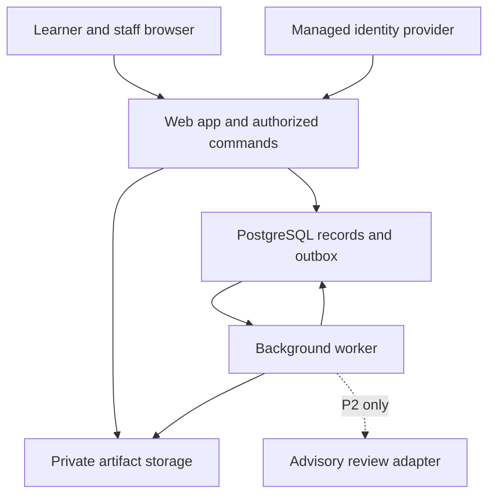

# Technical Architecture and Implementation Plan v1

## 1. Outcome and reading order

We now have an interactive workflow prototype and a concrete architecture for the first persistent learning service. The prototype demonstrates how the educational rules appear in the product; it does not establish production security, valid assessment, accessibility conformance, or learning effectiveness.

**Prototype:** [Open the private workflow prototype](https://engineering-practice-workflow.redataset-9085.chatgpt.site)

**Prototype source revision:** `5f9d8eb737281be0b84610b44e4b0a73374c9a65`

Start in **Learn**, continue the HTTP lesson, record a prediction, open **Practice**, request an explanation if useful, preview a synthetic submission, advance its scripted review, respond and revise, then inspect **Progress**. The **Demo perspective** selector opens the author, reviewer, assessor, and operations views over the same local records. **Explore scenarios** rehearses delayed work, revocation, stale results, duplicate requests, and unsaved drafts.

The planning artifacts remain separate and complementary:

| Artifact | Authority and purpose | Current state |
| --- | --- | --- |
| [Graduate_Competency_Standard_v1.md](Graduate_Competency_Standard_v1.md) | Graduate outcomes, depth, independence, evidence, and graduation semantics; internally v1.1 | 27 domains, 206 practical outcomes; not a claim that graduates have been validated |
| [Curriculum_Architecture_v1.md](Curriculum_Architecture_v1.md) | Learning sequence, module map, dependencies, projects, assessment architecture | 68 modules, 13 stages; detailed expansion still required |
| [Representative_Learning_Package_v1.zip](Representative_Learning_Package_v1.zip) | Actual sample teaching, exercises, local source, hints, review cases and author checks | Authored candidate; historical H4 labels require compatible release treatment |
| [Application_Requirements_and_UX_Specification_v1.md](Application_Requirements_and_UX_Specification_v1.md) | Product behavior, 54 requirements, 18 screens, 24 acceptance scenarios | Governs the prototype and P1 work |
| Interactive P0 prototype | Makes representative workflows inspectable and state transitions executable | Synthetic only; eight imported HTTP lessons, learner/staff screens, local state |
| This architecture | System boundaries, decisions, data contracts, concurrency, delivery sequence and verification gates | Proposed P1 implementation contract |

Precedence is the user’s agreed educational principles, the graduate standard, the curriculum, the application specification, and then this implementation design. A prototype shortcut cannot weaken an upstream requirement. Content and application releases are versioned independently.

## 2. What the prototype implements

The prototype uses the supplied React/TypeScript/Vinext starter and Sites delivery. Its own state transitions live in `lib/workflow.ts`; the screens in `components/workspace.tsx`; the eight imported lessons in `lib/lessons.json`; the theme in `app/globals.css`; and the invariant checks in `tests/workflow.test.mjs`. The repository’s `docs/Prototype_Review.md` contains the walkthrough, limitations and detailed screen mapping.

The layout is a working learning environment: a persistent course navigation, a current investigation, staged reading, an adjacent prediction notebook, explicit source preview, and criterion-level feedback. The neutral name **Engineering Practice** is descriptive working copy, not a final branding decision.

| Screen specification | Implemented prototype surface | Important boundary |
| --- | --- | --- |
| UX-01 Entry/readiness | `#/start` | Preparation and synthetic placement state; no real enrollment |
| UX-02 Learning plan | `#/learn` | Eight authored HTTP lessons; wider curriculum is labeled planned |
| UX-03 Lesson reader | `#/lesson/1` through `#/lesson/8` | Model, technical explanation and model limits; one shared prediction exercise |
| UX-04 Local practice | `#/practice` | Local-tool brief and setup-guide download; runnable package remains a separate deliverable |
| UX-05 Help | Get help sheet | H1–H5; the decisive diagnosis is H5; help stays with the main episode |
| UX-06 Preview | `#/prepare` | Synthetic file selection, source previews, valid/invalid alternatives, missing context |
| UX-07 Attempt status | `#/attempt` | Pinned source and queue, review, delay, context and withdrawal states |
| UX-08 Review | `#/reviews` | Scripted criterion findings, source citations and explicit provenance |
| UX-09 Response/revision | `#/respond` | Separate response; explicit new source revision within the same episode |
| UX-10 Progress | `#/progress` | Content, evidence and target achievement remain separate |
| UX-11 Fresh task | `#/fresh` | Exposure and request illustration; no fabricated fresh assignment |
| UX-12 Appeal | `#/appeal` | A separate appeal reason attached to a pinned review |
| UX-13 Data controls | `#/account` | Browser-local JSON/Markdown export and reset; no server lifecycle claim |
| UX-14 Authoring | `#/author` | Markdown candidate and inert preview, separate from imported learner content |
| UX-15 Release review | `#/releases` | Compatibility/gate ledger; release withdrawal simulation; publishing stays blocked |
| UX-16 Reviewer | `#/reviewer` | Local assignment, context review/request, scripted publication and revocation |
| UX-17 Assessor | `#/assessor` | Eligibility, conflict disclosure and local appeal disposition; target award unavailable |
| UX-18 Operations | `#/operations` | Bounded queue/event metadata, same-request recovery, stale-result simulation |

All personas share one browser-local data set. A role selector is not authentication. There is no server submission endpoint, paid service, model API, real observation, external notification or credential issuance. The Site’s private audience is separate from application-level authorization.

The initial profile marks two lessons studied so the resume flow is immediately usable. Those are synthetic initial conditions. Edited investigation notes do not receive a made-up quality score: the scripted process finding applies only to the known authored sample; changed notes require a real reviewer. The regression checkbox chooses a synthetic test summary, not an executed test.

All lesson and help assets are delivered to the browser. Consequently, the prototype cannot protect independent assessment material or measure undisclosed source inspection. Its visible help events are useful workflow records, not a complete exposure audit. The production design must enforce the boundaries below.

## 3. Design improvements made while implementing the flows

These are implementation and desk-review findings, not results from learner trials.

| Finding | Resolution in P0 | Required P1 treatment |
| --- | --- | --- |
| A historical H4 label can contain the entire decisive diagnosis | The diagnosis is delivered as H5; a genuinely partial H4 clue is separate | Validate disclosure content and compatibility before release; retain original provenance and record corrected interpretation |
| A correct revision can hide the help used earlier | Revisions retain the same episode; progress includes that episode’s actual help | Store help events with delivery time, affected indicators and disclosure identity; derive scope-specific eligibility |
| A response and an appeal can overwrite each other if treated as one note | Appeal reason and review response are separate fields | Separate versioned records and immutable published references; draft edits remain distinct from published responses |
| Long notes can be mistaken for good reasoning by a crude heuristic | Arbitrary edited notes receive no scripted positive process finding | Qualified rubric-based review; never infer quality from length, activity time, or completion clicks |
| Duplicate submissions and delayed results are ordinary workflow cases | One request key recovers one snapshot; changed payloads conflict; stale publication is blocked | Database uniqueness, state/version checks, transactional handoff, expiring leases and reauthorization |
| Browser-local exports look deceptively like a full data-rights service | The UI explicitly describes local export/reset only | Authenticated scope, job state, expiry, derived-copy handling and restoration reconciliation |
| An expiring source URL does not necessarily implement immediate revocation | P0 has no protected remote source URLs | Serve protected source through an authorization-enforcing retrieval path; see section 8 |
| A learning package containing public transfer solutions is not held-out assessment material | The public transfer example cannot award independent evidence | Separate exposed learning distributions from controlled, genuinely fresh assignments and their exposure records |

The public HTTP lessons remain historical authored content. They are not silently rewritten into a validated learner release. Production content import still needs the W-01 compatibility pass, independent review and the environment gates.

## 4. Proposed system shape

Build a modular application with one relational source of truth, private artifact storage, and a durable background worker. Keep identity, learning, content, submissions, review, evidence and data lifecycle as explicit modules in one codebase initially. They do not need separate network services to preserve their responsibilities.



The app and worker share domain code, migrations, policy definitions and release identity. The worker receives work identifiers and revision references, not a permanent grant to source. It rechecks access when loading context and again when publishing.

The learner’s local editor, Node processes, databases, Docker and later cloud labs are outside this diagram’s execution boundary. Students run the authorized course labs on their own machines or approved lab infrastructure. The educational platform ingests evidence; it never installs dependencies or runs learner-submitted scripts.

Trusted author fixture execution is a different activity in a separate author/CI environment. A learner upload does not become a trusted author fixture because both happen to contain JavaScript.

### 4.1 Runtime decision

**Proposed P1 baseline:** React/TypeScript frontend, a Node-compatible web application and separate worker process, PostgreSQL, private S3-compatible object storage, and managed OIDC identity. Choose supported stable runtime/framework releases at implementation kickoff and pin them with lockfiles and an update policy. A Node-compatible container deployment permits ordinary PostgreSQL connections and a persistent worker; start with managed hosting rather than operating an orchestration cluster for the educational product itself.

This does not remove Kubernetes, cloud networking or infrastructure-as-code from the curriculum. Students still need genuine practical experience in those areas. The platform’s initial operational footprint is a separate engineering decision.

The current Sites prototype is a Cloudflare-compatible build from the supplied Vinext starter. Its experimental framework version is not automatically approved for P1. The Node/PostgreSQL baseline cannot be deployed unchanged to a hosted Site that does not support raw TCP connections. A future Sites-based P1 would require supported HTTP database access, a compatible queue/worker design and independently verified storage/auth adapters. Do not solve that mismatch by silently changing the persistence guarantees.

No production hosting, identity, database or model provider is purchased or provisioned by this document. Provider selection follows a short compatibility and operating-cost spike; the domain and transaction contracts remain the same.

### 4.2 Architecture decisions

| ID | Proposed decision | Reason and tradeoff | Revisit when |
| --- | --- | --- | --- |
| ADR-01 | Modular monolith with a separate worker process | Makes policy and cross-record transactions easier to inspect; requires disciplined module interfaces | Independently scaling teams or measured service isolation needs justify a split |
| ADR-02 | PostgreSQL for authoritative metadata | Attempts, roles, versions, evidence and appeals need relationships, constraints and atomic state changes | A concrete deployment restriction requires another store with equivalent tested semantics |
| ADR-03 | Private object storage for source and exports | Avoids large source bodies in normal queries and logs; adds a commit/cleanup reconciliation boundary | Pilot volume and lifecycle requirements favor another governed artifact store |
| ADR-04 | Durable database-backed jobs/outbox initially | Reduces moving parts while preserving an atomic handoff; requires lease, retry, fairness and cleanup discipline | Measured backlog or independent throughput warrants a managed queue adapter |
| ADR-05 | Managed identity; server-owned scoped assignments | Avoids inventing a password system and prevents role claims from client payloads | Provider capabilities fail the reviewed audience/access requirements |
| ADR-06 | Markdown source with validated metadata and an inert renderer | Keeps AI/human authoring portable; requires a documented dialect and asset/reference checks | A proven learning interaction requires a new explicitly trusted component |
| ADR-07 | Manual review in P1 | Establishes review quality and operational evidence before automating it | Independent calibration, provider handling, costs and failure modes pass P2 gates |
| ADR-08 | Separate criterion results, provenance, eligibility and decisions | Prevents static correctness or course completion becoming an unsupported mastery claim | The standard changes through an explicit assessment revision |
| ADR-09 | Files/decoded JSON first; no learner ZIP/Git ingestion in P1 | Makes preview and bounded context tractable; learners still use real Git locally | Pilot evidence shows sufficient integration value to justify new ingestion risks and UX |
| ADR-10 | Fresh assignments controlled separately from public learning assets | Teaching remains generous while independent evidence can be meaningful | Assessment policy defines an equivalent, validated verification route |
| ADR-11 | Protected source downloads reauthorize on retrieval | Makes withdrawal/revocation enforceable for new reads; proxying has bandwidth/latency cost | A provider supports equivalent revocation semantics and they are tested |
| ADR-12 | Device-local state is a prototype mechanism only | Speeds workflow inspection without collecting real learner records | P1 replaces it with authenticated acknowledged drafts and controlled optional recovery |

## 5. Module boundaries and responsibilities

| Module | Owns | Commands and outputs | Must not own |
| --- | --- | --- | --- |
| Identity/access | Users, enrollments, assignments, expiry, active role, authorization revisions | Resolve principal; authorize object/action; revoke assignment | Competency judgments or source-derived roles |
| Curriculum | Program releases, modules, concepts, prerequisite edges and availability | Resolve available next work; explain preparation route | Fabricated published lessons or automatic mastery |
| Content | Markdown candidates, metadata, hints, solutions, fixtures, compatibility and release approvals | Validate candidate; request independent review; publish/withdraw | Silent changes to an attempt’s pinned requirements |
| Learning | Study acknowledgements, predictions, observations, reflections and help deliveries | Preserve the learning trail; explain readiness | Certifying that a local experiment occurred before a prediction |
| Submission | Drafts, upload sessions, artifact manifests, attempt revisions and episodes | Preview contract; validate/commit; reconcile retry; withdraw | Execution, trusted learner identity from a packet, or qualification decisions |
| Review | Requests, assignments, review drafts/revisions, findings and learner responses | Request context; publish bounded feedback; correct with history | Unreviewed model output writing final assessment decisions |
| Evidence/assessment | Scoped evidence, eligibility, observations, competency decisions and freshness | Explain counted/excluded evidence; record qualified bounded decisions | Averaging away critical gaps or multiplying revisions into occasions |
| Appeals | Disputed pinned records, reasons, conflict assignments and dispositions | Clarify, escalate, adjudicate, link resulting changes | Replacing the original finding without traceability |
| Lifecycle | Approved policy versions, expiry, exports, deletion/redaction and restore reconciliation | Produce authorized exports; remove governed copies; report partial work | Indefinite private source retention disguised as an audit log |
| Operations | Work leases, retry budgets, queue state, health and bounded diagnostics | Recover service work; route manual handling | Standing unrestricted source access or academic penalties for outages |

Keep APIs within the codebase explicit: submissions emit a durable review intent, reviews emit evidence candidates, and only authorized assessment commands can create decisions. A storage-layer convenience must not let a review adapter bypass that sequence.

## 6. Authoritative records and constraints

Use server-issued opaque IDs. Every private object includes organization and enrollment/owner scope where relevant. Enforce parent-child scope consistency with composite foreign keys or equivalent database constraints; a foreign artifact ID from another learner must not attach to a locally authorized attempt.

### 6.1 Core data model

| Record | Essential fields | Required invariant |
| --- | --- | --- |
| ProgramRelease | Standard/curriculum/policy versions, release hash, status | Attempts pin the exact compatible release |
| ContentRelease | Lesson/exercise/rubric/environment versions, manifest hash, approvals, availability | Published content is immutable; corrections create a new version |
| Enrollment | Principal, organization, program, status, authorization revision | Identity and scope come from the session/server |
| RoleAssignment | Role, object scope, starts/expires/revoked, granting authority | Assignment is checked at reads, commands and worker publication |
| Draft | Owner, task, expected revision, current fields, expiry | Compare-and-set save; no silent last-writer overwrite |
| PredictionRevision | Task/episode, text, time, author, previous revision | Original submission stays inspectable; reflection is separate |
| HelpEvent | Disclosure ID/version, request/delivery state, actual H, affected indicators, source and time | Actual delivered content determines classification; unknown reports remain unresolved |
| UploadSession | Owner/draft, proposed limits/manifest, expiry, validation state | Cannot address another object or silently commit unvalidated bytes |
| Artifact | Owner, immutable storage identity/version, received-byte hash/size/type, lifecycle state | Committed content cannot be overwritten by a later upload using the same key |
| Episode | Learner, task variant, encounter/freshness identity, start conditions | Resubmissions of the same encounter do not create new independent occasions |
| AttemptRevision | Episode, parent revision, task/rubric/environment pins, manifest, help cutoff, state | Immutable source snapshot; lifecycle and subsequent help remain separately linkable |
| IdempotencyRecord | Principal, operation, key, normalized payload digest, result reference | Same key/payload returns the same result; changed payload conflicts |
| ReviewRequest | Attempt/context revision, policy version, logical key, state/budget | One logical request for the committed intent |
| WorkLease | Request, worker/reviewer, fencing token, lease expiry | Expired or superseded leases cannot publish |
| ReviewRevision | Pinned context, author/model provenance, findings, status, supersedes | Published feedback is immutable; corrections append a new revision |
| FindingResponse | Pinned finding/review, learner response, evidence references, revision | A response is not a source resubmission or an appeal |
| EvidenceRecord | Semantic schema 2.0, claim scope, artifacts, help, provenance, criterion results | Validity/eligibility is explicit; no inferred graduation from storage |
| ObservationRecord | Qualified observer, assignment, actual task/source/environment, observed/reported distinction | Learner input cannot impersonate an assessor |
| CompetencyDecision | Target/version, counted/excluded evidence, reason, authority, recency, next action | Only scoped qualified authority can decide; P4 service stays disabled until its gates |
| Appeal | Pinned disputed result, reason, conflict/assignment, status, disposition links | Independent adjudication and subsequent correction remain traceable |
| DataJob | Export/delete scope, policy, phases, result/expiry, failure detail | Completed means every required governed subsystem has reconciled |
| OutboxEvent/WorkItem | Event identity, object/version, availability, lease, attempts, terminal state | Retry/replay is safe; terminal states do not resurrect withdrawn work |

The P1 serialization must implement all groups in specification section 8.2, including claims, environment, observations, critical findings, review provenance and lifecycle. Do not treat the table above as a replacement evidence schema or use the P0 TypeScript state as its database schema.

### 6.2 Distinct result axes

Preserve the specified vocabulary:

- Criterion: `met`, `not_met`, `insufficient_evidence`, `needs_review`.
- Verification provenance: `static_artifact`, `learner_reported_execution`, `corroborated_execution`, `observed_performance`.
- Descriptive competency: Not yet observed, Emerging, Developing, Strong, Adaptive, Needs reconfirmation.
- Target achievement: `not_evaluated`, `not_yet_met`, `met`, `needs_review`.
- Help: H0–H5, based on actual disclosure and affected claim scope.

These are not interchangeable ordinal scales. A correct static implementation plus a learner-reported test run and H5 diagnosis can support learning evidence while leaving independence unestablished. An H0 record alone still cannot prove observed performance, authenticity, breadth or repeated transfer.

Store an unresolved provenance/classification explicitly instead of converting missing data to the lowest numeric value. Keep conclusions attached to exact source and evidence revisions. A later disclosure or correction may require a new eligibility/decision revision with a reason; it does not silently rewrite what the original record said at publication time.

### 6.3 Illustrative commit payload

This is a proposed API contract example, not a completed schema 2.0 evidence record or an implemented endpoint:

```json
{
  "draft_id": "opaque-server-issued-draft-id",
  "expected_draft_revision": 4,
  "upload_session_id": "opaque-server-issued-session-id",
  "artifact_manifest_digest": "server-verified-manifest-digest",
  "client_report": {
    "baseline": "reported baseline or explicit unknown",
    "environment": "reported non-secret environment",
    "execution": "learner-reported result references",
    "external_help": "reported collaborators, generated material and exposure"
  }
}
```

The authenticated principal, organization, enrollment, authoritative hashes, release pins, actual platform help deliveries, review authority and verification category are resolved or constructed by the server. A local collector envelope marked `1.0` is decoded as untrusted input, not promoted wholesale into an authoritative evidence record marked `2.0`.

## 7. Drafts, upload commit and reliable work handoff

### 7.1 Local preview and ingestion

The client first selects and previews the exact proposed files. A source file is not uploaded simply because the learner opens the picker or preview. Explicit Submit begins transfer. Cancellation before that point transfers no selected source bytes.

For a decoded local JSON packet, show its file entries, path labels, sizes, baseline/context gaps, notes and reported results before transfer. Enforce limits on the decoded contents, not just the encoded container. Do not deserialize arbitrary object types or trust IDs, hashes, observer identities or claimed policy embedded in the packet.

P1 limits remain the specification’s proposed values: at most 64 source/text files, 256 KiB each, 8 MiB total text, at most two PNG/JPEG evidence images of 2 MiB each, 10 MiB aggregate, and three open upload sessions. Enforce the aggregate even when each individual class fits. These are admission limits to test, not measured capacity achievements.

Validate UTF-8 text, normalized paths, duplicate/case/Unicode collisions under the documented portability policy, types, required context, and ownership. Reject traversal, reserved names, symlinks, private-key material and disallowed paths such as `.env` and `.git`. A scanner can assist but cannot prove that every secret embedded in an allowed note has been found. The preview remains important. Image decoding has independent byte, dimension and resource bounds; disable active image formats and remote references.

Layered type/path/size checks, controlled storage and defense in depth are consistent with the [OWASP File Upload Cheat Sheet](https://cheatsheetseries.owasp.org/cheatsheets/File_Upload_Cheat_Sheet.html). The exact limits and workflow above are this product’s design decisions.

Do not run package managers, lifecycle hooks, submitted tests, macros, shell commands, MDX or arbitrary diagram code during ingestion or review. Even without code execution, parsers and rendered source need bounded, inert treatment. P1 keeps learner ZIP and remote Git import disabled; course-owned downloadable lab packages are a separate distribution channel.

### 7.2 Submission transaction

Upload bytes enter a private uncommitted area under server-generated identities. The app validates the received bytes, computes hashes itself, and binds the immutable manifest to that specific version. Choose an immutable destination/copy or object-version strategy so a reusable upload URL cannot change a committed snapshot afterward.

When CommitSubmission runs:

1. Resolve the authenticated enrollment, current access policy and scoped operation identity. Look up an existing idempotency result before treating a draft advanced by the original commit as a new precondition failure. A replay still needs current permission to the returned record.
2. Compare the incoming canonical command digest with any saved operation. It binds requested immutable manifest/release references and material reported fields, not changing server-side help history. For the same key and payload, return the original authorized result even if the original commit closed the draft; changed payload conflicts. Subsequent help remains a separate event and eligibility input.
3. If no committed operation exists, lock or compare-and-set the draft/commit record, reserve the unique scoped key, and verify current preparation, release availability, draft ownership/expected revision and upload-session state. Concurrent callers reconcile through that same key. Do not return success for different bytes or re-run a previously committed effect.
4. In one database transaction, create the immutable attempt revision, attach validated artifact versions and recorded help cutoff, create the logical review request/intent, and save the idempotency result.
5. Commit before acknowledging success. A lost network response is recovered through the same operation key/status lookup. A deliberate later submission receives a new revision and operation key in the same episode.
6. A worker polls or consumes the durable intent. Crashes cannot leave a committed attempt permanently absent from the queue; a reconciler also checks orphan states.

Object storage and the database are not one transaction. Use explicit states and reconciliation: a failed commit leaves expiring uncommitted objects; a missing committed object makes its artifact unavailable and review blocked; a database commit never assumes an unverified object was durable. Cleanup must recheck references and state before removing a candidate object.

### 7.3 Lease and retry semantics

P1 manual review uses an atomic claim with a lease/fencing token. Automated workers use the same logical-request identity but distinct transport-attempt counters. Never hold a database transaction open while waiting for a human or external model.

The proposed database job queue uses short transactions to claim eligible work and a lease expiry for crashed workers. PostgreSQL locking provides mechanisms for coordinating concurrent updates; the application must still define ordering and recheck its domain preconditions. This is a design implication of the documented locking behavior, not a claim that locks alone provide exactly-once processing. See [PostgreSQL explicit locking](https://www.postgresql.org/docs/current/explicit-locking.html).

Use at-least-once delivery with idempotent effects. Replaying a WorkItem cannot duplicate a ReviewRequest, generate another counted episode, or publish an obsolete result. Expired leases may be reclaimed with a newer fencing token; the previous token is invalid at publication.

For P2, allow at most the specified two automatic model attempts per logical request before manual routing. Count each actual provider attempt and reserve its budget before dispatch. A transport timeout may leave the provider’s outcome or billing uncertain; reconcile where supported rather than promising no duplicate provider charge. Exhaustion is a service state, not a learner penalty. P0’s requeue button does not implement provider budgets.

## 8. Authorization, withdrawal and private retrieval

### 8.1 Object/action authorization

Authenticate through managed identity, then resolve program enrollment and scoped assignments in the application. Use secure session handling and CSRF protections appropriate to the chosen deployment. Never trust a role, learner ID, observer ID, organization ID or verification category merely because the browser supplied it.

Every command and protected read checks principal, organization, enrollment, action, object relationship, current assignment, expiry/revocation, lifecycle state and relevant phase authority. A reviewer reads assigned cases; an operator sees bounded diagnostics unless separately granted time-limited source access with a reason. A content author’s own review is not an independent publication approval.

Use database row policies as defense in depth where appropriate, alongside application authorization and constrained relationships. The application database role must not unintentionally bypass its policies. PostgreSQL documents that superusers, `BYPASSRLS` roles and ordinarily table owners bypass row security; policy and role configuration therefore require explicit tests. See [PostgreSQL row security](https://www.postgresql.org/docs/current/ddl-rowsecurity.html).

For publication/revocation races, use a shared authorization/lifecycle guard and defined transaction ordering. For example, publication obtains the current scoped guard plus attempt/lease locks and verifies their revisions; withdrawal or assignment revocation updates the same guards. If publication commits first, it happened while authorized; if revocation commits first, later publication fails. Retry serialization/conflict failures through the same operation identity. Ordinary disconnected permission caches cannot authorize publication.

### 8.2 Withdrawal boundary

Withdrawal atomically marks the attempt unavailable for routine review/publication, advances its authorization/lifecycle revision and records cancellation intent. The worker’s cancellation is best effort; the publication check is mandatory. Read access and new download retrievals deny after the revocation boundary. A stale result is discarded or retained only under an explicitly permitted audit policy without exposing its source or creating evidence.

Previously delivered bytes cannot be recalled from a browser or a downloaded file. Specify immediate revocation for subsequent authorized reads/publication and stop ongoing streams where feasible; do not promise to erase a human’s memory or previously downloaded exports. Explain this boundary in the real data policy.

### 8.3 Retrieval design

Do not serve protected learner source or export packages through long-lived public URLs. A short-lived signed URL is also a bearer capability until its provider invalidates it. Amazon S3 explicitly permits presigned URLs to be reused until expiry and notes that an upload to an existing key can replace its object. Those facts motivate both immutable commit identities and a revocation-aware retrieval path. See [S3 presigned URLs](https://docs.aws.amazon.com/AmazonS3/latest/userguide/using-presigned-url.html).

Proposed P1 behavior: the browser requests an application download endpoint; the app authenticates, reauthorizes the exact record/version and lifecycle, then streams the private object with appropriate download headers and private/no-store caching. It does not redirect to a capability whose lifetime contradicts withdrawal requirements. Range requests, retries and export retrievals repeat the authorization check.

Upload capabilities may be narrowly scoped to uncommitted objects with expiry and size/type constraints, provided server validation and immutable commit binding remain independent. A reusable presigned PUT must never target the committed snapshot key directly. Provider-specific details need the storage spike and adversarial verification before collection.

## 9. Review, teaching and evidence decisions

### 9.1 P1 manual review packet

Provide the reviewer with the exact exercise/rubric versions, relevant taught prerequisites, expected concepts, full approved manifest, missing-context list, baseline/deviations, investigation, raw reported results, assistance/exposure, previous responses and source revisions. Display why context is missing rather than silently supplying a reference solution as if it came from the learner.

Feedback contains a criterion ID, result, scope, cited evidence, reasoning, severity, uncertainty/missing context, alternatives and next action. A controlled revision can be valid under the fixture’s stated assumptions; the reviewer cannot reject it solely for differing from a preferred hash implementation. A plausible source argument is not a verified test run.

A request for more context creates a new learner revision or clearly versioned supplemental record under the same episode. It does not mutate the original submission. Corrections to feedback create a new ReviewRevision linked to the original and notify only currently authorized users through approved channels.

### 9.2 Help and exposure

RequestHelp resolves a content release and classifies the actual disclosure. Record delivery state: requested, prepared, delivered, or uncertain. A generation failure is not delivery. If a delivery acknowledgement is lost after content may have arrived, preserve the uncertainty instead of asserting no help was seen. Teaching can remain available while an independent claim becomes pending or moves to learning mode.

Store the requested label, delivered content identity, actual H, source, time/order, affected indicators and self-reported external assistance. Access support and general references are not automatically solution-specific help. A complete diagnosis is H5 even when the historical button says H4. Full explanations remain available after an incomplete attempt; the system explains their effect on future independent evidence without shaming the learner.

Do not ship controlled fresh assessment solutions inside a general frontend bundle or public learning ZIP. Use assigned server-authorized content and log relevant disclosures. Even that cannot establish all external exposure; combine transparent reporting with fresh modification, explanation and qualified observation. Never claim an anti-cheating guarantee from a hidden button or MCP restriction.

### 9.3 Evidence and decisions

Review publication produces scoped evidence candidates. Eligibility considers source completeness, provenance, actual help, episode identity, freshness/exposure, conditions, critical findings, recency and required breadth. Revisions from the same encounter count together under that episode; a new commit is not a new independent occasion.

P1 may support narrow qualified feedback and evidence recording, but the broad graduate service remains disabled. Qualified decisions must cite counted/excluded evidence and reasons. A critical security allegation from an advisory model remains an allegation until qualified review; it cannot silently become a verified non-compensable failure. Appeals link to the exact disputed version and keep conflicts visible.

When an artifact is deleted, expires or is corrected, mark the dependent evidence availability/eligibility explicitly and determine whether reconfirmation or a decision revision is needed. Do not retain an unexplained verified result after its necessary basis has disappeared.

### 9.4 P2 advisory automation boundary

Add the model adapter only after independent calibration and an approved provider/data policy. The 40 synthetic packets from the existing owner package are useful development material, not genuine held-out evaluation merely because some were labeled reserved.

The adapter assembles authorized required context, measures capacity, reserves budget, and produces schema-constrained advisory output. It has no code-execution tools, no arbitrary network retrieval, no access to other learners, and no authority to write final decisions. Source comments, uploaded Markdown, image text and logs are untrusted evidence; instructions inside them cannot change the reviewer policy.

Validate output shape, referenced IDs/versions, source citations, criterion IDs, supported provenance and permitted effect. Reject or escalate fabricated references, claimed test execution, missing essential context, unsupported security certainty and final-decision writes. Oversized context leads to an explicit adequate-context or manual route, not silent truncation. Retain provider/model/prompt/policy/evaluation identity and actual retry/cost records under the approved lifecycle.

## 10. Content authoring, compatibility and release

Markdown is canonical. Define a narrow supported dialect for headings, paragraphs, lists, code blocks, tables and approved links/assets. Disable raw HTML, executable MDX, arbitrary imports and remote embeds in untrusted content. Trusted interactive learning widgets are separate versioned components with an explicit content schema; a generated Markdown file does not gain executable privileges.

Content metadata includes stable IDs, version, prerequisites, taught concepts, competency/indicator mapping, difficulty, estimated active effort with calibration status, exercise mode, evidence requirements, rubric, help disclosures, walkthrough/reference solutions, lab/fixture/environment versions, reset/cleanup instructions, access alternatives, rights/provenance and review state.

The release pipeline checks:

1. Schema and reference resolution, unique IDs, valid version relationships, hard prerequisite cycles and available preparation routes.
2. Coverage and depth mapping, assessment/evidence requirements, and whether a lesson uses untaught prerequisites without an explicit bridge.
3. Hint/disclosure compatibility, including C-01 H4/H5 treatment. Keep original source/label history and classify ambiguous imports as needing review.
4. Starter/fixture contracts, meaningful expected failures, valid alternative repairs, discriminating near misses, reset/cleanup behavior and supported environments.
5. Complete walkthroughs, instructor context, rubric examples and separation between public learning assets and controlled assessment variants.
6. Pedagogical, technical, accessibility and rights review by the appropriate independent people; author checks alone cannot supply independent sign-off.

Publish a manifest with immutable content, rubric, environment and policy references. Existing attempts stay pinned when a later release changes a requirement. Withdrawal pauses the affected route and supplies an explicit reviewed recovery/migration plan. A new rubric cannot silently replace the one governing an old submission.

The P0 editor checks only four bounded examples: the known HTTP indicator, a direct self-dependency, a required solution link and the diagnosis classification. It is not the full curriculum compiler or graph validator. The eight imported lessons are authored candidates, not a claim that the whole 68-module map is available.

## 11. Service command contracts

Use versioned JSON command APIs with consistent error envelopes and an operation ID. The paths below are proposed P1 boundaries, not endpoints available in the prototype. The chosen framework may implement the same commands differently without weakening their contracts.

| Command / illustrative endpoint | Required authority and concurrency | Durable effect |
| --- | --- | --- |
| SaveDraft / `PATCH /v1/drafts/{id}` | Owner; expected revision; scoped request key | Acknowledged revision or recoverable conflict |
| RecordPrediction / `POST /v1/episodes/{id}/predictions` | Owner/task; explicit original/reflection relationship | Preserved prediction record |
| RequestHelp / `POST /v1/episodes/{id}/help` | Assigned learning scope; compatible disclosure release | Actual/uncertain delivery event with claim scope |
| CreateUploadSession / `POST /v1/upload-sessions` | Owner/draft; policy active; bounded proposed manifest | Scoped expiring uncommitted upload session |
| CommitSubmission / `POST /v1/submissions` | Validated artifacts; draft revision; idempotency key | Immutable attempt plus durable review intent |
| ClaimReview / `POST /v1/review-requests/{id}/claim` | Qualified assigned reviewer; atomic claim | Expiring lease with fencing token |
| PublishReview / `POST /v1/reviews/{id}/revisions` | Current assignment/lease; expected revision and pinned context | Validated immutable feedback revision |
| RespondToFinding / `POST /v1/findings/{id}/responses` | Owner; exact finding version | Separate response record |
| SubmitRevision / `POST /v1/episodes/{id}/attempts` | Owner; previous attempt and fresh commit key | New revision within the existing encounter |
| RecordObservation / `POST /v1/observations` | Qualified assessor and actual assignment | Attributed source/environment-linked observation |
| DecideCompetency / `POST /v1/competency-decisions` | Permitted phase, authority, standard and evidence versions | Bounded decision with reasons; otherwise blocked/pending |
| OpenAppeal / `POST /v1/appeals` | Own disputed record; policy and version | Conflict-aware appeal case |
| WithdrawAttempt / `POST /v1/attempts/{id}/withdraw` | Owner; expected state; operation key | Revocation boundary and durable cancellation intent |
| Export/Delete / `POST /v1/data-jobs` | Owner/scope; policy; authenticated request | Tracked lifecycle job, not instant completion |
| PublishLearningRelease / `POST /v1/content-releases/{id}/publish` | Independent authorized approval and all required gates | Immutable release available to eligible learners |

Use explicit classes such as validation error, missing context, revision conflict, idempotency conflict, unauthenticated, denied/unavailable, service delayed and policy not active. Return bounded useful detail to authorized callers while avoiding cross-learner existence leaks. Do not return source or sensitive stack traces in generic error bodies.

A client retries safe operation identities and first reconciles uncertain commit outcomes. Status polling uses authenticated scoped reads; optional events carry only enough information to prompt an authorized refresh. A notification is not a permission to retrieve a record.

## 12. Data lifecycle and recovery

The application specification’s P1 defaults remain **proposals requiring approved policy**, not legal conclusions or promises already made to learners:

| Data | Candidate lifecycle | Implementation requirement |
| --- | --- | --- |
| Uncommitted upload bytes | 24 hours | Revoke session, reconcile partial objects, delete only after reference/state check |
| Unsubmitted drafts | 30 days of inactivity | Visible expiry and recovery/export route |
| Submitted source, help, observations and reviews | 90 days after a defined pilot closure | Explicit closure date; earlier governed deletion; scoped ongoing access |
| Observation recordings | Not collected by default | Separate approval and equivalent non-video route if introduced |
| Export packages | 24 hours | Authenticated revocable retrieval; no permanent bearer link |
| Routine diagnostics | Seven days | Exclude source, free text and detailed allegations |
| Minimal audit metadata | Candidate 180 days | Approved purpose and redaction/deletion rules |
| Backups | Candidate 35-day rolling expiry | Restore must reapply later revocations/deletions before serving |
| External provider data | No P1 model transfer | P2 contract/capability verification before processing |

A multi-year course cannot silently inherit a short pilot schedule. Before verified-program enrollment, define how long evidence must remain reviewable, how learners export it, how recency/reconfirmation works and what deletion means for contested decisions. This is a separate product/assessment/data-policy decision.

Export jobs collect the authorized source, manifests, learning/help trail, review/response/appeal records, evidence and decision explanations in portable Markdown/JSON plus original artifacts as appropriate. They recheck scope before generation and retrieval. A partial export reports what remains unavailable.

Deletion jobs enumerate governed copies and derivatives: source objects, decoded extracts, evidence images, previews, search entries, review-provider copies if enabled, exports, caches and backup reconciliation records. Each phase is idempotent and inspectable. Store only the minimum tombstone needed for lifecycle correctness; never copy deleted private source into an audit note as a workaround.

Backups need both a tested restore and a durable deletion/revocation reconciliation mechanism whose recovery coverage is at least as current as the service’s promises. A backup containing an old active attempt must not make it accessible again. After restore, hold protected traffic until current lifecycle/access state is reconciled and the resulting eligibility effects are processed.

Candidate service recovery targets remain RPO 15 minutes and RTO four hours. Neither is measured by a successful local build. Assign recovery ownership and rehearse database/object/version consistency, leases, duplicate work, lifecycle jobs and publication guards before committing to a service promise.

## 13. Operations, accessibility and cost controls

Use the specification’s proposed reference workload: 25 active learners, five staff, metadata for 68 modules and 206 practical outcomes, initially 16 authored lesson records. The P0 interface exposes eight HTTP lessons; it does not claim to serve the full planned content set or simulate concurrent users.

Measure end-to-end usable navigation at p95 within two seconds, acknowledged draft saves within one second, and async state visibility within five seconds on explicitly recorded supported device/network profiles. Upload time depends on bandwidth; the requirement is correct bounded handling, interruption and reconciliation at the admitted size. Manual review turnaround is a separately staffed operating commitment.

Operational metrics include queue age, claim/release rate, missing-context rate, revision cycles, review disagreements, appeal time/conflicts, service retry outcomes, lifecycle backlog, reviewed content errors, assistance use by context, and supported-path completion failures. Never infer learner ability from time spent, number of hints or raw activity alone. Avoid sensitive free-text telemetry and do not optimize engagement metrics at the expense of understanding.

Costs need a model before provider activation: hosting and database baseline, object storage, protected download/egress, backup retention, review staff minutes, support coverage, and P2 tokens/retries/context assembly. Give each logical request an auditable service budget; constrain concurrency and queue length; route to manual work when automation is unavailable. Dollar estimates are deliberately absent until region, provider, audience and observed workload are known.

Accessibility work covers complete journeys: navigation and focus, staged lesson reading, prediction/observation, file selection and error recovery, code evidence, help, response, appeal and data export. Use semantic controls, names and status announcements, responsive/reflow layouts, sufficient contrast and text resizing, keyboard operation, and equivalent text/source access. Validate selected supported browsers and assistive technologies with real tasks. Component reuse and CSS rules are implementation aids, not evidence of conformance.

The prototype includes semantic buttons/labels, existing accessible primitives, a skip link, live status, focus handling, responsive styles and reduced-motion treatment. Browser, mobile reflow, keyboard/zoom and screen-reader outcomes remain unverified. There was no supported browser QA scope executed in this turn; do not carry forward earlier failed browser attempts as if they tested this application.

## 14. Verification ledger

### 14.1 Checks actually performed for P0

| Check | Actual result | Scope |
| --- | --- | --- |
| Workflow invariants | 16 checks passed | Pure local state model and known synthetic fixtures |
| TypeScript validation | Passed | Static type compatibility of the prototype |
| Production build | Passed | Framework/client/server build artifacts produced |
| Native private publication | Succeeded: private prototype v1 | Saved source/build version and deployment result; not an interactive journey test |
| Browser/visual/end-to-end interaction | Not performed | No screenshots, click-path, keyboard, reflow or screen-reader result |
| Optional browser tools | Implemented; runtime validation unavailable | Feature-detected `read_learning_workflow` and `open_http_lesson`; no claim of registered/executed WebMCP behavior |
| Real identity/uploads/authorization | Not implemented in P0 | Cannot be proven by the persona selector or file fixtures |
| Real queue/provider/budget/recovery tests | Not performed | Local transitions are not distributed race or restore evidence |
| Docker and local-lab browser rehearsals | Still pending from authored package | Earlier Node/command-line checks retain their own scope |
| Independent content/reviewer calibration | Not performed | No qualified sign-off or valid held-out result supplied |
| Learner/staff usability and learning trials | Not performed | No participants, learning gains or comprehension observations claimed |

The 16 checks cover: actual H5 reclassification versus partial H4; prediction preservation; duplicate and conflicting submission keys; immutable source snapshots; episode/help continuity; withdrawal/stale-result protection; revoked reviewer leases; delayed-request identity; missing/duplicate/sensitive/traversing path rejection; valid alternatives and the title-only near miss; unresolved process evidence; exposure/help preservation; bounded content validation; appeal conflicts; preparation/release blocks; and missing-context revision behavior.

These checks exercise parts of AC-03, AC-05 through AC-06, AC-09 through AC-12, AC-14 through AC-19, and AC-23 in a local model. **No complete production AC-01–AC-24 scenario is marked passed.** In particular, fixture path checks do not test real hostile uploads; local lease guards do not test multi-user authorization or distributed races; and successful builds do not establish accessibility or operational readiness.

### 14.2 Required P1 verification

| Suite | Essential discriminating cases | Exit evidence |
| --- | --- | --- |
| Object/action authorization | Cross-learner ID substitutions; foreign artifact references; expired/revoked assignments; operator source access; protected downloads after withdrawal | Integration results against real session, database and storage policies |
| Ingestion | Oversized decoded JSON/images, traversal/collisions/types, forged identities/provenance, missing required context, inert hostile text | Boundary tests including server validation and no-source-transfer-before-submit inspection |
| Commit/concurrency | Double click; response lost after commit; changed payload under same key; crash between object validation and DB commit; repeated delivery | One durable revision/intent, explicit conflicts, reconciled orphan states |
| Review/assistance | Valid alternatives, near misses, actual disclosure, unknown external help, current/context pins, response/appeal corrections | Qualified rubric checks and durable provenance/history |
| Withdrawal/lifecycle | Revocation while leased; stale callback; previously minted retrieval; partial export/delete; restore of obsolete active state | No new unauthorized reads/publication or resurrection; honest partial-job state |
| Content compiler | Unknown IDs, graph cycles, untaught prerequisites, missing solutions, help misclassification, version drift, broken reset/environment | Specific errors and independently reviewed compatible candidate |
| End-to-end accessibility | All essential learner/staff paths, errors, help and exports with keyboard/zoom/screen reader | Recorded supported setup and observed task completion/failures |
| Load and recovery | Agreed workload, cold/warm paths, constrained network, job failures, restore/reconciliation | Actual p95/backlog/cost/RPO/RTO measurements and known misses |
| Review operations | Staffing, turnaround, uncertainty, valid rebuttals, independent appeals | Named coverage and calibration records before enrollment |

## 15. Implementation sequence and definition of done

Work proceeds by reviewable slices. Estimates should be added after the compatibility spike and named staffing; a calendar promise is not justified by the current artifacts.

| Work package | Concrete output | Dependencies | Definition of done |
| --- | --- | --- | --- |
| NEXT-01 Workflow and access rehearsal | Recorded learner/staff journeys using this prototype; browser/keyboard/reflow checks; revised copy/state issues | P0 prototype | Distinguish observation from inference; resolve blocking comprehension/access defects; no simulated test relabeled human evidence |
| NEXT-02 Content compatibility candidate | Corrected release manifest, H5 classification, full dependency/reference validation for the representative slice; learner/instructor distribution split | Standard/specification and authored package | Historical sources preserved; candidate checks pass; independent and runtime gates clearly pending or actually signed |
| NEXT-03 Provider/transaction spike | Supported stable app runtime, managed identity adapter, PostgreSQL connection, private storage retrieval, durable worker/outbox, operating estimate | This architecture | Demonstrate commit/retry/withdraw/retrieval semantics with synthetic records; resolve Sites-versus-Node runtime choice explicitly |
| NEXT-04 Persistent submission/manual-review slice | Authenticated preparation/drafts, actual bounded file/JSON preview and ingestion, immutable commit, reviewer assignment, feedback, response and revision | NEXT-02/03 plus approved collection policy before real users | Cross-user denial, lost-ack recovery, required context and stale-publication tests pass; no execution of learner code |
| NEXT-05 Evidence and appeal slice | Schema 2.0 serialization, scope-aware help/exposure, episode counting, eligibility, observation authority and appeal history | NEXT-04 | Helped static success cannot award independence; conflicts and missing evidence route correctly |
| NEXT-06 Lifecycle and operations slice | Export/delete/expiry, restore reconciliation, bounded diagnostics, queue/cost controls, deployment/rollback runbooks | NEXT-03/04 | Representative partial failure and restore drills pass; approved policy and staffed operations visible |
| NEXT-07 Private learner pilot | Curated compatible material, supported local setup, qualified manual review, accessibility support, measured tasks | Required gates across NEXT-01–06 | Actual participant evidence, review quality, feasibility and curriculum defects recorded; no unsupported qualification claim |
| NEXT-08 Advisory review/tutor | Provider adapter, independent calibration, prompt/output controls, context/budget/fallback handling | Valid held-out evaluation and approved data/provider policy | Promotion criteria met on unexposed cases and production-like failure tests; decisions remain scoped and authorized |
| NEXT-09 Curriculum and integrations | Expanded lesson/exercise bank, project progression, later ZIP/Git/editor/MCP as justified | Pilot friction and educational evidence | Content depth/quality preserved, new integrations independently verified, full-program gates not assumed |

The immediate engineering milestone after the workflow rehearsal is **one persistent HTTP submission reviewed manually from an authenticated staff account**, with a defensible revision and an evidence view that preserves help/provenance. That is the smallest complete implementation of the product’s defining learning loop.

Architecture/provider spikes may use synthetic data before policies and staffing are finalized. Real learner collection and enrollment must wait for their actual approval and coverage. No external participant is contacted and no cloud purchase is initiated by this plan.

## 16. Open decisions and remaining risks

| Decision/risk | Current position | Evidence needed |
| --- | --- | --- |
| Pilot audience and jurisdiction | Adult private pilot is still a planning assumption | Named audience, access needs and qualified data/product policy review |
| Runtime/provider | Node-compatible modular app proposed; Sites used only for P0 | Compatibility, regional handling, operational cost and recovery spike |
| Manual review availability | No promised turnaround | Named qualified reviewers, conflict-free appeal coverage and observed workload |
| Formal observation | No default video recording | Accessible task method, qualified observation, consent/handling and evidence validity |
| Full-program retention | Pilot defaults are insufficient for a long program without review | Assessment/data-owner schedule, export and reconfirmation policy |
| Explanation fidelity | Imported lesson model groups and one shared prediction are P0 shortcuts | Learner comprehension, distinct lesson interactions and content review |
| Browser-local state | Not a real draft store; cross-tab behavior not browser-tested | P1 acknowledged persistence, conflict recovery and browser rehearsal |
| Client-distributed solutions | All P0 content is inspectable | Controlled assessment packaging/authorization and honest exposure limits |
| Credential claims | Graduate service remains unavailable | Complete curriculum/assessment evidence, qualified standard validation and explicit P4 gates |
| Automation quality | Scripted examples are not model calibration | Independent labels, genuinely held-out cases, error analysis and monitored fallback |
| Exhaustive content workload | Macro-map is broader than written material | Authoring throughput, maintenance owners, editorial QA and pilot learning results |

These uncertainties do not prevent the next synthetic technical slice. They do prevent calling the current product production-ready or treating the course map as a delivered and validated curriculum.

## 17. Provenance and change discipline

This artifact derives its educational and product requirements from the user’s agreed plan and the conversation’s existing artifacts. External sources below support narrow implementation mechanisms; architectural choices are explicit proposals inferred for this workload rather than universal recommendations.

| Input | SHA-256 |
| --- | --- |
| Graduate standard, internally v1.1 | `501145c310956a46319d27649840c0e4bdf501e6a2ddd684422da51a335d78ca` |
| Curriculum architecture v1.0 | `369706fb1fb9bd80de8458e67b0b7a23dd2ec28257796d2ac0c44c206241d85b` |
| Application requirements/UX v1.0 | `fd2102de2e734ce9698f925f8476bf0cdc1fc3a4279fe231fb584bd034fe0764` |
| Representative learning package archive v1.0.0 | `19fbaf9a3c0a16e9dec7c47df88a807438521ee52c98b2aa2aaa0c77cfeb351b` |

Primary mechanism references were checked on 2026-09-10: PostgreSQL row security and locking, AWS S3 presigned URL behavior, and OWASP file-upload guidance, linked at their relevant claims. No exact provider price, contractual retention promise or legal-compliance conclusion is asserted.

Any future change to help classification, evidence semantics, supported environment, public/controlled content split, review authority, retention or graduate eligibility must identify affected releases and records. Update the specification/decision log, implement the migration or scoped compatibility behavior, and retain the distinction between proposed, authored, source-tested, runtime-tested, independently reviewed and learner-validated.
