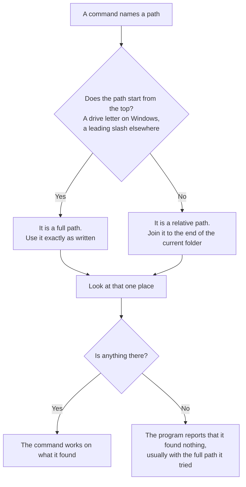

# Where the terminal is standing

So far you have typed commands that somebody else chose, in a folder somebody else told you to open. They worked, as long as you stayed exactly where you were put. The moment the terminal was one folder away, in the lesson *When something goes wrong*, the same command failed.

This module takes away that dependence. Over seven lessons it explains what really happens between pressing Enter and reading the result: where a command looks for files, what a program is handed, where its output goes, how it reports success, what settings surround it, and how it runs and stops. The last lesson gives you instructions that worked on someone else's computer and fail on yours, and you repair them.

This first lesson answers one question:

> "The file is right there. Why does the terminal say it cannot find it?"

You need the working setup from the lesson *Set up a safe workspace*. The steps were run on Windows 11 in PowerShell, and on Linux in bash and zsh. Nothing was run on macOS, where the terminal normally runs zsh.

## 1. Start with a familiar situation: directions over the phone

You have left a folder of papers at a friend's office, and a colleague of yours happens to be in that building. You phone them and say:

> "Go up one floor, turn left, and it's the third door."

Whether that works depends on something you did not say. You were picturing the main entrance. Your colleague is standing in the car park, one level down, at the back of the building. They go up one floor, turn left, count three doors, and find a store cupboard. They followed every word correctly. The directions were not wrong either. They were directions **from a place**, and the two of you had different places in mind.

Now a second way to say it:

> "Hartwell House, second floor, room 214."

This works from the car park, from the entrance, from the roof, from another city. It does not matter where your colleague is standing, because it starts from the building itself and names every step.

Compare the two.

- The first kind is short and convenient. It is also only as good as the starting point. Change where the listener stands, and the same words lead somewhere else, or nowhere.
- The second kind is longer. It leads to the same door no matter where the listener is standing.

Notice also how the first call fails. Your colleague does not report "your directions were ambiguous". They report "there's no folder here, it's a cupboard". The failure shows up at the end of the walk, at the wrong door, and it looks like a missing folder.

### Pause and explain

Before reading on: your colleague phones back and says, "I did exactly what you said and there's nothing here." What is the one question that sorts this out fastest?

"Where were you standing when you started?" It is faster than repeating the directions, and faster than checking whether the folder still exists. Keep that question. It is the most useful one in this lesson.

## 2. The terminal is always standing somewhere

A terminal is never "nowhere". At every moment it is in exactly one folder, called the **current folder**. You met it in the lesson *When something goes wrong*, where moving the terminal one folder up was enough to break a command. Many documents and tools call it the **working directory**, or the **current working directory**. "Directory" is another word for folder, and these are all the same thing.

Download the kit offered with this lesson, **Terminal_Practice_Kit_v1.zip**, move it into your `course-work` folder, and extract it as you did before. Open the folder named `terminal-practice-kit` in VS Code, the one that directly contains `where.mjs`, and open a new terminal. Before you run any of the kit's programs, apply the habit from *Set up a safe workspace*: the kit came with this lesson, and each program begins with a comment saying what it does. Open one and read its comment.

A terminal opened this way starts in the folder you opened. Ask it to say so. The command is `pwd`, which stands for *print working directory*:

```sh
pwd
```

The answer is the same fact in every shell, laid out differently. These are the author's runs, with the home folder renamed to the example user maria's.

```text
Windows PowerShell:

Path
----
C:\Users\maria\course-work\Terminal_Practice_Kit_v1\terminal-practice-kit

bash or zsh, on Linux:
/home/maria/course-work/terminal-practice-kit
```

PowerShell puts a small heading, `Path`, above its answer. bash and zsh print the answer alone. Your own answer will have your account's name in it, and on Windows it has the extra step `Terminal_Practice_Kit_v1` that Extract All adds.

What `pwd` printed is a path, and you learned to read one in *Set up a safe workspace*: the list of folders you pass through to reach a place, starting from the top. On Windows the top is a drive, `C:`, and the steps are separated by a backslash, `\`. On macOS and Linux the top is written as a single forward slash, `/`, and the steps are separated by forward slashes.

**Copy the path your `pwd` printed into a note now.** You will use it in Section 5 to get back here from anywhere.

Most prompts also show the current folder, in full or shortened. The prompt is a convenience and `pwd` is the definite answer. When you are unsure, ask.

### Look around: `ls`

The second command lists what is in the current folder. `ls` is short for *list*:

```sh
ls
```

You will see the kit's files and two folders, `data` and `handover`. Now give `ls` a folder to look into. This lists that folder without moving the terminal:

```sh
ls data
```

```text
Windows PowerShell (the author's run):

    Directory: C:\Users\maria\course-work\Terminal_Practice_Kit_v1\terminal-practice-kit\data

Mode                 LastWriteTime         Length Name
----                 -------------         ------ ----
d-----        19/11/2026     16:46                archive
-a----        19/11/2026     16:46            291 orders-2026-09.csv
-a----        19/11/2026     16:46            405 orders-2026-10.csv
-a----        19/11/2026     16:46            326 orders-2026-11.csv

bash or zsh (the author's run):
archive
orders-2026-09.csv
orders-2026-10.csv
orders-2026-11.csv
```

Both show the same four things: one folder, `archive`, and three files. PowerShell adds details. In its `Mode` column, a `d` at the start marks a folder, and the name is at the right. `Length` is the size of a file in bytes. Your dates will differ, and so may the way dates are written. bash and zsh print only the names. Some terminals lay the names out across the line and colour the folders.

The `.csv` files hold orders of a small shop, one order per line. The shop and its orders are invented for this course. You do not need to open them yet.

So you now have two questions you can always ask the terminal: **where am I** (`pwd`), and **what is here** (`ls`).

## 3. Two kinds of path

Look again at the two commands you just typed. `ls data` named a folder with one word. `pwd` answered with a long path from the top of the disk. Those are the two kinds of directions from the phone call.

- A **full path** starts from the top: from a drive letter such as `C:` on Windows, or from the leading `/` on macOS and Linux. It names every step. It leads to the same place from anywhere. It is also called an **absolute path**. It is "Hartwell House, second floor, room 214".
- A **relative path** starts from the current folder. `data` means "the thing called `data`, from where I am standing". It is short, and it depends on where the terminal is. It is "up one floor, turn left, third door".

How do you tell them apart? Look at how the path begins. If it begins from the top, it is full. Anything else is relative.

The computer does not treat a relative path as something vague. Every time a relative path is used, it is turned into a full path by one fixed rule: **join it to the end of the current folder**. The kit has a program that shows that rule working. Run it:

```sh
node where.mjs data/orders-2026-11.csv
```

The author's run in PowerShell:

```text
Current folder:  C:\Users\maria\course-work\Terminal_Practice_Kit_v1\terminal-practice-kit

You typed:       data/orders-2026-11.csv   (a relative path)
It leads to:     C:\Users\maria\course-work\Terminal_Practice_Kit_v1\terminal-practice-kit\data\orders-2026-11.csv
What is there:   a file of 326 bytes
```

On Linux the same lines appear with `/home/maria/course-work/terminal-practice-kit` at the front and forward slashes all the way.

Read the three middle facts as one sum. The current folder, plus what you typed, gives the place it leads to. `where.mjs` did nothing clever. It joined the two, as every program does, and then looked at that one place.

Read this diagram from top to bottom. Each diamond is a question with two answers.



In words: a command names a path. If the path starts from the top, it is full and is used as written. If not, it is relative and is joined to the current folder. Either way there is now exactly one place to look. If something is there, the command works on it. If nothing is there, the program reports it, and it usually prints the full path it tried.

That last box explains the advice from *When something goes wrong*: when a message says a file cannot be found, read the path it prints. You now know what that path is. It is the current folder with your relative path joined on. If it is not where the file really is, one of the two halves is wrong, and most of the time it is the first half.

## 4. Stand somewhere else and try again

Now move. You know `cd`, *change directory*, from the previous lesson. It takes a path, and the path may be relative:

```sh
cd data
pwd
```

`pwd` now ends in `data`. Nothing on the disk has moved. Only the terminal is standing in a different place.

### Predict, then run from another folder

You are about to run the same command as in Section 3, from this new place:

```sh
node where.mjs data/orders-2026-11.csv
```

Before you press Enter, write down your prediction. The command contains **two** relative paths. Find both. Where does each one lead now? Which of the two will be looked for first, and what do you expect to see?

Now run it.

### What the two runs show

The author's run in PowerShell, with the trail of `at` lines shortened:

```text
node:internal/modules/cjs/loader:1424
  throw err;
  ^

Error: Cannot find module 'C:\Users\maria\course-work\Terminal_Practice_Kit_v1\terminal-practice-kit\data\where.mjs'
    at Module._resolveFilename (node:internal/modules/cjs/loader:1421:15)
    ... seven more lines beginning with "at" ...
  code: 'MODULE_NOT_FOUND',
  requireStack: []
}

Node.js v24.12.0
```

Read it with the method you know. **Who is speaking?** Node.js: the last line names it. **What went wrong?** `Cannot find module`. **Where?** The path it tried, which ends `...\terminal-practice-kit\data\where.mjs`.

The two relative paths in the command were `where.mjs` and `data/orders-2026-11.csv`. The first one is easy to overlook, because it looks like "the name of the program". To the computer it is a relative path like any other. Node.js joined `where.mjs` to the current folder, looked in `data`, and found no such file there. It never got as far as the second path.

So the rule from Section 3 has no exceptions: **every relative path in a command is joined to the current folder, including the name of the program file itself.**

You need a way to say "the folder above this one". You know it already: two dots, `..`. A relative path may begin with it. Point Node.js at the program one folder up, and leave the rest of the command unchanged:

```sh
node ../where.mjs data/orders-2026-11.csv
```

```text
Current folder:  C:\Users\maria\course-work\Terminal_Practice_Kit_v1\terminal-practice-kit\data

You typed:       data/orders-2026-11.csv   (a relative path)
It leads to:     C:\Users\maria\course-work\Terminal_Practice_Kit_v1\terminal-practice-kit\data\data\orders-2026-11.csv
What is there:   nothing
```

The program runs now, and it shows the second half of the trouble. Look at the line "It leads to". It contains `data\data`. The path you typed has not changed by a single character since Section 3. The place it leads to has changed, because the current folder has. There is no folder `data` inside `data`, so nothing is there.

This is the store cupboard from the phone call. The directions were followed exactly, from a different starting point.

From here, the file is simply `orders-2026-11.csv`, with nothing in front:

```sh
node ../where.mjs orders-2026-11.csv
```

```text
You typed:       orders-2026-11.csv   (a relative path)
It leads to:     C:\Users\maria\course-work\Terminal_Practice_Kit_v1\terminal-practice-kit\data\orders-2026-11.csv
What is there:   a file of 326 bytes
```

Compare this "It leads to" line with the one in Section 3. They are identical. Two different relative paths, typed from two different folders, led to the same file. A relative path alone does not tell you which file is meant. A relative path **and** a current folder do.

### A good place to pause

You have the central idea of the lesson: the current folder is half of every relative path. The remaining sections give you the means to move around freely and name things from anywhere.

## 5. Moving around

Go back up to the kit folder:

```sh
cd ..
```

Four short names cover almost all moving about.

| You type | It means | Example |
| --- | --- | --- |
| a name | the folder or file with that name, inside the current folder | `cd data` |
| `..` | the folder above the current one | `cd ..` |
| `.` | the current folder itself | `ls .` lists the same as `ls` |
| `~` | your home folder | `cd ~` |

They can be combined into longer relative paths with a slash between the steps. Each step starts from where the previous step ended:

```sh
cd data/archive
pwd
cd ../..
pwd
```

The first `cd` goes down two folders in one command: into `data`, then into `archive`. The second goes up two: `..` and `..` again. The second `pwd` shows the kit folder.

A single dot looks useless, and it has one common job. Some commands need to be told a folder, and `.` lets you say "this one". You will also see it at the front of a relative path, as in `./data`, which leads to exactly the same place as `data`.

### Home, and the way back

Now go a long way from the kit in one step:

```sh
cd ~
pwd
```

`pwd` shows your home folder: `C:\Users\maria` or `/home/maria` in the author's runs, `/Users/` and your name on macOS.

How do you get back? You could type the relative steps one at a time: `cd course-work`, and so on. There is a shorter way, and it is the point of a full path. Take the path you copied in Section 2 and give it to `cd`:

```sh
cd C:\Users\maria\course-work\Terminal_Practice_Kit_v1\terminal-practice-kit
```

That is maria's path on Windows. Use your own. A full path works from anywhere: from your home folder, from `data`, from a folder you have never visited. That is what "Hartwell House, second floor, room 214" was for.

If your own path has a space in it, for example because your account name has two words, the command will fail. Put the whole path between double quotation marks and it will work: `cd "C:\Users\Maria Kowalska\course-work\..."`. The next lesson explains why a space needs that.

So when do you use which kind? Use a relative path for things near you: it is short and it keeps working if the whole kit is moved to another disk. Use a full path when you must be understood from anywhere, or when you write a location down for later. The recovery note you started in *When something goes wrong* asks for the full path of `course-work` for exactly that reason.

### Slashes, and capital letters

Two details differ between systems, and both cause real confusion.

**The separator.** Windows writes paths with a backslash, `\`, and macOS and Linux with a forward slash, `/`. PowerShell accepts both when you type: `cd data\archive` and `cd data/archive` do the same thing there. bash and zsh accept only the forward slash, and the next lesson shows what they do with a backslash. **These lessons write relative paths with forward slashes**, so that one spelling works in every shell. When a program on Windows prints a path, expect backslashes.

**Capital letters.** Try this from the kit folder:

```sh
cd Data
```

The folder is called `data`, with a small d. On Windows the command works anyway, because Windows ignores the difference between capital and small letters in names. macOS, as normally set up, does the same. Linux does not: there, `Data` and `data` are two different names, and the author's run fails with `bash: cd: Data: No such file or directory`. zsh words the same failure as `cd: no such file or directory: Data`.

If the command worked for you, go back with `cd ..`. Then treat capitals as if they always mattered, and type names exactly as they are spelled. Instructions written carelessly on Windows are a common source of "it works for me and not for you". Much of the software you will write and test later runs on Linux.

### Let the terminal finish the name

Typing long names exactly is tiresome, and you do not have to. Type `cd da` and press the **Tab** key. The shell looks in the current folder for names that begin with `da`, and completes the word for you. This is called **Tab completion**. If several names begin that way, press Tab again: PowerShell steps through them one by one, and bash and zsh show the choices or complete as far as the names agree.

Tab completion also works as a check. It can only complete a name that exists. If you press Tab and nothing happens, nothing in that folder starts with those letters, and you have learned that you are in the wrong folder, or have the wrong name, before running anything. The author could not capture Tab completion, because it needs a person at the keyboard. [VS Code: terminal basics](https://code.visualstudio.com/docs/terminal/basics)

## 6. Put it together: a command from the inside

Here is the idea doing real work. The kit contains a program, `check-orders.mjs`, that reads one file of orders and reports the orders that need a second look. It is used throughout this module. Go into the `data` folder and run it on November's orders from there:

```sh
cd data
node ../check-orders.mjs orders-2026-11.csv
```

```text
Checking orders-2026-11.csv (limit 500.00)
PROBLEM  line 5: order 1104 total 187.00 is not 2 x 89.00
Result: 7 orders checked, 6 in order, 1 with a problem.
```

The report is about the orders, and the next lessons come back to it. For now, look only at the command. It has two relative paths, and both are written from where you stand: the program is one folder up, so `../check-orders.mjs`, and the order file is right here, so `orders-2026-11.csv`.

From the kit folder, the same job is `node check-orders.mjs data/orders-2026-11.csv`. Both commands are correct. Each is correct **from one place only**. That is why a command copied from a set of instructions must always be read together with the folder those instructions assume.

Go back to the kit folder with `cd ..` before the practices.

## 7. Try it with less help

Complete explanations follow these four practices. Say your answer in your own words before you read them.

### Practice A: full or relative, and where does it lead?

The terminal's current folder is `/home/maria/course-work/terminal-practice-kit/data`. For each path below, say whether it is full or relative, and write the full path of the one place it leads to.

1. `archive`
2. `..`
3. `../check-orders.mjs`
4. `/home/maria/course-work`
5. `../../terminal-practice-kit/data/archive`
6. `orders-2026-10.csv`

Then answer: which of the six would lead to the same place from any other current folder?

### Practice B: predict, then check with the kit

Move the terminal into `data/archive`. Before running anything, predict the "It leads to" line and the "What is there" line of each command. Then run them and compare.

```sh
node ../../where.mjs ..
node ../../where.mjs ../orders-2026-09.csv
node ../../where.mjs orders-2026-09.csv
```

Return to the kit folder afterwards.

### Practice C: explain a failure from a message

A learner writes:

> "The lesson says to run `node check-orders.mjs data/orders-2026-11.csv`. I did, and it says the file doesn't exist. But I can see `check-orders.mjs` in the Explorer, so the kit must be broken."

They paste this, from a Windows computer:

```text
Error: Cannot find module 'C:\Users\li\course-work\Terminal_Practice_Kit_v1\terminal-practice-kit\data\check-orders.mjs'
```

1. Where is the learner's terminal standing? Say how the message tells you.
2. Which of the two relative paths in the command failed?
3. If Node.js had found the program, would the second path have worked from there? Say where it would have led.
4. Give two different repairs: one that moves the terminal, and one that leaves it where it is.

### Practice D: go there and back without the mouse

Starting from the kit folder, and using only the terminal:

1. Go to your home folder with one command, and confirm with `pwd`.
2. Come back to the kit folder with one command, using the full path you saved.
3. Go into `data/archive` with one command, and list what is there.
4. From there, list the contents of the kit's `handover` folder **without moving the terminal**.
5. Return to the kit folder with one command.

Write down each command you used. If one fails, apply the method: who is speaking, what went wrong, where?

### Practice explanations

**A.**

1. Relative. `/home/maria/course-work/terminal-practice-kit/data/archive`.
2. Relative. `/home/maria/course-work/terminal-practice-kit`: the folder above `data`.
3. Relative. `/home/maria/course-work/terminal-practice-kit/check-orders.mjs`: up one folder, then the file.
4. Full. It leads to itself: `/home/maria/course-work`.
5. Relative. Up from `data` to the kit folder, up again to `course-work`, then down through `terminal-practice-kit` and `data` into `archive`. It ends at `/home/maria/course-work/terminal-practice-kit/data/archive`, the same place as number 1, by a long way round.
6. Relative. `/home/maria/course-work/terminal-practice-kit/data/orders-2026-10.csv`.

Only number 4 leads to the same place from anywhere, because only number 4 starts from the top. If you answered that number 5 does too, because it "names all the folders", look at how it begins: with `..`. It starts from the current folder like every relative path, and from a different folder its first two steps would end somewhere else.

**B.** In `data/archive`, the current folder ends `...terminal-practice-kit/data/archive`.

- `..` leads to the folder above, the `data` folder, and the program reports a folder holding 4 items.
- `../orders-2026-09.csv` goes up to `data` and names the file there. It leads to `...terminal-practice-kit/data/orders-2026-09.csv`, a file of 291 bytes.
- `orders-2026-09.csv` is joined to the current folder and leads to `...terminal-practice-kit/data/archive/orders-2026-09.csv`, where there is nothing. The file exists. It is one folder up from where this path points.

Notice the front of each command as well. `../../where.mjs` is the program's own relative path: up to `data`, up to the kit folder, then the file. If you got `Cannot find module`, count your `..` steps against the folders in `pwd`.

**C.**

1. In the `data` folder. The path in the message is the current folder with `check-orders.mjs` joined on, and it reads `...\terminal-practice-kit\data\check-orders.mjs`. Take the file name off the end and what is left is where the terminal stands.
2. The first one, `check-orders.mjs`, the program's own name. Node.js was speaking and said it could not find that module.
3. No. From `data`, the path `data/orders-2026-11.csv` leads to `...\data\data\orders-2026-11.csv`, and there is no `data` inside `data`.
4. Moving the terminal: `cd ..`, then the lesson's command works as written. Leaving it where it is: `node ../check-orders.mjs orders-2026-11.csv`. Both paths are rewritten from where the terminal stands.

The learner's sentence "the kit must be broken" is an inference, and the evidence in their own paste contradicts it: Node.js started, and it named a place where the file was never meant to be. The Explorer showed that the file exists. It did not show where the terminal was standing. Those are separate facts, and "it exists" is not the same as "it is at the path this command leads to".

**D.** One set of commands that works, with maria's paths:

1. `cd ~`
2. `cd C:\Users\maria\course-work\Terminal_Practice_Kit_v1\terminal-practice-kit` on Windows, or `cd /home/maria/course-work/terminal-practice-kit` on Linux, with your own path.
3. `cd data/archive`, then `ls`. It shows one file, `orders 2025.csv`. That name has a space in it, which is where the next lesson begins.
4. `ls ../../handover`. From `archive`, go up to `data`, up to the kit folder, then down into `handover`.
5. `cd ../..`

Other answers are fine. In step 4 a full path to `handover` works as well, and in step 5 so does the full path from step 2. What matters is that each command did what you predicted, and that you can say why.

## 8. What you should be able to explain now

Close the lesson for a moment and explain to an imaginary friend who has just said "it can't find my file, and the file is right there":

- What is the current folder, and which two commands tell you where you are and what is there?
- How do you tell a full path from a relative one by looking at it?
- What rule turns a relative path into the one place it leads to?
- Why is the name of the program file in `node where.mjs` a relative path?
- Two commands are different and both correct. How can that be?
- When a message prints the path it could not find, what do you compare it with?
- What do `..`, `.` and `~` mean?
- Why do these lessons write `/` in relative paths, and why should you type capitals exactly?

You are ready for the next lesson when you can answer these in your own words, when you have produced the `data\data` result yourself and can say where it came from, and when you can get from any folder back to the kit with one command.

One question was left open. In `archive` there is a file called `orders 2025.csv`. If you try to name it in a command, the command breaks at the space. The next lesson shows what happens to the words you type before a program ever sees them.

## If something does not match

**`node` is not recognised, or "command not found".** The shell did not find Node.js. Go back to "If something does not match" in the lesson *Set up a safe workspace*.

**`pwd` or `ls` shows a folder with `.zip` in its name and no `where.mjs`.** You are one folder too high: on Windows, Extract All puts the kit's folder inside a folder named after the ZIP. Run `ls`, then `cd` into `terminal-practice-kit`.

**`cd` with your full path fails.** Read the message: the shell is speaking, and it prints the path it could not find. Compare it, step by step, with the path `pwd` printed earlier. A space in the path needs the double quotation marks described in Section 5.

**PowerShell prints a long red message where this lesson shows a short one.** PowerShell adds several lines of its own technical detail to every error. The first line says what went wrong. You may skip the lines that begin with `+`.
