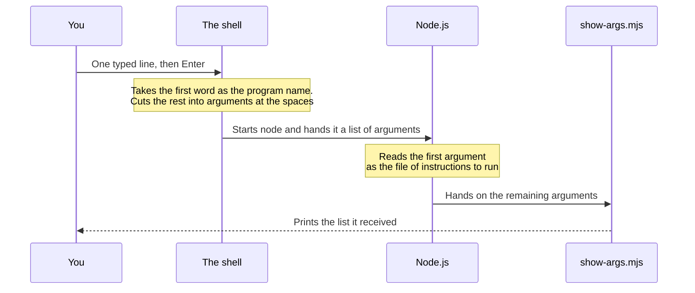

# What a program receives

At the end of the last lesson you found a file called `orders 2025.csv`, and a warning that its name would break a command. It does. The reason is the subject of this lesson, and it explains much more than spaces. It explains what the dashes in a command mean, why some instructions work in one terminal and fail in another, and why a program sometimes complains about a word you never typed.

The lesson answers one question:

> "I type one line. What does the program actually get?"

You need the kit from the lesson *Where the terminal is standing*, unchanged, and a terminal standing in the `terminal-practice-kit` folder. Confirm with `pwd`.

## 1. Start with a familiar situation: the order slip

Picture a busy sandwich counter. You speak to the person at the till. They do not make your food. They write a slip and pass it through a hatch, and behind the hatch are stations: one makes sandwiches, one makes soup, one makes coffee. The people at the stations never hear you. Everything they know about your order is on the slip.

Today the person at the till is new, and they have been taught one rule:

> "The first word the customer says is the station. After that, every word goes on its own line of the slip."

You say: *"Sandwich cheese plain."* The slip reads:

```text
To: SANDWICH
  1. cheese
  2. plain
```

The sandwich station reads line 1 as the filling and line 2 as an instruction about how to make it. You get a plain cheese sandwich. The rule worked.

Now you say: *"Sandwich egg mayonnaise plain."* You mean one filling, called egg mayonnaise. The slip reads:

```text
To: SANDWICH
  1. egg
  2. mayonnaise
  3. plain
```

The station reads line 1 as the filling: egg. Then it meets line 2, `mayonnaise`, where it expected an instruction or nothing, and calls back through the hatch: "One filling per sandwich, and I've got two here: egg, mayonnaise."

Look at who made the mistake, because it is not who complained. The station did its job correctly with what it was handed. The slip was wrong before it ever reached the hatch. And the station cannot see what you said. It cannot know that "egg mayonnaise" was one thing in your mouth, because the pause between the words is gone. Only lines arrive.

There is a way to fix it, and it belongs at the till, not in the kitchen. You say: *"Sandwich, and this is one item: egg mayonnaise. Then: plain."* The newcomer writes:

```text
To: SANDWICH
  1. egg mayonnaise
  2. plain
```

Three things to keep from this scene:

- The one who **cuts your words into lines** is not the one who **decides what the lines mean**.
- Whoever decides the meaning sees only the lines, never your sentence.
- If words belong together, you have to say so to the one who cuts.

### Pause and explain

The station said "I've got two fillings here". A customer who hears that might answer, "No, I ordered one sandwich with one filling!" Both are telling the truth. How?

The customer is describing what they said. The station is describing what arrived. Between the two stands the till, which changed one into the other by its rule. Whenever a program complains about something you are sure you did not type, think of the hatch: the complaint is about the slip.

## 2. The shell writes the slip

The till is the shell. The stations are programs. The slip is a list of **arguments**.

When you type a line and press Enter, the shell reads it before anything else happens. It takes the first word as the **name of the program to start**, exactly as you learned in *Set up a safe workspace*. It cuts the rest of the line into pieces **at the spaces**. Then it starts the program and hands it those pieces as a list. Each piece is one argument. The program receives the list and nothing else: not your original line, not the spaces, not how long you paused.

The kit has a program whose only job is to show you its slip. Run it:

```sh
node show-args.mjs hello world
```

```text
I received 2 arguments.
  1: [hello]
  2: [world]
```

The square brackets are printed by the program so that you can see exactly where each argument begins and ends. Now put six spaces between the words:

```sh
node show-args.mjs hello      world
```

The output is identical: two arguments, `[hello]` and `[world]`. The spaces were only places to cut. They were never handed over.

One detail about that command. The program the shell started is `node`. The shell handed Node.js three arguments: `show-args.mjs`, `hello` and `world`. Node.js takes its first argument to be the file of instructions to run, and hands the remaining ones on to that file's program. So there are two hand-overs, and `show-args.mjs` shows you the end of the chain. [Node.js: process.argv](https://nodejs.org/api/process.html#processargv)

Read this diagram from top to bottom. The arrows are hand-overs, and the boxes at the side say what happens at that point.



In words: you type one line. The shell takes the first word as the program to start and cuts the rest into arguments at the spaces. It starts Node.js with that list. Node.js reads the first argument as the file to run and hands the rest to that program, which here prints them back to you.

`show-args.mjs` is a measuring instrument. Whenever you are unsure what a command hands over, replace the program's name with `show-args.mjs` and look.

## 3. A name with a space

### Predict, then run with a space in the name

The file from the end of the last lesson is in `data/archive` and is called `orders 2025.csv`, with a space after `orders`. Here is the command that seems right for checking it:

```sh
node check-orders.mjs data/archive/orders 2025.csv
```

Before you press Enter, predict. How many arguments will `check-orders.mjs` receive? Write them down, one per line, as a slip. Then decide: who will be speaking in the message, the shell, Node.js, or `check-orders.mjs`?

Now run it. Then run the measuring instrument on the same words:

```sh
node show-args.mjs data/archive/orders 2025.csv
```

### Why the space broke it

The author's runs, the same in PowerShell, bash and zsh:

```text
check-orders: one order file is expected and 2 arguments arrived: [data/archive/orders] [2025.csv]
```

```text
I received 2 arguments.
  1: [data/archive/orders]
  2: [2025.csv]
```

The shell cut at the space, as its rule says. It does not know that you meant a file name, and it never checks whether files exist. `check-orders.mjs` received two arguments where it expects one file, and said so. This is the station calling back through the hatch.

Apply the method. **Who is speaking?** `check-orders`: it begins the message with its own name. So the shell found Node.js, Node.js found the program, and the program started. **What went wrong?** Two arguments arrived and one was expected. **Where?** It prints both, in brackets. The message is about the slip, and it shows you the slip.

The repair belongs at the till. Tell the shell that the words belong together, by putting them between **quotation marks**:

```sh
node show-args.mjs "data/archive/orders 2025.csv"
```

```text
I received 1 argument.
  1: [data/archive/orders 2025.csv]
```

One argument, with the space inside it. Look closely at what is **not** inside the brackets: the quotation marks. They were a message from you to the shell, "do not cut here", and the shell removed them after obeying. The program never sees them.

Now the real command works:

```sh
node check-orders.mjs "data/archive/orders 2025.csv"
```

```text
Checking data/archive/orders 2025.csv (limit 500.00)
Result: 3 orders checked, 3 in order, 0 with a problem.
```

Single quotation marks, `'...'`, keep words together as well. Section 6 shows the one difference between the two kinds.

This is also the full reason behind an early piece of advice. *Set up a safe workspace* told you to name your folder `course-work` and not `Course Work`. A name without a space never needs quotation marks, and a name with one needs them in every command, forever. When you name files and folders of your own, leave spaces out. When somebody else's name has one, quote it.

If you use Tab completion on a name with a space, the shell finishes the name and protects the space for you. That is convenient, and it hides the problem: people who always press Tab write instructions for others with the quotation marks missing.

### A good place to pause

You have the central mechanism: the shell cuts, the program receives a list, and quotation marks tell the shell where not to cut. The next sections cover what programs do with the list, and what else the shell changes on the way.

## 4. Options: arguments that change how the job is done

At the counter, "cheese" said **what** to make and "plain" said **how**. Arguments to a program divide the same way. Run the order checker on September's file in three ways:

```sh
node check-orders.mjs data/orders-2026-09.csv
node check-orders.mjs data/orders-2026-09.csv --quiet
node check-orders.mjs data/orders-2026-09.csv -q
```

```text
Checking data/orders-2026-09.csv (limit 500.00)
Result: 6 orders checked, 6 in order, 0 with a problem.
```

```text
Result: 6 orders checked, 6 in order, 0 with a problem.
```

The first run prints two lines. The second and third print only the `Result` line.

`--quiet` is an **option**: an argument that begins with dashes and changes how the program does its job. You met one in your very first command, `node --version`. Many programs give a common option two spellings: a **long** one with two dashes and a whole word, `--quiet`, which is easy to read, and a **short** one with one dash and one letter, `-q`, which is quick to type.

The order file's path is not an option. It says what to work on. Arguments like that are often called **positional**, because the program knows them by their position and not by a name.

Some options need a **value**. The checker reports any order whose total is above a limit, and the limit is 500 unless you say otherwise:

```sh
node check-orders.mjs data/orders-2026-09.csv --limit 100
```

```text
Checking data/orders-2026-09.csv (limit 100.00)
PROBLEM  line 5: order 0904 total 180.00 is above the limit
PROBLEM  line 7: order 0906 total 130.00 is above the limit
Result: 6 orders checked, 4 in order, 2 with a problem.
```

Look at this with the instrument:

```sh
node show-args.mjs data/orders-2026-09.csv --limit 100
```

```text
I received 3 arguments.
  1: [data/orders-2026-09.csv]
  2: [--limit]
  3: [100]
```

To the shell, `--limit` and `100` are two ordinary pieces. It cut at the space between them like anywhere else. It is the **program** that reads `--limit` and then takes the next argument as the amount. The shell knows nothing about options. It does not know which words are options, whether they exist, or whether they need a value. All of that is decided behind the hatch.

That has a consequence you can observe. Mistype the option:

```sh
node check-orders.mjs data/orders-2026-09.csv --limt 100
```

```text
check-orders: unknown option --limt. For the options it accepts: node check-orders.mjs --help
```

The program is speaking, not the shell. The shell was content: it found `node` and handed over four arguments. Only the program could know that `--limt` means nothing to it. Compare that with typing `nod` for `node`, where the shell spoke, because finding the program is the shell's job. Who complains tells you which half of the command was wrong.

Leave the amount out and the program explains that too:

```text
check-orders: the option --limit needs an amount after it, such as --limit 200
```

### Ask the program: `--help`

How would you know that `--limit` and `--quiet` exist? Not from the shell, and not reliably from memory or from a search result. The program itself is the first source, because it is the only one that cannot be out of date about itself. Nearly every command-line program answers `--help`:

```sh
node check-orders.mjs --help
```

```text
check-orders 1.0.0

Checks one file of orders and lists the orders that need a second look.

Usage:
  node check-orders.mjs <order file> [options]

Options:
  --limit <amount>   Report an order whose total is above this amount (default 500.00)
  -q, --quiet        Print only the Result line
  --settings         Print the settings in use and where each one came from, then stop
  -h, --help         Print this help, then stop
  --version          Print the version, then stop

Environment variables:
  ORDERS_LIMIT       The limit to use when --limit is not given
  ORDERS_DIR         A folder to look in when the order file is not a full path

Exit codes:
  0  every order is in order
  1  at least one order has a problem
  2  the check could not be done (no such file, or an option it does not know)
```

Help texts share a small notation, and it is worth learning once.

- The **Usage** line is the shape of a command.
- Words in angle brackets, `<order file>` and `<amount>`, are placeholders. You replace the brackets and the words with a value of your own. You never type the brackets.
- Square brackets, `[options]`, mean "you may leave this out".
- `-q, --quiet` lists two spellings of one option.

The last two parts of this help text, environment variables and exit codes, are the subjects of later lessons in this module. You can already see that the program documents them.

When you find a command in a search result, a forum or an AI assistant's answer, compare it with what `--help` says on **your** computer. Programs change between versions, and an option that existed for the person who wrote the answer may not exist in yours, or may mean something else. The version is one option away: `node check-orders.mjs --version` prints `check-orders 1.0.0`.

### Options are a habit, not a law

Two dashes for words and one dash for letters is a widespread habit among programs. It is not a rule of the terminal, and each program decides its own. Three things you will meet:

- Some programs let you join an option and its value with an equals sign, `--limit=100`. This one does not, and says `unknown option --limit=100`.
- Some programs care about the order of options and positional arguments. This one does not: `--limit 100` works before the file as well as after it.
- PowerShell's own commands, the ones built into it, write whole words after a single dash, such as `-Recurse`. That is PowerShell's habit for its own commands. A program you start from PowerShell still follows its own rules: `-limit` gets you `unknown option -limit` from the checker.

The help text settles all three. That is why it comes first.

## 5. Which program is speaking, again

You have now seen three different refusals. Put them side by side.

| What you typed wrong | Who spoke | Why that one |
| --- | --- | --- |
| The program's name: `nod` for `node` | The shell | Finding the program is the shell's job |
| The file to run: a wrong path to `check-orders.mjs` | Node.js | Node.js reads its first argument as a file and looks for it |
| An argument: a space cut a name in two, or `--limt` | `check-orders` | Only the program knows what its arguments should be |

This is the road from the lesson *When something goes wrong*, with one more stop at the end. Each stop can only check its own part. The shell does not read your options, and the program cannot see your spaces.

## 6. What the shell fills in before it cuts

The till in the story only cut. A real shell does one more thing on the way: it **replaces** certain pieces of what you typed with something else, and the program receives the replacement. The technical word is **expansion**. Two kinds matter now.

### Variables

A shell keeps named values called **variables**. To use one, you write a dollar sign and its name. One exists in every shell this course uses: `HOME`, which holds the path of your home folder. Hand it to the instrument three ways:

```sh
node show-args.mjs $HOME "$HOME" '$HOME'
```

The author's run in PowerShell:

```text
I received 3 arguments.
  1: [C:\Users\maria]
  2: [C:\Users\maria]
  3: [$HOME]
```

On Linux, arguments 1 and 2 read `/home/maria`, and argument 3 is the same.

Read each one.

1. `$HOME` with no quotation marks: the shell replaced it with the folder's path. The program never saw a dollar sign.
2. `"$HOME"` in **double** quotation marks: replaced as well. Double quotation marks keep words together and still let the shell fill in variables.
3. `'$HOME'` in **single** quotation marks: handed over exactly as typed. Single quotation marks mean "change nothing in here".

That is the one difference between the two kinds of quotation mark, and it is the same in PowerShell, bash and zsh. Double: keep together, fill in. Single: keep together, leave alone. [PowerShell: quoting rules](https://learn.microsoft.com/powershell/module/microsoft.powershell.core/about/about_quoting_rules) [Bash manual: quoting](https://www.gnu.org/software/bash/manual/bash.html#Quoting)

You do not need variables of your own yet. The fifth lesson of this module is about them. What you need today is to recognise a `$` in a command as something the shell will act on before the program starts.

### Wildcards, and a real difference between shells

A star, `*`, in a path stands for "any run of characters". `data/*.csv` describes every name in `data` that ends in `.csv`. It is called a **wildcard**. What happens to it depends on your shell, and this is the first place in this module where the shells truly disagree.

```sh
node show-args.mjs data/*.csv
```

```text
bash or zsh (the author's run):
I received 3 arguments.
  1: [data/orders-2026-09.csv]
  2: [data/orders-2026-10.csv]
  3: [data/orders-2026-11.csv]

Windows PowerShell (the author's run):
I received 1 argument.
  1: [data/*.csv]
```

In bash and zsh, the **shell** looks in the folder, finds the three matching names, and writes all three on the slip in place of the pattern. The program receives three arguments and cannot tell that you typed a star.

PowerShell does not do that for a program such as `node`. It hands the pattern over as it stands, one argument with a star in it, and leaves the program to deal with it. PowerShell's own built-in commands, such as `ls`, understand patterns themselves, so `ls data/*.csv` lists the three files in every shell. [Bash manual: filename expansion](https://www.gnu.org/software/bash/manual/bash.html#Filename-Expansion) [PowerShell: parsing](https://learn.microsoft.com/powershell/module/microsoft.powershell.core/about/about_parsing)

Two more differences of the same kind:

- When **nothing** matches the pattern, bash hands the pattern over unchanged, and zsh refuses to run the command at all, with `zsh: no matches found: data/*.txt`.
- The home-folder sign `~` is filled in by bash and zsh for every program. PowerShell fills it in only for its own commands, such as `cd ~`, and hands a bare `~` to `node` unchanged.

Quotation marks of either kind switch wildcard filling off in every shell: `"data/*.csv"` arrives as one argument with a star in it.

Why does this matter to you? Because the same instruction can mean different things on two computers. "Run the checker on `data/*.csv`" hands a Linux user's program three files, and a Windows user's program one odd name. Neither person typed anything wrong. When an instruction contains `*`, `~` or `$`, ask what it will have become by the time the program sees it, and use the instrument to find out.

### Other characters the shell acts on

Several more characters mean something to a shell, so it acts on them and does not hand them over. You will learn the important ones in the fourth lesson of this module. For now, recognise them:

| Character | What the shell does with it |
| --- | --- |
| `;` | Ends one command and begins another on the same line |
| `>`, `<`, `\|` | Send output to a file, or pass it between programs: the fourth lesson |
| `&` | Has a special meaning in bash and zsh. PowerShell refuses it outright |
| `#` | Begins a comment: the shell ignores the rest of the line |
| `\` in bash and zsh | Protects the one character after it, and is then removed |
| `` ` `` in PowerShell | The same job as `\` has in bash and zsh |

The backslash row explains something from the last lesson. In bash and zsh, a Windows-style path loses its separators before the program sees it:

```sh
node show-args.mjs data\archive\orders 2025.csv
```

```text
bash or zsh (the author's run):
I received 2 arguments.
  1: [dataarchiveorders]
  2: [2025.csv]
```

Each backslash protected the letter after it and was removed. That is why these lessons write `/`, and why instructions written on Windows with backslashes fail on macOS and Linux.

A practical rule covers all of this. **If an argument contains anything other than letters, digits, dots, dashes, underscores and forward slashes, put it between single quotation marks, and check it with `show-args.mjs` if you are unsure.**

One limit, stated plainly. An argument that must itself contain a quotation mark is a harder case, and Windows PowerShell 5.1 handles it in a surprising way: in the author's run, `'say "hi"'` arrived at the program as `[say hi]`, with the inner quotation marks gone, while bash and zsh delivered `[say "hi"]`. This module avoids such arguments. When you meet one, measure it with the instrument before you trust it.

## 7. Try it with less help

Complete explanations follow these four practices. Say your answer in your own words before you read them.

### Practice A: write the slip

For each command, predict how many arguments `show-args.mjs` receives and what is in each. Write your prediction for **your own** shell. Then run each one and compare.

```sh
node show-args.mjs one two   three
node show-args.mjs "one two" three
node show-args.mjs --limit 250 "notes for May.txt"
node show-args.mjs 'Total: $HOME'
node show-args.mjs "Total: $HOME"
node show-args.mjs data/archive/*.csv
```

### Practice B: read a usage text

This is the help of a program you have not seen. It is fictional and is not in the kit.

```text
Usage:
  node send-report.mjs <report file> --to <address> [--copy <address>] [-d, --dry-run]

Options:
  --to <address>     Who receives the report
  --copy <address>   Somebody who receives a copy
  -d, --dry-run      Show what would be sent, and send nothing
```

1. Which parts must always be given?
2. Write a command that would show what sending the file `summary for June.txt` to `orders@shop.example` would do, without sending it.
3. A colleague types `node send-report.mjs <summary.txt> --to <orders@shop.example>` and gets an error. What did they misread?
4. How many arguments does the program receive from your command in question 2?

### Practice C: repair three commands

Each of these fails or does the wrong thing. For each, say **who would be speaking** in the message, then repair it and run the repaired command.

```sh
node check-orders.mjs data/archive/orders 2025.csv --quiet
node check-orders.mjs data/orders-2026-09.csv --limit
node check-orders.mjs data/orders-2026-09.csv -quiet
```

### Practice D: the same instruction on two computers

Two learners follow the same line from a set of instructions:

```sh
node check-orders.mjs data/*.csv
```

Dana uses PowerShell on Windows. Tomás uses bash on Linux. Both get an error from `check-orders`, and the two errors are different.

1. What does `check-orders.mjs` receive on each computer?
2. Using what you have seen of its messages, what is each learner's error about?
3. Dana says, "It can't find the file, so the star must be wrong." Tomás says, "It found too many files, so the star works." Which parts of those two sentences are observations and which are inferences?
4. The instructions were meant to check September's file. Rewrite the line so that it does the same thing on both computers.

### Practice explanations

**A.**

1. Three arguments: `[one]`, `[two]`, `[three]`. The extra spaces before `three` are only a place to cut.
2. Two arguments: `[one two]` and `[three]`. The quotation marks kept the first two words together and were then removed.
3. Three arguments: `[--limit]`, `[250]` and `[notes for May.txt]`. The shell does not know that `--limit` is an option or that `250` belongs to it. It cuts at spaces outside quotation marks, and nothing else.
4. One argument, `[Total: $HOME]`. Single quotation marks: nothing is filled in.
5. One argument, with your home folder's path in place of `$HOME`, such as `[Total: C:\Users\maria]`. Double quotation marks keep the words together and still fill in the variable.
6. This one depends on your shell. In bash and zsh: one argument, `[data/archive/orders 2025.csv]`. The shell filled in the one matching name, and it arrives as **one** argument, space included, because the cutting at spaces applies to what you typed and not to names the shell fills in. In PowerShell: one argument, `[data/archive/*.csv]`, the pattern as typed.

If you predicted two arguments for number 6 in bash or zsh, you applied the cutting rule one step too late. It is a reasonable guess, and it is the kind of thing the instrument is for.

**B.**

1. The report file and `--to` with an address. Neither has square brackets around it. `--copy` and `--dry-run` are in square brackets, so they may be left out.
2. `node send-report.mjs "summary for June.txt" --to orders@shop.example --dry-run`. The file name needs quotation marks because of its spaces. `-d` in place of `--dry-run` is the same command. Putting the address in single quotation marks is harmless and follows the practical rule of Section 6, since `@` is not on its list of safe characters.
3. They typed the angle brackets. `<report file>` is a placeholder: the brackets mark the place where your value goes. Typed literally, `<` and `>` are also characters the shell acts on, so the command failed before the program could explain.
4. Four: `[summary for June.txt]`, `[--to]`, `[orders@shop.example]`, `[--dry-run]`.

**C.**

1. `check-orders` speaks: `one order file is expected and 2 arguments arrived: [data/archive/orders] [2025.csv]`. The option was not the problem. Repair: `node check-orders.mjs "data/archive/orders 2025.csv" --quiet`, which prints `Result: 3 orders checked, 3 in order, 0 with a problem.`
2. `check-orders` speaks: the option `--limit` needs an amount after it. Repair by giving one, for example `--limit 100`, or by removing the option.
3. `check-orders` speaks: `unknown option -quiet`. One dash goes with one letter and two dashes with a word, in this program. Repair: `--quiet` or `-q`.

In all three the shell was satisfied, because the program's name was right and the line could be cut. In all three the program started and then refused. If you answered "the shell" for any of them, go back to the table in Section 5.

**D.**

1. Dana's program receives one argument, `[data/*.csv]`: PowerShell hands the pattern over unchanged. Tomás's program receives three arguments, the three file paths: bash filled them in.
2. Dana's checker looks for a file literally named `*.csv` in `data`, finds none, and reports that it cannot read that file. Tomás's checker receives three arguments where it expects one, and reports that one order file is expected and 3 arguments arrived.
3. "It can't find the file" and "it found too many files" are close to observations, though each is a report in the learner's words and the pasted message would be better. "So the star must be wrong" and "so the star works" are inferences. Both are partly mistaken. The star did nothing on Dana's computer, and on Tomás's it was the shell, not the checker, that found three files.
4. `node check-orders.mjs data/orders-2026-09.csv`. Naming the one file removes the wildcard, and with it the difference between the shells. Instructions meant for more than one kind of computer are safest when they contain nothing for a shell to fill in.

## 8. What you should be able to explain now

Close the lesson for a moment and explain to an imaginary friend who has just said "my command breaks whenever the file name has a space":

- What does the shell do to a typed line before the program starts?
- What does the program receive, and what can it not know about what you typed?
- What do quotation marks tell the shell, and what happens to them afterwards?
- What is an option, and who decides which options exist?
- Where do you look first to find out which options a program accepts?
- A message says an option is unknown. Who is speaking, and what does that tell you?
- What is the one difference between single and double quotation marks?
- What does `data/*.csv` become in bash or zsh, and what does it become in PowerShell?
- How do you find out what any command hands over?

You are ready for the next lesson when you can answer these in your own words, when you have repaired the command with the space yourself, and when you have seen with `show-args.mjs` what your own shell does with a `$` and a `*`.

So far every command in this module has only looked. The next lesson changes things: it creates, copies, moves and deletes. Everything from these two lessons, where you are standing and what the shell hands over, decides whether a delete command removes what you meant or something else.

## If something does not match

**PowerShell prints `>>` and waits.** You opened a quotation mark and did not close it, so PowerShell is waiting for the rest. Press Ctrl+C to cancel the line, and type it again. bash and zsh show a `>` or a similar short prompt in the same situation.

**Practice A, number 6, shows "no matches found".** You are using zsh and the terminal is not in the kit folder, so the pattern matched nothing. Check with `pwd`.

**`$HOME` prints nothing between the brackets.** The variable is not set in your shell, which is unusual. Note which shell the terminal panel names, and include that in a help request.

**A command from this lesson gives a different count of arguments.** Compare your typed line with the lesson's, character by character, looking at spaces and the kind of quotation mark. Text copied from a word processor or a chat program sometimes carries curved quotation marks, `“ ”`, which a shell does not treat as quotation marks at all.
