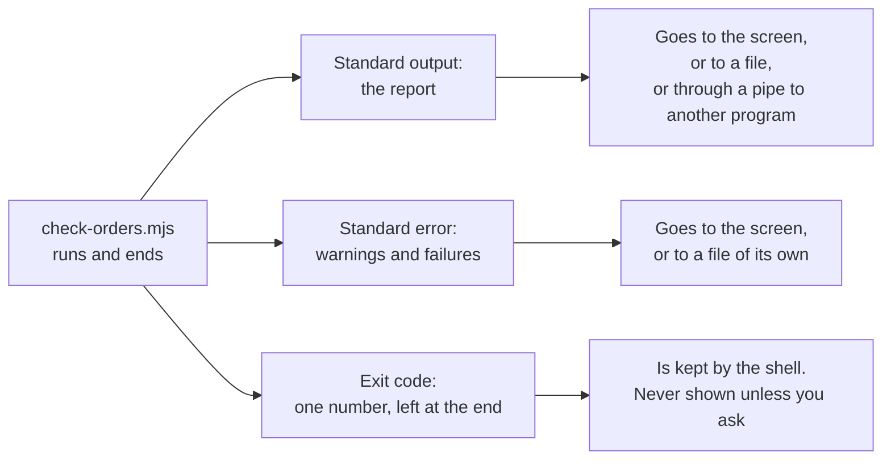

# Output, messages and the exit code

Until now you have treated what a program prints as one thing: text on the screen. You read it, and that was the end of it.

A program in fact leaves three separate things behind, and only two of them are text. They are meant for different readers. One of them you have never seen, although every program you have run in this course produced it, and although it is the one that other programs care about most.

The lesson answers one question:

> "A program printed some lines and stopped. How does anyone, a person or another program, know whether it worked?"

You need the kit from the lesson *Where the terminal is standing*, and a terminal standing in the `terminal-practice-kit` folder. Confirm with `pwd`.

## 1. Start with a familiar situation: a delivery

You have ordered a pair of shoes online. Think about what a delivery actually consists of. It is three things, and they go to three different places.

**The parcel.** This is what you ordered. It is the reason for the whole exercise. If you are out, it might go to a neighbour or a pick-up point, and it is still the parcel: you can send it somewhere else without opening it.

**The card through the door.** *"Tried at 10:40. Left with number 12. Box slightly dented."* This is not what you ordered. It is the courier talking to you **about** the delivery. Nobody puts the card inside the parcel, for a good reason: if the parcel goes to a pick-up point, you still need the card, at your door, where you will see it.

**The tracking status.** One word on the shop's website: *Delivered*, or *Failed*. You may look at it, but it was not made for you. It was made for the shop's computer. That computer does not read cards and cannot open parcels. It reads one word, and on that word alone it decides what happens next: close the order, or send a replacement and refund you.

Now the part everybody has lived through. The status says **Delivered**. There is no parcel. Not at the door, not at number 12.

What exactly has gone wrong there? The status is not a fact about your doorstep. It is the **courier's own claim**, entered by the courier, about what the courier did. Usually the claim is true. The shop's computer cannot tell the difference, so it has closed your order, and it will stay closed until a person looks at the evidence.

Keep three points.

- The thing you wanted, and the remarks about it, travel separately, so that each can reach the right reader.
- The status is tiny, and it is for machines. Whatever acts automatically, acts on the status.
- The status is a claim by the one who did the work. It deserves the trust you would give that worker's word, and no more.

### Pause and explain

Why would it be a bad design to print the courier's remarks on a sheet inside the parcel?

Because the parcel does not always come to you. When it is redirected, the remarks go with it and you never see them. And whoever opens the parcel expects shoes, and gets shoes mixed with notes. Keeping the two apart lets the parcel be passed along untouched while the remarks still reach a person.

## 2. Two streams that look like one

Run the order checker on October's file. You have not used this file before.

```sh
node check-orders.mjs data/orders-2026-10.csv
```

The author's run, the same in every shell:

```text
check-orders: warning: line 10 skipped, it has 5 fields and 6 are expected
Checking data/orders-2026-10.csv (limit 500.00)
PROBLEM  line 4: order 1003 has quantity 0
PROBLEM  line 6: order 1005 total 640.00 is above the limit
PROBLEM  line 8: order 1007 total 31.00 is not 3 x 10.50
Result: 8 orders checked, 5 in order, 3 with a problem.
```

Six lines of text, all in the same place, all looking alike. But read them as a delivery. Five of them are the report: the thing you ran the program for. One of them, the first, is different in kind. It is not a finding about an order. It is the program remarking on its own work: one line of the file was unreadable, and it was left out. That is a card through the door.

The program did not send those six lines the same way. Every program is given two separate channels for text when it starts.

- **Standard output**, often shortened to **stdout**. This is for the result: the thing the program exists to produce. It is the parcel.
- **Standard error**, often shortened to **stderr**. This is for messages about the work: warnings, failures, progress notes. It is the card. The name is narrower than the use. A warning is not an error, and it goes there all the same.

A channel like this is called a **stream**, because text flows through it line by line. Both streams normally end at the same place, your terminal, which is why you have never noticed there are two. To see them come apart, send one of them somewhere else.

### Predict, then send the report into a file

A `>` after a command means: do not show the standard output, **write it into this file**. This is called **redirecting**.

```sh
node check-orders.mjs data/orders-2026-10.csv > report.txt
```

Before you press Enter, predict. Which of the six lines will end up in `report.txt`? Will anything still appear on the screen, and if so, what?

Now run it. Then print the file:

```sh
cat report.txt
```

### What stayed on the screen

The author's run. On the screen, after the command:

```text
check-orders: warning: line 10 skipped, it has 5 fields and 6 are expected
```

And in the file:

```text
Checking data/orders-2026-10.csv (limit 500.00)
PROBLEM  line 4: order 1003 has quantity 0
PROBLEM  line 6: order 1005 total 640.00 is above the limit
PROBLEM  line 8: order 1007 total 31.00 is not 3 x 10.50
Result: 8 orders checked, 5 in order, 3 with a problem.
```

The parcel went to the file. The card still came to your door. `>` redirected standard output only, and the warning travelled on the other stream.

Think about why that is the helpful behaviour. Suppose you send this report to the accountant every month. You want the file to hold the report and nothing else. And you want to **see** that a line was skipped, at the moment you run it, without having to open the file. Had the warning gone into the file, you would have sent the accountant a report with a stray remark in it, and never known that order 1009 was not checked at all.

It also explains the order of the six lines in the first run. The warning came first because the program wrote it at the moment it met the bad line, and it wrote the report at the end. The two streams are independent, and the screen showed each line as it arrived.

Three practical details about `>`.

- **It replaces without asking.** If `report.txt` exists, its old content is destroyed. This is the trap from *Change files without regret*, in a new form: redirecting to a file is a write. Two greater-than signs, `>>`, **add** to the end of the file and leave what is there.
- **The file appears in the current folder**, because `report.txt` is a relative path. The lesson *Where the terminal is standing* applies to output as much as to input.
- **On Windows PowerShell 5.1** the file is saved in a text encoding called UTF-16. VS Code and `cat` read it correctly. Some other programs expect a different encoding and show gaps between the letters or odd characters at the start. The file is not damaged if that happens. Text encodings are taught in the programming stage.

## 3. Catching the messages as well

Standard error can be redirected too. The two streams are numbered: standard output is 1 and standard error is 2. So `2>` means "write stream 2 into this file":

```sh
node check-orders.mjs data/orders-2026-10.csv 2> messages.txt
cat messages.txt
```

Now the five report lines appear on the screen and the warning goes into the file. What the file contains depends on your shell, and the difference needs explaining.

```text
bash or zsh (the author's run):
check-orders: warning: line 10 skipped, it has 5 fields and 6 are expected

Windows PowerShell 5.1 (the author's run):
node : check-orders: warning: line 10 skipped, it has 5 fields and 6 are expected
At line:1 char:1
+ node check-orders.mjs data/orders-2026-10.csv 2> messages.txt
+ ~~~~~~~~~~~~~~~~~~~~~~~~~~~~~~~~~~~~~~~~~~~~~~~~~~~~~~~~~~~~~
    + CategoryInfo          : NotSpecified: (check-orders: w... 6 are expected:String) [], RemoteException
    + FullyQualifiedErrorId : NativeCommandError
```

bash and zsh wrote the program's line as it was. Windows PowerShell 5.1 wrapped it in its own error report: it put `node :` in front and added five lines of its own. Read it with the method from *When something goes wrong*. Who is speaking? Two voices. The first line, after `node :`, is the program's own message. The lines beginning `At line` and `+` are PowerShell describing where the message came from. The words `NativeCommandError` and `RemoteException` sound alarming and mean only "a program outside PowerShell wrote to standard error". Nothing failed: it was a warning. [PowerShell: redirection](https://learn.microsoft.com/powershell/module/microsoft.powershell.core/about/about_redirection)

Both streams can go to two files in one command, and that is the usual way to keep a full record of a run:

```sh
node check-orders.mjs data/orders-2026-10.csv > report.txt 2> messages.txt
```

Nothing at all appears on the screen now. The prompt returns in silence, as after a successful `cp`. That silence does not mean "all in order". It means only that both streams went elsewhere.

One more form you will meet in other people's instructions sends the messages nowhere: `2> /dev/null` in bash and zsh, `2> $null` in PowerShell. It throws the card away unread. It makes output tidy, and it is how people stay unaware for months that a line is being skipped. Be suspicious of it in any instruction you are given.

## 4. Passing the parcel on: the pipe

A file is one place to send standard output. Another program is the other. The character `|`, called a **pipe**, connects the standard output of the program on its left to the input of the program on its right.

The kit has a small program for the right-hand side. `keep-lines.mjs` reads lines and passes on only those containing a word you name:

```sh
node check-orders.mjs data/orders-2026-10.csv | node keep-lines.mjs PROBLEM
```

```text
check-orders: warning: line 10 skipped, it has 5 fields and 6 are expected
PROBLEM  line 4: order 1003 has quantity 0
PROBLEM  line 6: order 1005 total 640.00 is above the limit
PROBLEM  line 8: order 1007 total 31.00 is not 3 x 10.50
keep-lines: kept 3 lines containing PROBLEM
```

Follow each line.

- The checker's five report lines went into the pipe and never reached the screen directly. `keep-lines` received them, kept the three containing `PROBLEM`, and wrote those to **its** standard output, which is the screen.
- The checker's warning did not go into the pipe. A pipe carries standard output only. The warning went to the screen by itself, which is why you still see it, although it does not contain the word `PROBLEM`.
- The last line is `keep-lines` remarking on its own work, on its own standard error.

This is the redirected parcel. The first program's result was handed to a second program, unopened by you, and both programs' remarks still reached you.

Each shell comes with a tool that does what `keep-lines.mjs` does. In bash and zsh it is `grep PROBLEM`. In PowerShell it is `Select-String PROBLEM -CaseSensitive`. Without `-CaseSensitive`, PowerShell's tool ignores capitals, and in the author's run it also kept the `Result:` line, because that line ends in the word "problem".

Here is the whole picture. Read it from left to right.



In words: a program that runs and ends leaves three things. Its standard output, here the report, goes to the screen unless you send it to a file or through a pipe to another program. Its standard error, the warnings and failures, goes to the screen unless you send it to a file of its own. Its exit code is a single number left at the end, which the shell keeps and does not show unless you ask.

That third box is the tracking status.

## 5. The exit code

When a program ends, it hands one whole number back to whatever started it. The number is its **exit code**, also called its **exit status**. It is not printed. The shell stores it, and you have to ask to see it. How you ask is one of the real differences between the shells.

| Shell | Ask for the last program's exit code |
| --- | --- |
| PowerShell | `$LASTEXITCODE` |
| bash or zsh | `echo $?` |

Run the checker on three files, and ask after each one. September first:

```sh
node check-orders.mjs data/orders-2026-09.csv -q
```

Then ask, in your shell's way. Then do the same for October and for a month that does not exist:

```sh
node check-orders.mjs data/orders-2026-10.csv -q
node check-orders.mjs data/orders-2026-13.csv
```

The author's results:

| Command | What was printed | Exit code |
| --- | --- | --- |
| September | `Result: 6 orders checked, 6 in order, 0 with a problem.` | `0` |
| October | the warning, then `Result: 8 orders checked, 5 in order, 3 with a problem.` | `1` |
| Month 13 | `check-orders: cannot read the file ...data\orders-2026-13.csv` | `2` |

There is one rule that nearly every program follows: **0 means success, and any other number means something else happened.** It is the opposite of what you might guess, and the reason is practical. There is one way for a job to go right and many ways for it to go wrong, so the one number that stands apart is given to success, and the others are left for the different kinds of trouble.

What each non-zero number means is **decided by each program**. There is no general table. You find out where you found the options: in the program's own help. Look again at the end of `node check-orders.mjs --help`:

```text
Exit codes:
  0  every order is in order
  1  at least one order has a problem
  2  the check could not be done (no such file, or an option it does not know)
```

Notice the distinction this program draws between 1 and 2, because many checking tools draw the same one. Exit code 1 means: *I did my job, and the answer is bad news.* Exit code 2 means: *I could not do my job, so there is no answer.* Those call for different reactions. After a 1 you look at the orders. After a 2 you look at your command. Treating a 2 as "the orders are bad", or as "the orders are fine because no problems were listed", are both mistakes, and the second is the more dangerous.

### Read it at once

The shell keeps only the most recent exit code. Each new program overwrites it. In bash and zsh, even asking counts: `echo` is a command, so a second `echo $?` straight after the first prints `0`, which is the exit code of the first `echo`. Ask once, immediately, and write the number down.

Two more cases where the number is not what you might expect.

**After a pipe**, the number belongs to the last program in the pipe. In the author's runs, `node check-orders.mjs data/orders-2026-10.csv | node keep-lines.mjs PROBLEM` left `0` in both PowerShell and bash, although the checker found three problems and ended with 1. `keep-lines` ended happily, and its code is the one that was kept.

**When the shell cannot find the program at all**, no program ran, so no program left a code. The shells handle that differently. In the author's runs, after `nod --version`, bash and zsh reported `127`, a number they use themselves for "command not found". PowerShell's `$LASTEXITCODE` still showed `2`, left over from the program before. So in PowerShell, a number is only meaningful if a program actually ran just before you asked.

You may also meet `$?` in PowerShell. There it is not a number: it answers `True` or `False`. For the exit code of a program, use `$LASTEXITCODE`. [PowerShell: automatic variables](https://learn.microsoft.com/powershell/module/microsoft.powershell.core/about/about_automatic_variables) [Bash manual: exit status](https://www.gnu.org/software/bash/manual/bash.html#Exit-Status) [Node.js: process.exitCode](https://nodejs.org/api/process.html#processexitcode_1)

## 6. Who reads it

You can read a report. So why does the number exist?

Because most programs, most of the time, are not started by a person watching a screen. They are started by other programs: a script that runs five steps in a row, a tool that runs a check every time a file changes, a system that checks a team's work overnight. None of them can read English. Each of them needs to decide one thing: carry on, or stop. They decide it on the exit code and on nothing else.

You can see that decision being made. In bash and zsh, two ampersands between two commands mean: **run the second only if the first ended with 0**.

```sh
node check-orders.mjs data/orders-2026-09.csv -q && echo "all in order"
node check-orders.mjs data/orders-2026-10.csv -q && echo "all in order"
```

```text
bash or zsh (the author's run):
Result: 6 orders checked, 6 in order, 0 with a problem.
all in order

check-orders: warning: line 10 skipped, it has 5 fields and 6 are expected
Result: 8 orders checked, 5 in order, 3 with a problem.
```

September's check ended with 0, so `echo` ran. October's ended with 1, so `echo` never started. The shell did not read the word "problem". It read the number.

You will see `&&` in installation instructions everywhere, usually in the form "do this `&&` then that". **Windows PowerShell 5.1 does not accept it.** The author's run:

```text
The token '&&' is not a valid statement separator in this version.
```

Who is speaking? PowerShell, and it refused the whole line before running any of it. Newer versions of PowerShell do accept `&&`. In Windows PowerShell 5.1, run the two commands one after the other and look at `$LASTEXITCODE` in between, or write the decision out:

```powershell
node check-orders.mjs data/orders-2026-09.csv -q; if ($LASTEXITCODE -eq 0) { echo "all in order" }
```

You do not need to write lines like that yet. You need to be able to read `&&` in somebody's instructions and know what it does: it makes the second step depend on the first step's exit code. [PowerShell: pipeline chain operators](https://learn.microsoft.com/powershell/module/microsoft.powershell.core/about/about_pipeline_chain_operators)

### The status is a claim

Now the missing parcel. An exit code of 0 is the program's own statement that it did what it set out to do. It is exactly as reliable as the program.

- A badly written program can print "FAILED" in large letters and still end with 0. Everything that runs it automatically will record a success.
- A well-written program ends with 0 when **what it checks** is in order. The checker's 0 for September says that six orders have a quantity, a total that matches, and a total within the limit. It says nothing about whether those six are all the orders the shop took in September.
- October's run printed its warning and counted eight orders. The file has nine. The exit code, 1, was about the eight. Only the card through the door, the warning on standard error, tells you about the ninth.

So the three things answer three different questions, and none of them replaces another. The output says **what was found**. The messages say **what happened along the way**. The exit code says **how the program itself sums it up**, in a form a machine can act on.

## 7. Keeping the evidence of a failed run

In *When something goes wrong* you learned to paste the exact message into a help request and never to describe it. You can now do better than copying from the screen. A complete record of a run is four things:

1. The command, exactly as typed, and the folder it was typed in.
2. The standard output.
3. The standard error.
4. The exit code.

Redirecting gives you items 2 and 3 as files that cannot be mistyped, and that survive when you close the terminal. Item 4 has to be asked for at once and written down, because the next command destroys it. A report that says "exit code 2" tells a helper, before they read anything else, that the program could not do its job at all.

## 8. Try it with less help

Complete explanations follow these four practices. Say your answer in your own words before you read them.

### Practice A: which stream, which number?

For each command, predict three things before running it: what appears on the screen, what ends up in the file if there is one, and the exit code. Then run it, ask for the exit code at once, and compare.

```sh
node check-orders.mjs data/orders-2026-11.csv > november.txt
node check-orders.mjs data/orders-2026-11.csv --limt 100 > november.txt
node check-orders.mjs data/orders-2026-09.csv --quiet 2> messages.txt
```

After the second command, print `november.txt` with `cat`. What is in it, and why?

### Practice B: read three results

A colleague runs a nightly script that checks the month's orders and writes one line to a log. Here are three nights. For each, say what you know about the orders, what you do not know, and what you would look at next.

| Night | The script's log line |
| --- | --- |
| Monday | `check-orders ended with exit code 0` |
| Tuesday | `check-orders ended with exit code 1` |
| Wednesday | `check-orders ended with exit code 2` |

Then answer: on which of the three nights is "no problems were reported" true, and on which of those is it reassuring?

### Practice C: keep the evidence

Produce a complete record of this failing run, in files, without copying anything from the screen:

```sh
node check-orders.mjs data/orders-2026-10.csv --limit 100
```

1. Run it so that the report goes into `october-report.txt` and the messages into `october-messages.txt`.
2. Ask for the exit code and note it.
3. Print both files.
4. Write two sentences: what the report says, and what the messages say that the report does not.

When you have finished, delete the files this lesson created. Apply the three checks from *Change files without regret*: `pwd`, then `ls *.txt` to see exactly what a delete would remove, then the delete.

### Practice D: "It said Success"

A learner writes:

> "My colleague's script runs three steps joined with `&&`. The first step printed `Success!` and then the script just stopped, without running steps two and three and without any error. The script is clearly broken."

1. Which sentence parts are observations and which is an inference?
2. Using what you know about `&&`, give an explanation in which the script is working exactly as written.
3. What single thing would you ask the learner to check, and how, in their shell?
4. If your explanation is right, which program has the defect?

### Practice explanations

**A.**

1. Nothing on the screen. `november.txt` holds the three lines of November's report: the `Checking` line, one `PROBLEM` line for order 1104, and the `Result` line. Exit code 1, because one order has a problem. November's file has no unreadable line, so there is no warning and standard error stayed empty.
2. On the screen: `check-orders: unknown option --limt. For the options it accepts: node check-orders.mjs --help`. Exit code 2. `november.txt` is now **empty**. The shell created the file fresh before the program started, as `>` always does. The program then refused the option, wrote its complaint to standard error, and wrote nothing to standard output. The report from the first command is gone. A redirect destroys the old file even when the command fails.
3. On the screen: `Result: 6 orders checked, 6 in order, 0 with a problem.` Exit code 0. `messages.txt` exists and is empty, because the program had nothing to say on standard error. An empty messages file is a real observation: it tells you there were no warnings.

**B.**

- **Monday, 0.** Every order the program checked passed the three things it checks. You do not know whether any lines were skipped, because that is reported on standard error and the log shows only the code. Next: look at the saved messages, if the script kept them.
- **Tuesday, 1.** The check ran, and at least one order has a problem. You do not know which or how many. Next: the report.
- **Wednesday, 2.** The check could not be done. You know **nothing** about the orders. Perhaps the file had not arrived, or the script's command is wrong. Next: the messages, which will say why.

"No problems were reported" is true on Monday and on Wednesday. It is reassuring only on Monday, and only as far as the warning stream is also clean. On Wednesday no problems were reported because nothing was checked. A log that shows only exit codes makes Monday and Wednesday look as different as they should. A log that showed only "problems listed: none" would make them look the same.

**C.** One way:

```sh
node check-orders.mjs data/orders-2026-10.csv --limit 100 > october-report.txt 2> october-messages.txt
```

The exit code is 1. The report lists four orders with a problem: 1003 with quantity 0, 1005 and 1008 above the limit of 100, and 1007 with a total that does not match. It ends `Result: 8 orders checked, 4 in order, 4 with a problem.` The messages file holds the warning that line 10 was skipped, wrapped in PowerShell's own lines if you use Windows PowerShell 5.1. The report does not mention the skipped line at all, and its count of eight is one short of the nine orders in the file.

For the clean-up, `ls *.txt` should list only files you created in this lesson, such as `report.txt`, `messages.txt`, `november.txt` and the two October files. If it lists anything else, stop and delete by name instead of by pattern.

**D.**

1. Observations: the first step printed `Success!`, the script stopped, steps two and three did not run, and no error text appeared. Inference: "the script is clearly broken".
2. `&&` runs the next step only if the previous one ended with exit code 0. If the first step printed `Success!` and then ended with a non-zero exit code, the shell did exactly what `&&` says: it did not start step two. Nothing about that produces an error message. Stopping quietly is what `&&` does.
3. Run the first step alone and ask for its exit code straight afterwards: `$LASTEXITCODE` in PowerShell, `echo $?` in bash or zsh.
4. The first step's program. It printed a claim of success on one channel and reported failure on the other. The script believed the number, as every automatic reader does. Which of the two is true can only be settled by looking at what the step actually did.

## 9. What you should be able to explain now

Close the lesson for a moment and explain to an imaginary friend who has just said "it didn't print any error, so it worked":

- What are the two streams of text a program has, and what is each for?
- Why do both normally appear in the same place, and how do you separate them?
- What does `>` do to a file that already exists, and what does `>>` do?
- What travels through a pipe, and what does not?
- What is an exit code, and how do you ask for it in your shell?
- What does 0 mean, and where do you find the meaning of the other numbers?
- Why is "could not do the check" a different result from "the check found problems"?
- Who mainly reads exit codes, and what does `&&` do with one?
- Why is an exit code of 0 a claim and not a proof?

You are ready for the next lesson when you can answer these in your own words, when you have seen the warning stay on the screen while the report went into a file, and when you have read 0, 1 and 2 from the checker in your own shell.

One thing in this lesson was left unexplained. The help text listed two **environment variables**, and the report keeps printing `(limit 500.00)` as if the limit could come from somewhere other than the command. It can. The next lesson is about the settings a program is handed without your typing them.

## If something does not match

**`$LASTEXITCODE` prints nothing.** No program has run in this terminal yet, or you are in bash or zsh, where the question is `echo $?`.

**`echo $?` prints `True` or `False`.** You are in PowerShell. Use `$LASTEXITCODE`.

**PowerShell shows `>>` and waits after a command with `>`.** A quotation mark was left open. Press Ctrl+C and type the line again.

**`cat report.txt` in another tool shows spaces between all the letters.** The file was written by Windows PowerShell 5.1 in UTF-16, as Section 2 describes. Open it in VS Code.

**A file you expected is not in the kit folder.** It was created in whichever folder the terminal was standing in. Run `pwd` and look there.
