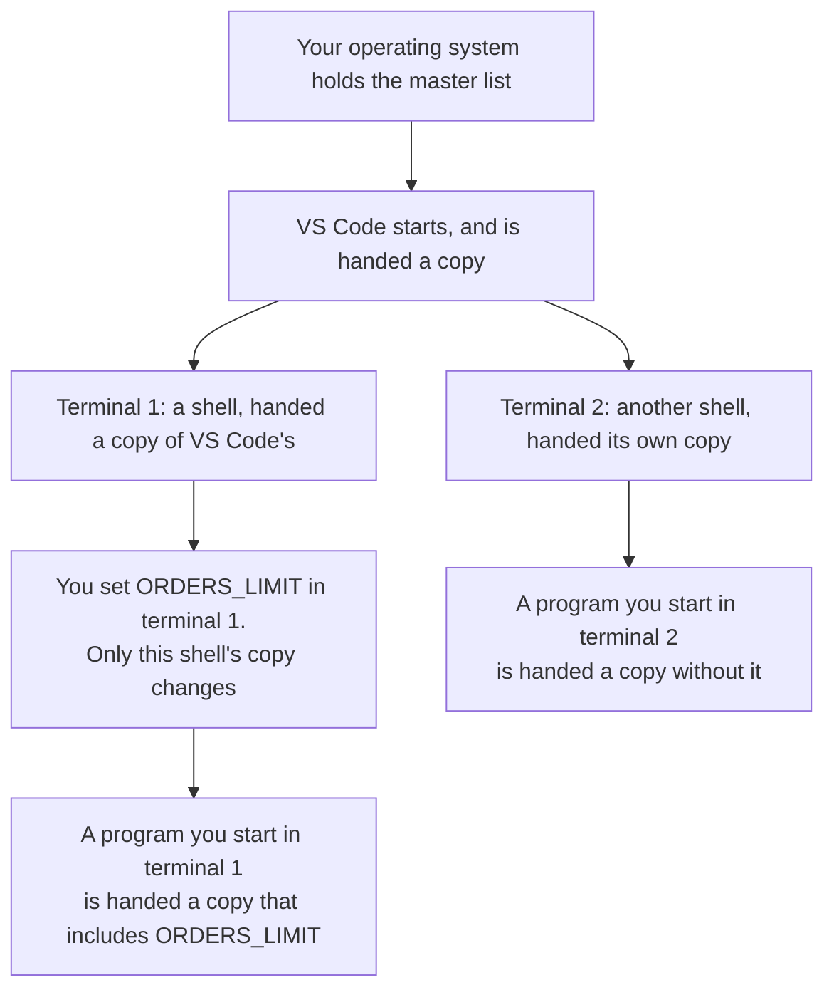

# The settings a program is handed

Two people sit at two computers. They have the same kit, the same order file and the same program. They type the same command, character for character. One is told that all six orders are in order. The other is told that two have a problem.

Neither made a mistake, and nothing is broken. You already know that a program's result depends on the folder it is started in and on the arguments it receives. There is a third thing it is handed, which you never type and cannot see on the command line.

The lesson answers one question:

> "The command is identical. What else can make the result different?"

You need the kit from the lesson *Where the terminal is standing*, and a terminal standing in the `terminal-practice-kit` folder. Confirm with `pwd`.

## 1. Start with a familiar situation: the handover sheet

An agency sends a worker to cover a reception desk for a day. The worker is experienced and knows the job: answer the phone, sign for parcels, book meeting rooms. What they cannot know is everything particular to this building. So at the door, the office manager hands them a sheet:

```text
Phone extension for IT: 4410
Parcels go to: room 2.07
Meeting rooms bookable until: 18:00
Fire assembly point: car park B
```

The worker reads from that sheet all day. The same person, with the same skills, would behave differently in the building next door, because the sheet there says different things. Nobody had to retrain them. Only the sheet changed.

Now three details about how the sheet travels.

**It is a copy, handed over at the start.** The manager printed it from a master list and kept the master. At eleven o'clock the manager changes the master: parcels now go to room 3.01. The worker's sheet still says 2.07. Nobody told them, and they have no reason to look. Parcels keep going to 2.07 until someone hands the worker a new sheet, which in practice means until the next person starts a shift.

**It gets passed down.** At noon a trainee arrives to help. The worker photocopies their own sheet and hands the copy over. The trainee's sheet is whatever the worker's sheet said at noon, including anything the worker had scribbled on it.

**It never travels up.** The trainee crosses out "18:00" and writes "17:00" on their own copy. The worker's sheet is unchanged. The manager's master is unchanged. A note on your own copy changes your own copy.

One more thing, which matters later. The sheet may also carry the alarm code. So it is not a thing to photograph and post on a noticeboard, however harmless most of its lines look.

### Pause and explain

At two o'clock a courier is sent to room 2.07 and finds it locked. The manager says, "But I updated the list at eleven." Both the manager and the worker did their jobs properly. What is the shortest correct explanation?

The worker is still reading the copy they were handed at nine. Updating the master does not reach copies already handed out. Hold on to that sentence. You met the same thing in *Set up a safe workspace*, where a terminal inside VS Code could not find a freshly installed Node.js until VS Code was restarted.

## 2. Every program gets a sheet

The sheet is called the **environment**. It is a list of named values, and each named value is an **environment variable**. Every program on your computer, when it starts, is handed an environment by whatever started it. The program may read any of it, or ignore it.

The kit has a program that reads its own sheet. Run it with no arguments:

```sh
node show-env.mjs
```

```text
This program was handed 104 environment variables when it started.
Name the ones you want to see, for example: node show-env.mjs ORDERS_LIMIT
```

That is the author's run on a Windows computer with many tools installed. On a bare Linux system the author's run showed 24. Your number will differ. You have never typed one of them. They were set up by your operating system, by installers, and by VS Code, and they have been handed to every program you ran in this course.

`show-env.mjs` prints only the variables you name, never the whole list. Section 7 gives the reason. Ask for one:

```sh
node show-env.mjs ORDERS_LIMIT
```

```text
ORDERS_LIMIT is not set
```

Nothing on the sheet has that name yet. You are about to write it on.

## 3. Write on the sheet, and watch a program change

Recall the help text of `check-orders.mjs`. It listed `ORDERS_LIMIT` under "Environment variables", as "the limit to use when --limit is not given". First, see where the program's limit comes from at the moment. It has an option for exactly that:

```sh
node check-orders.mjs --settings
```

```text
Settings in use:
  limit        500.00  (from the built-in default)
  orders dir   not set  (an order file is looked for from the current folder)
```

Now set the variable **for this terminal**. This is the first command in the module that is entirely different in the two families of shell, so use the one for yours.

```powershell
# PowerShell
$env:ORDERS_LIMIT = "100"
```

```sh
# bash or zsh
export ORDERS_LIMIT=100
```

Neither prints anything. In bash and zsh, write it without spaces around the `=`. From *What a program receives* you know why: a space would cut the line into separate words.

Ask the two programs again:

```sh
node show-env.mjs ORDERS_LIMIT
node check-orders.mjs --settings
```

```text
ORDERS_LIMIT = [100]
```

```text
Settings in use:
  limit        100.00  (from the environment variable ORDERS_LIMIT)
  orders dir   not set  (an order file is looked for from the current folder)
```

The value is on the sheet, and the checker says it is using it and where it found it.

### Predict, then run the unchanged command

Here is a command you ran in *Output, messages and the exit code*. Then, it reported six orders in order and ended with exit code 0.

```sh
node check-orders.mjs data/orders-2026-09.csv
```

Nothing in this command has changed. The file has not changed. The program has not changed. Before you press Enter, predict the `Result` line and the exit code.

Now run it, and ask for the exit code.

### What changed, and what did not

The author's run:

```text
Checking data/orders-2026-09.csv (limit 100.00)
PROBLEM  line 5: order 0904 total 180.00 is above the limit
PROBLEM  line 7: order 0906 total 130.00 is above the limit
Result: 6 orders checked, 4 in order, 2 with a problem.
```

The exit code is `1`.

The same command, the same file and the same program gave a different report and a different exit code. Anything that runs this check automatically would have recorded a pass an hour ago and records a failure now. The only thing that differs is a line on a sheet that the command does not show.

This is the pair of colleagues from the opening. It is also why a complete description of a run, in a help request or in a record of your own, sometimes needs more than the command and the folder. The environment is part of what the program was given. When a result differs between two computers, or between yesterday and today, and the command is the same, the environment is one of the first places to look.

The program helped you here: the first line of its report says `(limit 100.00)`. Many programs are less forthcoming, and you have to ask them, with an option like `--settings`, or look at the variable yourself.

## 4. Three places a setting can come from

The checker's limit can now come from three places. Try the third while the variable is still set:

```sh
node check-orders.mjs --settings --limit 250
```

```text
Settings in use:
  limit        250.00  (from the option --limit)
  orders dir   not set  (an order file is looked for from the current folder)
```

The option won, although the environment variable still says 100. This program's order is:

1. An **option** on the command line, if one is given.
2. Otherwise the **environment variable**, if it is set.
3. Otherwise the **built-in default**.

That order is very common, and it is reasonable. An option speaks for this one run, and it is right there in the command where you can see it. The environment speaks for this terminal, or this computer: it suits things that stay the same from run to run, such as where the order files live on this machine. The default is the program's own guess for when nobody has said anything.

It is a habit of programs and not a law, like the dashes of options. Each program decides, and its documentation is where you check.

A value on the sheet is always **text**. The brackets in `[100]` show exactly the characters the program was handed. The program has to make sense of them, and it complains if it cannot. Set the variable to the word `cheap` in the same way, and run the check on September's file again:

```text
check-orders: the limit must be an amount such as 200 or 199.50, and it is [cheap]
```

The exit code is 2: the check could not be done. Who is speaking? The program. The shell was content to write any text on the sheet. Notice what this failure looks like from the outside. A perfectly correct command suddenly fails with a complaint about a value that appears nowhere in the command.

Now take the variable off the sheet again:

```powershell
# PowerShell
Remove-Item Env:ORDERS_LIMIT
```

```sh
# bash or zsh
unset ORDERS_LIMIT
```

Confirm with `node show-env.mjs ORDERS_LIMIT`, which should say it is not set.

### A good place to pause

You have the first half of the lesson: programs are handed named settings, the settings change results, and a careful program can tell you where each one came from. The second half is about how the sheet travels, and about the one variable that decides which program runs at all.

## 5. How the sheet travels

Go back to the three details of the handover sheet. Each one is a rule about environments.

**A copy, handed over at the start.** A program receives a copy of the environment of whatever started it, at the moment it starts. Later changes to the original do not reach it.

**Passed down.** When that program starts another program, it hands over a copy of its own sheet, as it is at that moment.

**Never up.** A program can change its own copy. It cannot change the sheet of the program that started it.

Read this diagram from top to bottom. Each arrow is a hand-over of a copy.



In words: your operating system holds the master list. VS Code is handed a copy when it starts. Each terminal's shell is handed its own copy of VS Code's. When you set `ORDERS_LIMIT` in terminal 1, only that shell's copy changes. A program started there receives it. A program started in terminal 2 does not.

Test the last two boxes yourself. Set `ORDERS_LIMIT` to 100 again in your terminal. Then open a **second** terminal in VS Code: the **+** button of the terminal panel, or **Terminal → New Terminal**. In the second terminal, run:

```sh
node show-env.mjs ORDERS_LIMIT
```

It says `ORDERS_LIMIT is not set`. Switch back to the first terminal and run the same command: `ORDERS_LIMIT = [100]`. Two terminals, side by side in one window, with different sheets.

Three consequences follow, and each one catches people.

- **Closing the terminal ends the setting.** The shell's copy disappears with the shell. What you set this way lasts for one terminal's lifetime. Making a setting permanent means changing the master list, which is a different act and belongs to a later module.
- **A change to the master does not reach what is already running.** This is the VS Code restart from *Set up a safe workspace*, now with its full explanation. An installer changed the master list. VS Code held a copy from before. Every terminal it opened was handed that old copy.
- **A program cannot set a variable for your terminal.** It can only change its own copy, which vanishes when it ends. When instructions tell you to run a command so that a setting "takes effect in your shell", that command has to be something the shell itself carries out, not a separate program.

### The shell's own notes

There is one more step on the way, and it differs between the shells.

A shell keeps variables of its own, for its own use. You met one, `$HOME`, in *What a program receives*. A shell's own variable is like a note in the worker's pocket: it is not on the sheet, and it is not photocopied for the trainee.

In **bash and zsh**, writing `ORDERS_LIMIT=100` without the word `export` creates only such a pocket note. The author's run:

```text
$ ORDERS_LIMIT=100
$ echo $ORDERS_LIMIT
100
$ node show-env.mjs ORDERS_LIMIT
ORDERS_LIMIT is not set
```

The shell knows the value, and `echo`, which is part of the shell, prints it. The program never received it. The word `export` is what moves a variable onto the sheet. This is a classic puzzle: "I set it, I can print it, and the program says it is not set."

bash and zsh also have a form that puts a variable on the sheet of **one command only**, written in front of that command on the same line: `ORDERS_LIMIT=50 node check-orders.mjs --settings`. The setting is gone again as soon as that program ends. PowerShell has no such form.

In **PowerShell**, the same distinction is in the spelling. `$env:ORDERS_LIMIT` is on the sheet. `$ORDERS_LIMIT`, without `env:`, is a pocket note that programs never see. [PowerShell: environment variables](https://learn.microsoft.com/powershell/module/microsoft.powershell.core/about/about_environment_variables) [Bash manual: environment](https://www.gnu.org/software/bash/manual/bash.html#Environment)

One difference between systems concerns the names. On Windows, the names of environment variables ignore capitals: in the author's run, asking for `orders_limit` returned the value of `ORDERS_LIMIT`. On Linux and macOS they are two different variables. As with file names, write them exactly as documented.

Remove the variable again before you go on, and close the second terminal.

## 6. PATH, the variable that decides which program runs

One line on the sheet you already know by name. In *Set up a safe workspace* you learned that a shell finds `node` by looking through a list of folders called PATH. PATH is an environment variable. Its value is one long piece of text: folder paths, one after another, separated by `;` on Windows and by `:` on macOS and Linux.

The kit has a program that walks that list the way a shell does. Run it:

```sh
node find-on-path.mjs node
```

A shortened example of what it prints on Windows, with typical folders:

```text
Looking for a program named node in the 9 folders of PATH, in order:

  1  C:\WINDOWS\system32
  2  C:\WINDOWS
  3  C:\Program Files\nodejs   <-- node.exe: FOUND, and this is the one a shell starts
  4  C:\Users\maria\AppData\Local\Programs\Microsoft VS Code\bin
  ...

Found in 1 folder. The earliest folder on the list wins.
```

Your list is your own computer's, and it will be longer. Read it for three things: the folders are tried **in order**; the search **stops at the first** folder that holds a program with that name; and on Windows the file found is `node.exe`, with an ending you never type.

Your shell can answer the same question directly. This is the command to remember for the question "which file runs when I type this name?":

```powershell
# PowerShell: prints the full path of the file
(Get-Command node).Source
```

```sh
# bash or zsh
command -v node
```

Compare its answer with the folder that `find-on-path.mjs` marked. They agree, because both follow the same list.

### Two programs with one name

Here is a real result from the author's Linux system, with the tool folder renamed:

```text
Looking for a program named node in the 4 folders of PATH, in order:

  1  /home/maria/tools/node24/bin   <-- node: FOUND, and this is the one a shell starts
  2  /usr/local/bin
  3  /usr/bin   <-- node: also here, never reached
  4  /bin   <-- node: also here, never reached

Found in 3 folders. The earliest folder on the list wins.
```

This computer has more than one Node.js: version 24 in the first folder, and an older version 18 that came with the system, further down. Typing `node` starts version 24, only because its folder comes first. If the order of the list were different, the same command would start version 18, with no message of any kind, and programs written for version 24 would begin to fail in ways that have nothing to do with their own code.

This situation is common. It arises whenever a tool has been installed twice by different routes. Its signature is a version number you did not expect. So when a program behaves as if it were the wrong version, ask two questions before anything else: what does `node --version` say, and which file is it? Then look at where on the list that file's folder stands.

### Break PATH, in one terminal, on purpose

You can now run the experiment that *Set up a safe workspace* could only describe. You will make your terminal unable to find Node.js, and then repair it. It is safe because of the copy rule: you are changing one shell's copy, and it dies with the terminal.

First keep the current value in one of the shell's own pocket notes, then replace PATH with a folder that does not exist:

```powershell
# PowerShell
$saved = $env:PATH
$env:PATH = "C:\nowhere"
```

```sh
# bash or zsh
saved=$PATH
PATH=/nowhere
```

Now ask for Node.js, then try three commands you know:

```sh
node --version
pwd
cd data
ls
```

The author's runs, shortened:

```text
Windows PowerShell:
node : The term 'node' is not recognized as the name of a cmdlet, function, script file, or operable program. ...
(pwd, cd and ls all work as before)

bash:
bash: node: command not found
(pwd and cd work as before)
bash: ls: command not found
```

Who is speaking about `node`? The shell. This is the message from the very first failure in *When something goes wrong*, and this time you produced its real cause. Node.js is still installed. Not one of its files has been touched. The shell walked a list that no longer includes its folder, reached the end, and said so. "Not recognised" and "not found" have never meant "not installed". They mean "not on the list I was handed".

Why does `ls` fail in bash and zsh and not in PowerShell? Because commands are of two kinds. Some are **built into the shell**: `cd` and `pwd` in every shell, and in PowerShell on Windows also `ls`, `cp`, `rm` and the rest from *Change files without regret*. The shell carries those out itself and needs no list. Others are **separate programs on the disk**, found through PATH: `node` everywhere, and in bash and zsh also `ls`. In bash and zsh, `type ls` and `type cd` tell you which kind a command is.

Now repair it, from the pocket note:

```powershell
# PowerShell
$env:PATH = $saved
```

```sh
# bash or zsh
PATH=$saved
```

Go back to the kit folder with `cd ..`, and confirm that `node --version` answers again. If anything went wrong on the way, there is a simpler repair, and you should be able to say why it works: close this terminal and open a new one. The new shell is handed a fresh copy from VS Code, which never knew about your change.

## 7. What is on the sheet is not for the noticeboard

The handover sheet might hold the alarm code. Environments very often hold the equivalent: the keys and tokens that programs use to prove who they are to other systems. It is a standard place to keep them, precisely because the environment is handed to a program without appearing on the command line.

That has two consequences for you now.

**Never paste a whole environment anywhere.** Both shells can list every variable: `Get-ChildItem Env:` in PowerShell, `env` in bash and zsh. Run it once and read your own list. Then treat that output as *When something goes wrong* taught you to treat anything that might hold a secret. In a help request, give the one or two variables that matter, by name, and check each value before you paste it. This is why `show-env.mjs` refuses to print everything.

**PATH, on the other hand, is usually fine to share**, and often exactly what a helper needs. It contains folder names, which include your account name and reveal which tools you have installed. You can now make that choice knowingly.

## 8. Try it with less help

Complete explanations follow these four practices. Say your answer in your own words before you read them. Start with `ORDERS_LIMIT` and `ORDERS_DIR` not set.

### Practice A: where did the limit come from?

For each situation, predict the limit that `node check-orders.mjs --settings` reports and the source it names. Then set things up in your shell and check.

1. `ORDERS_LIMIT` is set to 80, and the command is `node check-orders.mjs --settings`.
2. `ORDERS_LIMIT` is set to 80, and the command is `node check-orders.mjs --settings --limit 300`.
3. `ORDERS_LIMIT` has been removed, and the command is `node check-orders.mjs --settings`.
4. bash or zsh only: you typed `ORDERS_LIMIT=80` without `export`, and the command is `node check-orders.mjs --settings`. PowerShell only: you typed `$ORDERS_LIMIT = "80"` without `env:`.

### Practice B: a second variable, and a path

The help text names a second variable, `ORDERS_DIR`: "a folder to look in when the order file is not a full path".

1. Set `ORDERS_DIR` to the **full path** of the kit's `data` folder. Build it from what `pwd` prints, and quote it if it contains a space.
2. Go to your home folder with `cd ~`.
3. From there, run the checker on `orders-2026-11.csv`, giving the order file as a bare name with no folder in front. You will need a path to `check-orders.mjs` itself.
4. Explain why the bare file name worked from your home folder, when the lesson *Where the terminal is standing* said a relative path is joined to the current folder.
5. Remove `ORDERS_DIR`, and return to the kit folder.

### Practice C: "It works in my other terminal"

A learner writes:

> "I followed the instructions and set the variable for the test address. In the terminal where I set it, the program finds it. I opened a new terminal to run the tests and now the program says the variable is not set. I think VS Code is losing my settings."

1. Explain what happened, using the copy rule.
2. Is anything being lost? Say precisely where the value lives.
3. Give two ways the learner can run their tests successfully right now.
4. What would have to change for every new terminal to have the value, and why does this lesson not do that?

### Practice D: which Node.js is this?

A colleague sends this, from a Windows computer:

```text
PS> node --version
v18.20.4
PS> (Get-Command node).Source
C:\ProgramData\anaconda3\node.exe
```

They say: "I installed Node.js 24 from nodejs.org this morning. The installer said it finished. But I still get 18, so the installation must have failed."

1. Which of their statements are observations, and which is an inference?
2. Give an explanation in which the installation succeeded.
3. What one command would you ask them to run to test your explanation, and what would you expect to see?
4. Why would uninstalling and reinstalling Node.js 24 probably change nothing?

### Practice explanations

**A.**

1. `80.00`, from the environment variable `ORDERS_LIMIT`.
2. `300.00`, from the option `--limit`. The variable is still set to 80 and is not used: an option wins.
3. `500.00`, from the built-in default.
4. `500.00`, from the built-in default. The value was only a note of the shell's own and was never put on the sheet, so the program was not handed it. In bash and zsh, `echo $ORDERS_LIMIT` prints 80 all the same, which is what makes this case confusing. If you predicted 80, you assumed that what the shell can print, a program can read. `export`, or `$env:`, is the step in between.

**B.** With maria's paths, on Linux:

```sh
export ORDERS_DIR=/home/maria/course-work/terminal-practice-kit/data
cd ~
node course-work/terminal-practice-kit/check-orders.mjs orders-2026-11.csv
```

On Windows the first line is `$env:ORDERS_DIR = "C:\Users\maria\course-work\Terminal_Practice_Kit_v1\terminal-practice-kit\data"` and the path to the program has the extra folder in it. The report begins `Checking orders-2026-11.csv (limit 500.00)` and ends `Result: 7 orders checked, 6 in order, 1 with a problem.`

For question 4: the rule from *Where the terminal is standing* is what happens when nothing else is said, and it still holds for the program's own path, `course-work/.../check-orders.mjs`, which was joined to your home folder. For the order file, this program was written to make its own choice: when `ORDERS_DIR` is set, it joins a relative file name to that folder instead of the current one. The program decides how to treat its arguments, as it decides what its options mean. `node check-orders.mjs --settings` shows the folder in use, and so would the path in the message if the file were missing.

This is also the hidden kind of dependence at its clearest. Somebody who had `ORDERS_DIR` set permanently could type `check-orders.mjs orders-2026-11.csv` from anywhere for years, write that command into instructions, and never realise that it works on their computer only.

**C.**

1. The variable was set in the first terminal's shell, so it is on that shell's copy of the environment and on the copy of every program started from it. The new terminal is a new shell. It was handed a fresh copy from VS Code, which never had the variable.
2. Nothing is lost. The value lives in the first shell's environment and nowhere else, and it will stay there until that terminal is closed. "VS Code is losing my settings" is an inference, and what was observed is explained without it.
3. Run the tests in the first terminal, where the variable is set. Or set the variable again in the new terminal, with the same command as before.
4. The value would have to be added to a list that new shells are given when they start: the operating system's own settings, or a file the shell reads at start-up. That is a lasting change to the computer, it is done differently on each system, and it is taught in the dependencies and tooling module together with a better home for a project's settings.

**D.**

1. Observations: `node --version` prints `v18.20.4`. The file that runs is `C:\ProgramData\anaconda3\node.exe`. The installer said it finished. Inference: "the installation must have failed".
2. The installation succeeded, and there are now two programs named `node` on this computer: the new one, in the Node.js folder, and an older one that came with another tool, in the `anaconda3` folder. The `anaconda3` folder stands earlier on the PATH list, so the shell finds that `node.exe` first and never reaches the new one.
3. `node find-on-path.mjs node` from the kit folder, or `Get-Command node -All` in PowerShell. The expectation is two folders marked: `anaconda3` first, and the Node.js folder further down, marked as never reached. If only the `anaconda3` folder is marked, the explanation is wrong or incomplete. Then the next suspect is the copy rule: was this terminal's VS Code started before the installation?
4. Reinstalling puts the same files in the same folder and leaves the order of the list as it is. The other `node.exe` would still be found first. The repair lies in the order of the list, or in which of the two the person means to use. It does not lie in the installation that worked.

## 9. What you should be able to explain now

Close the lesson for a moment and explain to an imaginary friend who has just said "we typed exactly the same command and got different answers":

- What is the environment, and who hands it to a program?
- How do you set, read and remove a variable in your shell, for one terminal?
- An option, an environment variable and a default disagree. Which usually wins, and how do you check for a given program?
- What are the three rules about how an environment travels?
- Why did a new terminal not have the variable you set in the old one?
- In bash or zsh, what does `export` do? In PowerShell, what is the difference between `$env:NAME` and `$NAME`?
- What is PATH, in what order is it searched, and what happens when two folders hold a program of the same name?
- What does "command not found" tell you, and what does it not tell you?
- Why is `cd` still available when PATH is broken?
- Why do you not paste your whole environment into a help request?

You are ready for the next lesson when you can answer these in your own words, when you have made the same command give two different exit codes by changing only a variable, and when you have broken and repaired PATH in one terminal.

Add one line to your recovery note under "How I check that it works": the command that shows which file runs for `node` on your computer, and the path it printed today.

Every program you have run so far finished in a moment and gave the prompt back. The next lesson is about programs that do not: what a running program is, why the terminal seems to stop responding, and how to stop one without losing track of what it was doing.

## If something does not match

**PowerShell says `export` is not recognised.** `export` belongs to bash and zsh. Use `$env:ORDERS_LIMIT = "100"`.

**bash or zsh says `:ORDERS_LIMIT: command not found` or something similar.** You typed the PowerShell form. Use `export ORDERS_LIMIT=100`.

**bash or zsh says `ORDERS_LIMIT: command not found`.** There is a space next to the `=`. Write it without spaces.

**After the PATH experiment, nothing works, and restoring from the saved value fails too.** Close the terminal with the bin icon in the terminal panel and open a new one. Nothing outside that one terminal was changed.

**`find-on-path.mjs` marks no folder, and `node` still runs.** Tell the author through the course's feedback route, with your operating system and the output. On some systems a program can be reached in ways this small program does not follow.
