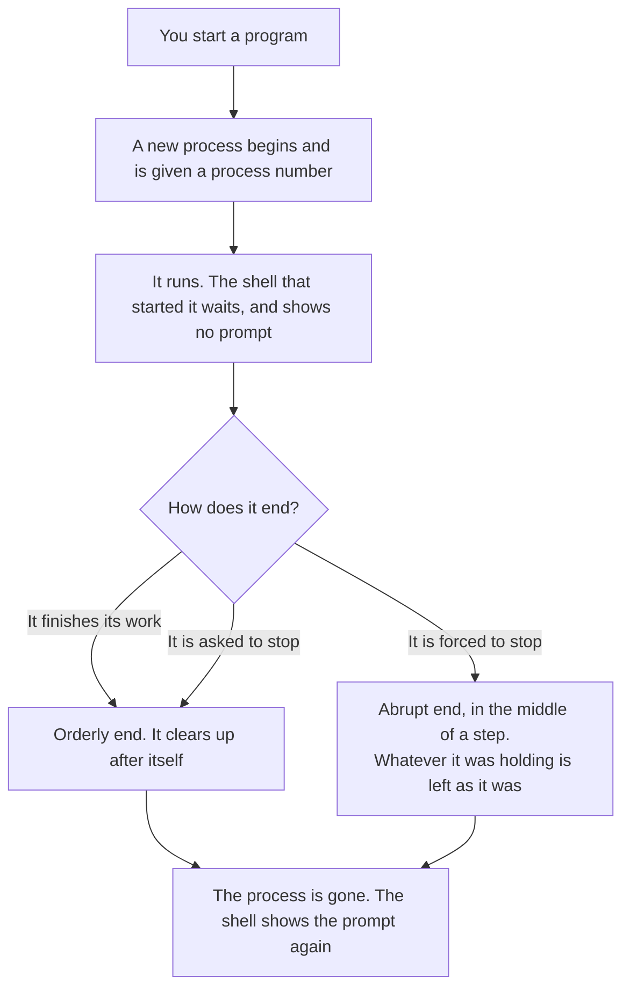

# Programs that keep running

Every program you have started in this module did its work in a moment and gave the prompt back. Many programs you will work with do not. A local web server, a tool that watches your files for changes, a long test run: these start, and stay.

That brings a new set of experiences. The terminal stops responding to what you type. A program you thought you had closed is still there an hour later. A tool refuses to start because, it says, it is already running. Each of these feels like something broken, and each is ordinary.

The lesson answers one question:

> "I started a program and it is still going. Is my terminal broken, how do I stop the program, and how do I know it has really stopped?"

You need the kit from the lesson *Where the terminal is standing*, and a terminal standing in the `terminal-practice-kit` folder. Confirm with `pwd`.

If you already stop processes by number, read Section 5, where the two shell families turn out to do different things, then go to Section 7 and try Practices C and D.

## 1. Start with a familiar situation: a recipe and a pan

In a shared kitchen there is a card on the wall with a recipe for soup.

The card is paper. It is not hot and it does not smell of anything. It can hang there for a year without a single onion being cut. It is a set of instructions, and nothing more.

Then someone cooks from it. Now there is a pan on a ring, at a particular step, with a particular amount of water in it. That is a different kind of thing from the card. It began at some moment and it will end at some moment. It is occupying a ring. It can go well or badly.

Look at how the two relate.

- **Two people can cook from the one card at the same time.** There are then two pans, at different steps. The card is the same. The cookings are separate.
- **Stopping a cooking does nothing to the card.** Tip the pan down the sink and the recipe is exactly as it was.
- **To talk about a cooking, the card's name is not enough.** "The soup" could be either pan. The kitchen hands each cook a numbered ticket when they start, and you say "ticket 31".
- **While you are cooking at a ring, that ring is taken.** You cannot start a second dish on it until the first one is finished or taken off.

Now, how a cooking ends. There are two ways.

**The orderly way.** The soup is done, or somebody says "we need to stop, please finish up". The cook completes the step they are on, turns off the ring, clears the pan away and turns the sign above the ring back to *Free*.

**The power cut.** Everything stops at once, in the middle of a step. Nobody clears up, because nobody was given the chance. The pan sits there half done. And the sign above the ring still says *In use*.

The next person to come in sees that sign. They have a real question to answer before they can cook: is somebody using this ring, or is the sign left over from something that ended badly? The sign cannot tell them. They have to look at the ring.

### Pause and explain

Somebody says, "I deleted the soup." What are the two different things they might mean, and why does it matter which?

They might have thrown away a pan of soup, one cooking, or they might have torn the card off the wall. The first ends one activity and leaves everyone able to cook again. The second removes the instructions and leaves any pans already on the rings bubbling away. A file of instructions and a running of it are different things, and the same word is used for both all the time.

## 2. A program, and a process

The card is a **program**: a file of instructions, such as `tick.mjs`. It sits on the disk and does nothing.

A cooking is a **process**: one running of a program. It starts when you press Enter and it ends at some later moment. While it exists it has its own copy of the environment, as you saw in the last lesson, its own current folder, and its own place in its work.

The ticket is the **process number**, usually called the **process ID** or **PID**. The operating system gives every process a number when it starts. It is how you point at one particular running of a program.

The kit's `tick.mjs` prints a line each second and tells you its number. Run it with the option that makes it stop by itself after three lines:

```sh
node tick.mjs --count 3
```

The author's run in PowerShell:

```text
tick: started as process 29776. Stop me with Ctrl+C.
tick 1
tick 2
tick 3
tick: finished after 3 ticks. Marker removed.
```

Run exactly the same command again and compare the first lines. The number is different. The author's second run said `process 36424`. The program has not changed by one character. These were two processes: two cookings from one card.

### Why the terminal seemed to stop

While those three seconds passed, there was no prompt. If you typed during them, nothing appeared to happen.

The terminal was not broken. It was **busy**. When the shell starts a program in the ordinary way, it does one thing until that program ends: it waits. It is at the ring, cooking. It shows the prompt again only when the process has ended and handed back its exit code.

This matters in practice, because the wait can be long. A program that runs for ten minutes gives you ten minutes without a prompt, and one that never ends by itself gives you no prompt until you end it. Before concluding that anything is stuck, look at the last lines on the screen and ask: did the prompt come back? If not, a process is running in this terminal.

One caution. Keys you press while the shell is waiting are not thrown away. They are kept, and the shell reads them as a command when the prompt returns. Do not type into a busy terminal unless you mean the running program to receive it.

## 3. Stopping it yourself: Ctrl+C

Now start it without the count. It will go on until you stop it:

```sh
node tick.mjs
```

Let it tick a few times. Then, with the terminal panel active, hold the **Ctrl** key and press **C**. On a Mac it is also the Control key, not Command.

```text
tick: started as process 688. Stop me with Ctrl+C.
tick 1
tick 2
tick 3
tick 4
^Ctick: stopped on request (Ctrl+C) after 4 ticks. Marker removed.
```

That is the author's run on Linux. The `^C` is the terminal showing the keypress, and your terminal may not show it.

The prompt is back. Look at the last line the program printed, because it shows what Ctrl+C really is. It did not cut the power. The terminal sent the process a **signal**: a short, fixed message that the operating system delivers to a running program. There are a handful of them, and the one behind Ctrl+C means "please stop". It is a **request**. Node.js documents that Ctrl+C reaches a program in this way on Windows, macOS and Linux. [Node.js: signal events](https://nodejs.org/api/process.html#signal-events) `tick.mjs` received the request, finished properly, printed a closing line, removed something called a marker, and ended. That is the orderly way. A program that receives Ctrl+C and has made no arrangements for it simply ends at once, which is fine for most small programs.

Because it is a request, a program is able to react to it in other ways: some ask "are you sure?", and some take a few seconds to finish what they are doing. Give a program a moment before pressing again.

In VS Code's terminal on Windows, Ctrl+C has a second job. When some text in the terminal is selected with the mouse, the keypress copies that text instead. If Ctrl+C seems to do nothing, click once in the terminal to clear the selection and press it again.

## 4. Looking at a process from outside

To watch a process while it runs, you need to be somewhere other than the busy terminal. Open a second terminal in VS Code, as you did in the last lesson. Arrange the two so that you can switch between them. Call the first one terminal 1 and the new one terminal 2.

In **terminal 1**, start the program and leave it running:

```sh
node tick.mjs
```

Note the process number in its first line. The examples below use the author's numbers. **Use your own number wherever a number appears.**

Everything else in this section happens in **terminal 2**, which has a prompt. Confirm with `pwd` that it is standing in the kit folder.

### The marker

List the folder:

```sh
ls
```

There is a file that was not there before: `tick.running`. Read it:

```sh
cat tick.running
```

It contains one number, and it is the process number from terminal 1. This is the *In use* sign above the ring. `tick.mjs` writes this file when it starts and deletes it when it ends in an orderly way. That is what "Marker removed" meant.

### Ask the operating system

The marker is a note that the program left. To find out whether a process with that number truly exists, ask the operating system, which keeps the real list.

**PowerShell, with your number:**

```powershell
Get-Process -Id 16428
```

**bash or zsh, with your number:**

```sh
ps -p 629
```

The author's runs:

```text
Windows PowerShell:

Handles  NPM(K)    PM(K)      WS(K)     CPU(s)     Id  SI ProcessName
-------  ------    -----      -----     ------     --  -- -----------
    210      18    22476      55632       0,08  16428   3 node

bash, on Linux:

    PID TTY          TIME CMD
    629 pts/0    00:00:00 MainThread
```

A row came back, so the process exists. In PowerShell's table, find the columns `Id` and `ProcessName`: process 16428 is a running of the program `node`. The other columns describe its use of memory and processor time, and you may skip them. The author's computer writes decimals with a comma, and yours may use a dot.

On Linux, the last column in the author's run says `MainThread`, which is a name that this version of Node.js gives its process there. To see the command that started it, ask `ps` for it: `ps -p 629 -o pid,args` printed `629 node tick.mjs`.

If you do not know the number, you can look processes up by what they are running. In PowerShell, `Get-Process node` lists every process of the program `node`, and on a computer with VS Code extensions or other tools there may be several. In bash and zsh, `pgrep -f tick.mjs` prints the numbers of the processes whose command contains `tick.mjs`.

### A second copy is refused

Still in terminal 2, try to start the program a second time:

```sh
node tick.mjs
```

```text
tick: already running as process 16428. Stop that one first.
```

Ask for the exit code: it is `1`. Who is speaking? The program, on its standard error. It started, found the sign, checked that a process with that number really exists, and declined to carry on.

Two cooks can share a recipe card, as Section 1 said. So why refuse? Because some things cannot be shared, and two cooks cannot use one ring. `tick.mjs` needs nothing of that kind. It was written to behave as if it did, so that you can practise on something harmless, and its marker stands in for the real thing. Many real programs do hold something of which there can be only one. A database must be the only one writing its files. A local web server holds a numbered connection point called a port, and only one process can hold a given port. The HTTP module explains ports. The shape of the experience is the one you just had: a correct command, a program that worked a minute ago, and a refusal that says, in some wording, that it is already running. The first thing to do is always what you have just learned: find out whether a process is really there.

Leave the program running in terminal 1 for the next section.

## 5. Stopping it from outside

You are in terminal 2, and the process is running in terminal 1. You can end it from here, by its number. The commands for this differ between the shells, and they do **not do the same thing**. That difference is the subject of this section.

### Predict, then stop it from outside

Before you run the command for your shell, predict two things by thinking about the kitchen. Will terminal 1 show the program's closing line, the one ending "Marker removed"? And will the file `tick.running` still exist afterwards?

**PowerShell, with your number:**

```powershell
Stop-Process -Id 16428
```

**bash or zsh, with your number:**

```sh
kill 629
```

Now look at terminal 1. Then, in terminal 2, run `ls`.

### A request and a forced stop

The author's runs. This is what terminal 1 showed in each case:

```text
After Stop-Process, in Windows PowerShell:
tick: started as process 16428. Stop me with Ctrl+C.
tick 1
tick 2

After kill, in bash on Linux:
tick: started as process 629. Stop me with Ctrl+C.
tick 1
tick 2
tick: stopped on request after 2 ticks. Marker removed.
```

On Linux the closing line is there, and `tick.running` is gone. On Windows there is no closing line, and `tick.running` is still in the folder.

The two commands sound alike and are different in kind.

- `kill` with a number, in bash and zsh, sends a **request** to stop. The name is harsher than the act. The process receives the request and may finish up, as `tick.mjs` did: the orderly way.
- `Stop-Process`, in PowerShell on Windows, **ends the process at once**. The process is not told. It does not finish its step and does not clear up. That is the power cut. [PowerShell: Stop-Process](https://learn.microsoft.com/powershell/module/microsoft.powershell.management/stop-process)

bash and zsh have the power cut as well. It is `kill -9` with a number, where `-9` is an option that selects a signal the process never gets to see: the operating system ends the process itself. The author's run of that, with a fresh process:

```text
tick: started as process 833. Stop me with Ctrl+C.
tick 1
tick 2
Killed
```

No closing line. The word `Killed` was added by the shell, bash here. zsh words it `zsh: killed     node tick.mjs`. The exit code both recorded was 137, a number these shells use for "ended by force". The marker was left behind.

| What you do | Shell | Kind | Closing line? | Marker afterwards |
| --- | --- | --- | --- | --- |
| Ctrl+C in the program's terminal | any | Request | Yes | Removed |
| `kill` and the number | bash, zsh | Request | Yes | Removed |
| `kill -9` and the number | bash, zsh | Forced | No | Left behind |
| `Stop-Process -Id` and the number | PowerShell | Forced | No | Left behind |

Read this diagram from top to bottom. The diamond has three ways out.



In words: starting a program begins a new process with its own number. While it runs, the shell that started it waits. It can end in three ways. It finishes its work, or it is asked to stop: both are orderly, and it clears up after itself. Or it is forced to stop, in the middle of a step, and whatever it was holding stays as it was. Either way the process is gone and the prompt returns.

### What a forced stop leaves behind

If your marker was removed, make a stale one now, so that everyone has seen it: start `node tick.mjs` in terminal 1 and end it from terminal 2 with `kill -9` and its number. PowerShell users already have one.

The sign says *In use* and nothing is cooking. Check both halves of that, in terminal 2:

```sh
cat tick.running
```

Then ask the operating system for the number it shows, with `Get-Process -Id` or `ps -p` as in Section 4. The author's runs:

```text
Windows PowerShell:
Get-Process : Cannot find a process with the process identifier 16428.

bash, on Linux:
    PID TTY          TIME CMD
```

PowerShell says it plainly. `ps` prints its heading and no row, which means the same. The marker names a process that does not exist. A marker in that state is called **stale**.

Now start the program once more, with a count so that it ends by itself:

```sh
node tick.mjs --count 2
```

```text
tick: found a marker left by process 16428, which is no longer running.
tick: that process did not stop in an orderly way. Replacing its marker.
tick: started as process 36424. Stop me with Ctrl+C.
tick 1
tick 2
tick: finished after 2 ticks. Marker removed.
```

`tick.mjs` was written to do what the next cook in the kitchen should do. It did not trust the sign and it did not ignore it. It looked at the ring: it asked whether process 16428 exists, found that it does not, said so, and carried on. Its first two lines went to standard error, and they are a small piece of evidence in themselves: they record that an earlier run ended badly.

Not every program is this careful. Some see their own stale marker and refuse to start until a person removes it. When a program insists it is already running, you now know the two-step check: read the number it names, and ask the operating system whether that process exists. Delete a marker only after the second step says the process is gone.

One refinement to the second step. An operating system reuses process numbers, so after a while a stale marker's number can belong to some unrelated program. If a row does come back, read what the process is before you believe the marker: the `ProcessName` column in PowerShell, or `ps -p` with `-o pid,args` in bash and zsh. A process that is not `node` running `tick.mjs` is not the one the marker meant.

So the choice of how to stop something is not about strength. Ask first, and force only when asking has failed. A forced stop is sometimes necessary. What it costs is that the program had no chance to put things back, and you may have to do that for it.

## 6. Stuck, or only quiet?

A program that prints nothing for a while puts you in an awkward position. Is it working on something slow, or will it never continue? From the outside the two look the same.

`tick.mjs` can imitate this. In terminal 1:

```sh
node tick.mjs --stall-after 3
```

It prints three ticks and then nothing. No prompt, no message, no end.

The impulse is to stop it at once and start again. Sometimes that is right. But the moment you stop it, part of the evidence is gone, and if the cause is not understood it will happen again. Before you stop a program that seems stuck, take one minute for four observations.

1. **What did it last print?** Scroll up and read the final lines, and copy them into a note as text. Here: `tick 3`. Whatever it was about to do next is where it stopped.
2. **How long has it been silent?** Write down a rough time. "About two minutes" is useful. "Ages" is not.
3. **Does its process still exist?** From terminal 2, with its number: `Get-Process -Id` or `ps -p`. A row means it is alive and waiting for something. No row means it has in fact ended, and what you are looking at is a terminal with a different problem.
4. **Is there a marker, and whose number is in it?**

Then stop it by the gentlest means that works, in this order: Ctrl+C in its own terminal. If that has no effect after a few seconds, a request by number where your shell has one. Only then by force. Note which one you needed, because that too is information: a program that did not respond to a request was not in a state to listen.

Do those four observations for the stalled `tick.mjs` now, then stop it with Ctrl+C in terminal 1. It answers the request and removes its marker. The program was never broken: it was alive, quiet, and able to listen.

These observations are what turn "it froze, so I restarted it" into something a helper can use, as the lesson *When something goes wrong* asked: "After `tick 3` it printed nothing for two minutes. Process 688 still existed. Ctrl+C stopped it in an orderly way."

### Closing the terminal

What about simply closing the terminal panel with a program still running in it? In the normal case that ends the program too, by one of the ways above, depending on your system. It is a poor way to stop something you care about, for two reasons you can now give: you do not choose whether the stop is a request or forced, and you throw away the screen with the program's last lines on it. If you have done it, check afterwards from another terminal that the process is gone, and look for a marker.

When you have finished this section, close terminal 2, and make sure no `tick.running` is left in the kit folder. If one is, check its number as in Section 5, and delete the file with `rm tick.running` once you have seen that the process does not exist.

## 7. Try it with less help

Complete explanations follow these four practices. Say your answer in your own words before you read them.

### Practice A: program or process?

For each sentence, say whether the speaker means a program or a process, and how you can tell.

1. "I updated `tick.mjs`, but the one in my other terminal is still printing the old message."
2. "Node is using a lot of memory."
3. "I installed Node 24."
4. "There are three Nodes running and I only started one."
5. "I stopped it, but the file is still there." Give both readings of this one.

### Practice B: two at once

1. In terminal 1, start `node tick.mjs`.
2. In terminal 2, find its number **without** looking at terminal 1.
3. In terminal 2, confirm that a process with that number exists.
4. In terminal 2, try to start a second copy, and note the message and the exit code.
5. Stop the first one by a **request**, in whichever way your shell allows from where you are. PowerShell users: think about which terminal you need to be in.
6. Show with two commands that it ended in an orderly way.

Write down each command you used.

### Practice C: judge the advice

A colleague gives you three pieces of advice. For each, say what is right in it, what it costs, and what you would do instead.

1. "If a program hangs, don't waste time. `kill -9` it straight away. That always works."
2. "If it says it's already running, just delete the lock file and start it again."
3. "You don't need a second terminal. If the terminal's frozen, close it and open a new one."

### Practice D: read the evidence

Here is everything a learner recorded. Nothing was run by the author: it is a constructed example.

```text
Terminal 1:
tick: started as process 5120. Stop me with Ctrl+C.
tick 1
tick 2
tick 3
tick 4

Terminal 2, a minute later:
PS> cat tick.running
5120
PS> Get-Process -Id 5120
Get-Process : Cannot find a process with the process identifier 5120.
```

1. Did process 5120 end in an orderly way? Give two separate pieces of evidence.
2. Name two things that could have ended it this way.
3. The learner now types `node tick.mjs` in terminal 2. Write the first two lines the program will print, and say which stream they go to.
4. Terminal 1 shows no prompt after `tick 4`, in this record. Is that an observation you can rely on? What would you ask the learner?

### Practice explanations

**A.**

1. Both. `tick.mjs` that was updated is the program, the file. "The one in my other terminal" is a process, started from the file as it was earlier. A running process does not pick up changes to its file. It has to be stopped and started again. This is the pan already on the ring when the card is corrected.
2. A process. A file on the disk uses no memory. Strictly, it is one particular process of the program `node`, and the next question is which one.
3. The program: files were placed on the disk.
4. Processes. One program, `node`, has three runnings. The speaker started one. The others were started by something else, for example by VS Code extensions, which is common and harmless. Their numbers, and what each is running, tell them apart.
5. Reading one: "I stopped the process, and the program file is still there." That is always true, and nothing is wrong. Reading two: "I stopped the process, and its marker file is still there." That is a stale marker, and it says the stop was a forced one. The sentence is ambiguous until you ask which file.

**B.** One way:

1. `node tick.mjs` in terminal 1.
2. `cat tick.running` in terminal 2. Or `pgrep -f tick.mjs` in bash and zsh. `Get-Process node` in PowerShell lists the candidates, and the marker says which one.
3. `Get-Process -Id` with the number, or `ps -p` with the number.
4. `node tick.mjs` prints `tick: already running as process` with the number, and `Stop that one first.` The exit code is 1.
5. In bash and zsh: `kill` with the number, from terminal 2. In PowerShell there is no request by number: `Stop-Process` is a forced stop. The request available to you is Ctrl+C, and it has to be pressed in terminal 1, where the program is running.
6. Terminal 1 shows the closing line ending "Marker removed", and in terminal 2 `ls` no longer shows `tick.running`. A third confirmation is that `Get-Process -Id` or `ps -p` finds no such process.

If you used `Stop-Process` in step 5, step 6 will have shown you: no closing line, and the marker still there. That is a correct observation of a forced stop, and you now have a stale marker to clear as in Section 5.

**C.**

1. Right: it does end a process that will not listen, and sometimes nothing else will. The cost: the program gets no chance to finish a step or clear up, so files it was writing may be half written and markers are left behind. "Always works" is true of ending the process and false of leaving things in a good state. Instead: make the four observations, try Ctrl+C, then a request by number, and force it last.
2. Right: if the marker is stale, removing it is the repair. The cost of doing it blindly: if the process is in fact still running, you now have two copies of a program that was built to run once, both working on the same files. Instead: read the number the program names, ask the operating system whether that process exists, and delete the marker only if it does not.
3. Right: a new terminal does give you a prompt. The cost: "frozen" was probably "busy", so a process was running, and closing the panel ends it in a way you did not choose and discards its last lines. Instead: read the last lines, decide whether a process is running, and stop it with Ctrl+C. A second terminal is how you look at it first.

**D.**

1. No. First, the marker `tick.running` still exists and holds 5120, and the program removes its marker whenever it ends in an orderly way. Second, terminal 1 shows no closing line: an orderly end prints either "finished after" or "stopped on request".
2. A forced stop by number, such as `Stop-Process -Id 5120` or `kill -9 5120`, typed by the learner or by something else. Or the terminal or the computer being shut down underneath it. The record does not say which, and "it crashed by itself" would be an inference.
3. `tick: found a marker left by process 5120, which is no longer running.` and `tick: that process did not stop in an orderly way. Replacing its marker.` Both go to standard error. The third line, `tick: started as process` with a new number, goes to standard output.
4. Not from this record. The paste ends at `tick 4`, and a paste cannot show the absence of a prompt reliably: the learner may have stopped copying there. Ask them what terminal 1 shows below `tick 4` right now. If a prompt is there, the shell has already noticed that the process ended, which fits the rest of the evidence.

## 8. What you should be able to explain now

Close the lesson for a moment and explain to an imaginary friend who has just said "my terminal has frozen":

- What is the difference between a program and a process?
- What is a process number for?
- Why does a terminal show no prompt while a program runs in it?
- What does Ctrl+C send, and why can a program still print a closing line afterwards?
- How do you find out, from another terminal, whether a process still exists?
- Which of these are requests and which are forced: Ctrl+C, `kill` with a number, `kill -9` with a number, `Stop-Process -Id`?
- What does a forced stop leave behind that an orderly one does not?
- What is a stale marker, and what two things do you check before deleting one?
- What four things do you note before stopping a program that seems stuck?

You are ready for the last lesson of this module when you can answer these in your own words, when you have ended a process both ways and seen the difference in the evidence, and when your kit folder has no `tick.running` left in it.

You now have every part of the picture: the folder a command starts from, the arguments a program receives, the files it changes, the output and exit code it leaves, the settings it is handed, and the process it becomes. The last lesson gives you two sets of instructions that worked on somebody else's computer. On yours they will fail, and each failure will come from one of those parts.

## If something does not match

**Ctrl+C does nothing.** Click once inside the terminal panel so that it is active and no text is selected, then press Ctrl+C again. On a Mac, use Control, not Command.

**`Stop-Process` or `kill` says it cannot find the process.** The number is wrong, or the process has already ended. Read the number again from the program's first line or from `tick.running`.

**`tick.mjs` says it is already running, and you cannot find where.** Read the number in the message and ask the operating system for it, as in Section 4. If the process exists, it is in a terminal you have forgotten: look through the terminals listed at the right of the terminal panel.

**`Get-Process node` lists several processes.** That is normal: VS Code and other tools run Node.js programs of their own. Never stop a process because of its name alone. Use the number the program gave you.

**The second terminal starts in a different folder.** Check with `pwd` and `cd` to the kit folder by its full path, as in the lesson *Where the terminal is standing*.
