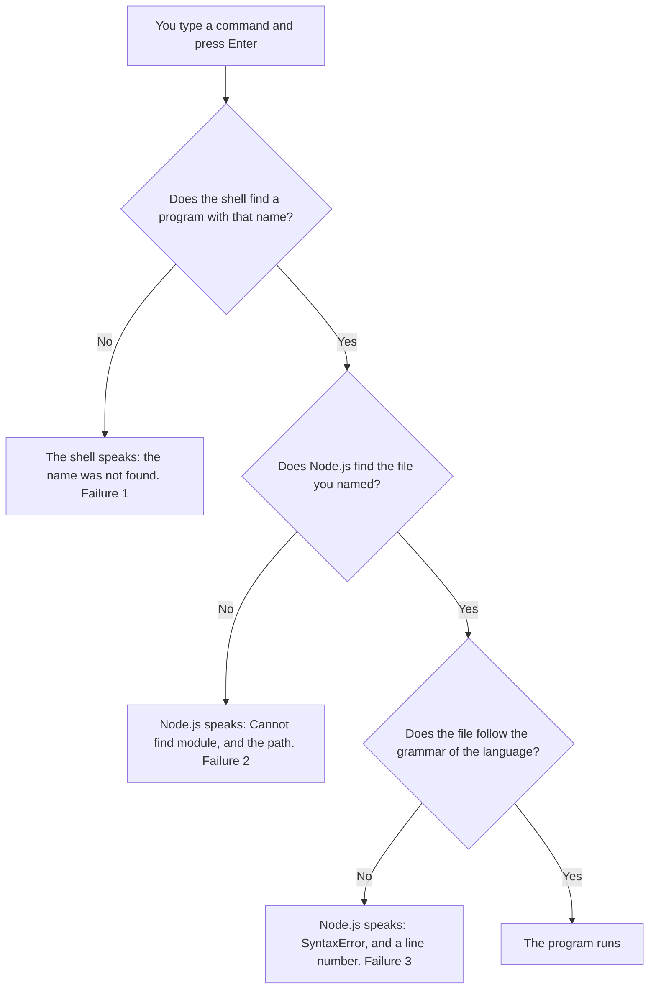

# When something goes wrong

Something will go wrong. A command will fail, a tool will refuse to start, a screen will fill with red text. This does not mean you are unsuited to the work. It is a normal part of the work: people who have done this for twenty years see error messages every single day. The difference between them and a beginner is not that fewer things fail. It is what they do in the first minute afterwards.

This lesson teaches that first minute. It answers one question:

> "Something failed. What do I do next, and what do I say if I need to ask for help?"

You will break three things on purpose, in a safe place, and read what the computer says each time. You will learn the difference between what you saw and what you concluded. You will write a request for help that somebody can actually answer. And you will finish with a short document that lets you rebuild your whole setup if you ever have to.

You need the working setup from the lesson *Set up a safe workspace*, and its kit, unchanged. The steps were checked on Windows 11. The macOS and Linux steps have not yet been run by the author.

## 1. Start with a familiar situation: phoning the garage

It is a cold morning and your car will not start. You phone a garage. The mechanic cannot see your car. Everything they know will come from what you say.

Here is one way the call can go.

> "My car's broken. It just doesn't work. I think it's the engine."

The mechanic can do nothing with this. "Broken" could be a hundred things. So the questions begin: what happens when you turn the key? Do the lights come on? Any noise? Did it work yesterday? Ten minutes later the mechanic knows what the first sentence could have said, and you have both lost ten minutes. Worse, if the mechanic had simply believed "it's the engine", they would have arrived with the wrong tools.

Here is the same car, the same fault, the same mechanic, and a different call.

> "I turned the key. The dashboard lights came on, but dimly. There was a fast clicking sound and the engine did not turn at all. It started normally yesterday evening. It was below freezing overnight, and I may have left the inside light on. I haven't tried anything else. My guess is the battery, but I don't know."

"That's almost certainly the battery," says the mechanic. "I'll bring jump leads. Twenty minutes."

Nothing about the car changed between the two calls. What changed was the kind of sentence. Look closely, because there are three kinds, and the whole lesson depends on seeing the difference.

- **"It doesn't work."** This is true, and almost empty. It is your summary of what happened, for someone who was not there.
- **"The dashboard lights came on dimly. There was a fast clicking sound."** This is what was actually there to see and hear. Anyone standing next to you would have seen and heard the same.
- **"I think it's the engine."** This is a conclusion about the cause. It may be right. In this story it was wrong.

The second caller also added two things that cost nothing and help a great deal: **what had changed** since it last worked, and **what they had already tried**. And they kept their guess, clearly labelled as a guess.

### Pause and explain

Before reading on: why was "I think it's the engine" more dangerous in the first call than "My guess is the battery, but I don't know" was in the second?

In the first call the conclusion stood alone, with nothing beside it that the mechanic could check it against. In the second call the conclusion came after the things that were seen and heard, and it was marked as a guess. The mechanic could weigh it against the clicking and the dim lights. A guess next to its evidence is useful. A guess in place of the evidence sends people the wrong way.

## 2. Three kinds of statement

Give the three kinds their names. They are used throughout this course.

| Kind | What it is | From the garage call | On a computer |
| --- | --- | --- | --- |
| **Observation** | What was actually there to be seen | "Fast clicking, dim lights" | The exact words the screen showed, and the exact command you typed |
| **Report** | Your description of what happened, for someone who was not there | "It doesn't work" | "It gave an error about a missing file" |
| **Inference** | A conclusion about the cause | "It's the engine" | "Node.js is broken", "the download is corrupted" |

All three have their place. An inference is how a problem finally gets solved, and you should make them. The skill is knowing which kind each sentence is, and never letting an inference or a loose report stand in for an observation.

Here is a test for telling an observation from a report: **could the helper check it without trusting your wording?** If you paste the screen's exact text, they can. That is an observation. If you describe the text in your own words, they cannot. That is a report.

The garage call has a limit here, and it is worth seeing. On the phone, the mechanic only ever gets reports. Even "a fast clicking sound" is the caller's description of a noise that is gone. A careful caller keeps the description close to what was heard, and that is the best a phone call allows.

A computer does better. **It writes its observation down.** When a program fails, it prints a message in exact words, and the message stays on the screen. You can copy it, character for character, and hand it to someone else. They are then no longer relying on your description. They are reading the same words you read.

So the first rule of this lesson is simple: **never describe an error message. Copy it.**

There is a reason people break this rule, and it is worth admitting. Error messages look hostile. They are long, they are full of unfamiliar words, and they often arrive in red. The natural reaction is to look away and summarise: "it gave an error". The next two sections replace that reaction with a way of reading.

## 3. How to read an error message

An error message is written by a program at the moment it gave up. It is that program's own statement of what it was trying to do and what stopped it. However long it is, look for three things, in this order.

1. **Who is speaking?** Which program wrote this message? This matters more than it sounds. In the previous lesson you saw that the shell finds a program and starts it. So a message can come from the shell, before your program ever started, or from the program itself. Those are different problems.
2. **What went wrong?** Somewhere there is one sentence that says it. Often it follows the word `Error`.
3. **Where?** Most messages name a place: a file, a line number, or the thing the program was looking for and could not find.

Everything else in the message is detail for later. In particular you will see blocks of lines beginning with the word `at`. That is called a **stack trace**. It is the trail of internal steps the program was in the middle of, and the errors and debugging module teaches you to read it. For now you may skip those lines. Skipping the right lines is part of reading well. [Node.js: errors](https://nodejs.org/api/errors.html)

## 4. Break three things on purpose

A fire drill works because nobody is frightened during it. You are about to cause three failures deliberately, so that you meet each message when you already know the cause. Later, when one of them happens by accident, you will recognise it.

Open your `workspace-check-kit` folder in VS Code and open a new terminal, as in the previous lesson. Look at the terminal panel: it shows the name of the shell it is running, such as `powershell`, `bash` or `zsh`. Note which one you have.

First confirm that everything works:

```sh
node greeting.mjs
```

It should print two lines: a greeting, and today's date. `greeting.mjs` is a very small program supplied in the kit for this lesson.

For each failure below, write down your prediction before you press Enter. What do you expect to see, and which program do you expect to be speaking?

### Failure 1: a name the shell cannot find

Type the command with a letter missing from the program's name, `nod` instead of `node`:

```sh
nod --version
```

What appears depends on which shell your terminal runs. These are all the same failure:

```text
Windows PowerShell (the author's run):
nod : The term 'nod' is not recognized as the name of a cmdlet, function, script file, or operable
program. Check the spelling of the name, or if a path was included, verify that the path is correct
and try again.
At line:1 char:1
+ nod --version
+ ~~~
    + CategoryInfo          : ObjectNotFound: (nod:String) [], CommandNotFoundException
    + FullyQualifiedErrorId : CommandNotFoundException

bash (the author's run):
bash: nod: command not found

zsh, the usual shell on macOS (typical wording, not captured by the author):
zsh: command not found: nod
```

Read it with the three questions.

- **Who is speaking?** The shell. bash and zsh begin the message with their own name. PowerShell does not name itself. You can recognise it by the words `cmdlet` and `CommandNotFoundException`, which only PowerShell uses. Node.js is not speaking, and it cannot be: it never started.
- **What went wrong?** The shell found no program with that name. PowerShell's last five lines say the same thing again in its own technical terms, and you may skip them.
- **Where?** The name it could not find: `nod`.

Connect this to what you know. The shell looked through its PATH list for a program named `nod`, reached the end, and said so. This is the "No" branch of the diagram in the previous lesson.

Now notice something about inference. If Node.js were not installed at all, typing the correct `node --version` would produce *this same message*, with `node` in place of `nod`. The message cannot tell a typing mistake from a missing program. It reports one observation: no program of this name was found. "Node.js is not installed" would be an inference, and here it would be false. So the first thing to check, always, is the cheapest: is the name spelled correctly?

**Repair:** type the command correctly, `node --version`, and confirm that the version appears.

### Failure 2: the right command in the wrong folder

For this one you need a single new command. `cd` means *change directory*, and "directory" is another word for folder. Two dots, `..`, mean "the folder above this one". So this command moves the terminal up one level, out of the kit folder:

```sh
cd ..
```

Look at the prompt. The folder it shows has changed. Nothing has been moved or deleted. Only the terminal's **current folder** has changed: the folder where the terminal now is. Now run the program exactly as you did a minute ago, when it worked:

```sh
node greeting.mjs
```

This is the author's run on Windows 11, with the path shortened to an example user:

```text
node:internal/modules/cjs/loader:1424
  throw err;
  ^

Error: Cannot find module 'C:\Users\maria\course-work\Workspace_Check_Kit_v1\greeting.mjs'
    at Module._resolveFilename (node:internal/modules/cjs/loader:1421:15)
    at defaultResolveImpl (node:internal/modules/cjs/loader:1059:19)
    at resolveForCJSWithHooks (node:internal/modules/cjs/loader:1064:22)
    at Module._load (node:internal/modules/cjs/loader:1227:37)
    at TracingChannel.traceSync (node:diagnostics_channel:328:14)
    at wrapModuleLoad (node:internal/modules/cjs/loader:245:24)
    at Module.executeUserEntryPoint [as runMain] (node:internal/modules/run_main:154:5)
    at node:internal/main/run_main_module:33:47 {
  code: 'MODULE_NOT_FOUND',
  requireStack: []
}

Node.js v24.12.0
```

Almost twenty lines, and this is the kind of message that makes people look away. Apply the three questions and it shrinks to one line.

- **Who is speaking?** Node.js. The last line says so, and gives its version. That alone is good news: the shell found `node` and started it, so the installation is fine.
- **What went wrong?** Find the line starting with `Error:`. It says `Cannot find module`. "Module" is Node.js's word for a file of program instructions.
- **Where?** The same line gives the full path of the file Node.js looked for. Read that path step by step, as you learned to. It ends `...\Workspace_Check_Kit_v1\greeting.mjs`. But the file is not there. It is one folder further down, in `workspace-check-kit`.

The eight lines beginning with `at` are the stack trace. Skip them.

So the message, read properly, says: *I am Node.js. I looked for `greeting.mjs` in this exact folder, and no such file is there.* The command was correct. The folder was wrong. When a command names a file without a full path, the file is looked for in the terminal's current folder, and you had moved the terminal.

The path is the most useful part of this message. Whenever a message says a file cannot be found, read the path it prints and ask: is that where the file really is?

**Repair:** move the terminal back into the kit folder and run the program again:

```sh
cd workspace-check-kit
node greeting.mjs
```

### Failure 3: a broken program

This time the command and the folder are right, and the program itself is damaged.

In VS Code's Explorer, click `greeting.mjs` to open it. Find the **last** line of the program:

```js
console.log('Today is ' + today + '.');
```

Delete the closing round bracket, the `)` just before the final semicolon, so that the line ends `'.';`. Then **save the file**: **File → Save**, or Ctrl+S (Command+S on macOS).

Saving matters, and forgetting it is a classic mistake. The editor shows you its own copy of the text. Node.js reads the file on the disk. Until you save, those two are different, and a dot on the file's tab in VS Code tells you so. Many cases of "I fixed it and nothing changed" are an unsaved file.

Now run it:

```sh
node greeting.mjs
```

The author's run, with the path and the trail of `at` lines shortened:

```text
file:///C:/Users/maria/course-work/Workspace_Check_Kit_v1/workspace-check-kit/greeting.mjs:10
console.log('Today is ' + today + '.';
                                  ^^^

SyntaxError: missing ) after argument list
    at compileSourceTextModule (node:internal/modules/esm/utils:318:16)
    ... nine more lines beginning with "at" ...

Node.js v24.12.0
```

- **Who is speaking?** Node.js again.
- **What went wrong?** `SyntaxError: missing ) after argument list`. **Syntax** is the grammar of a programming language: the rules about where brackets, quotation marks and other symbols must go. Node.js is saying that the text of the program breaks those rules, and it even names the missing symbol.
- **Where?** The very first line. It gives the file, and after the final colon, a number: `greeting.mjs:10` means **line 10** of that file. Below it, Node.js prints the line itself and marks a position with `^^^`.

One caution about that marker. It is close to the mistake, and not always exactly on it. Here it sits under `'.'`, and the missing bracket belongs just after that. Look at the marked place and a few characters on each side.

Notice also what did *not* happen. Line 9 of the program is correct, and it prints the greeting. The greeting did not appear. Node.js checks the grammar of the whole file before it carries out any of it, so one damaged line stops every line.

**Repair:** put the `)` back, save, and run the program again. If you ever damage a kit file and cannot find the mistake, there is always a complete reset: delete the kit folder and extract the ZIP again. You can always get every kit file back that way.

### What the three failures had in common

Put your three predictions beside what happened. Then look at the pattern:

| Failure | Who spoke | What went wrong | Where the message pointed |
| --- | --- | --- | --- |
| 1 | The shell | No program with that name | The misspelled name |
| 2 | Node.js | The file was not found | The full path it looked in |
| 3 | Node.js | The program's text breaks the grammar | A file and a line number |

The three failures are three stops on one road. Read this diagram from top to bottom. Each diamond is a question with two answers.



In words: first the shell looks for a program with the name you typed. If it finds none, the shell reports it, and nothing else happens. If it finds Node.js, Node.js looks for the file you named. If the file is not there, Node.js reports the path it tried. If the file is there, Node.js checks its grammar. If the grammar is broken, Node.js reports the line. Only when all three questions are answered "yes" does the program run.

This is why "who is speaking?" comes first. It tells you how far along the road you got, and so which question failed.

In all three failures the message contained the answer, once you knew which line to read. That will not always be true. It is true far more often than a beginner expects.

## 5. Before you ask: five steps

When something fails for real, work through these in order. They take a few minutes, and often the problem is solved before step 5.

1. **Stop and read the message once, slowly.** Who is speaking, what went wrong, where?
2. **Say what you expected and what happened instead.** One sentence each, out loud or on paper. It is surprising how often the problem shows itself while you are saying it.
3. **Check the three most common causes.** Is the terminal in the right folder? Is the file saved? Was VS Code started after the tool was installed?
4. **Change one thing, then run it again.** If you change three things at once and it works, you do not know which one mattered. If it still fails, you do not know which one made it worse. Note each thing you try.
5. **Ask.** If you have made no progress for about twenty minutes, stop trying alone. Asking does not mean you failed. It is a normal working skill, and doing it well is the subject of the next section. Twenty minutes is a rough guide, not an exact number: the point is to have a limit.

## 6. A help request somebody can answer

A good help request is the second garage call, written down. It has seven parts, and you can keep this list as a template.

1. **What I was trying to do.** The lesson and the step.
2. **What I typed, and where.** The exact command, and the folder the terminal was in.
3. **What I expected.**
4. **What happened.** The exact output, pasted as text.
5. **What I have already tried**, and what each attempt changed.
6. **My setup.** Operating system and Node.js version. The workspace check prints both, so you can paste its report.
7. **My guess**, labelled as a guess.

Paste text, not a photograph of the screen. Text can be read by a screen reader, searched for, and copied into a reply. A photograph can do none of those, and it usually cuts off the line that matters.

Here is a worked example, for failure 2.

> **Trying to do:** run `greeting.mjs` in the lesson *When something goes wrong*, Section 4.
>
> **Typed:** `node greeting.mjs`, in the folder `C:\Users\maria\course-work\Workspace_Check_Kit_v1`.
>
> **Expected:** two lines, a greeting and today's date. It printed them five minutes ago.
>
> **Happened:**
> `Error: Cannot find module 'C:\Users\maria\course-work\Workspace_Check_Kit_v1\greeting.mjs'`
> `code: 'MODULE_NOT_FOUND'`
> `Node.js v24.12.0`
> (Full output attached below.)
>
> **Tried:** ran `node --version`, which prints `v24.12.0`, so Node.js itself starts.
>
> **Setup:** Windows 11, Node.js v24.12.0.
>
> **Guess:** the terminal may be in the wrong folder, because the path in the message stops one folder short of where I think the file is.

A person who knows nothing about maria's computer could answer that in one line. Notice that the guess is right, and that writing the request is what produced it. Programmers call this *rubber duck debugging*: explain the problem carefully, even to a rubber duck on your desk, and you often find the answer yourself.

## 7. What must not go into a help request

When you paste text into a chat, a forum, an email or an AI assistant, it leaves your computer and you cannot take it back. Other people can read it, and services may store it. So before you send anything, read what you are about to paste and look for three things.

- **Secrets.** Passwords, and the long random-looking strings called keys or tokens that programs use to prove who they are. You have none in this kit. Later in the course you will, and terminal output sometimes prints them.
- **Personal data about real people.** Names, email addresses, phone numbers, customer or patient records. Their owners did not agree to appear in a forum.
- **Your employer's confidential material.** Internal addresses, source code, documents. Your employer's rules decide this. It does not matter how harmless the text looks to you.

If something of that kind is in the text, replace it with a clear placeholder that says what was removed, and tell the reader that you did. Here is a fictional piece of terminal output, before and after.

```text
Before:
Connecting to https://orders.northwind-logistics.example as maria.k@northwind-logistics.example
Using token nwl_live_8f3a9c2e71b04d5a
Error: 403 Forbidden

After:
Connecting to <REMOVED: company address> as <REMOVED: my work email>
Using token <REMOVED: token>
Error: 403 Forbidden
```

The second version can be pasted anywhere. Look at what it kept. The helper can still see what kind of thing was in each place, and the line that matters, the error, is untouched. Removing a secret does not mean removing the evidence.

Be aware that a file path contains your account name, as `C:\Users\maria\...` does. That is usually acceptable to share. Now you know it is there, and the choice is yours.

### Why course data is made up

This is also the reason the course's exercises use **synthetic data**: invented people, invented records, and web addresses ending in `.example`. That ending is reserved, so an example address can never belong to a real site. [RFC 2606](https://www.rfc-editor.org/rfc/rfc2606) Everything in a course exercise can be pasted anywhere, shown to anyone and broken freely, because none of it is real.

Keep it that way from your side. **Never bring real data into your course work**: not a real customer list to "make the exercise more realistic", not a file from your job. The moment real data enters the folder, every help request and every shared screen becomes a risk.

## 8. Help from AI assistants

You may use an AI assistant while you learn, and it can be a good helper for exactly the situation in this lesson. It is patient, it is available at midnight, and it is often good at explaining what an error message means. Three things about it need the same care you have just practised.

**Its answer is an inference, not an observation.** An assistant produces a likely-sounding explanation whether or not it is correct, in the same confident voice either way. Treat what it says as a guess to test.

**What you paste leaves your computer.** Section 7 applies in full. Many employers have rules about which assistants may be used and what may be pasted into them. Follow those rules for anything connected with your work.

**A command it gives you is second-hand.** In the previous lesson you learned three questions to ask before running anything: source, action, permission. An assistant that hands you a command is the neighbour with the leaflet: well-meaning, and not the maker. Ask it what the command does. When the command installs or changes something, check that against the tool's own documentation. Never run a command you could not describe in one sentence.

### A worked example: testing an assistant's answer

Suppose you paste only the `Error:` line from failure 2 into an assistant and ask what is wrong. Here is a fictional reply of a kind assistants do give:

> "The file `greeting.mjs` is missing. It may have been deleted, or the download may be incomplete. Download the kit again, or reinstall Node.js."

That sounds reasonable. It is an inference, so test it against what you can observe. Is the file missing? Look in the Explorer: `greeting.mjs` is there, inside `workspace-check-kit`. The assistant's explanation fails the test. Downloading the kit again would have cost you time and changed nothing, and reinstalling Node.js would have cost more.

Now give it what a good help request contains: the command, the folder the terminal was in, and the full message. A fictional second reply:

> "The path in the error ends in `Workspace_Check_Kit_v1\greeting.mjs`, but your file is in the `workspace-check-kit` folder inside it. Your terminal is one folder too high. Run `cd workspace-check-kit` and try again."

Test this one too. Look at the prompt: does it show the folder above the kit? It does. The explanation matches the observation, and you can say in one sentence what the suggested command does. Now you may use it.

Two things happened there. The assistant's first answer was wrong because it was given too little, exactly as the mechanic was in the first garage call. And in both cases it was **you** who decided whether the answer was right, by checking it against the screen. That part cannot be handed over.

One more choice is yours to make each time: **what kind of help to ask for**. "Explain what this message means" teaches you to read messages. "Tell me the command that fixes it" fixes this message, and you will not know what to do with the next one. Neither is forbidden. Choose knowingly, and say which you want.

## 9. Keeping an honest record of help

Some activities in this course ask what help you used. It is worth knowing why, because the reason is not the one you might expect.

When you **practise**, use whatever help you need: hints, the full explanation, a colleague, an assistant. Every explanation in these lessons is open to you at any time, and nothing is hidden behind a score. Practice exists so that you learn, and needing a walkthrough the first time is an ordinary way to learn.

The note about help is not a judgment on you. It is information **for** you. "I solved this alone" and "I solved this after being told where to look" are both fine results. They mean different things about what you can do tomorrow without that help. Only an honest note can tell you which one happened.

The course describes help on a simple scale, by what information you were given:

| Level | What you were given |
| --- | --- |
| H0 | Nothing aimed at the answer. Ordinary documentation, setup or accessibility support, or a question to clarify the task |
| H1 | A direction: "look at what the terminal's prompt shows" |
| H2 | The area or idea involved: "this is about the current folder" |
| H3 | A check to run that separates the possibilities |
| H4 | Part of the solution |
| H5 | The full diagnosis or a complete walkthrough |

Judge the level by what the help actually told you, not by how small it felt. Help with installation, with your equipment or with accessibility does not lower the level recorded for a technical skill.

### Pause and explain

You are stuck on failure 2. Name the level of each of these three pieces of help before you read on.

1. You read VS Code's documentation page about the terminal.
2. A friend says: "It's nothing to do with Node.js. Think about where you are."
3. An assistant says: "Your terminal is in the folder above the kit. Type `cd workspace-check-kit`."

The first is **H0**: ordinary documentation, not aimed at your answer. The second is **H2**: it names the area, your location, without saying what to check or do. The third is **H5**: it gives the diagnosis and the repair, however short the sentence is. "Just a tiny hint" that names the cause is H5.

Later, some tasks will be marked as a demonstration of what you can do independently. They will say so in advance. A task that does not say so is practice.

## 10. The recovery note

Imagine it is two months from now. Your laptop has been replaced, or a system update has left your tools in a strange state, and you need the workspace back. How long would it take you today to remember which two tools you installed, from where, in which version, and where the folder was meant to go?

A **recovery note** is a short text file that answers those questions while you still remember them. It is the first working document of your course, and it follows the same rule as the help request: observations, not memories.

The kit contains a template, `Recovery_Note_Template.md`. Do this now:

1. Open the template in VS Code.
2. Choose **File → Save As** and save a copy named `recovery-note.md` directly in your `course-work` folder. It goes there, outside the kit folder, on purpose: a kit folder can be deleted and extracted again at any time, and your note must survive that.
3. Fill in each heading from what is true on your computer today.

The template is a Markdown file, and in the editor you see its formatting marks. Words between two asterisks, like `*date*`, are placeholders: replace the words and the asterisks with your own text. Lines made of `|` bars are tables: type between the bars.

When you later open your note from outside a kit folder, VS Code may ask whether you trust the file's authors. It is your own file, so you can open it.

The headings are:

- **Where my course work lives.** The full path of `course-work`, and why it is there.
- **What I installed, from where.** Each tool, the site it came from, the version, the date, and any choice you made in the installer.
- **How I check that it works.** The commands and what a good result looks like: `node --version` printing `v24`, and the workspace check showing no FAIL line.
- **How I reset a kit.** Delete the kit folder, extract the ZIP again.
- **Problems I met and what fixed them.** Start it today with anything that went wrong during setup. This section becomes the most valuable one. A problem you solve once tends to come back months later, and by then you will have forgotten the fix.

The test of a recovery note is practical: could a careful person who has never seen your computer rebuild your workspace from it, without asking you anything? Read yours once with that question, and fill what is missing.

Add to the note whenever a later lesson installs a tool or you solve a setup problem.

## 11. Try it with less help

Complete explanations follow these four practices. Say your answer in your own words before you read them.

### Practice A: sort a learner's message

A learner sends this message to a help channel:

> "Node is broken on my machine. I ran the workspace check and it crashed. The terminal says `Error: Cannot find module 'C:\Users\li\course-work\check-workspace.mjs'`. I think the download was corrupted."

1. The message has four sentences. Say for each one whether it is an observation, a report or an inference.
2. Using only the observation, what is the most likely cause? Read the path.
3. The learner suspects a corrupted download. Name one quick check whose result would be different depending on which cause is the real one: the wrong folder, or a damaged download.

### Practice B: read a message you have not seen before

A learner changed one line of `greeting.mjs` and now gets this. It is the author's run on Windows 11, with the path shortened.

```text
file:///C:/Users/maria/course-work/Workspace_Check_Kit_v1/workspace-check-kit/greeting.mjs:9
console.log('Hello, ' + nam + '.');
                        ^

ReferenceError: nam is not defined
    at file:///C:/Users/maria/course-work/Workspace_Check_Kit_v1/workspace-check-kit/greeting.mjs:9:25
    at ModuleJob.run (node:internal/modules/esm/module_job:413:25)
    at async onImport.tracePromise.__proto__ (node:internal/modules/esm/loader:660:26)
    at async asyncRunEntryPointWithESMLoader (node:internal/modules/run_main:101:5)

Node.js v24.12.0
```

You have not been taught what a `ReferenceError` is, and you do not need to know yet.

1. Who is speaking?
2. Which single line says what went wrong?
3. Where does the message point? Give the file and the line number.
4. Without knowing the programming language, what would you compare that line with, and what do you suspect?

### Practice C: repair a help request

Here is a help request. It has at least five problems.

> "Hi, the check thing isn't working, it's broken since the update. I get some error about permissions (photo attached). I logged in with my work account maria.k@northwind-logistics.example, password Winter2026!, in case you need to try it. Please help, it's urgent!!"

1. List the problems. Use the seven parts from Section 6 and the three checks from Section 7.
2. One sentence in it states a cause as if it were a fact. Which one?
3. Write down the questions a helper would have to ask before they could even begin.
4. Rewrite the third sentence so that the request could be sent safely.

### Practice D: write your recovery note

Complete your `recovery-note.md` as described in Section 10, then test it with the question from that section: could a careful stranger rebuild your workspace from it?

### Practice explanations

**A.**

1. "Node is broken on my machine" is an **inference**: a conclusion about the cause. "I ran the workspace check and it crashed" is a **report**: a description of what happened, in the learner's words. The sentence quoting the terminal contains the **observation**: the exact message. "I think the download was corrupted" is an **inference**, and to the learner's credit it is labelled as one. If you called the second sentence an observation, apply the test from Section 2. Could a helper check "it crashed" without trusting the learner's wording? No. The pasted message is what they can check.
2. The path in the message is `C:\Users\li\course-work\check-workspace.mjs`. It goes straight from `course-work` to the file. But the kit's files live further down, in a folder named `workspace-check-kit`, and that part of the path is missing. Node.js looked for the program directly in `course-work`. The most likely cause is that the terminal was in `course-work`, not in the kit folder: failure 2. Notice also that Node.js wrote the message, so Node.js starts and runs. "Node is broken" is contradicted by the learner's own evidence.
3. Look in the Explorer, or in the file manager, for `check-workspace.mjs` inside `workspace-check-kit`. If the file is there and opens as readable text, the download is fine and the folder is the problem. If the file is missing or the folder is empty, the extraction or the download is the problem. Another good check: open a new terminal in the kit folder and run the same command. If it works there, nothing was corrupted.

**B.**

1. Node.js. The last line names it.
2. `ReferenceError: nam is not defined`.
3. The file `greeting.mjs`, line 9. The first line of the message ends in `:9`, and the first `at` line repeats it more exactly as `:9:25`, line 9, character 25. The `^` marker sits under the word `nam`.
4. Compare line 9 as it is now with line 9 in a fresh copy of the kit. There the word is `name`. Here it is `nam`. The message says `nam` "is not defined". A fair suspicion, with no knowledge of the language, is that the program gives a meaning to `name` earlier in the file and to nothing called `nam`, so a letter has gone missing. That is correct. You read a message of a kind you had never seen, in a language you have not learned, and found the cause. The method does not depend on recognising the error.

**C.**

1. The problems, by part. *What I was trying to do:* "the check thing" names no lesson and no step. *What I typed, and where:* missing entirely. *What I expected:* missing. *What happened:* "some error about permissions" is a report, and the evidence is a photograph, not text. *What I tried:* missing. *Setup:* missing. *Secrets:* it contains a password. *Personal and employer data:* it contains a work email address and names an employer. And "it's urgent!!" adds pressure without adding information. The password is the most serious. Once sent, it must be treated as known to everyone who can read the channel, and changed. Nobody who helps you properly needs your password, ever.
2. "It's broken since the update." The writer states a cause as if it had been seen. Perhaps the update is the cause. Nothing in the message lets a helper check it. Compare the learner in Practice A, who wrote "I think" in front of a guess.
3. For example: Which lesson and step? What exactly did you type? In which folder? What is the exact text of the error? What did you expect instead? Which update, and of what? Did it work before, and when? What have you tried? Which operating system and Node.js version? Each of those questions is a part of the template that was left out.
4. The safest rewrite removes the sentence: a helper does not need to sign in as you. If the account matters to the problem, say what kind it is and nothing more: "I was signed in with my work account." The email address and the password go, and no placeholder is needed for a password, because nothing about it helps the reader.

**D.** There is no single correct note, because it describes your computer. Check yours against these points. The path of `course-work` is written in full, not as "in my home folder". Each tool has its source site and its version, read from the tool itself today, not remembered. Any choice you made in an installer is recorded. The check commands are written exactly as typed, with what a good result looks like. The reset step is there. The problems section has at least one entry, or says plainly that setup went without problems. If any of those is missing, add it now.

## 12. What you should be able to explain now

Close the lesson for a moment and explain to an imaginary friend who has just said "my computer gave an error":

- What is the difference between an observation, a report and an inference? Give one of each.
- Why is pasting the exact message better than describing it?
- What three things do you look for in any error message, and which lines may you skip for now?
- What goes into a help request, and what must never go into one?
- An assistant explains your error. What do you do before you act on it?
- Why does an honest note about help matter in practice, when practice is not scored?
- What is your recovery note for, and where is it?

You are ready to go on when you can answer these in your own words, when you have produced and repaired all three failures yourself, and when your recovery note exists. From here on, lessons will ask you to install and run more. Things will go wrong. You now know what to do in the first minute.
