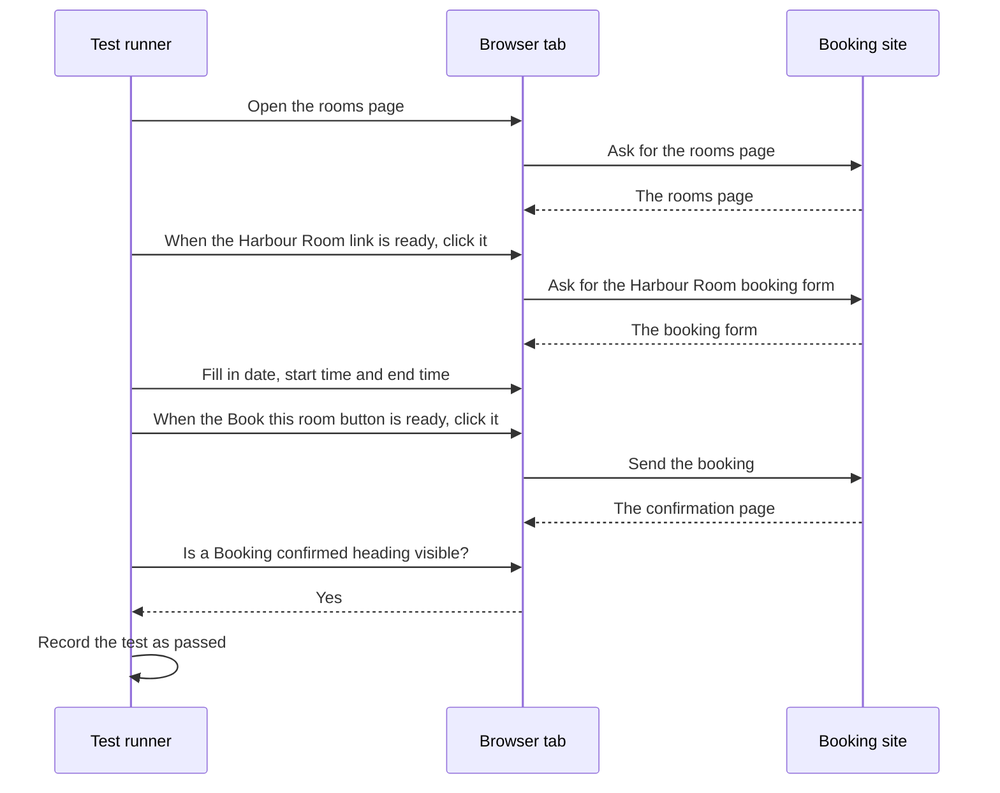

# Lesson 1: What changes when a machine runs your test?

You have run the same regression test so many times that you could do it with your eyes closed. Open the page, choose the room, fill in the form, press the button, check the message. It passes, you mark it, you move on.

Now imagine a machine doing that instead of you, a hundred times a day, every time a developer changes something. That is what test automation is. It is also where most people new to it make their first serious mistake: they assume the machine does what they did. It does not. It does what was **written down**, and you do a great deal that was never written down.

This lesson is about that gap. By the end of it you will be able to look at a test, manual or automated, and say exactly what it checks, what it silently relies on, and which bugs would walk straight past it. That skill is the foundation of everything else in this course. The rest of the course turns it into working code.

You do not need to install anything or write any code today. You will read a manual test case, then a real automated test written with **Playwright**, a widely used tool for controlling a web browser from a program. You will read it line by line, the way you would read a test case written by a colleague. In the lessons that follow you will set up your own computer and then run a test like this one.

If a word is new, it is explained where it first appears. Your testing experience is the starting point here, not something to put aside. Every new idea in this lesson begins from something you already do.

## 1. Start with a familiar situation: handing over your test case

Here is a test case from a meeting-room booking site. You have probably written dozens like it.

**TC-014: Book a free meeting room**

*Preconditions:* Logged in as a member. The Harbour Room is free on 1 December 2026.

| Step | Action | Expected result |
| --- | --- | --- |
| 1 | Open the Rooms page | The list of rooms is shown |
| 2 | Select the Harbour Room | The room's booking form is shown |
| 3 | Enter date 1 December 2026, start 10:00, end 12:00 | — |
| 4 | Press **Book this room** | A "Booking confirmed" message is shown |

A new colleague joins your team. On their first day you hand them TC-014 and ask them to run it while you are in a meeting. They are careful and conscientious, but they have never seen this product before. They follow each step exactly as written and compare what they see against the expected result column.

When you come back, they have marked it **Pass**. You look at the screen they left open. The confirmation message is there, and under it the booking says **Total: €0.00**.

The Harbour Room costs €12 an hour. A two-hour booking should cost €24.00. You would have seen that in a second, because you know the price. Your colleague did not know it, and nothing in the test case asked them to check it. By the rules they were given, they did their job correctly. The test passed, and the product is broken.

The next morning they run it again. This time step 4 shows "This room is already booked", so they mark it **Fail** and raise a bug. You check, and there is no bug. Somebody booked the Harbour Room for real yesterday afternoon. When you run this test, you glance at the calendar first and pick a free room without even thinking about it. The precondition said the room had to be free, but it never said how to make sure it was.

Two runs, two wrong conclusions, and your colleague did nothing careless either time. They did exactly what was written. The problem is everything that **was not** written.

### Pause and explain

Before reading on, answer this for yourself. In each of the two runs, what did you know that your colleague did not? Was that knowledge anywhere in TC-014?

In the first run, you knew what the price should be. That expectation was in your head, not in the expected result column. In the second run, you knew how to make the precondition true, by finding a free room. TC-014 states the precondition but never says how to arrange it.

## 2. What a good tester carries that the test case never says

When you run a test, you apply knowledge you no longer notice because it has become habit. It helps to sort it into four kinds, because each kind needs a different answer once a machine is involved.

**1. The data, and the state the product must be in first.** Which account, which room, which date, and whether that room is actually free. You arrange this almost without thinking: you pick a room you know is free, or you clean up yesterday's booking. A written precondition states what must be true. It rarely says how to make it true.

**2. When a step is finished.** You do not start typing into the booking form while the page is still loading. You wait until the form is there, then you type. Nobody writes "wait until the form has appeared" in a test case, because no person would need telling. A program does not wait unless something makes it wait.

**3. What "correct" means beyond the expected result.** The expected result column says a confirmation message appears. You also expect the right price, the right room, the right times, and a page that does not take nine seconds to appear. In testing, the way you decide whether an outcome is right is called the **test oracle**. Part of yours is written down, and much of it lives in your head: the price list, the previous release's behaviour, a sense of what looks wrong.

**4. What to do with a surprise.** If something unexpected appears, such as an error you have never seen or a layout that looks broken, you stop. You investigate, try a variation and decide whether it matters. That is judgment, and it is the most valuable thing you bring to testing.

Your new colleague lacked the first and third kinds, beyond what TC-014 spelled out. They did have the second: like any person, they waited for the booking form to appear before typing into it. And they had little of the fourth. They noticed the surprise on the second morning, but without knowing the product they could not investigate it, so they reported it as a bug. That is exactly what a failing automated test does: it reports that something did not match, and nothing more.

Keep these four kinds in mind. The next section hands TC-014 to a colleague far more literal than any person, one that does not even have the second kind until someone gives it.

## 3. Now give the test case to a machine

An automated test is a **program**: a set of instructions a computer follows exactly. It does each step it is given and makes each check it is given. Then it reports the outcome. For now, two outcomes matter: **passed**, meaning every check it was told to make came out true, and **failed**, meaning one did not or a step could not be done.

The program is run by a **test runner**, a tool that starts each test, records whether it passed or failed, and reports the results. In this course the runner is **Playwright Test**, and the tests control a real web browser engine: Playwright's own builds of Chromium (the engine behind Chrome and Edge), Firefox, and WebKit (the engine behind Safari). [Playwright: getting started](https://playwright.dev/docs/intro), [Playwright: browsers](https://playwright.dev/docs/browsers)

Return to your new colleague, and push the comparison to its extreme. Imagine a colleague who:

- does every step **exactly** as written, every time, in exactly the same way;
- checks **only** what the expected results say, and notices nothing else at all;
- never gets tired, bored or careless, even on the five-hundredth run;
- can often run the whole regression pack in minutes, at three in the morning, after every change a developer makes;
- has **no** knowledge of the product beyond the test, and **no** judgment about surprises.

That is a fair picture of an automated test. Here is how the parts of your manual work map onto it:

| What you do today | What it becomes | What changes |
| --- | --- | --- |
| A test case | A test, written as a short program | It runs identically every time, with no improvising |
| Preconditions | Setup code that runs before the test | The test must create its own starting state, not hope for it |
| The test data you choose | Data the test creates or is given | Nothing is chosen "by eye" on the day |
| The expected result column | **Assertions**: checks written as code | It checks only what was written; anything unchecked passes silently |
| Waiting for the page | Waiting the tool does for you, within limits | The tool waits for named things, not for "the page to look ready" |
| Your bug report with screenshots | A recorded trace, screenshots and logs | The evidence can be captured automatically when a test fails, once the suite is set up to do so |

The word **assertion** will appear in every lesson from now on. An assertion is a statement the test makes about the product, such as "a heading saying Booking confirmed is visible", together with an instruction to fail the test if it is not true. It is the machine's version of your expected result column. Like that column, it covers exactly what was written and nothing more.

Look at the four kinds of unwritten knowledge again. The machine has none of them unless someone writes them down. Writing them down well is the job of an automation engineer, and you already know what they are. Most people who start in automation have to learn that part slowly. You have spent years doing it.

## 4. Read an automated test, one piece at a time

Here is TC-014 written as a Playwright test. It is an illustrative example to read, not something to run yet. It is written in **TypeScript**, the programming language this course uses. You do not need to know TypeScript to follow it, because each part is explained below.

```ts
import { test, expect } from '@playwright/test';

test('a member can book a free meeting room', async ({ page }) => {
  await page.goto('https://bookinglab.example/rooms');
  await page.getByRole('link', { name: 'Harbour Room' }).click();

  await page.getByLabel('Date').fill('2026-12-01');
  await page.getByLabel('Start time').fill('10:00');
  await page.getByLabel('End time').fill('12:00');
  await page.getByRole('button', { name: 'Book this room' }).click();

  await expect(page.getByRole('heading', { name: 'Booking confirmed' })).toBeVisible();
});
```

That looks like a lot of punctuation. Read it the way you would read a dense test case: find the steps first, then the detail.

### The first line brings in the tools

```ts
import { test, expect } from '@playwright/test';
```

A **package** is a bundle of code someone else wrote and published for others to use. This line says: from the Playwright Test package, bring in two tools, `test` and `expect`. `test` is how you declare a test. `expect` is how you write an assertion. Almost every test file you write will start with a line like this.

### The test has a name and a body

```ts
test('a member can book a free meeting room', async ({ page }) => {
  ...
});
```

The text in quotes is the test's **name**, the same job as your test-case title. It is what appears in the report when this test passes or fails, so it should say what behaviour is being checked.

Everything between the `{` at the end of the first line and the closing `});` is the test's **body**: the steps. `async (…) => { … }` is TypeScript's way of writing a block of steps that `test` will run for you, and the word `async` marks that the steps inside use `await`, which is explained next.

`({ page })` means "give this test a browser page to work with". You can think of `page` as one browser tab that Playwright opens for this test, controls, and closes when the test ends. Each test gets a fresh tab with a clean browser: no cookies, no saved login, nothing left over from the last test. [Playwright: fixtures](https://playwright.dev/docs/test-fixtures)

A clean browser is not a clean booking site. The site's own data is not reset: a room booked by yesterday's run is still booked. A fresh tab solves the browser half of your colleague's second-morning problem, and leaves the data half untouched.

### `await` means "finish this step before starting the next"

Nearly every step begins with `await`. Talking to a browser takes time: a page has to load, a click has to happen. `await` tells the program to wait until the step is complete before moving on to the next line. Without it, the program would rush ahead and start the next step while the previous one was still in progress.

Be precise about what "complete" means. For a click, it means the click was made, not that the site has finished answering it. That is why the check at the end of the test keeps trying for a few seconds, as Section 5 explains.

Leaving out `await` does not always produce an error. Sometimes the test still passes because of lucky timing, and later fails in ways that look random. The module on asynchronous code shows exactly when and why. For now, read `await` as "do this, and wait until it is done".

### Steps 1 and 2: open the page and choose the room

```ts
await page.goto('https://bookinglab.example/rooms');
await page.getByRole('link', { name: 'Harbour Room' }).click();
```

`page.goto(...)` opens an address in the browser tab, like typing it into the address bar. The dot means "on this page, do this": `page.goto` is the page's own go-to-an-address action. The address here is fictional.

The second line is the most important idea in this lesson's code, so read it slowly. It does not say "click at position 340, 210" or "click the third link". It says: **find the link whose name is Harbour Room, and click it**.

`getByRole('link', { name: 'Harbour Room' })` describes the element the way you would describe it to a person: what kind of thing it is (a **link**), and what it is called (**Harbour Room**). The kind of thing is called its **role**. Links, buttons, headings, checkboxes and text fields each have a role. Screen readers and other assistive technology use these roles, and Playwright works them out by the same published rules, so it sees the page much as they do. [Playwright: locators](https://playwright.dev/docs/locators)

A description like this, which tells Playwright how to find an element, is called a **locator**. Playwright's own guidance recommends locating elements by what the user sees and uses, such as roles, labels and visible text, rather than by the page's internal structure, which changes far more often. [Playwright: locators](https://playwright.dev/docs/locators) This is why your instinct as a tester matters here too. You already describe screens in terms of what a user sees, not in terms of how the page was built.

One precise detail: by default, the name only has to **contain** the text you give, and capital letters are ignored. A link called "The Harbour Room" would also match, and so would one called "Harbour Room (large)". You can ask for an exact match, and you will learn when that matters in the Playwright stage of the course.

### Step 3: fill in the form

```ts
await page.getByLabel('Date').fill('2026-12-01');
await page.getByLabel('Start time').fill('10:00');
await page.getByLabel('End time').fill('12:00');
```

`getByLabel('Date')` finds the form field whose **label** says "Date". That is the text next to a field telling the user what to type. `.fill(...)` types the given value into it, replacing anything already there. The date is written year-month-day, which is what this fictional booking form expects.

Notice that the test case's "Enter date, start, end" has become three separate, exact instructions. Nothing is left to interpretation.

### Step 4: press the button

```ts
await page.getByRole('button', { name: 'Book this room' }).click();
```

You can probably read this one yourself by now: find the button called "Book this room", and click it.

### The check: the expected result, as an assertion

```ts
await expect(page.getByRole('heading', { name: 'Booking confirmed' })).toBeVisible();
```

This is the assertion. Read it from the inside out: **expect** that the **heading** called **Booking confirmed** **is visible**. If it is visible, this check passes. If it is not, the test fails, and the report names this line.

### What is missing

Read the test again and look for TC-014's preconditions. They are not there. Nothing in this test logs in, and nothing makes sure the Harbour Room is free.

A fresh tab starts logged out, so for this lesson assume that something has already logged in and prepared a free room before the test begins. Real test suites arrange both in code: preparing data is taught in the test-design lesson of the Playwright stage, and logging in once for many tests in the sessions and roles lesson. For now, notice the gap: **the machine's preconditions must be arranged in code too**, or the test is relying on luck. That was exactly your new colleague's second-morning problem.

## 5. What the machine actually does with it

When this test runs, Playwright works through the steps in order. Two things happen that a test case would never need to spell out for a person.

**It waits for each element to be ready.** Before clicking the Harbour Room link, Playwright checks that the link exists, is visible, has stopped moving, is not covered by something else, and is enabled. If it is not ready yet, Playwright keeps checking until it is. [Playwright: auto-waiting](https://playwright.dev/docs/actionability) This is the machine's answer to the second kind of unwritten knowledge, knowing when a step is finished. The waiting has limits, though. By default a whole test gets 30 seconds. A click has no time limit of its own: it keeps waiting until the whole test's 30 seconds run out. So if the link never appears, the test fails after 30 seconds instead of waiting forever. [Playwright: timeouts](https://playwright.dev/docs/test-timeouts)

**It retries the assertion for a while.** The confirmation heading might take a moment to appear after the button is pressed. `toBeVisible()` keeps checking, by default for up to 5 seconds, and passes as soon as the heading is visible. If the heading is still not visible after 5 seconds, the assertion fails. This 5-second limit belongs only to assertions; steps such as clicks use the test's 30 seconds. [Playwright: assertions](https://playwright.dev/docs/test-assertions)

So in the first run from Section 1, which outcome would this automated test report?

It would report **passed**. The heading "Booking confirmed" is visible, and that is the only thing the test checks. The €0.00 total is on the screen, and the test does not look at it. The automated test makes your new colleague's first mistake perfectly, every time, in a fraction of a second.

This is the most important sentence in the lesson: **a passing test means every check that was written came out true. It does not mean the feature works.**

The fix is not cleverness. It is writing down the expectation that was in your head:

```ts
await expect(page.getByText('Total: €24.00')).toBeVisible();
```

`getByText(...)` finds an element containing the given text. This line asserts that the total shown is €24.00. Add it after the confirmation check, and the €0.00 defect makes the test fail. The machine still has no idea what a price is. It knows exactly one more thing that you know: you have written one more piece of your test oracle down.

This works on this page. Remember from Section 4 that the text only has to be contained: if the page also had a line reading "Subtotal: €24.00", that line would satisfy the check even while the total said €0.00. The Playwright stage teaches how to make a check exact.

Deciding which of your many expectations deserve to be written down is a design decision. Every check you add catches more defects. It also gives the test one more reason to fail when the product changes on purpose. Weighing that trade-off is a large part of what this course teaches.

## 6. Follow one whole run

Read this diagram from top to bottom. Time moves downward. Each arrow is an instruction or a message, and its label says what happens.



In words: the test runner tells the browser tab to open the rooms page, and the browser asks the booking site for it. The runner waits until the Harbour Room link is ready, then clicks it, and the browser asks the site for the room's booking form. The runner fills in the three fields, then waits until the booking button is ready and clicks it. The browser sends the booking to the site, and the site answers with a confirmation page. The runner asks whether a "Booking confirmed" heading is visible, gets "yes", and records a pass.

Notice the three participants. **The test runner never talks to the booking site directly.** It drives a real browser, much as a user's mouse and keyboard would, and the browser talks to the site. That is why a browser test catches problems that only appear in a real browser. It is also why such tests are slower than checks made in other ways. Later in the course you will test the site's API directly, without a browser. An **API** is the entrance programs use instead of screens; if you have ever called a service with Postman, you have used one. You will learn when each kind of test is the better choice.

## 7. What the machine is better at, and what you are better at

It would be easy to read this lesson as "automation is a weaker tester". It is not weaker. It is different, and the difference is the whole reason it is worth doing.

The machine is better at:

- **Repetition without drift.** The five-hundredth run is identical to the first. People skip steps when they are tired, and the machine never does.
- **Speed and frequency.** A suite that takes you two days by hand can often run in minutes, on every change a developer makes, before a defect ever reaches you.
- **Precision.** It compares "€24.00" to "€24.00" exactly. It will not miss a wrong digit because the number looked about right.
- **Evidence.** When it fails, it can record the screen, the steps and the messages at that moment, without anyone remembering to take a screenshot.

You are better at:

- **Noticing what nobody asked about.** The €0.00. The nine-second delay. The button that is technically there but impossible to read.
- **Exploring.** Trying the variation nobody wrote down, which is where many of the worst defects are found.
- **Judging what matters.** Deciding which checks are worth writing, which failures are serious, and what a surprise means.

So automation does not replace your testing. It **moves your judgment into the design of the test**. Every expectation you write down is one the machine will check, at speed, forever. Every expectation you leave in your head is one it will never check. And not every test is worth automating at all. Choosing which ones are is a skill of its own, with its own lesson later in the course.

## 8. Where the new-colleague comparison helps, and where to stop using it

The literal new colleague is a good way to think about an automated test, and you can keep using it whenever a test's result surprises you. Ask: "What did I write down, and what did I assume?"

Three points should now be stated more precisely:

1. **The machine is more literal than any person.** A new colleague faced with an ambiguous step asks you a question. Playwright cannot ask. If a locator matches **two** elements, say a "Harbour Room" link and a "Harbour Room (large)" link, which both match because the name only has to contain "Harbour Room" (Section 4), Playwright refuses to guess. The step fails with an error saying more than one element matched. [Playwright: locator strictness](https://playwright.dev/docs/locators#strictness) That is a deliberate design choice, and a good one: a test that guessed would sometimes click the wrong room and pass anyway.
2. **The machine does not get better at the product.** Your new colleague learns the price list within a week. An automated test knows on its thousandth run exactly what it knew on its first. Its knowledge grows only when somebody edits it.
3. **"Notices nothing else" is literally true.** The colleague might mention in passing that the page looked odd. The test reports only on its own checks. If you want something checked, it has to be written.

These are limits of the comparison, not faults in Playwright. The comparison has done its job if it reminds you, every time, that a test knows only what it was told.

## 9. Where this course is going

This lesson is the first step on a long path. Here is the shape of it, so you can see where each new idea will be used.

| Stage | What you will be able to do |
| --- | --- |
| Setup and first steps | Run an automated test on your own computer, and use the terminal and Git, the tool teams use to track every change to code |
| Programming for testers | Write small programs that check things you would otherwise check by hand, ending with a tiny test runner you build yourself, to see what Playwright Test does underneath |
| TypeScript and the runtime | Read and write the language confidently, including the waiting and timing behind most unreliable tests |
| The web as a system under test | Understand pages, the accessibility information browsers expose, and web traffic well enough to know why a test failed |
| Playwright in depth | Build, structure and debug a real browser test suite, including tracking down flaky tests (tests that pass and fail at random) to their actual cause |
| Beyond the UI layer | Test the site's API directly, and check data, permissions, accessibility, visual changes and performance |
| Tools compared and transferred | Work in Selenium with Java, compare Cypress, and judge when BDD helps |
| Tests in the delivery pipeline | Run the practice application in containers and your tests automatically on every change |
| Quality strategy and the team | Decide what to test, at which level and why, review tests (including ones an AI wrote), and keep a suite alive through product change |
| Capstone | Test an application you have never seen, from strategy to working suite, and defend your choices |

Throughout the course you will build one test suite against a practice booking application. The application will be released in versions, as a real product is. Each version adds features, changes some behaviour, and contains defects planted on purpose. Your suite will be graded by whether it catches them. That is the honest measure of a test suite, and after this lesson you know why. A suite where every test passes tells you nothing until you know what it would have caught.

## 10. Try it with less help

Use the explanations above if you need them. Complete explanations follow these three practices. Take your time, and say your answer in your own words before you read them.

### Practice A: find the unwritten knowledge

Here is another manual test case:

**TC-031: Reset a forgotten password**

| Step | Action | Expected result |
| --- | --- | --- |
| 1 | Open the login page and choose **Forgot password** | The reset form is shown |
| 2 | Enter the account's email address and press **Send link** | "Check your email" is shown |
| 3 | Open the email and follow the link | The new-password form is shown |
| 4 | Enter a new password twice and press **Save** | "Password changed" is shown |

Imagine handing this to the literal colleague, or to a machine. Using the four kinds from Section 2 (data and starting state, when a step is finished, what "correct" means beyond the expected result, and what to do with a surprise), list at least four things you would know or do that TC-031 does not say. Name the kind each one belongs to.

### Practice B: say exactly what a test checks

Here is an automated test for applying a discount code:

```ts
test('a member can apply a discount code', async ({ page }) => {
  await page.goto('https://bookinglab.example/basket');
  await page.getByLabel('Discount code').fill('WINTER10');
  await page.getByRole('button', { name: 'Apply' }).click();
  await expect(page.getByText('Code applied')).toBeVisible();
});
```

The basket holds one two-hour Harbour Room booking at €24.00. `WINTER10` is meant to take 10% off.

1. In one sentence, what exactly does this test check?
2. Name two different defects this test would let pass.
3. In plain words, not code, describe one more check that would catch one of your defects.

### Practice C: predict a failure, then interpret it

Return to the room-booking test from Section 4. A developer changes the booking button's wording from **Book this room** to **Confirm booking**. Nothing else changes, and booking still works correctly for users.

1. Predict what happens when the test runs. Which step goes wrong, and roughly how long does the test take to fail?
2. Is the failing test evidence of a defect in the product? What would you need to know to decide?

### Practice explanations

**A.** There are many good answers. Here are some, by kind:

- *Data and starting state:* which account to use, and that it must exist with a known email address. You need access to that email inbox. You may need to reset the password back afterwards, or the next run starts from a password nobody knows.
- *When a step is finished:* the email does not arrive instantly. You wait for it, perhaps a minute, and check the spam folder before deciding it never came. A machine needs to be told how long it may wait and where to look.
- *What "correct" means beyond the expected result:* the old password should stop working and the new one should work. The link should work only once, and should expire. The email should come from the right sender and name the right account. "Password changed" appearing proves none of this.
- *What to do with a surprise:* if the email names a different account, or the link opens someone else's reset form, you would stop and raise it as serious. A test checks only for the message it was told to expect.

If you listed the first and third kinds but not the second, notice how invisible waiting is. You do it so naturally that it rarely feels like a step.

**B.**

1. It checks one thing: that some text containing "Code applied" becomes visible within the assertion's time limit.
2. Defects it would let pass include: the message appears but no discount is taken off, and the total stays €24.00. The wrong amount is taken off, such as 1% instead of 10%. The discount is applied twice. The message appears even for a misspelt code. Any defect that leaves "Code applied" on the screen passes this test.
3. For example: "Check that the total now shows €21.60." That is €24.00 minus 10%, and it would catch both the missing and the wrong discount, as long as it checks the total itself and not any line that happens to contain the same text (Section 5). A check that a made-up code shows an error instead would catch the misspelt-code defect.

If your first answer was "it checks that the discount works", reread the assertion. It says nothing about any amount. That gap between what a test's name promises and what its assertions check is one of the most common defects in real test suites.

**C.**

1. The step that clicks the button looks for a button named "Book this room". No element matches any more, so Playwright keeps waiting for one to appear. With the default settings, the test fails after about 30 seconds, the test's time limit. The report shows that it timed out waiting for that button. The assertion is never reached.
2. Not by itself. The test failed because it described the button by its old wording. Users can still book a room, so the product may be fine and the test simply out of date. But a failing test is **evidence to investigate**, not a verdict. If the wording change was not approved, for example if the requirement says "Book this room", then the change itself may be the defect. To decide, you need to know what the product is supposed to do: the requirement, the design, or the person who made the change. Telling "the product broke" apart from "the test is out of date" is a daily part of automation work. Later in the course, a whole lesson practises it against a new release of the practice application.

If you predicted that the test would click some other button instead, look again at Sections 5 and 8. Playwright does not guess. It waits for a match, and fails if none arrives.

## 11. What you should be able to explain now

Close the examples for a moment, and explain to an imaginary new colleague:

- What four kinds of knowledge does a tester apply that a written test case usually does not state?
- In the room-booking test, what does `getByRole('link', { name: 'Harbour Room' })` describe, and why does describing an element that way survive more product changes than describing its position?
- What does a passing automated test establish, and what does it not establish?
- Why is a failing automated test something to investigate rather than an automatic bug report?

You are ready for the next lesson when you can answer these in your own words and read a short test like the ones above. You do not need to remember the exact punctuation. You do need to be able to say what a test checks and what it relies on. Writing the code comes later, and it will be much easier because you understand this part first.

In the next lesson, you will set up your own computer for the course: a code editor, and Node.js, the program that runs TypeScript (and JavaScript, the language TypeScript is built on) outside a browser. Two lessons after that, you will run a test someone else wrote, and watch a browser do in a few seconds what TC-014 takes you a few minutes to do by hand.
