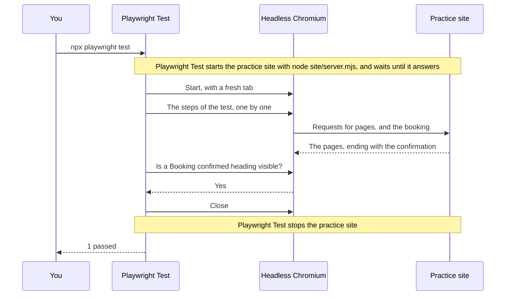

# Lesson 4: Run a test someone else wrote

In Lesson 1 you read an automated test line by line and reasoned about what it would do. You worked out that it would pass on a page showing a total of €0.00, because nothing in it looked at the total. You could only reason, because you had nothing to run it on.

Today you run it. The two lessons in between gave you a working computer and a method for the moments when something fails. This lesson uses both.

The question for today is:

> "What actually happens on my computer when an automated test runs, and how do I read what it tells me?"

By the end you will have done four things with your own hands. You will have run TC-014 manually against a small booking site. You will have watched a machine run the same case in about half a second, and pass a page that is wrong. You will have added one line that makes the test catch the defect. And you will have seen a test fail for a reason that has nothing to do with a defect at all.

The steps were checked on Windows 11. The macOS and Linux steps have not yet been run by the author.

## 1. Start with a familiar situation: the first morning on a new test environment

A test team gets a new test environment on a Monday. The release is on Friday, and a regression pack of two hundred cases is waiting. Dimitra, who is new to the team and keen, starts at case 1 and works down.

By Tuesday afternoon she has forty failures and has raised eleven bug reports. On Wednesday morning a developer looks at the first report for two minutes and asks one question: "Which address are you testing against?" The environment's address in the test plan was the old one. It pointed at last month's build, with last month's data. Nothing she found was about this release. Two days are gone, eleven bug reports are withdrawn, and the pack has to start again with two days left.

You already know what an experienced tester does differently on that Monday. Before the pack, they run **one case they know very well**, alone. If that case behaves as expected, the address is right, the account works and the data is there, and any surprise later in the pack is about the product. If that case misbehaves, they have learned it in two minutes, with one case to think about, not forty.

You may not call this a technique. It is one, and here is why it works: **when everything is new, you can only understand a surprise if exactly one thing is unknown.**

Today everything is new. You have new tools on your computer and you have never seen them work together. So you will do what the experienced tester does. You will run **one test you already understand**, from Lesson 1, against **a site small enough to know completely**. When it behaves as Lesson 1 said it would, you will know your setup is sound. When something surprises you, you will have only one test to think about.

There is a second habit from your working life that this lesson keeps. Before you automate a case, you run it by hand. You cannot judge what a machine did to a page unless you know what the page does. So the machine goes second today.

## 2. Open the kit

Download the kit offered with this lesson, **QAAE_First_Run_Kit_v1.zip**. Move it into your `course-work` folder and extract it, as you did with the first kit. Open the extracted folder named `first-run-kit` in VS Code, the folder that directly contains `package.json`. When VS Code asks whether you trust the authors, apply the three questions from *Set up a safe workspace*: the kit came with this lesson and you downloaded it yourself. Trust this folder, and leave the box for the folder above it unticked.

Look at the Explorer before you run anything. The folder holds:

| File or folder | What it is |
| --- | --- |
| `site/server.mjs` | The practice booking site: a program that serves the pages |
| `tests/book-room.spec.ts` | The test from Lesson 1 |
| `package.json` | A short list of what this project needs, and some named commands |
| `package-lock.json` | The exact versions of everything in that list, recorded so that every learner gets the same ones |
| `playwright.config.ts` | Settings for Playwright Test |
| `playwright.watch.config.ts` | The same settings, changed so that a person can watch a run |
| `README.md` | A one-page reminder of the commands, for after the lesson |

Click `tests/book-room.spec.ts`. It is the test you read in Lesson 1, with one difference: the address in the first step. Lesson 1 used a fictional address. This one is `http://127.0.0.1:4410/rooms`, and Section 3 explains each part of it.

## 3. First, run TC-014 by hand

### Start the site

Open a new terminal in VS Code and run:

```sh
node site/server.mjs
```

You know both halves of this from the earlier lessons: `node` starts Node.js, and `site/server.mjs` is the file of instructions, inside the folder `site`. The terminal prints:

```text
BookingLab practice site is listening at http://127.0.0.1:4410/rooms
Press Ctrl+C in this terminal to stop it.
```

Then nothing more happens, and the prompt does not come back. That is correct, and it is different from the programs you have run so far. `greeting.mjs` printed two lines and stopped. This program is a **server**: a program that starts, and then waits for browsers to ask it for pages, for as long as you let it run. While it runs, this terminal belongs to it.

Now the address, one piece at a time.

- **`127.0.0.1`** is a special address that always means "this same computer". A browser that opens it is not going out to the internet. It is talking to a program on the machine it is running on. Nobody else, anywhere, can reach your copy of the site.
- **`4410`** is a **port**. One computer can run many programs that wait for connections, and each one waits at its own numbered door. This site waits at door 4410. The number itself has no meaning. It only has to be one that nothing else is using.
- **`/rooms`** names the page being asked for.

That is as much as you need today. The module on HTTP, later in the course, explains all of this in full.

### Do the test case

Open your ordinary browser and go to `http://127.0.0.1:4410/rooms`. Here is TC-014 again. Lesson 1's version had a precondition, "Logged in as a member". This small site has no login: everyone who opens it is treated as a member.

Run the case as you would run any case, and before step 4, **write down the total you expect to see.**

| Step | Action | Expected result |
| --- | --- | --- |
| 1 | Open the Rooms page | The list of rooms is shown |
| 2 | Select the Harbour Room | The room's booking form is shown |
| 3 | Enter date 1 December 2026, start 10:00, end 12:00 | — |
| 4 | Press **Book this room** | A "Booking confirmed" message is shown |

If your browser shows times with AM and PM, the end time is 12:00 PM, noon.

You should see **Booking confirmed**, the room, the date, the time, and **Total: €0.00**.

The Harbour Room costs €12 an hour, as the Rooms page says. Two hours should cost €24.00. This site has that defect planted in it on purpose, and you have just found it the way you find defects every day: you knew what the total should be, and you looked.

Record two things before going on.

1. If you follow TC-014 exactly as written, did the case pass? Look at the expected result column.
2. Roughly how long did the four steps take you?

Now look at the terminal where the site is running. It has printed a line for each thing your browser asked for:

```text
GET /rooms
GET /rooms/harbour
POST /bookings
GET /bookings/1
```

Each line is one message from your browser to the site: three requests to *get* a page, and one that *posts*, which means sends, your booking. In Lesson 1 these were arrows in a diagram between "Browser tab" and "Booking site". Here they are real, and you can watch them arrive.

And the answer to the first question: followed exactly as written, TC-014 passed. The expected result column asks only for the message, and the message was there. That was your new colleague's first run in Lesson 1.

### Book it again, then stop the site

Go back to the Rooms page and make exactly the same booking a second time. The site answers **This room is already booked**. It remembered your first booking. Keep that in mind. It returns in Practice B.

Now stop the site. Click into the terminal where it is running and press **Ctrl+C**. On macOS this is the **Control** key, not Command. It is the one shortcut in this lesson that is the same on every system. The prompt comes back.

The program has ended, and so has its memory: this site keeps its bookings only while it runs. Start it again and every room is free.

Go to the Rooms address in your browser again. The browser reports that it cannot connect. Nothing is waiting at door 4410 any more.

## 4. Install what the test needs

Make sure the site is stopped. Then try to run the test, before installing anything, to see what is missing. The command is explained in a moment. For now, type it:

```sh
npx playwright test
```

One of two things happens.

- You are asked **`Need to install the following packages: … Ok to proceed? (y)`**. Type **n** and press Enter.
- Or you get an error saying it cannot find `@playwright/test`.

Either way the message is the same underneath. The test's first line brings in tools from a package called `@playwright/test`, and that package is not on your computer. Two things are missing, in fact, and you will meet the second in a few minutes. Each needs one command. Both commands download something, so apply the three questions from *Set up a safe workspace* to each: source, action, permission.

### The packages: `npm install`

**npm** is a tool that was installed together with Node.js. Its job is to download **packages**, the bundles of published code you met in Lesson 1, from a public library of them called the **npm registry**.

It does not decide what to download. It reads a list. Open `package.json` and find this part:

```json
"devDependencies": {
  "@playwright/test": "1.65.1"
}
```

`devDependencies` is the heading for "packages this project needs while it is being worked on". Under it is the whole list: one package, Playwright Test, at one exact version. An exact version means that you, the author of this lesson and every other learner run the same Playwright.

- **Source.** The npm registry, and from it one package published by Microsoft, the maker of Playwright. You are not typing a package name from a forum. You are installing what the kit's own list names.
- **Action.** It downloads Playwright Test, and two packages that Playwright itself needs, into a new folder named `node_modules` inside the kit.
- **Permission.** None beyond your own account. It writes the packages inside this folder. npm also keeps a copy of what it downloaded, and its logs, in a cache folder in your home folder.

One fact belongs here, and you will need it for the rest of your working life. Installing a package can also *run* code from that package on your computer. That is how the system is designed. It is the reason the list in `package.json` deserves the same care as any installer. A project's list comes from the project. A package name pasted from a stranger's message is the neighbour's leaflet. [npm: install](https://docs.npmjs.com/cli/v11/commands/npm-install)

In the terminal, run:

```sh
npm install
```

The author's run printed:

```text
added 3 packages, and audited 4 packages in 4s

found 0 vulnerabilities
```

Your timing will differ. Look at the Explorer: a folder named `node_modules` has appeared. Two things about that folder are worth knowing from the first day.

- **It is a download, not your work.** Never edit anything in it.
- **It can always be rebuilt.** If it is ever damaged, delete the folder and run `npm install` again. The list in `package.json` and the exact versions in `package-lock.json` bring back the same contents.

On Windows, this is the command most likely to stop you, with a red message that says "running scripts is disabled on this system". If you see it, go to "If something does not match" at the end of this lesson. It is explained there, with a fix that changes nothing on your computer.

### What `npx` does

Now the command you typed at the start of this section. In *Set up a safe workspace* you learned that the shell finds a program by looking through its PATH list. The `playwright` tool is not on that list. It sits inside this project's `node_modules` folder, where the shell never looks.

**npx**, which also came with Node.js, bridges that gap: it runs a tool that lives in this project's `node_modules` folder. So `npx playwright test` means: *in this project's folder, find the tool called `playwright`, and tell it to run the tests.*

That also explains the question you may have been asked. If the tool is not in `node_modules`, npx offers to download it from the registry and asks `Ok to proceed?`. In this course, always answer **n**. The question means that you are in the wrong folder, or that `npm install` has not been run here.

### The browser: `npx playwright install chromium`

Run the test again:

```sh
npx playwright test
```

This time Playwright Test starts, and the test fails within a moment. The author's run, with the path shortened:

```text
  ✘  1 [chromium] › tests\book-room.spec.ts:3:1 › a member can book a free meeting room (2ms)

    Error: browserType.launch: Executable doesn't exist at C:\Users\maria\AppData\Local\ms-playwright\chromium_headless_shell-1255\chrome-headless-shell-win64\chrome-headless-shell.exe
    ╔════════════════════════════════════════════════════════════╗
    ║ Looks like Playwright was just installed or updated.       ║
    ║ Please run the following command to download new browsers: ║
    ║                                                            ║
    ║     npx playwright install                                 ║
    ║                                                            ║
    ║ <3 Playwright Team                                         ║
    ╚════════════════════════════════════════════════════════════╝
```

If your test ran and passed, Playwright's browser is already on your computer from other work. Read on anyway.

Use the method from *When something goes wrong*. **Who is speaking?** Playwright. **What went wrong?** An `Executable`, which means a program, `doesn't exist`. **Where?** The path of the program it wanted: a browser, in a folder named `ms-playwright`.

You already have a browser. Playwright wants its own, and the reason is one you know from the other side. "It works on my machine" is the oldest argument in testing. If each person's test uses a different browser version, a result cannot end that argument. So every version of Playwright is tied to one exact build of each browser, and it downloads that build. The same test then runs in the same browser on every computer. [Playwright: browsers](https://playwright.dev/docs/browsers)

The box suggests `npx playwright install`, which downloads all three browser engines. This lesson needs one, so you will name it.

- **Source.** Playwright's own download server. The command prints each address it uses.
- **Action.** It downloads two builds of Chromium that belong to this Playwright version: the full browser, used when you ask to see a window, and a smaller one with no window, used for ordinary runs. A small video tool comes with them.
- **Permission.** None on Windows and macOS. It writes into a folder in your home folder, not into the kit, so that later kits can share the same browser. On Linux, see the note in "If something does not match".

Run:

```sh
npx playwright install chromium
```

Several downloads follow, each with a progress bar, and each ends with a line saying where it was put. On the author's Windows computer they came to about 750 MB on disk. Allow a few minutes on a slow connection. The folder is:

| System | Where Playwright keeps its browsers |
| --- | --- |
| Windows | `C:\Users\<name>\AppData\Local\ms-playwright` (File Explorer hides `AppData` unless you ask for hidden items) |
| macOS | `/Users/<name>/Library/Caches/ms-playwright` |
| Linux | `/home/<name>/.cache/ms-playwright` |

Add both install commands, and your browser folder, to your recovery note now, while you can see them.

### A good place to pause

Everything the test needs is now on your computer: the packages in the kit's `node_modules` folder, and the browser in your home folder. Nothing has run yet. The rest of the lesson runs the test, watches it, and changes it.

## 5. Let the machine run it

### Predict, then run the test

Make sure the site is stopped. You pressed Ctrl+C in Section 3, and the prompt is back.

**Predict before you run.** You did TC-014 by hand and saw €0.00. The test in `tests/book-room.spec.ts` is the one from Lesson 1. Will it pass or fail? Write your prediction and one sentence of reasoning.

Now run it:

```sh
npx playwright test
```

The author's run:

```text
Running 1 test using 1 worker

  ✓  1 [chromium] › tests\book-room.spec.ts:3:1 › a member can book a free meeting room (342ms)

  1 passed (1.9s)
```

It passed. Compare that with your prediction.

Read the middle line from left to right, because you will read thousands like it.

- **`✓`** means the test passed. A failed test shows `✘`. Some terminals print `ok` and `x` instead.
- **`[chromium]`** is the name the settings file gives to this browser setup. Here it means Playwright's Chromium.
- **`tests\book-room.spec.ts:3:1`** is where the test begins: the file, then line 3, then character 1. On macOS and Linux the path is written with `/`.
- **`a member can book a free meeting room`** is the test's name, the text in quotes on that line of the file.
- **`(342ms)`** is how long the test took: about a third of a second. Your figure will differ from run to run.

The first line says `using 1 worker`: one copy of the test runner did the work. Larger suites use several at once, which a later stage teaches. The last line is the summary: `1 passed`, and the time for the whole run, which includes starting everything up.

Less than a second, against the minute or two the same four steps took you. And it passed a booking page that says a two-hour booking is free. That is the sentence from Lesson 1, no longer something you were told: **a passing test means every check that was written came out true. It does not mean the feature works.** The test checked for the heading "Booking confirmed". The heading was there.

### Two things you did not see

Two things happened in that run that you had no way of noticing.

**You did not see a browser.** By default Playwright runs the browser **headless**: a real browser engine doing real work, with no window drawn on the screen. That is the smaller of the two builds you downloaded. Most test runs happen where nobody is watching, so no window is needed.

**You did not start the site.** You stopped it in Section 3, and the test still found it. Open `playwright.config.ts` and read the last block:

```ts
webServer: {
  command: 'node site/server.mjs',
  port: 4410,
  reuseExistingServer: true,
},
```

You can read this without knowing the language. Before the tests, Playwright runs the `command`, the very one you typed by hand, and waits until something answers at door 4410. After the tests, it stops the site again. The last setting says: if a site is *already* answering at that door, use it and do not start a second one. That setting returns in Practice B. [Playwright: web server](https://playwright.dev/docs/test-webserver)

### The whole run, in order

Read this diagram from top to bottom. Time moves downward, and each arrow is an instruction or a message.



The two wide boxes are things Playwright Test does to the practice site directly: starting it before the test and stopping it afterwards.

In words: you give one command. Playwright Test starts the practice site and waits until it answers. It starts a headless Chromium with a fresh tab and sends it the test's steps one at a time. The browser asks the site for pages and sends the booking, and the site answers. Playwright asks the browser whether the heading is visible, hears yes, closes the browser, stops the site, and reports one pass.

Compare this with the diagram in Lesson 1. The three participants there, the test runner, the browser tab and the booking site, are all here, and now each is a real program on your computer. The runner still never talks to the site about the booking. It drives the browser, and the browser talks to the site.

## 6. Watch it happen

You can ask to see the browser. The option is `--headed`:

```sh
npx playwright test --headed
```

Try it. A browser window appears and is gone almost before you can focus on it. The machine works at full speed, even when you watch.

So the kit has a second set of settings for watching. Run:

```sh
npm run watch
```

`npm run` starts a command that the project has given a name to. Look in `package.json` and you will find the name `watch` beside the command it stands for. npm prints two lines beginning with `>` to show you which command it is starting. That command uses `playwright.watch.config.ts`, which makes two changes: it shows the browser window, and it tells Playwright to pause for 0.8 seconds after every action.

This time you can follow it. The Rooms page opens. The Harbour Room link is clicked. The date and the two times fill in. The button is pressed. The confirmation appears, and for a moment, there on the screen in front of you, is **Total: €0.00**. Then the window closes and the terminal reports a pass.

You have now watched the machine look straight at the defect and report success.

The window you saw is the full build of Chromium from Section 4. Ordinary runs use the windowless one.

### When to watch, and when not to

Being able to watch is useful, and it is worth being clear about when.

- **Watch** when you are writing a test, when you are working out why one fails, or when you are showing somebody what a test does.
- **Do not watch** as a routine. The value of an automated test is that it runs without you. Most runs of a real suite happen on machines with no screen at all, many times a day.
- **Be careful with slow motion.** Those 0.8-second pauses change the timing of everything. A test that passes only when slowed down has a problem with waiting, and the pauses are hiding it. Slow motion is for human eyes, never for making a test pass.

## 7. Make the test catch the defect

### Add the check, predict, then run

In Lesson 1 you read the line that would catch the €0.00 total. Now add it.

Open `tests/book-room.spec.ts`. Find the last line inside the test, the one that expects the heading. Directly under it, add this line, with the same two spaces at the start as the line above:

```ts
  await expect(page.getByText('Total: €24.00')).toBeVisible();
```

Copy it from this lesson so that every character is right, the `€` sign included. The end of the test should now read:

```ts
  await expect(page.getByRole('heading', { name: 'Booking confirmed' })).toBeVisible();
  await expect(page.getByText('Total: €24.00')).toBeVisible();
});
```

**Save the file.** You know why from *When something goes wrong*: Playwright reads the file on the disk, not the text in the editor.

**Predict before you run:** pass or fail? If it fails, roughly how long will the test take, and which line will the report point to? Lesson 1, Section 5 has what you need.

```sh
npx playwright test
```

The author's run, with the folder path shortened:

```text
Running 1 test using 1 worker

  ✘  1 [chromium] › tests\book-room.spec.ts:3:1 › a member can book a free meeting room (5.6s)


  1) [chromium] › tests\book-room.spec.ts:3:1 › a member can book a free meeting room ──────────────

    Error: expect(locator).toBeVisible() failed

    Locator: getByText('Total: €24.00')
    Expected: visible
    Timeout: 5000ms
    Error: element(s) not found

    Call log:
      - Expect "toBeVisible" getByText('Total: €24.00') with timeout 5000ms
      - waiting for getByText('Total: €24.00')


      11 |
      12 |   await expect(page.getByRole('heading', { name: 'Booking confirmed' })).toBeVisible();
    > 13 |   await expect(page.getByText('Total: €24.00')).toBeVisible();
         |                                                 ^
      14 | });
      15 |
        at C:\Users\maria\course-work\QAAE_First_Run_Kit_v1\first-run-kit\tests\book-room.spec.ts:13:49

    Error Context: test-results\book-room-a-member-can-book-a-free-meeting-room-chromium\error-context.md

  1 failed
    [chromium] › tests\book-room.spec.ts:3:1 › a member can book a free meeting room ───────────────
```

This is a long message, and you have a method for long messages. Use it.

- **Who is speaking?** Playwright Test. The `✘` line has the same shape as the `✓` line you read in Section 5.
- **What went wrong?** `expect(locator).toBeVisible() failed`. An expectation did not come true. The four lines under it say which one: the locator was `getByText('Total: €24.00')`, it was expected to be `visible`, Playwright kept trying for `5000ms`, and no such element was found.
- **Where?** The report prints the lines of the test file around the place, and marks one with `>`: line 13, the line you added.

Now connect the details to what you already know.

**The test took more than five seconds, not a third of a second.** That is the assertion's 5-second wait. Lesson 1 described it. Now you have measured it. Playwright did not look once and give up. It kept looking for the text for five seconds, in case the page was still changing, and only then failed.

**Line 12 is not marked.** The heading "Booking confirmed" was found, exactly as before. The test got all the way through the booking and failed on the one new thing you asked about.

**The message does not say "the price is wrong".** It says an element with the text "Total: €24.00" was not found. That is precisely what Playwright observed. The step from "that text was not found" to "the site charges the wrong amount" is an inference. Keep that distinction. A failure report tells you what a check observed. What it means is yours to work out.

You do not have to rely on memory to work it out. Near the end of the report, the line beginning `Error Context:` names a file, `error-context.md`, in a new folder called `test-results`. Open it from the Explorer. It begins with a few instructions addressed to an AI assistant, because the file is designed so that it can be handed to one. Below them it repeats the error. Then comes the part worth your attention: an outline, in text, of the page as it was at the moment of failure. In the author's run the outline began:

```text
- heading "Booking confirmed" [level=1]
- paragraph: "Room: Harbour Room"
- paragraph: "Date: 1 December 2026"
- paragraph: "Time: 10:00 to 12:00"
- paragraph: "Total: €0.00"
```

There is the observation that supports your inference: the page said `Total: €0.00`. The machine recorded it at the moment the check failed, without anyone taking a screenshot. In Lesson 1 this appeared as one row of a table, "the evidence can be captured automatically when a test fails". This file is the simplest form of that evidence. Later lessons work with much richer recordings.

If you ever hand that file to an AI assistant, the rules from *When something goes wrong* apply. Check what is in it before it leaves your computer. Treat the assistant's explanation as an inference to test against the outline, not as a second observation.

### A failing test that is right

Your test is red, and the test is correct. The site has a defect. The test now says so, every time, in a few seconds, to anyone who runs it.

Stop here for a moment. Many people believe that all tests must be green. In real work this is the point where you raise the bug, with this report attached. The test stays as it is and keeps failing until the product is repaired. Changing the test to expect €0.00 would turn it green and make it worthless.

You cannot repair the site in this lesson. The next lesson gives you a build of it where the price is right, and several builds where other things are wrong.

## 8. What this run does and does not tell you

Running a test on your own computer is the fastest feedback you will ever get from one, and it is where every test starts its life. It also shows only a small part. A tester should be able to say which part.

The run in Section 5 tells you that one test, in **one browser** (Chromium), on **one computer** (yours), against **a site that had just been started with no bookings in it**, found one heading. Change any of those four things and the result may change:

- Another browser engine may draw or behave differently. Playwright can run the same test in Firefox and WebKit, and the Playwright stage of the course does.
- Another computer may be slower, or have a different screen size or language.
- A site that has been running for a week is full of other people's data.
- And it found what it looked for. You already know how much that leaves unchecked.

None of this is a reason to distrust a local run. It is a reason to describe one accurately. "It passed on my machine" is an observation about one machine.

## 9. Try it with less help

Complete explanations follow these three practices. Write your prediction or your answer before you read them.

### Practice A: a failure that is not a defect

In Lesson 1, Practice C, a developer renamed the booking button and you predicted what the test would do. Now make it happen. This time, change the test, not the site: make the test look for a button that does not exist.

1. In `tests/book-room.spec.ts`, find the step that clicks the button, and change `'Book this room'` to `'Confirm booking'`. Save.
2. **Predict:** which line will the report mark? How long will the test take? Will the report mention the total?
3. Run `npx playwright test` and compare.
4. Open `test-results` and read the page outline in `error-context.md`. What does the page call its button?
5. Change the name back to `'Book this room'`, save, and run once more to confirm that you are back at the failure from Section 7.

Then answer: the reports from Section 7 and from this practice are both red and both end in `1 failed`. What is the difference between what the two messages say happened?

### Practice B: the second morning, on your own computer

In Lesson 1 your new colleague ran TC-014 on a second morning and it failed, although nothing in the product had changed. Reproduce that.

Keep the test as it is at the end of Practice A, with the total check in place.

1. In the terminal, start the site by hand and leave it running: `node site/server.mjs`.
2. Open a **second** terminal with the **+** button at the top of the terminal panel. The first one stays busy with the site.
3. **Predict:** you are about to run the test twice in the second terminal, changing nothing in between. Will the two reports be the same? If not, which line will each one mark?
4. Run `npx playwright test`. Read the report. Run it again. Read the report.
5. Look at the first terminal, where the site prints its lines.
6. Stop the site with Ctrl+C in the first terminal.

Then answer: the test file did not change between the two runs, and neither did the site's code. What did change, and where does it live? And one harder question: the first run *failed*. Did it leave anything behind?

### Practice C: what a colleague's green run establishes

A colleague writes in the team chat: "I ran the booking suite on my laptop just now, all 40 tests green, so the release is good to go."

1. Name three things that this run does not establish. Use Section 8, and what you know from Lesson 1 about what a passing test means.
2. Write the two or three questions you would ask before agreeing, in words you would really use with a colleague.

### Practice explanations

**A.** The report marks line 10, the click, and says:

```text
    Test timeout of 30000ms exceeded.

    Error: locator.click: Test timeout of 30000ms exceeded.
    Call log:
      - waiting for getByRole('button', { name: 'Confirm booking' })
```

The test takes 30 seconds. The total is never mentioned, because the test never reached the lines that check anything. That is the author's run.

The difference between the two messages is the difference between the two ways a test can fail, which Lesson 1 named. In Section 7, **a check came out false**: Playwright did every step, looked for some text for 5 seconds, and it was not there. Here, **a step could not be done**: Playwright waited for a button to click, the button never appeared, and the whole test ran out of its 30 seconds. The first message begins with `expect(...) failed`. The second begins with `Test timeout`, and its call log says `waiting for` the thing it wanted to act on.

Neither message says whose fault it is. In Section 7 the product was wrong. Here the product is fine and the test is wrong, and you know that only because you made the change yourself. In real work you would not know. You would have to find out what the button is supposed to be called. The page outline gives you the first piece of evidence: it lists `button "Book this room"`. So the page has a button, under another name. Whether that name is the right one is a question for the requirement, not for the report.

If you predicted that the report would mark line 13 again, notice the order of the steps: a test stops at the first thing that fails. If any of your three predictions was wrong, reread the three bold paragraphs in Section 7, then change the name once more and time the run.

**B.** The two reports are different. The first run fails at line 13, on the total, exactly as in Section 7. The second run fails earlier, at line 12:

```text
    Error: expect(locator).toBeVisible() failed

    Locator: getByRole('heading', { name: 'Booking confirmed' })
    Expected: visible
    Timeout: 5000ms
    Error: element(s) not found
```

What changed is the **site's state**: the bookings it holds in memory. The first run booked the Harbour Room for 1 December, 10:00 to 12:00. The site was still running when the second run began, so that booking was still there, and the site refused the second one with "This room is already booked". The heading "Booking confirmed" never appeared. You can see it in two places. In the site's terminal there are two sets of requests, and the second set ends at `POST /bookings` with no `GET /bookings/2` after it. And if you open `error-context.md` after the second run, the outline of the page begins with `heading "This room is already booked"`.

This is the same problem as the second morning in Lesson 1. The precondition "the Harbour Room is free" was true for the first run and false for the second, and nothing in the test makes it true.

Why did this not happen in Sections 5 to 7, where you ran the test several times? Because there Playwright started the site fresh for each run and stopped it afterwards. This time a site was already answering, and the `reuseExistingServer` setting told Playwright to use it. Each test gets a fresh browser tab. Nothing gives it a fresh site.

And the harder question: yes. The first run failed, and it still left a booking behind. A test that fails halfway has still done everything up to that point. This is one of the reasons that preparing and cleaning up a site's data has a lesson of its own, in the Playwright stage.

If you predicted that the two reports would be identical because nothing changed, look at what "nothing" covered: the files did not change. The running site did. To see it once more, stop the site, start it again, and run the test twice more. The first of those runs is back at line 13.

**C.**

1. Good answers include these. It ran on one laptop, in whichever browsers that suite is set up to use there, so it says nothing about other browsers or other machines. It ran against whichever copy of the site that laptop reached, with whatever data was in it, and that may not be the build being released. Forty green tests means that every check written in those forty tests came out true. It says nothing about anything they do not check. And one run cannot show whether any of the forty sometimes fails.
2. For example: "Which build was that against, the release candidate?" "Is that Chromium only, or all three browsers?" "Do we know what those forty cover, for example does anything check the totals?" Notice that none of these questions doubts your colleague. Each asks for an observation where the message gave a conclusion.

If your answer to question 1 was "nothing, forty green is good evidence", you are partly right. It is evidence. Your questions show what it is evidence of. Dimitra in Section 1 had forty red results that were evidence about the wrong build. Green results can be about the wrong build too. As a next step, write down which of your own team's test results you could answer those three questions for today.

## 10. What you should be able to explain now

Close the kit for a moment and explain to an imaginary colleague who has never run an automated test:

- What did `npm install` download, where did it put it, and what tells it what to fetch?
- Why does Playwright download a browser when you already have one?
- In the line `✓ 1 [chromium] › tests\book-room.spec.ts:3:1 › a member can book a free meeting room (342ms)`, what does each part mean?
- The test passed while the page said €0.00, and failed after you added one line. What did each result establish?
- Two failure reports: one begins `expect(...) failed`, the other `Test timeout`. What happened in each?
- Why did the same test, unchanged, fail differently on its second run against a site you had left running?

You are ready for the next lesson when you can answer these in your own words, and when you have seen all three results on your own screen: the pass, the failure on the total, and the timeout.

You now have one test that catches one defect, and you found that defect yourself, by hand, first. That raises an uncomfortable question. On a real product you do not know in advance which defects are there. So how would you ever know whether your tests are good enough to catch them? The next lesson gives you a way to measure it.

## If something does not match

Use the part that matches what you see. For anything not listed, use the five steps from *When something goes wrong*.

### Windows: "running scripts is disabled on this system"

You typed `npm install`, or `npx …`, and got a message like this, in red. The path shown is where the standard installer puts Node.js:

```text
npm : File C:\Program Files\nodejs\npm.ps1 cannot be loaded because running scripts is disabled on
this system. For more information, see about_Execution_Policies at
https:/go.microsoft.com/fwlink/?LinkID=135170.
```

Read it with the method. **Who is speaking?** Not npm. The wording is PowerShell's, the shell that VS Code's terminal uses on Windows. npm never started. **What went wrong?** PowerShell refused to load a file named `npm.ps1`. **Where?** The path of that file, inside the Node.js folder.

Here is the cause. A `.ps1` file is a PowerShell script, a file of commands. Windows PowerShell, the version that comes with Windows, will not run script files at all on a computer that nobody has configured. That rule is called its **execution policy**, and it exists so that scripts are not run by accident. [Microsoft: about execution policies](https://learn.microsoft.com/en-us/powershell/module/microsoft.powershell.core/about/about_execution_policies?view=powershell-5.1) Node.js installs npm in more than one form, and one of them is a `.ps1` file. PowerShell picks that one and its own policy blocks it. Your Node.js installation is fine.

You will find plenty of advice about this message on the internet, and much of it tells you to change a security setting. That makes it a good test of the three questions. There are three ways through, and they are listed with the smallest change first.

1. **Use a different shell. This changes nothing on your computer.** In the terminal panel, click the small arrow next to the **+** button and choose **Command Prompt**. A new terminal opens that is not PowerShell, and the policy does not apply to it. Run `npm install` there. Every command in this lesson works the same way in it. One difference: when you stop a program that was started with `npm run`, Command Prompt may ask `Terminate batch job (Y/N)?`. Type **Y**.
2. **Name the other form of the command. This also changes nothing.** In PowerShell, type `npm.cmd install` in place of `npm install`, and `npx.cmd playwright test` in place of `npx playwright test`. You are choosing the form of npm that is not a PowerShell script.
3. **Change the policy for your own account.** The command is `Set-ExecutionPolicy -Scope CurrentUser -ExecutionPolicy RemoteSigned`. Apply the three questions before you decide. *Source:* the command and its meaning are in Microsoft's own documentation, linked above. *Action:* it lets PowerShell run script files that are on your own disk, while still refusing unsigned scripts downloaded from the internet. *Permission:* your account only. It needs no administrator rights and changes nothing for other accounts. On a computer you own and use for development, that is a reasonable setting, and it is the one Microsoft's documentation uses in its own example. On a work computer, ask your IT support first: the policy may be set centrally, and then this command has no effect anyway.

Refuse advice that changes more than the problem needs: setting the policy to `Unrestricted` or `Bypass`, or changing it for the whole computer from an administrator window. The problem is one file in one shell. Routes 1 and 2 solve it with no change at all.

### `npx` asks "Ok to proceed?"

Answer **n**. npx did not find the tool in this folder's `node_modules`, and is offering to download it from the registry. Check that the prompt shows `first-run-kit`, then run `npm install`.

### `npm install` stops with a network error

Messages containing `ETIMEDOUT`, `ECONNRESET`, `ENOTFOUND` or `certificate` mean npm could not reach the registry. Check that your internet connection works, then run the command once more. On a work network this is usually a company proxy or a security product. Keep the exact message and ask your IT support. Do not follow advice that tells you to switch off certificate checking: that is turning the alarm off.

### "Cannot find module '@playwright/test'"

The packages are not installed in the folder where the terminal is. Either `npm install` has not been run, or the terminal is in a different folder. Check that the prompt shows `first-run-kit`, then run `npm install`.

### The browser was downloaded and will not start

Playwright names the systems it supports: at the time of writing, Windows 11 or later, macOS 14 or later, and recent Debian and Ubuntu versions. [Playwright: system requirements](https://playwright.dev/docs/intro#system-requirements) On an older system the download may succeed and the browser may still fail to start. Say which system you have first when you ask for help. The workspace check prints it.

On Linux, Playwright's browsers need some system libraries that a fresh installation may not have. Playwright's documentation gives the command `npx playwright install --with-deps chromium`, which installs them and asks for your password to do so. [Playwright: browsers](https://playwright.dev/docs/browsers) Source, action and permission are all clear here, and the permission is only what the job needs: system libraries are shared by every account.

### The first run fails on the heading, or says a room is already booked

A copy of the site is still running from Section 3 or from Practice B, with an old booking in it. Find the terminal where it runs and press Ctrl+C, then run the test again.

### Starting the site says "Port 4410 is already in use"

The same cause: a copy of the site is already running in another terminal. Stop that one first.

### The test fails and the report points at the line you added

If the report says the text was not found, that is the expected result of Section 7. If it says something about an unexpected character or a syntax error, the line was not copied exactly. Compare it character by character with the lesson, including the quotation marks, the brackets and the semicolon at the end. If you cannot find the difference, delete the `first-run-kit` folder, extract the ZIP again, run `npm install` again, and add the line once more.
