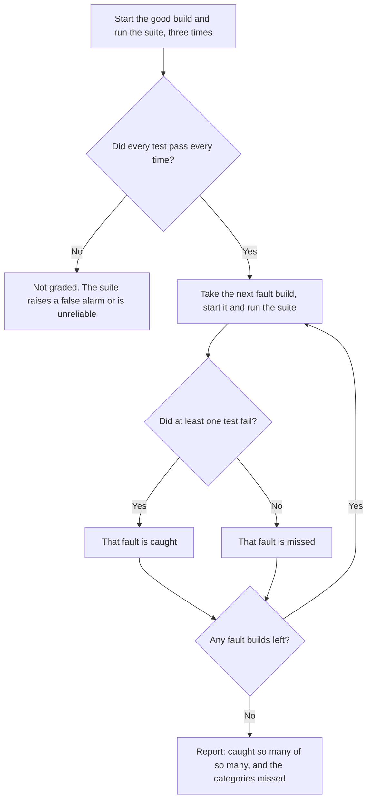

# Lesson 5: How good are your tests?

At the end of Lesson 4 you had one test that catches one defect. You knew it caught the defect because you had found the €0.00 total yourself, by hand, before the test ever ran.

You will not usually have that advantage. On a real product nobody hands you the list of defects in advance. You write tests, they pass, and the question that matters is the one a passing result cannot answer:

> "If something were wrong, would these tests notice?"

This lesson gives you a way to measure that. The course grades your tests with the same method later, when you build a suite for its practice application. Today you will run a small version of it, read its report, and use the report to make a test better. You will also learn exactly what its number means, because it is easy to think "5 of 6" means more than it does.

The steps were checked on Windows 11. The macOS and Linux steps have not yet been run by the author.

## 1. Start with a familiar situation: the hiring exercise

Your team lead is hiring a tester, and has prepared an exercise that you may have taken yourself. Each candidate gets a build of a small application and an afternoon. The instruction is: "Test this and tell me what you find."

What the candidates do not know is that the lead prepared the build. Six defects have been planted in it, and they are written on a sheet of paper in the lead's drawer.

Three candidates hand in their notes.

- **The first** writes: "Went through all the main screens. Everything works. No issues found."
- **The second** reports four defects. All four are on the sheet.
- **The third** reports nine. Three are on the sheet. The lead looks into the other six one by one, and none is a defect: the candidate misread what the application was supposed to do.

Without the sheet, the lead has only impressions. The first candidate sounds confident. The third sounds thorough, with nine findings. With the sheet, the lead has a measurement: the first found **0 of 6**, the second **4 of 6**, the third **3 of 6**.

And the lead has a second measurement, from the findings that were *not* on the sheet. The third candidate raised six **false alarms**. A tester who raises false alarms costs the team time on every one, and after a while nobody reads their reports.

So the exercise measures two things, and it needs both:

1. **Of the planted defects, how many did you find?** This measures what you miss.
2. **How many things did you report that were not defects?** This measures whether your reports can be believed.

### Pause and explain

Before reading on: the first candidate found nothing and said "everything works". Suppose the lead had given every candidate a clean build, with nothing planted. What would the lead have learned about the first candidate?

Nothing. On a clean build, "no issues found" is the correct answer. It is also exactly what a candidate who checks nothing would write. The two cannot be told apart. Only a build where something *is* wrong can separate a careful tester from a careless one. That is Lesson 1's sentence about passing tests, seen from the examiner's side.

## 2. Grade a set of tests the same way

Replace the candidate with a set of automated tests, and you have the method. The course calls the set of tests for one product a **suite**.

| The hiring exercise | Grading a suite |
| --- | --- |
| The candidate | Your test suite |
| A build with a planted defect | A **fault build**: the site with one **fault** planted |
| The sheet in the drawer | The **fault set**: the list of planted faults |
| The candidate reports the defect | At least one test **fails** on that fault build. The fault is **caught** |
| The candidate says "all fine" | Every test **passes** on that fault build. The fault is **missed** |
| A reported "defect" that is not one | A **false alarm**: a test fails where nothing is wrong |

The word **fault** is used here for a defect that was planted deliberately, to keep it apart from defects nobody intended.

One row of that table hides a difficulty. The lead found the false alarms by reading each finding and looking into it. A candidate's finding *says* something: "the total is wrong on the confirmation page". A failed test says nothing of the kind. It just fails. Nobody can read a failure and decide whether it was justified.

So for a suite there is only one way to measure false alarms: run it where nothing is wrong, and see whether it stays quiet. That needs one more build, the **good build**: the site with nothing planted in it. A suite that passes on the good build does not raise false alarms. A suite that fails there cannot be measured at all, because nobody could tell its justified failures from its unjustified ones.

The mechanism can now be stated in full. A grading program does this:

1. It starts the **good build** and runs your suite against it. Every test must pass. It does this more than once, because the same tests against the same build must give the same answer each time.
2. It then takes the fault builds one at a time. It starts one, runs your suite against it, notes whether any test failed, and stops it.
3. It reports how many faults were caught, and which were missed.

Read this diagram from top to bottom. Each diamond is a question with two answers.



In words: the suite first runs three times against the good build. If any test fails in any of those runs, grading stops, because a suite that fails when nothing is wrong cannot show that something is wrong. Otherwise each fault build is started in turn and the suite runs against it. If at least one test fails, the fault is caught. If every test passes, it is missed. When no fault builds are left, the report is printed.

### One difference from the hiring exercise, and the reason for it

The lead planted six defects in **one** build. The grading program uses six builds with **one** fault each. The reason is something you saw in Lesson 4: a test stops at the first thing that fails. With six faults in one build, a test that fails on the first fault never reaches the others, and you could not tell which of the six it would have caught. One fault per build gives a clean answer for each fault: this one, caught or missed.

### Where the comparison stops

Two limits are true of the hiring exercise and of grading a suite alike.

1. **The sheet is a sample.** Six planted defects are six of the countless things that could be wrong. Six of six means "all of these six".
2. **The sheet reflects its author.** The faults are the ones the person who planted them thought of.

And in two ways a suite is weaker than a candidate.

1. **A candidate names each defect. A suite only fails.** The lead can match a named finding to the sheet. For a suite, "caught" means only "a test failed on that build". It does not mean the test failed for the right reason.
2. **A candidate can find a defect that is not on the sheet. A suite cannot.** It checks what it was written to check, on every build, and nothing else. That is the oldest lesson of this course.

Keep these in mind. Section 7 returns to them when you have a number to interpret.

The technique has names that you may know. Planting faults in order to measure testing is called **fault seeding**. When a program generates the faults automatically, by making many small changes to the code, the technique is called **mutation testing**. [ISTQB Glossary](https://glossary.istqb.org/) This kit's six faults were planted by hand. The module on test strategy, late in the course, studies mutation testing properly, including the ways it can mislead.

## 3. Open the kit and meet the good build

Download the kit offered with this lesson, **QAAE_Sample_Grading_Kit_v1.zip**. Extract it into `course-work`, open the folder named `sample-grading-kit` in VS Code, and trust it, as before. Then, in a new terminal:

```sh
npm install
```

This time one command is enough. There is no browser download. In Lesson 4 you learned that Playwright keeps its browser in your home folder, outside any kit, so that later kits can share it. This kit names the same Playwright version, so it finds the same browser already there.

The kit holds a practice site, one test, and a grading program:

| File or folder | What it is |
| --- | --- |
| `site/server.mjs` | The practice site. It can serve a good build, or one of six fault builds |
| `tests/book-room.spec.ts` | The suite you will grade: one test, the original from Lesson 1 |
| `grade.mjs` | The grading program |
| `package.json`, `package-lock.json` | What the project needs, and three named commands |
| `playwright.config.ts` | Settings for Playwright Test |
| `README.md` | A one-page reminder of the commands, for after the lesson |

One honest note before you start. In this sample kit the six faults are written in `site/server.mjs`, a file you can open. Reading them before you grade would spoil the exercise for you. It would change nothing else: nobody is examining you today. The course's full grading kit, which arrives with the practice application in the Playwright stage, hides its faults inside the builds, where you cannot read them. Today, choose not to look until the end.

### Run TC-014 by hand on the good build

You cannot judge a fault until you know what correct looks like. Start the good build:

```sh
node site/server.mjs
```

The site reports that it is listening at `http://127.0.0.1:4420/rooms`. The port is 4420 this time, a different door from the last kit's, so the two can never be mistaken for each other.

Open that address in your browser and run TC-014: Harbour Room, 1 December 2026, 10:00 to 12:00. Before you press the button, **write down what you expect the confirmation to tell you**: which room, which day, which times, and how much. Use what you know: what you entered, and the price on the Rooms page.

The good build's confirmation reads:

```text
Booking confirmed
Room: Harbour Room
Date: 1 December 2026
Time: 10:00 to 12:00
Total: €24.00
```

Compare it with what you wrote down, and separate two things.

The **values** are yours. Which room, which day, which times: you chose them. How much: you calculated it, two hours at €12. None of those came from reading the screen and assuming it was right.

The **wording** is the site's. That the line begins `Date:`, and that the day is written `1 December 2026`, you could not have known before you looked. On a real product the wording comes from the requirement or the design. Here the good build stands in for them.

That separation matters, and Section 5 depends on it.

Stop the site before you go on: press Ctrl+C in its terminal, which is the Control key on macOS too. The grading program needs to start each build itself, and it will tell you if a site is still running.

## 4. Grade the test from Lesson 1

Run the suite once in the ordinary way, to confirm that it works here:

```sh
npx playwright test
```

One test, one pass. It is the test from Lesson 1: it books the room and checks for the heading "Booking confirmed". Nothing else.

### Predict, then grade

Now the fault set. The grading program reports faults by **category**, and these are the six:

| Category | Faults | What the category covers |
| --- | --- | --- |
| pricing | 2 | What the customer is charged |
| booking details | 1 | Whether the confirmation describes the booking that was made |
| dates | 1 | How a date is handled or shown |
| booking flow | 1 | Whether a valid booking goes through at all |
| booking rules | 1 | What the site must allow and what it must refuse |

**Predict before you grade.** This suite checks one heading. How many of the six faults will it catch, and in which categories? Write down a number and your reasons. This prediction is the most useful one in the lesson, so take a minute over it.

Then:

```sh
npm run grade
```

It takes about half a minute. npm first prints two lines beginning with `>`, naming the command it starts. Then, in the author's run:

```text
Sample grading kit 1.0.0-draft, fault set QAAE-SAMPLE-FAULTS-1

Good build, run 1 of 3 ... passed (1 of 1 tests)
Good build, run 2 of 3 ... passed (1 of 1 tests)
Good build, run 3 of 3 ... passed (1 of 1 tests)
Fault build 1 of 6 ... missed
Fault build 2 of 6 ... missed
Fault build 3 of 6 ... missed
Fault build 4 of 6 ... missed
Fault build 5 of 6 ... caught
Fault build 6 of 6 ... missed

Good build     passed 3 of 3 runs
Fault builds   caught 1 of 6

  caught  booking flow
  missed  pricing (2 faults)
  missed  booking details
  missed  dates
  missed  booking rules

Written to results/grade-results.json
```

**One of six.** Compare that with your prediction.

Take the report apart.

- **`Good build passed 3 of 3 runs`.** No false alarm, and the same answer three times. So when this suite fails on a fault build, it is at least not something it also does on a correct site.
- **`Fault builds caught 1 of 6`.** Against five of the six faulty sites, this suite reported that everything was fine.
- **`caught booking flow`.** The one fault it caught stopped a valid booking from going through. No confirmation heading appeared, and the heading is the one thing this test looks for.
- **The four `missed` lines.** On each of those builds a customer would have been charged wrongly, or told something untrue about their booking, or allowed to do something the site should have refused. Each time the heading "Booking confirmed" appeared, and the test passed.

This is Lesson 1, with a number on it. In Lesson 1 you worked out, by reading, that this test would let the €0.00 defect through. Now you have run it against six faults and counted: it lets five through. The suite's result on the good build was "1 passed", and on five broken builds it was also "1 passed". Those passes were telling you almost nothing, and until a minute ago you had no way to see that.

### Why the report names a category and not a place

The report says `missed pricing`. It does not say which page, which amount or which booking. That is deliberate, and the course's full kit behaves the same way.

If the report said "the total shows €0.00 where €24.00 was expected", you would add a check for exactly that and catch it. You would have learned to follow an instruction. The category asks more of you, and it asks the question a tester asks: *"Pricing can go wrong on this site. What about the price have I not checked?"* That question stays useful on a product where nobody has planted anything and no report will ever tell you what you missed.

In the terms of the help scale from *When something goes wrong*, being told which line of the confirmation is wrong would be strong help, level H4. Being told the wrong value as well would be H5. You may always ask for either. Neither is what the report gives you by default.

## 5. Use the report to improve the test

### Add the price check, predict, then grade

The report says two pricing faults were missed. You know one check for the price, from Lesson 4. Open `tests/book-room.spec.ts` and add it under the heading check, exactly as you did before:

```ts
  await expect(page.getByText('Total: €24.00')).toBeVisible();
```

Save the file.

Look at where the value `€24.00` comes from. It is the amount you calculated in Section 3: two hours at €12. It is **not** "whatever the site showed". This is the test oracle from Lesson 1 doing its work, and it is the reason you ran the case by hand and wrote your expectation down first. Only the wording, `Total:` and the form of the amount, was taken from the good build.

Suppose you had done it the other way round, and copied the whole line from the screen without asking what the amount should be. Such a check can only ever confirm that the screen shows what the screen showed that day. If the screen was wrong on the day you copied it, your test now protects the defect.

**Predict:** the report said `missed pricing (2 faults)`. You have added one check. How many of the two will it catch?

```sh
npm run grade
```

The author's run, from the summary on:

```text
Good build     passed 3 of 3 runs
Fault builds   caught 3 of 6

  caught  pricing (2 faults)
  caught  booking flow
  missed  booking details
  missed  dates
  missed  booking rules
```

Both. One line caught two faults, and you still do not know what the second pricing fault is. You do not need to know. Your check does not say "the total must not be zero". It says "the total must be €24.00". That single exact expectation is false on **every** build that gets this total wrong, whatever the cause.

That is the strength of a precise expected result. You know it from manual work, where "the correct total is shown" is a weaker expected result than "Total: €24.00". The machine makes the difference measurable.

Notice also that this run took longer than the first. A check that fails waits five seconds first, as you saw in Lesson 4. A check that passes costs almost nothing. So grading gets slower as your suite catches more. An ordinary run on a healthy product does not.

### What a wrong expectation does

One more experiment, because it shows the other half of the method. Make your check wrong on purpose: change `€24.00` in the line you added to `€25.00`. Save, and grade.

The author's run:

```text
Good build, run 1 of 3 ... FAILED (1 of 1 tests failed)
Good build, run 2 of 3 ... FAILED (1 of 1 tests failed)
Good build, run 3 of 3 ... FAILED (1 of 1 tests failed)

Not graded: your tests passed on the good build in 0 of 3 runs.
The good build has no planted fault, so a failure here does not come from the site.
Tests that fail when nothing is wrong cannot show that something is wrong.
Run "npx playwright test" to read the failure, repair it, then grade again.
```

No count of faults at all. This is the third candidate from Section 1, in a worse form. A test that expects €25.00 fails on every build, the good one included. It would "catch" all six faults, and that would mean nothing, because it would also report a perfectly correct site as broken. So the grading program refuses to count anything until every test passes on the good build.

Change the value back to `€24.00`, save, and grade once more to confirm that you are back at 3 of 6.

## 6. Two more categories, and one you cannot reach

The report still shows three categories missed. Two of them are within your reach today, with the kind of line you already know. The third is not, and seeing why is part of the lesson.

### Your turn: from three to five

Your report shows `missed booking details` and `missed dates`. Do this part yourself. The explanation follows directly below, and you may read it whenever you want.

1. Look at the confirmation from Section 3 and at the test as it stands. Which facts on the confirmation does the test not check yet?
2. For each of the two categories, **predict** which unchecked fact a fault of that kind would change.
3. Add a check for **every** fact on the confirmation that the test does not check yet. Use the same pattern as the total check. Take each value from what you chose in Section 3, and the wording from the good build's confirmation. Save.
4. Run `npx playwright test` first. It must pass on the good build before grading is worth the wait.
5. Run `npm run grade` and compare the report with your predictions.

### From three to five: explanation

The test checked the heading and the total. It did not check the room, the date or the time. The three lines are:

```ts
  await expect(page.getByText('Room: Harbour Room')).toBeVisible();
  await expect(page.getByText('Date: 1 December 2026')).toBeVisible();
  await expect(page.getByText('Time: 10:00 to 12:00')).toBeVisible();
```

The author's run, from the summary on:

```text
Good build     passed 3 of 3 runs
Fault builds   caught 5 of 6

  caught  pricing (2 faults)
  caught  booking details
  caught  dates
  caught  booking flow
  missed  booking rules
```

About your predictions. A *dates* fault changes how the date is handled or shown, so the `Date:` line was the one to expect. A *booking details* fault makes the confirmation describe a different booking from the one made. Nothing in the category tells you whether it changes the room or the time, and that is why step 3 asked for both. In this fault set it is the room.

If your grade did not move, run `npx playwright test` and read the report. The usual causes are a line that was not saved, and a text that does not match the page exactly: `1 December 2026` and `1st December 2026` are different texts to a machine. If you see `Not graded`, one of your new checks is failing on the good build. It expects something the correct page does not say. Compare it with the confirmation in Section 3, then grade again.

### Booking rules

The report still says `missed booking rules`. No check added to this test can change that, and the category's description says why: *what the site must allow and what it must refuse*.

Think about what this test does. It makes one valid booking of a free room and checks that it was accepted. That exercises what the site must **allow**. Nothing in it ever asks the site to do something it should **refuse**. A fault in a refusal can only show itself when a refusal is called for.

You have met the refusal already. In Lesson 4 you booked the same room twice by hand, and the site answered "This room is already booked". A site that has lost that rule lets two people book the same room for the same hour. It also passes every check you could add to a test that books once.

So the missed category is telling you something no added check can fix: **a whole kind of test is absent from the suite.** That is a different finding from "a check is missing", and a more important one. Testing what must be refused is half of testing, as you know from every negative case you have ever written.

Writing a second test means writing code beyond one supplied line, which this course teaches properly in the Playwright stage. If you want to try now, Practice B is an optional stretch with the complete test supplied.

## 7. What the number means

You have a result: 5 of 6. Before you feel pleased or disappointed, be exact about what it says. This is the part of the lesson you will use longest.

**What the result establishes.** Against this fault set, your suite fails on these builds and passes on those, and it passes on the good build three times out of three. That is an observation. Anyone with the same kit and the same test file can repeat it.

**What it does not establish.**

- **It is not a measure of the product.** The grade says nothing about how many defects the site has. It measures the tests.
- **It is not "83% of defects caught".** Five of six is five of *these* six. The fault set is a sample chosen by the kit's author. A real product can fail in ways nobody planted.
- **A check that catches no planted fault is not worthless.** You added a check for `Time: 10:00 to 12:00`. No fault in this set changes the time, so that check did not move the grade at all. Would you leave the booking's time unchecked on a real booking site? The grade can tell you that a check is doing work. It cannot tell you that a check is useless.
- **Six of six is not "finished".** It means your tests caught everything on this one list.

**What each check costs.** Every check you added today is also a promise that the page will keep saying exactly that. Suppose the product team decides, deliberately, to show totals as `Total: 24,00 €`. Nothing is broken, and a test that expects `Total: €24.00` now fails on a correct site. You saw the same thing in Lesson 1, Practice C, with a renamed button. More checks catch more faults. They also raise more false alarms when the product changes on purpose. You cannot have the first without the second. Choosing which expectations are worth that cost is the judgment the grade cannot make for you. It is the judgment you bring from years of deciding what belongs in an expected result column.

**How to describe a result honestly.** The course keeps to plain statements, and so should you. "Graded by the sample kit: caught 5 of 6 in fault set QAAE-SAMPLE-FAULTS-1, missed booking rules" is a complete and true statement. "My tests are 83% effective" is not. Neither statement says anything about how skilled you are. A grade describes one suite on one day.

### The results file

The last line of every run says `Written to results/grade-results.json`. Open that file from the Explorer. It is the same result as text that a program can read: the kit's version, the fault set, each good-build run, each fault build with its outcome. For the test file, and for three of the kit's own files, it also holds a long string labelled `sha256`.

That string is a **fingerprint** of a file's exact contents. Change one character of the file and its fingerprint changes completely. Without the fingerprints, the file would say only "5 of 6". With them, anyone can check which test file got that result, against which site and which grading program.

## 8. Try it with less help

Complete explanations follow these two practices. Practice B is optional.

### Practice A: read three results

For each situation, say what the grading program would report, or what you would say to the person, and why.

1. A suite catches every fault it meets. On the good build, it passes on runs 1 and 3 and fails on run 2. Nothing was changed between the runs.
2. A colleague is proud of a suite: "Forty tests, all green." You grade it against a set of ten faults and it catches two.
3. Your check for `Time: 10:00 to 12:00` did not raise the grade. A teammate says: "It caught nothing, so delete it. Fewer checks, less maintenance."

### Practice B (optional stretch): catch the booking-rules fault

This goes beyond what the lesson has taught: it asks you to add a whole second test to the file. The complete test is in the explanation below, and there is no loss in reading it first. Try it if you are curious.

Add a second test to `tests/book-room.spec.ts`, after the first one. It should book the **Garden Room** for 2 December 2026 from 14:00 to 15:00 and expect the booking to be confirmed, then make exactly the same booking again and expect the heading "This room is already booked". Run `npx playwright test`, then grade.

### Practice explanations

**A.**

1. `Not graded: your tests passed on the good build in 2 of 3 runs`, with the line "The same tests against the same build gave different results. That is an unreliable test." The faults are not counted at all. A test that sometimes fails on a correct site will also sometimes fail on a fault build for no reason connected to the fault, so its "catches" cannot be believed. Lesson 1 called such tests flaky. The course returns to them in depth, because finding out *why* a test is unreliable is a skill of its own. If you answered "graded, with a warning", look at the first diamond of the diagram in Section 2: the suite must pass on the good build before anything is counted.
2. Forty green tests on the good build is the first candidate's "everything works". Two of ten means that on eight broken builds those forty tests reported success. The honest thing to say is the observation: "Against these ten faults it catches two. The missed categories are these." Then ask the question the category asks: what do the tests check after each action? A next step you can offer: pick one test together, and list what its page shows that the test never looks at. That is the exercise you did in Section 6.
3. Keep it, and say why. The grade showed that the check catches none of *these six* faults. It did not show that the check is useless: no fault in this set touches the time, so the set cannot measure that check at all. Whether to keep it is a judgment about the product. A booking confirmation that shows the wrong time is a serious defect on a booking site, and the check is one line. Your teammate is right about one thing: every check has a maintenance cost, and that is a real reason to delete some checks. "It did not raise this grade" is not that reason. If you agreed with the teammate, reread the third point under "What it does not establish" in Section 7.

**B.** Add this after the closing `});` of the first test:

```ts
test('a room that is already booked cannot be booked again', async ({ page }) => {
  await page.goto('http://127.0.0.1:4420/rooms');
  await page.getByRole('link', { name: 'Garden Room' }).click();
  await page.getByLabel('Date').fill('2026-12-02');
  await page.getByLabel('Start time').fill('14:00');
  await page.getByLabel('End time').fill('15:00');
  await page.getByRole('button', { name: 'Book this room' }).click();
  await expect(page.getByRole('heading', { name: 'Booking confirmed' })).toBeVisible();

  await page.goto('http://127.0.0.1:4420/rooms');
  await page.getByRole('link', { name: 'Garden Room' }).click();
  await page.getByLabel('Date').fill('2026-12-02');
  await page.getByLabel('Start time').fill('14:00');
  await page.getByLabel('End time').fill('15:00');
  await page.getByRole('button', { name: 'Book this room' }).click();
  await expect(page.getByRole('heading', { name: 'This room is already booked' })).toBeVisible();
});
```

You can read every line of it with what Lesson 1 taught. The first half makes a booking and expects it to be confirmed. The second half makes the same booking again and expects the refusal. With this test in the file, the author's grade was `caught 6 of 6`, and the run took a little over a minute.

Two things about it deserve a comment. It uses a different room and a different day from the first test, so that the two tests cannot disturb each other's bookings. Each grading run starts the site fresh, but both tests run against that same fresh site. And the second half repeats seven lines of the first half almost word for word. That repetition is a real cost. Removing it without hiding what the test does is a large part of the Playwright stage.

If your grade stayed at 5 of 6, run `npx playwright test` and check that the report now lists two tests. If it lists one, the new test was pasted inside the first test's closing `});` and not after it.

## 9. What you should be able to explain now

Close the kit for a moment and explain to an imaginary colleague who says "our tests all pass, so we're fine":

- Why can a clean build never show whether a set of tests is any good?
- What do "caught", "missed" and "false alarm" mean, and which build does each one come from?
- Why does the grading program run the suite on the good build first, and why more than once?
- One check for `Total: €24.00` caught two different pricing faults. Why?
- In an expected result, where should the value come from, and where does the wording come from?
- Your result is 5 of 6. Say what that establishes in one sentence, and name two things it does not establish.
- Why could no added check in the booking test catch the booking-rules fault?

You are ready to go on when you can answer these in your own words, when you have seen 1 of 6, 3 of 6 and `Not graded` on your own screen, and when Section 6 has taken you to 5 of 6.

### Where you are now

This lesson ends the first module. Look at what you have that you did not have at the start of it. You can say exactly what a test checks and what it lets through. You have a workspace you built yourself and could rebuild from your own note. You have a method for the first minute after something fails. You have run a real browser test, read its failure reports, and made it catch a defect. And you have an honest way to measure a set of tests.

Before you move on, add three things to your recovery note. First, the two kits of this module, with the commands that install and run them. Second, the memory and free disk space that your workspace check reported. Later stages introduce larger tools, among them the software that runs the full practice application, and the lesson that introduces each one states what it needs. Having your own figures written down means that will not be a surprise.

Third, write down the one thing in this module that surprised you most. In a few months it will be hard to remember that it ever did.

What you have not yet done is write a test of your own, and you were not asked to. That needs a programming language. Before the language come the two tools that every later lesson assumes: the terminal, which you have so far used one line at a time, and Git, which keeps the history of every change you make to your tests. Those are the next two modules.

## If something does not match

Use the part that matches what you see. For anything not listed, use the five steps from *When something goes wrong*.

### Grading says a site is already answering on port 4420

A copy of the site is still running, most likely from Section 3. Find the terminal where it runs, press Ctrl+C there, and grade again. The grading program refuses to continue because it must know exactly which build each run is against.

### Grading says Playwright could not run your tests

The message below that line is Playwright's own. If it names a line and a position in the test file, a bracket, a quotation mark or a semicolon is missing from a line you added. If it names something else, such as a missing browser, the problem is in your setup and Lesson 4's last section covers it. Run `npx playwright test` to see the same message, repair it, and grade again.

### Grading says Playwright Test is not installed

`npm install` has not been run in this folder. Check that the prompt shows `sample-grading-kit`, then run it.

### `Not graded`, and you did not expect it

Run `npx playwright test` and read the failure report as in Lesson 4. One of your checks expects something the good build does not show. Compare the expected text with the confirmation in Section 3.

### "running scripts is disabled on this system", or `Terminate batch job (Y/N)?`

Both are the Windows matters explained at the end of Lesson 4. The same three routes apply to the first. Answer **Y** to the second.

### The grade is different from the author's for the same test

Check first that the file is saved and that each line you added is inside the test, above the closing `});`. If it still differs, keep the whole report and the file `results/grade-results.json`, and ask for help with both. A difference from the lesson is worth reporting: it may be the lesson that is wrong.

### You want to start again

Delete the `sample-grading-kit` folder, extract the ZIP again and run `npm install`. The browser download is kept, so this takes seconds.
