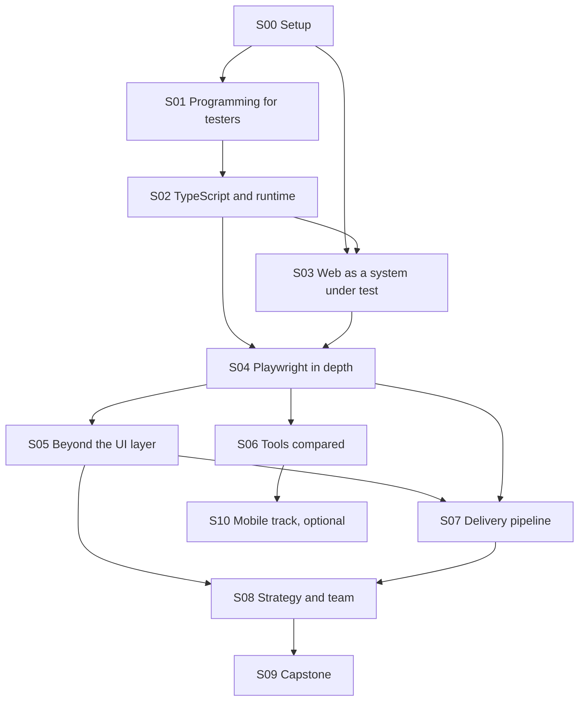

# QA Automation Engineering Curriculum Architecture v0.1

## 1. Purpose and status

This document plans a course that takes an experienced manual tester with no coding background to
mid-level test automation and QA engineering. It sets the audience, the teaching contract, the
stages, the projects, grading and review. Module records and the map of modules shared with the
full-stack course are in `Module_Syllabus_v0_1.md`.

This is a plan, not a lesson library. No lesson, kit or practice application exists yet. The
full-stack course was planned from a written competency standard. This course has no such standard
yet: Section 9 proposes its outcome domains, and writing the standard is an open item (Section 12).

Decisions already made are recorded in ADRs 0014 (separate course on a shared module library),
0015 (Playwright and TypeScript in depth), 0016 (grading kit on the learner's machine) and 0017 (AI
review in the learner's own Claude Code).

## 2. The learner

The learner has spent years testing software by hand. They write test cases, find and report bugs,
run regression passes and explore an application for weak points. They know environments, release
cycles and the gap between a requirement and what was built. Many have used Jira, Postman or a SQL
client. They have not written programs.

So the course does **not** teach testing from zero. It teaches someone who already tests to make a
machine do it, and to understand the system well enough to know why the machine's checks fail.

- **Their experience shortens the course without hiding gaps.** An entry diagnostic can credit test
  design, bug reporting and exploratory testing. Programming is never credited from job history,
  only from a demonstrated task.
- **The patient style holds throughout.** The Lesson Authoring Standard (FSSE-AUTHOR-001) applies
  unchanged. Depth comes from more accurate models, interacting mechanisms and hard failure cases,
  never from denser terminology.
- **Target role.** Mid-level automation engineer, the role often titled SDET (Software Development
  Engineer in Test). A course can build the skills; it cannot supply years of experience, and no
  lesson or result may claim it does.

## 3. The teaching contract

The owner's four requirements, and how every module meets them.

### 3.1 Understanding and practice in balance

Two rules apply to every lesson.

**No tool before its problem.** The learner first does the job the naive way and watches it fail.
The tool then arrives as the answer to something they have already felt. Example: a test that
sleeps 2 seconds before clicking fails about 3 runs in 20. The learner works out that it guessed a
wait. Only then does the lesson teach Playwright's auto-waiting locators, and it closes with how
Selenium's explicit waits differ and which a given team should prefer.

**No concept without practice in the same lesson.** Each lesson has a lab in its kit. The planning
target is at least 60% of active hours spent in labs and project work. That figure is an authoring
target, not a measurement.

The reasoning half is taught as **decision criteria that outlive any tool**: the team's existing
language, the application's architecture, required browsers and devices, feedback speed,
debuggability, licence and hosting cost, and who maintains the tests after their author leaves.
Dedicated decision modules cover tool choice, language choice, test layer, BDD, buy-versus-build
and **when not to automate**. The learner records each choice they make in a short decision note
(options, criteria, evidence, choice). The notes become portfolio artifacts.

### 3.2 Analogies, then the exact terms

Sections 4–5 of the authoring standard apply: develop an analogy instead of renaming the system,
then bridge from it to the causal mechanism with the real terminology. This course adds one rule:
**the first analogy comes from the learner's manual-testing life**, before any everyday analogy.

| What they do today             | What it becomes                | The new idea they must learn                                             |
| ------------------------------ | ------------------------------ | ------------------------------------------------------------------------ |
| Test case                      | Test function                  | It runs identically every time, with no judgment or improvisation        |
| Preconditions                  | Fixture / `beforeEach`         | Each test creates its own state instead of relying on the test before it |
| Test data sheet                | Data factory                   | Data is generated on demand, so parallel tests do not collide            |
| Expected result column         | Assertion                      | It checks only what was written; anything unchecked passes silently      |
| "Works on my machine"          | Environment config, containers | The environment is part of the test                                      |
| Regression pass before release | CI suite on every change       | Minutes, unattended, many times a day                                    |
| Bug report with screenshots    | Trace, video, logs             | Evidence captured automatically at the moment of failure                 |

The third column is where the teaching happens. The analogy gets the learner in the door; the
difference from what they know is the lesson.

### 3.3 A portfolio project

The course supplies the application under test and the learner builds one framework against it for
the whole course (Section 6). The public repository is the portfolio.

### 3.4 A review mechanism

Machine grading for whether tests catch bugs, and AI review for the reasoning work (Section 7).

## 4. Lesson shape

The authoring standard governs. Within it, a lesson in this course normally runs in this order:

1. **A scene from testing life** — the learner's own experience of the problem.
2. **The naive attempt and its failure** — observed, not described.
3. **The mechanism** — analogy, bridge, then the technical model with exact terms.
4. **The lab** — the learner does it, predicting before running where useful.
5. **The decision** — when this is the right approach, when it is not, and what it costs.
6. **Feedback** — complete answers for every self-check, per standard Section 8.

Shared lessons from the full-stack course keep their own shape. A bridge lesson before them
supplies steps 1 and 5 for a tester.

## 5. Stages

Hours are author estimates of active learner work. They are not observed completion times.

| Stage                              | Modules    | Outcome                                                                                               | Draft hours   |
| ---------------------------------- | ---------- | ----------------------------------------------------------------------------------------------------- | ------------- |
| S00 Setup and the new workbench    | Q01–Q03    | A working machine, terminal, Git and grading kit; know how to get unstuck                             | 26–46         |
| S01 Programming for testers        | Q04–Q08    | Write, test and debug small programs; build a toy test runner                                         | 84–142        |
| S02 TypeScript and the runtime     | Q09–Q13    | Reason about equality, objects, types and async code — the roots of most flaky tests                  | 68–116        |
| S03 The web as a system under test | Q14–Q18    | Read pages, the accessibility tree and HTTP traffic well enough to locate and diagnose                | 70–120        |
| S04 Playwright in depth            | Q19–Q26    | Build, structure and debug a maintainable UI suite; diagnose flakiness as races                       | 102–170       |
| S05 Beyond the UI layer            | Q27–Q33    | Test APIs, data, permissions, contracts, accessibility, visuals, performance, security basics         | 86–146        |
| S06 Tools compared and transferred | Q34–Q37    | Work in Selenium/Java, compare Cypress, judge BDD, defend a tool choice                               | 52–86         |
| S07 Tests in the delivery pipeline | Q38–Q40    | Run the system in containers, run suites in CI, correlate failures with logs                          | 38–64         |
| S08 Quality strategy and the team  | Q41–Q44    | Plan risk-based strategy, review tests (including AI-written ones), keep a suite alive through change | 46–76         |
| S09 Capstone and readiness         | Q45–Q46    | Test an unfamiliar system end to end and defend the work                                              | 50–86         |
| **Main path total**                | 46 modules |                                                                                                       | **622–1,052** |
| S10 Mobile track (optional)        | QM01–QM04  | Automate a mobile client with Appium                                                                  | 62–102        |

The range is above the 600–900 hours first suggested in conversation; the module-level estimate
replaced that guess. Calibrate both against the first learners.

## 6. Projects

| Project                  | What it is                                                                                                                                                                                                                                                 | Used in |
| ------------------------ | ---------------------------------------------------------------------------------------------------------------------------------------------------------------------------------------------------------------------------------------------------------- | ------- |
| QP01 TinyRunner          | A toy test runner the learner builds from scratch: register tests, run them, report pass and fail. Building one shows what every framework does under the hood.                                                                                            | Q08     |
| QP02 BookingLab          | The course-owned **application under test**: multi-user booking of rooms and equipment, with pricing rules, dates and time zones, roles, an API, a database, email to a local fake mailbox, and file upload. Runs locally with one Docker Compose command. | S03–S08 |
| QP03 Portfolio framework | The learner's public repository: a Playwright/TypeScript suite against BookingLab, with CI, reports, a test strategy, decision notes, bug reports and a flaky-test write-up.                                                                               | S04–S08 |
| QP04 Capstone system     | An unfamiliar application in a different domain (working idea: stock and order handling). The learner arrives with no prior framework.                                                                                                                     | S09     |

BookingLab is a working name, not a brand. It is a separate application from the full-stack course's
SupportDesk (PJ02), because PJ02 is built by learners and does not yet exist.

### 6.1 BookingLab releases

BookingLab ships in versions, like a real product. Each version adds features, changes some
behaviour and carries planted faults. The learner's framework must keep up, which teaches the part
of the job courses usually skip: telling a real bug from an outdated test after a product change.

| Release | Arrives at | Adds                                        | Fault classes planted                                               |
| ------- | ---------- | ------------------------------------------- | ------------------------------------------------------------------- |
| R0      | Q20        | Browse and book as a single user            | Boundary and pricing                                                |
| R1      | Q21        | Booking rules, calendars, time zones        | Date and time zone, validation                                      |
| R2      | Q23        | Accounts, roles, sessions                   | Session and state                                                   |
| R3      | Q26–Q27    | Public API, external price service          | API contract drift, error handling                                  |
| R4      | Q29        | Organisations and permissions               | Permission and IDOR (reading another user's data by changing an ID) |
| R5      | Q31        | Redesigned booking page                     | Accessibility and visual regressions                                |
| R6      | Q32        | Busy-period load                            | Performance regression, double booking under concurrency            |
| R7      | Q44        | Breaking UI and API changes, renamed fields | Real bugs mixed with intended changes                               |

## 7. Grading and review

### 7.1 Grading: do the tests catch bugs? (ADR 0016)

Each BookingLab release has one known-good build and a set of fault builds. The grading kit runs the
learner's suite against each. The suite should pass on the good build and fail on every fault
build. The kit repeats the good-build run to detect flakiness. The result reads: "caught 7 of 10;
missed: double booking, two permission faults; 1 test failed once in 10 runs on the good build".

- The kit lives in the portfolio repository and updates with `git pull`. The app imports its
  results file and runs nothing.
- A missed fault is reported by category only. Revealing its location counts as strong help (H4)
  under the full-stack course's H0–H5 scale, which this course adopts unchanged.
- The technique the kit uses, mutation testing, is itself taught in Q41. Learners grade their own
  suites and later understand why the grade is honest.

### 7.2 Review: is the reasoning sound? (ADR 0017)

Strategy documents, decision notes, bug reports and test-code readability are reviewed by AI against
a versioned rubric. The review runs in the learner's own Claude Code through the app's MCP server.
The app stores each review labelled as AI, with rubric version and model identity, and never as a
grade. The review packet follows the full-stack review contract (FSSE-CURR-001 Section 10, "Hint,
Review, and Transfer Contract"), so human reviewers can use the same packets later.

### 7.3 What results may claim

"Studied", "practice recorded", "graded by kit" and "AI review received" are the available states.
None of them means competence, mid-level readiness or employability.

## 8. Mobile track

The track is optional and can start once S06 is done, because Appium speaks the same WebDriver
protocol taught in Q34. It is **Android first**: iOS automation needs a Mac, which the course cannot
assume. Real-device clouds are mentioned with their costs, never required. BookingLab needs a mobile
client for this track; that client is a significant authoring cost (Section 11).

Mobile **web** testing through Playwright's device emulation stays in the main path (Q31), free and
with no extra setup.

## 9. Proposed outcome domains

Until a competency standard exists, these domains organise the module map. The standard should
define outcomes and depth for each.

| Code | Domain                                                                                 |
| ---- | -------------------------------------------------------------------------------------- |
| PRG  | Programming in TypeScript                                                              |
| TSD  | Test design: techniques, boundaries, data, oracles (how a test knows the right answer) |
| AUT  | UI automation with Playwright                                                          |
| ARC  | Suite architecture and maintainability                                                 |
| DBG  | Failure diagnosis, triage and flakiness                                                |
| WEB  | Web and HTTP behaviour as a tester needs it                                            |
| API  | API and contract testing                                                               |
| DAT  | Test data and databases                                                                |
| NFT  | Non-functional testing: accessibility, visual, performance, security basics            |
| CIC  | Environments, containers and CI                                                        |
| STR  | Strategy, risk and tool decisions                                                      |
| COM  | Bug reports, test reports and arguing for quality                                      |
| AIE  | Verifying AI-generated tests and claims                                                |
| MOB  | Mobile automation (optional track)                                                     |

## 10. Authoring order and dependency on the full-stack course

Shared modules are authored once for both courses (ADR 0014). Today only full-stack M020 and M021
have lessons (Lessons 1–15), and those await the owner's review of 5–15. So:

1. No lesson for this course is written until the owner's Lesson 5–15 review returns. That review
   may change the authoring standard both courses follow.
2. The first new authoring is S00–S01 (new modules) and the BookingLab specification, which do not
   depend on shared content.
3. Shared modules not yet written (M001–M003, M009–M013, M017–M019 and later) are written once, for
   both courses, when the first of the two courses needs them.

## 11. Risks

| ID   | Risk                                                                                                                                           | Mitigation                                                                                          |
| ---- | ---------------------------------------------------------------------------------------------------------------------------------------------- | --------------------------------------------------------------------------------------------------- |
| QR01 | BookingLab is a real software product: eight releases, each with a fault set, kept working for years. It is the largest single authoring cost. | Specify it before any S04 lesson. Build R0 and the grading kit first and prove the loop end to end. |
| QR02 | Two courses double the owner's review load.                                                                                                    | Shared modules are reviewed once. New modules are reviewed in stage-sized batches.                  |
| QR03 | Learners can inspect fault images or edit results files.                                                                                       | Acceptable for self-study; results never claim assessment (Section 7.3). Revisit for certification. |
| QR04 | AI review quality varies with the learner's model and plan.                                                                                    | Rubric versioned with the course; the review records model identity.                                |
| QR05 | Tool market churn.                                                                                                                             | Decision criteria taught independently of tools; ADR 0015 names its revisit trigger.                |
| QR06 | The Java bridge in Q34 is a second language in 30–50 hours.                                                                                    | Scope it to reading and writing Selenium tests, not general Java.                                   |
| QR07 | Docker and an Android emulator need RAM some learners lack.                                                                                    | State minimum hardware in Q01. Codespaces fallback for the main path. Mobile remains optional.      |
| QR08 | The app serves one course.                                                                                                                     | Multi-course support is an app milestone before this course's first release.                        |

## 12. Open items for the owner

1. **Competency standard.** Write a QA graduate competency standard before authoring, as the
   full-stack course did, or let this architecture govern until the first stage is reviewed?
2. **BookingLab domain.** Bookings were chosen because they naturally contain pricing, dates,
   permissions and concurrency bugs. Is there a domain closer to your learners' work, such as
   banking or telecoms?
3. **Entry diagnostic.** Which manual-testing skills may it credit? This draft proposes test design,
   bug reporting and exploratory testing.

## 13. What happens next

1. The owner reviews this draft and the module syllabus.
2. The BookingLab and grading-kit specification is written. It is the critical path.
3. The app gains multi-course support (a roadmap milestone).
4. Lesson authoring starts with S00–S01 once the Lesson 5–15 review is back.
